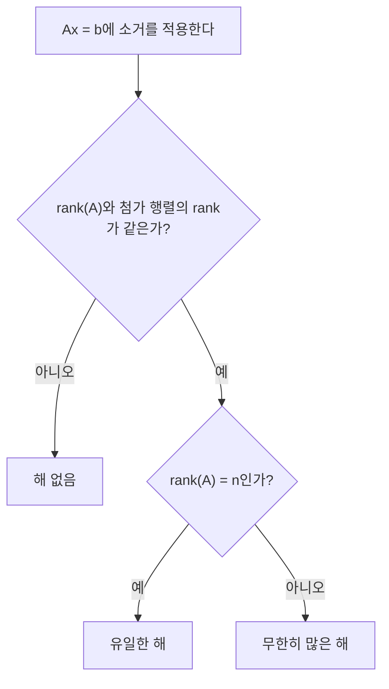

# 2장 — 연립일차방정식 풀기

[레포지토리 안내](../../README.ko.md) | [English](Concepts_Lecture.md) | [한국어](Concepts_Lecture.ko.md)

> **최종 수정일:** 2026-10-19
>
> Introduction to Linear Algebra, Strang, Ch 2

> **학습 목표:**
> 1. 가우스 소거법을 적용하여 연립방정식을 풀 수 있다
> 2. 소거법을 행렬 분해($`A = LU`$)로 표현할 수 있다
> 3. 연립방정식의 해가 없는 경우, 유일한 경우, 무한히 많은 경우를 판별할 수 있다
> 4. 순열 행렬과 전치의 성질을 이용하여 $`PA = LU`$와 $`LDL^T`$ 분해를 구할 수 있다
> 5. 유한 차분으로 도함수를 근사하고 이차 차분 행렬 $`K`$, $`T`$, $`B`$의 성질을 설명할 수 있다

---

<br>

## 목차

- [1. 서론](#1-서론)
- [2. 소거법과 후진 대입 (2.1)](#2-소거법과-후진-대입-21)
  - [2.1 소거 과정](#21-소거-과정)
  - [2.2 해의 세 가지 경우](#22-해의-세-가지-경우)
  - [2.3 2x2 연립방정식 예제](#23-2x2-연립방정식-예제)
  - [2.4 동차 연립방정식](#24-동차-연립방정식)
  - [2.5 후진 대입 예제](#25-후진-대입-예제)
  - [2.6 각 열에 대한 소거](#26-각-열에-대한-소거)
  - [2.7 소거법의 실패 가능성](#27-소거법의-실패-가능성)
  - [2.8 종속 열과 독립 열](#28-종속-열과-독립-열)
  - [2.9 행 관점과 열 관점](#29-행-관점과-열-관점)
- [3. 소거 행렬과 역행렬 (2.2)](#3-소거-행렬과-역행렬-22)
  - [3.1 소거와 순열의 예제](#31-소거와-순열의-예제)
  - [3.2 소거 행렬과 A = LU](#32-소거-행렬과-a--lu)
  - [3.3 역행렬에 관한 사실들](#33-역행렬에-관한-사실들)
  - [3.4 곱 AB의 역행렬](#34-곱-ab의-역행렬)
  - [3.5 소거 행렬의 역행렬](#35-소거-행렬의-역행렬)
  - [3.6 L은 E의 역행렬](#36-l은-e의-역행렬)
- [4. 행렬 연산과 A = LU (2.3)](#4-행렬-연산과-a--lu-23)
  - [4.1 핵심 사실](#41-핵심-사실)
  - [4.2 역행렬의 명시적 계산](#42-역행렬의-명시적-계산)
  - [4.3 가우스-조르단 소거법](#43-가우스-조르단-소거법)
  - [4.4 소거의 비용](#44-소거의-비용)
  - [4.5 위대한 분해 A = LU](#45-위대한-분해-a--lu)
  - [4.6 A = LU의 두 번째 증명](#46-a--lu의-두-번째-증명)
  - [4.7 행 교환 없는 소거](#47-행-교환-없는-소거)
- [5. 순열과 전치 (2.4)](#5-순열과-전치-24)
  - [5.1 순열 행렬](#51-순열-행렬)
  - [5.2 순열 행렬의 성질](#52-순열-행렬의-성질)
  - [5.3 PA = LU 분해](#53-pa--lu-분해)
  - [5.4 부분 피벗팅](#54-부분-피벗팅)
  - [5.5 PAQ: 행과 열 순열](#55-paq-행과-열-순열)
  - [5.6 A의 전치](#56-a의-전치)
  - [5.7 내적과 전치](#57-내적과-전치)
  - [5.8 대칭 행렬](#58-대칭-행렬)
  - [5.9 대칭 곱과 LDL^T](#59-대칭-곱과-ldlt)
- [6. 도함수와 유한 차분 행렬 (2.5)](#6-도함수와-유한-차분-행렬-25)
  - [6.1 테일러 급수와 근사](#61-테일러-급수와-근사)
  - [6.2 차분으로부터의 도함수](#62-차분으로부터의-도함수)
  - [6.3 이차 차분 행렬 K, T, B](#63-이차-차분-행렬-k-t-b)
  - [6.4 K의 성질](#64-k의-성질)
  - [6.5 자유-고정 행렬 T](#65-자유-고정-행렬-t)
  - [6.6 자유-자유 행렬 B](#66-자유-자유-행렬-b)
- [요약](#요약)
- [점검 문제](#점검-문제)

---

<br>

## 1. 서론

이 장은 연립일차방정식을 푸는 것에 집중한다:

```math
A\mathbf{x} = \mathbf{b}
```

**다루는 절:**

1. **2.1** 소거법과 후진 대입 (Elimination and Back Substitution)
2. **2.2** 소거 행렬과 역행렬 (Elimination Matrices and Inverse Matrix)
3. **2.3** 행렬 연산과 $`A = LU`$ (Matrix Computations and $`A = LU`$)
4. **2.4** 순열과 전치 (Permutations and Transposes)
5. **2.5** 도함수와 유한 차분 행렬 (Derivatives and Finite Difference Matrices)

**정사각 행렬** $`A \in \mathbb{R}^{n \times n}`$에 집중한다.

$`A\mathbf{x} = \mathbf{b}`$는 $`n`$개의 방정식을 제공한다.

**예제 ($`2 \times 2`$ 연립방정식):**

```math
a_{11}x_1 + a_{12}x_2 = b_1
```
```math
a_{21}x_1 + a_{22}x_2 = b_2
```

행렬 형태:

```math
\begin{pmatrix} a_{11} & a_{12} \\ a_{21} & a_{22} \end{pmatrix} \begin{pmatrix} x_1 \\ x_2 \end{pmatrix} = \begin{pmatrix} b_1 \\ b_2 \end{pmatrix}
```

**일반 형태** ($`n`$개의 방정식, $`n`$개의 미지수):

```math
\begin{pmatrix} a_{11} & a_{12} & \cdots & a_{1n} \\ a_{21} & a_{22} & \cdots & a_{2n} \\ \vdots & \vdots & \ddots & \vdots \\ a_{n1} & a_{n2} & \cdots & a_{nn} \end{pmatrix} \begin{pmatrix} x_1 \\ x_2 \\ \vdots \\ x_n \end{pmatrix} = \begin{pmatrix} b_1 \\ b_2 \\ \vdots \\ b_n \end{pmatrix}
```

주어진 $`\mathbf{b}`$에 대해 유일한 해 $`\mathbf{x} \in \mathbb{R}^n`$이 존재하면, 역행렬 $`A^{-1}`$이 존재하여 다음을 만족한다:

```math
A^{-1}A = AA^{-1} = I
```

이 경우 해는 다음과 같다:

```math
A\mathbf{x} = \mathbf{b} \implies A^{-1}A\mathbf{x} = A^{-1}\mathbf{b} \implies \boxed{\mathbf{x} = A^{-1}\mathbf{b}}
```

이 장의 목표는 $`A^{-1}`$을 명시적으로 계산하지 **않고** 해 $`\mathbf{x}`$를 구하는 것이다. 다음 두 가지 방법을 사용한다:

1. **소거법** (Elimination)
2. **후진 대입** (Back substitution)

**과정 개요:**

```math
\begin{pmatrix} A & | & \mathbf{b} \end{pmatrix} \xrightarrow{\text{elimination}} \begin{pmatrix} U & | & \mathbf{c} \end{pmatrix} \xrightarrow{\text{back substitution}} \mathbf{x}
```

여기서 $`U`$는 **상삼각 행렬** (upper triangular matrix)이다.

식으로 정리하면:

```math
A\mathbf{x} = \mathbf{b} \implies U\mathbf{x} = \mathbf{c} \implies \mathbf{x} = U^{-1}\mathbf{c} = A^{-1}\mathbf{b}
```

---

<br>

## 2. 소거법과 후진 대입 (2.1)

### 2.1 소거 과정

**1단계:** 소거법은 행 $`j`$의 $`l_{ij}`$배를 행 $`i`$에서 빼서 행 $`i`$에 0을 만든다.

```math
\text{row } i \leftarrow \text{row } i - l_{ij} \cdot \text{row } j
```

**예제:**

```math
\begin{pmatrix} 2 & 3 \\ 4 & 2 \end{pmatrix} \xrightarrow{R_2 - 2 \cdot R_1} \begin{pmatrix} 2 & 3 \\ 0 & -4 \end{pmatrix}
```

**2단계:** $`A\mathbf{x} = \mathbf{b}`$는 다음 중 하나가 된다:
- $`U\mathbf{x} = \mathbf{c}`$ (유일한 해)
- 해 없음
- 무한히 많은 해

**3단계:** $`U\mathbf{x} = \mathbf{c}`$는 **후진 대입**으로 풀리며, $`U`$는 상삼각 행렬이다.

---

### 2.2 해의 세 가지 경우

$`A\mathbf{x} = \mathbf{b}`$를 생각한다. 여기서 $`A \in \mathbb{R}^{n \times n}`$, $`\mathbf{x}, \mathbf{b} \in \mathbb{R}^{n \times 1}`$이다.

**세 가지 경우**가 있다:

**경우 1: 유일한 해.** $`A\mathbf{x} = \mathbf{b}`$를 만족하는 $`\mathbf{x}`$가 유일하게 존재한다($`\exists! \; \mathbf{x}`$).

- $`A`$는 **독립인 열**을 가진다.
- $`A\mathbf{x} = \mathbf{0}`$의 유일한 해는 $`\mathbf{x} = \mathbf{0}`$이다.
- $`A`$는 역행렬 $`A^{-1}`$을 가진다.

**경우 2: 해 없음.** $`A\mathbf{x} = \mathbf{b}`$를 만족하는 $`\mathbf{x}`$가 없다.

- $`\mathbf{b}`$가 $`A`$의 열공간(column space)에 **속하지 않는다**.
- $`\mathbf{b}`$가 $`A`$의 열들의 선형결합이 아니다.

**경우 3: 무한히 많은 해.** $`A\mathbf{x} = \mathbf{b}`$를 만족하는 $`\mathbf{x}`$가 무한히 많다.

- $`A`$의 열들이 **독립이 아니다**.
- $`\mathbf{b}`$가 $`A`$의 열공간에 속한다.
- $`n > \text{rank}(A) = \text{rank}(A|\mathbf{b})`$

세 경우는 $`A`$의 랭크와 첨가 행렬 $`(A|\mathbf{b})`$의 랭크를 비교하여 구분할 수 있다.



*그림 1. 랭크 비교에 따른 해의 세 가지 경우*

---

### 2.3 2x2 연립방정식 예제

**예제 1: 유일한 해**

```math
x + 2y = 1, \quad 3x + y = -2
```

```math
\begin{pmatrix} 1 & 2 \\ 3 & 1 \end{pmatrix}\begin{pmatrix} x \\ y \end{pmatrix} = \begin{pmatrix} 1 \\ -2 \end{pmatrix}
```

첨가 행렬(augmented matrix):

```math
\begin{pmatrix} 1 & 2 & | & 1 \\ 3 & 1 & | & -2 \end{pmatrix} \xrightarrow{R_2 - 3R_1} \begin{pmatrix} 1 & 2 & | & 1 \\ 0 & -5 & | & -5 \end{pmatrix} \implies \begin{pmatrix} 1 & 2 & | & 1 \\ 0 & 1 & | & 1 \end{pmatrix} \xrightarrow{R_1 - 2R_2} \begin{pmatrix} 1 & 0 & | & -1 \\ 0 & 1 & | & 1 \end{pmatrix}
```

$`\text{rank}(A) = 2`$, $`\text{rank}(A|\mathbf{b}) = 2`$, 미지수의 수 $`= 2`$.

$`\Rightarrow \exists! \; \mathbf{x}`$. 해: $`x = -1, y = 1`$.

**예제 2: 해 없음**

```math
3x + 2y = 3, \quad -6x - 4y = 0
```

```math
\begin{pmatrix} 3 & 2 \\ -6 & -4 \end{pmatrix}\begin{pmatrix} x \\ y \end{pmatrix} = \begin{pmatrix} 3 \\ 0 \end{pmatrix}
```

첨가 행렬:

```math
\begin{pmatrix} 3 & 2 & | & 3 \\ -6 & -4 & | & 0 \end{pmatrix} \xrightarrow{R_2 + 2R_1} \begin{pmatrix} 3 & 2 & | & 3 \\ 0 & 0 & | & 6 \end{pmatrix} \implies \begin{pmatrix} 1 & 2/3 & | & 1 \\ 0 & 0 & | & 1 \end{pmatrix}
```

$`\text{rank}(A) = 1`$, $`\text{rank}(A|\mathbf{b}) = 2`$.

$`\Rightarrow`$ **해가 존재하지 않는다.**

**예제 3: 무한히 많은 해**

```math
3x + 2y = 3, \quad -6x - 4y = -6
```

```math
\begin{pmatrix} 3 & 2 \\ -6 & -4 \end{pmatrix}\begin{pmatrix} x \\ y \end{pmatrix} = \begin{pmatrix} 3 \\ -6 \end{pmatrix}
```

```math
\begin{pmatrix} 3 & 2 & | & 3 \\ -6 & -4 & | & -6 \end{pmatrix} \xrightarrow{R_2 + 2R_1} \begin{pmatrix} 3 & 2 & | & 3 \\ 0 & 0 & | & 0 \end{pmatrix} \implies \begin{pmatrix} 1 & 2/3 & | & 1 \\ 0 & 0 & | & 0 \end{pmatrix}
```

$`\text{rank}(A) = 1`$, $`\text{rank}(A|\mathbf{b}) = 1`$, 미지수의 수는 2.

$`\Rightarrow`$ **무한히 많은 해.** 방정식은 사실상 하나인데 미지수는 두 개이므로 자유 매개변수가 1개 있다.

---

### 2.4 동차 연립방정식

$`\mathbf{b} = \mathbf{0}`$일 때, **동차 연립방정식** (homogeneous system)이 된다:

```math
A\mathbf{x} = \mathbf{0}
```

$`\mathbf{x} = \mathbf{0}`$은 **자명한 해** (trivial solution)이다. 다른 해가 있는가?

$`\text{rank}(A) < n`$일 때 **있다**. $`A\mathbf{x} = \mathbf{0}`$을 만족하는 영이 아닌 벡터 $`\mathbf{x}`$를 $`X`$ (영공간 벡터)로 표기한다.

**핵심 성질:** $`A\mathbf{x} = \mathbf{b}`$의 해 $`\mathbf{x}`$가 하나 존재하면, $`AX = \mathbf{0}`$의 임의의 해를 더할 수 있다:

```math
\mathbf{x} + \alpha X \text{ 는 같은 방정식을 만족한다.}
```

**증명:** $`\alpha \in \mathbb{R}`$에 대해,

```math
A(\mathbf{x} + \alpha X) = A\mathbf{x} + \alpha AX = \mathbf{b} + \mathbf{0} = \mathbf{b}
```

**예제:**

```math
\begin{pmatrix} 2 & 3 \\ 4 & 6 \end{pmatrix}\begin{pmatrix} x \\ y \end{pmatrix} = \begin{pmatrix} 6 \\ 12 \end{pmatrix}
```

$`\text{rank}(A) = 1`$, $`\text{rank}(A|\mathbf{b}) = 1 < n = 2`$. $`\Rightarrow`$ 무한히 많은 해.

특수해로 $`\mathbf{x} = \begin{pmatrix} 3 \\ 0 \end{pmatrix}`$를 택한다.

$`\begin{pmatrix} 2 & 3 \\ 4 & 6 \end{pmatrix}\begin{pmatrix} x \\ y \end{pmatrix} = \begin{pmatrix} 0 \\ 0 \end{pmatrix}`$의 비자명 동차해로 다음을 택한다:

```math
X = \begin{pmatrix} 3 \\ -2 \end{pmatrix}
```

모든 벡터 $`\alpha X`$를 특수해 $`\mathbf{x}`$에 더할 수 있다:

```math
\mathbf{x} + \alpha X = \begin{pmatrix} 3 \\ 0 \end{pmatrix} + \alpha \begin{pmatrix} 3 \\ -2 \end{pmatrix}
```

이것은 $`A\mathbf{x} = \mathbf{b}`$에 대한 해의 **직선** (line)을 형성한다.

---

### 2.5 후진 대입 예제

$`A\mathbf{x} = \mathbf{b}`$에 소거법을 적용하면 $`U\mathbf{x} = \mathbf{c}`$가 된다.

**예제:**

```math
\begin{pmatrix} 2 & 3 & 4 \\ 0 & 5 & 6 \\ 0 & 0 & 7 \end{pmatrix}\begin{pmatrix} x_1 \\ x_2 \\ x_3 \end{pmatrix} = \begin{pmatrix} 19 \\ 17 \\ 14 \end{pmatrix}
```

후진 대입으로 $`\mathbf{x}`$를 구한다:

1. 3번째 행에서: $`7x_3 = 14 \implies x_3 = 2`$
2. 2번째 행에서: $`5x_2 + 6x_3 = 17 \implies 5x_2 + 12 = 17 \implies x_2 = 1`$
3. 1번째 행에서: $`2x_1 + 3x_2 + 4x_3 = 19 \implies 2x_1 + 3 + 8 = 19 \implies x_1 = 4`$

```math
\therefore \mathbf{x} = \begin{pmatrix} 4 \\ 1 \\ 2 \end{pmatrix}
```

**참고 사항:**
- **피벗** (pivots) $`2, 5, 7`$로 나누어야 했다.
- 피벗은 소거 후에 발견된다.
- 0이 피벗이 되는 것은 허용하지 **않는다**. 필요하면 **행 교환**을 수행한다.
- 독립인 열을 가진 모든 정사각 행렬 $`A`$는 **영이 아닌 피벗**을 가진 삼각 행렬로 축소될 수 있다.

---

### 2.6 각 열에 대한 소거

**예제:**

```math
A = \begin{pmatrix} 2 & 3 & 4 \\ 4 & 11 & 14 \\ 2 & 8 & 17 \end{pmatrix}, \quad \mathbf{b} = \begin{pmatrix} 19 \\ 55 \\ 50 \end{pmatrix}
```

**1단계:** 첨가 행렬 $`(A|\mathbf{b})`$를 만들고 $`R_2 - 2R_1`$을 적용한다:

```math
\begin{pmatrix} 2 & 3 & 4 & | & 19 \\ 4 & 11 & 14 & | & 55 \\ 2 & 8 & 17 & | & 50 \end{pmatrix} \xrightarrow{R_2 - 2R_1} \begin{pmatrix} 2 & 3 & 4 & | & 19 \\ 0 & 5 & 6 & | & 17 \\ 2 & 8 & 17 & | & 50 \end{pmatrix}
```

이 연산은 다음에 대응된다:

```math
-2R_1 + R_2 + 0 \cdot R_3 = (-2 \quad 1 \quad 0)\begin{pmatrix} R_1 \\ R_2 \\ R_3 \end{pmatrix}
```

소거 행렬(elimination matrix)을 도입한다:

```math
E_{21} = \begin{pmatrix} 1 & 0 & 0 \\ -2 & 1 & 0 \\ 0 & 0 & 1 \end{pmatrix}
```

결과는 $`(E_{21}A \mid E_{21}\mathbf{b})`$이다.

**2단계:** $`R_3 - R_1`$을 적용한다:

```math
\begin{pmatrix} 2 & 3 & 4 & | & 19 \\ 0 & 5 & 6 & | & 17 \\ 2 & 8 & 17 & | & 50 \end{pmatrix} \xrightarrow{R_3 - R_1} \begin{pmatrix} 2 & 3 & 4 & | & 19 \\ 0 & 5 & 6 & | & 17 \\ 0 & 5 & 13 & | & 31 \end{pmatrix}
```

```math
E_{31} = \begin{pmatrix} 1 & 0 & 0 \\ 0 & 1 & 0 \\ -1 & 0 & 1 \end{pmatrix}
```

결과: $`(E_{31}E_{21}A \mid E_{31}E_{21}\mathbf{b})`$

**3단계:** $`R_3' - R_2'`$을 적용한다:

```math
\begin{pmatrix} 2 & 3 & 4 & | & 19 \\ 0 & 5 & 6 & | & 17 \\ 0 & 5 & 13 & | & 31 \end{pmatrix} \xrightarrow{R_3' - R_2'} \begin{pmatrix} 2 & 3 & 4 & | & 19 \\ 0 & 5 & 6 & | & 17 \\ 0 & 0 & 7 & | & 14 \end{pmatrix}
```

```math
E_{32} = \begin{pmatrix} 1 & 0 & 0 \\ 0 & 1 & 0 \\ 0 & -1 & 1 \end{pmatrix}
```

최종 결과: $`(E_{32}E_{31}E_{21}A \mid E_{32}E_{31}E_{21}\mathbf{b}) = (U \mid \mathbf{c})`$

---

### 2.7 소거법의 실패 가능성

**피벗 위치에 0이 나타날 때** 발생한다.

**예제 (행 교환으로 해결 가능):**

```math
\begin{pmatrix} 2 & 3 & 4 \\ 4 & 6 & 14 \\ 2 & 8 & 17 \end{pmatrix} \rightarrow \begin{pmatrix} 2 & 3 & 4 \\ 0 & 0 & 6 \\ 0 & 5 & 13 \end{pmatrix}
```

순열 행렬 $`P`$를 사용하여 **2행과 3행을 교환**:

```math
\begin{pmatrix} 1 & 0 & 0 \\ 0 & 0 & 1 \\ 0 & 1 & 0 \end{pmatrix}\begin{pmatrix} 2 & 3 & 4 \\ 0 & 0 & 6 \\ 0 & 5 & 13 \end{pmatrix} = \begin{pmatrix} 2 & 3 & 4 \\ 0 & 5 & 13 \\ 0 & 0 & 6 \end{pmatrix}
```

**예제 (해결 불가, 특이 행렬):**

```math
A^* = \begin{pmatrix} 2 & 3 & 4 \\ 4 & 6 & 14 \\ 2 & 3 & 17 \end{pmatrix} \rightarrow \begin{pmatrix} 2 & 3 & 4 \\ 0 & 0 & 6 \\ 0 & 0 & 13 \end{pmatrix} = U^*
```

두 번째 열에서 피벗을 찾을 수 없다.

- $`A^*`$는 완전 랭크(full rank)를 가지지 **않는다**.
- $`A^*`$와 $`U^*`$는 가역이 **아니다**.
- 1열과 2열이 같은 방향이다.
- $`A^* X = \mathbf{0}`$은 영이 아닌 해 $`X`$를 가진다.

---

### 2.8 종속 열과 독립 열

정사각 삼각 행렬 $`U`$는 주 대각선에 **0이 없을** 때, 그리고 그때에만 **완전 랭크**를 가진다.

완전 랭크인 $`A`$에 대해:
- $`U`$의 열들은 독립이다.
- $`U`$의 행들은 독립이다.

$`U`$의 **대각선에 0**이 있을 때:
- $`U`$는 **특이** (singular) 행렬이다.
- $`U^{-1}`$이 존재하지 않는다.
- $`A^{-1}`$이 존재하지 않는다.
- $`A`$는 **특이** 행렬이다.

---

### 2.9 행 관점과 열 관점

**행 관점 (The Row Picture):**

각 방정식은 직선(2D), 평면(3D), 또는 초평면을 나타낸다. 해는 이들이 교차하는 곳이다.

**예제 1 (해 없음, 평행선):**

```math
x - 2y = -1, \quad x - 2y = 1 \implies \begin{pmatrix} 1 & -2 \\ 1 & -2 \end{pmatrix}\begin{pmatrix} x \\ y \end{pmatrix} = \begin{pmatrix} -1 \\ 1 \end{pmatrix}
```

**예제 2 (무한히 많은 해, 같은 직선):**

```math
x - 2y = 1, \quad x - 2y = 1 \implies \begin{pmatrix} 1 & -2 \\ 1 & -2 \end{pmatrix}\begin{pmatrix} x \\ y \end{pmatrix} = \begin{pmatrix} 1 \\ 1 \end{pmatrix}
```

해는 직선을 이룬다.

**예제 3 (유일한 해, 교차하는 직선):**

```math
x - 2y = 7, \quad x + y = 2 \implies \begin{pmatrix} 1 & -2 \\ 1 & 1 \end{pmatrix}\begin{pmatrix} x \\ y \end{pmatrix} = \begin{pmatrix} 7 \\ 2 \end{pmatrix}
```

두 직선의 교점에서 유일한 해를 가진다.

**열 관점 (The Column Picture):**

```math
A = \begin{pmatrix} 1 & -2 \\ 1 & 1 \end{pmatrix}, \quad \mathbf{b} = \begin{pmatrix} 7 \\ 2 \end{pmatrix}
```

열벡터: $`\mathbf{a}_1 = \begin{pmatrix} 1 \\ 1 \end{pmatrix}`$, $`\mathbf{a}_2 = \begin{pmatrix} -2 \\ 1 \end{pmatrix}`$

```math
x_1 \mathbf{a}_1 + x_2 \mathbf{a}_2 = \mathbf{b}
```

$`\mathbf{b}`$는 $`\mathbf{a}_1`$과 $`\mathbf{a}_2`$의 **선형결합** (linear combination)이다.

$`\Leftrightarrow`$ $`\mathbf{b}`$는 $`A`$의 **열공간** (column space)에 속한다.

---

<br>

## 3. 소거 행렬과 역행렬 (2.2)

### 3.1 소거와 순열의 예제

**예제 1 (순열 불필요):**

```math
A = \begin{pmatrix} 2 & 4 & -2 \\ 4 & 9 & -3 \\ -2 & -3 & 7 \end{pmatrix}
```

```math
E_{21}: R_2 - 2R_1 \implies E_{21} = \begin{pmatrix} 1 & 0 & 0 \\ -2 & 1 & 0 \\ 0 & 0 & 1 \end{pmatrix}
```

```math
\begin{pmatrix} 2 & 4 & -2 \\ 0 & 1 & 1 \\ -2 & -3 & 7 \end{pmatrix}
```

```math
E_{31}: R_3 + R_1 \implies E_{31} = \begin{pmatrix} 1 & 0 & 0 \\ 0 & 1 & 0 \\ 1 & 0 & 1 \end{pmatrix}
```

```math
\begin{pmatrix} 2 & 4 & -2 \\ 0 & 1 & 1 \\ 0 & 1 & 5 \end{pmatrix}
```

```math
E_{32}: R_3' - R_2' \implies E_{32} = \begin{pmatrix} 1 & 0 & 0 \\ 0 & 1 & 0 \\ 0 & -1 & 1 \end{pmatrix}
```

```math
\begin{pmatrix} 2 & 4 & -2 \\ 0 & 1 & 1 \\ 0 & 0 & 4 \end{pmatrix} = U
```

같은 연산을 $`\mathbf{b} = \begin{pmatrix} 2 \\ 8 \\ 10 \end{pmatrix}`$에 적용한다:

```math
\mathbf{b} = \begin{pmatrix} 2 \\ 8 \\ 10 \end{pmatrix} \xrightarrow{E_{21}} \begin{pmatrix} 2 \\ 4 \\ 10 \end{pmatrix} \xrightarrow{E_{31}} \begin{pmatrix} 2 \\ 4 \\ 12 \end{pmatrix} \xrightarrow{E_{32}} \begin{pmatrix} 2 \\ 4 \\ 8 \end{pmatrix} = \mathbf{c}
```

```math
(A|\mathbf{b}) \xrightarrow{E} (U|\mathbf{c})
```

**예제 2 (순열 필요):**

```math
A = \begin{pmatrix} 1 & 1 & 1 \\ 2 & 2 & 3 \\ 0 & 4 & 5 \end{pmatrix}
```

```math
E_{21}: R_2 - 2R_1 \implies \begin{pmatrix} 1 & 1 & 1 \\ 0 & 0 & 1 \\ 0 & 4 & 5 \end{pmatrix}
```

피벗 위치에 0이 나타나므로 $`P = \begin{pmatrix} 1 & 0 & 0 \\ 0 & 0 & 1 \\ 0 & 1 & 0 \end{pmatrix}`$를 사용하여 행을 교환한다:

```math
\begin{pmatrix} 1 & 1 & 1 \\ 0 & 4 & 5 \\ 0 & 0 & 1 \end{pmatrix} = U
```

**$`P`$를 $`A`$에 먼저 적용할 수 있는가?**

```math
PA = \begin{pmatrix} 1 & 1 & 1 \\ 0 & 4 & 5 \\ 2 & 2 & 3 \end{pmatrix}
```

```math
E_{31}: R_3 - 2R_1 \implies E_{31} = \begin{pmatrix} 1 & 0 & 0 \\ 0 & 1 & 0 \\ -2 & 0 & 1 \end{pmatrix}
```

```math
\begin{pmatrix} 1 & 1 & 1 \\ 0 & 4 & 5 \\ 0 & 0 & 1 \end{pmatrix} = U \quad \text{가능하다!}
```

**전체 방정식:**

```math
EPA = U \iff \boxed{PA = E^{-1}U = LU}
```

---

### 3.2 소거 행렬과 A = LU

1. 소거는 $`A`$에 $`E_{21}, E_{31}, \ldots, E_{n1}`$을 곱하고, 그 다음 $`E_{32}, E_{42}, \ldots, E_{n2}`$를 곱하여 $`A`$가 $`EA = U`$가 된다.

2. 역순으로, $`E`$들의 역행렬이 $`U`$에 곱해져 $`A = E^{-1}U`$를 복원한다. 이것이 $`A = LU`$이다.

3. $`A^{-1}A = I`$이고 $`(LU)^{-1} = U^{-1}L^{-1}`$이다. 그러면 $`A\mathbf{x} = \mathbf{b}`$는 다음이 된다:

```math
\mathbf{x} = A^{-1}\mathbf{b} = U^{-1}L^{-1}\mathbf{b}
```

소거의 모든 단계는 행렬로 수행될 수 있다:

```math
E_{n2} \cdots E_{42} E_{32} A = C
```

이 단계들은 행렬로 되돌릴 수 있다:

```math
A = E_{32}^{-1} E_{42}^{-1} \cdots E_{n2}^{-1} C
```

**예제:**

$`A = \begin{pmatrix} 3 & 1 & 0 \\ -3 & 1 & 1 \\ 6 & 8 & 4 \end{pmatrix}`$라 하자.

```math
E_{21}: R_2 + R_1 \implies E_{21} = \begin{pmatrix} 1 & 0 & 0 \\ 1 & 1 & 0 \\ 0 & 0 & 1 \end{pmatrix}
```

```math
E_{31}: R_3 - 2R_1 \implies E_{31} = \begin{pmatrix} 1 & 0 & 0 \\ 0 & 1 & 0 \\ -2 & 0 & 1 \end{pmatrix}
```

```math
\begin{pmatrix} 3 & 1 & 0 \\ 0 & 2 & 1 \\ 0 & 6 & 4 \end{pmatrix}
```

```math
E_{32}: R_3' - 3R_2' \implies E_{32} = \begin{pmatrix} 1 & 0 & 0 \\ 0 & 1 & 0 \\ 0 & -3 & 1 \end{pmatrix}
```

```math
\begin{pmatrix} 3 & 1 & 0 \\ 0 & 2 & 1 \\ 0 & 0 & 1 \end{pmatrix} = U
```

$`E = E_{32}E_{31}E_{21}`$로 놓으면:

```math
EA = U \implies A = E^{-1}U = LU
```

---

### 3.3 역행렬에 관한 사실들

**정의:** 행렬 $`A`$가 **가역** (invertible)이란 $`A`$를 역변환하는 행렬 $`A^{-1}`$이 존재하는 것이다:

```math
A^{-1}A = AA^{-1} = I
```

$`A \in \mathbb{R}^{n \times n}`$라 하자. $`A`$가 $`n`$개의 독립인 열을 가지면, $`A`$는 가역이다. 이는 $`\text{rank}(A) = n`$을 의미한다.

**참고 1:** 역행렬은 소거가 (행 교환과 함께) $`n`$개의 피벗을 생성할 때에만 존재한다.

소거는 명시적으로 $`A^{-1}`$을 구하지 않고 $`A\mathbf{x} = \mathbf{b}`$를 푼다.

**참고 2:** 행렬 $`A`$는 **두 개의 서로 다른 역행렬을 가질 수 없다**.

$`BA = I`$이고 $`AC = I`$라 가정하자. 그러면 $`B = C`$이다.

*증명:* 결합법칙에 의해,

```math
BAC = B(AC) = (BA)C
```

에서 $`B = C`$가 된다. $`\square`$

좌역행렬 (left inverse) $`B`$와 우역행렬 (right inverse) $`C`$는 같아야 한다.

**참고 3:** $`A`$가 가역이면, $`A\mathbf{x} = \mathbf{b}`$의 해는 $`\mathbf{x} = A^{-1}\mathbf{b}`$ 하나뿐이다($`\exists! \; \mathbf{x}`$).

*증명:*

```math
A\mathbf{x} = \mathbf{b} \implies A^{-1}A\mathbf{x} = A^{-1}\mathbf{b} \implies \mathbf{x} = A^{-1}\mathbf{b}. \quad \square
```

**참고 4:** 영이 아닌 벡터 $`\mathbf{x}`$가 존재하여 $`A\mathbf{x} = \mathbf{0}`$이라 하자. 그러면:

- $`A`$는 **종속인 열**을 가진다.
- $`A`$는 역행렬을 가질 수 없다.
- 어떤 행렬도 $`\mathbf{0}`$을 $`\mathbf{x}`$로 되돌릴 수 없다.

**예제:**

```math
\begin{pmatrix} 1 & 2 \\ 1 & 2 \end{pmatrix}\begin{pmatrix} -2 \\ 1 \end{pmatrix} = \begin{pmatrix} 0 \\ 0 \end{pmatrix}
```

$`A`$가 가역이면, $`A\mathbf{x} = \mathbf{0}`$은 $`\mathbf{x} = A^{-1}\mathbf{0} = \mathbf{0}`$을 의미한다.

**참고 5:** 정사각 행렬은 열들이 독립일 때에만 가역이다.

**참고 6:** $`A = \begin{pmatrix} a & b \\ c & d \end{pmatrix}`$는 $`ad - bc \neq 0`$ ($`A`$의 **행렬식** (determinant))일 때에만 가역이다.

```math
A^{-1} = \frac{1}{ad - bc}\begin{pmatrix} d & -b \\ -c & a \end{pmatrix}
```

**참고 7:** 삼각 행렬은 **영이 아닌 대각 원소**를 가지면 역행렬을 가진다.

$`A`$가 대각 원소 $`d_1, d_2, \ldots, d_n`$ (모두 영이 아닌)을 가진 상삼각 행렬이면, $`A^{-1}`$도 대각 원소 $`\frac{1}{d_1}, \frac{1}{d_2}, \ldots, \frac{1}{d_n}`$을 가진 상삼각 행렬이다.

**예제 2:**

```math
A = \begin{pmatrix} 1 & 2 \\ 1 & 2 \end{pmatrix} \xrightarrow{R_2 - R_1} \begin{pmatrix} 1 & 2 \\ 0 & 0 \end{pmatrix}
```

$`\text{rank}(A) = 1 < 2`$. $`A`$는 1개의 피벗을 가진다. $`\det(A) = 1 \cdot 2 - 2 \cdot 1 = 0`$. $`A`$는 종속인 열을 가진다.

**예제 3:**

```math
A = \begin{pmatrix} 4 & 3 \\ 8 & 6 \end{pmatrix} \quad \text{rank}(A) = 1 < 2 \quad \text{(가역이 아님)}
```

```math
B = \begin{pmatrix} 4 & 3 \\ 8 & 7 \end{pmatrix} \quad \det(B) = 4 \cdot 7 - 3 \cdot 8 = 4 \neq 0 \quad B^{-1} = \frac{1}{4}\begin{pmatrix} 7 & -3 \\ -8 & 4 \end{pmatrix}
```

```math
C = \begin{pmatrix} 6 & 6 \\ 6 & 0 \end{pmatrix} \quad \det(C) = 6 \cdot 0 - 6 \cdot 6 = -36 \neq 0 \quad C^{-1} = -\frac{1}{36}\begin{pmatrix} 0 & -6 \\ -6 & 6 \end{pmatrix} = \frac{1}{6}\begin{pmatrix} 0 & 1 \\ 1 & -1 \end{pmatrix}
```

```math
D = \begin{pmatrix} 6 & 6 \\ 6 & 6 \end{pmatrix} \quad \text{rank}(D) = 1 < 2 \quad \text{(가역이 아님)}
```

```math
S = \begin{pmatrix} 1 & 0 & 0 \\ 1 & 1 & 0 \\ 1 & 1 & 1 \end{pmatrix} \xrightarrow{R_2 - R_1, R_3 - R_1} \begin{pmatrix} 1 & 0 & 0 \\ 0 & 1 & 0 \\ 0 & 1 & 1 \end{pmatrix} \xrightarrow{R_3' - R_2'} \begin{pmatrix} 1 & 0 & 0 \\ 0 & 1 & 0 \\ 0 & 0 & 1 \end{pmatrix}
```

피벗이 3개이므로 $`S`$는 가역이다.

$`E = E_{32}E_{31}E_{21} = S^{-1}`$을 계산한다:

```math
E_{21} = \begin{pmatrix} 1 & 0 & 0 \\ -1 & 1 & 0 \\ 0 & 0 & 1 \end{pmatrix}, \quad E_{31} = \begin{pmatrix} 1 & 0 & 0 \\ 0 & 1 & 0 \\ -1 & 0 & 1 \end{pmatrix}, \quad E_{32} = \begin{pmatrix} 1 & 0 & 0 \\ 0 & 1 & 0 \\ 0 & -1 & 1 \end{pmatrix}
```

```math
E_{31}E_{21} = \begin{pmatrix} 1 & 0 & 0 \\ -1 & 1 & 0 \\ -1 & 0 & 1 \end{pmatrix}
```

```math
E_{32}(E_{31}E_{21}) = \begin{pmatrix} 1 & 0 & 0 \\ -1 & 1 & 0 \\ 0 & -1 & 1 \end{pmatrix} = E = S^{-1}
```

```math
T = \begin{pmatrix} 1 & 1 & 1 \\ 1 & 1 & 0 \\ 1 & 1 & 1 \end{pmatrix} \xrightarrow{R_3 - R_1} \begin{pmatrix} 1 & 1 & 1 \\ 1 & 1 & 0 \\ 0 & 0 & 0 \end{pmatrix}
```

$`\text{rank}(T) = 2 < 3`$. **가역이 아니다.**

---

### 3.4 곱 AB의 역행렬

영이 아닌 두 값 $`a`$와 $`b`$에 대해, 합 $`(a + b)`$는 가역이 아닐 수 있다.

**예제:** $`a = 3 \implies a^{-1} = 1/3`$, $`b = -3 \implies b^{-1} = -1/3`$, $`a + b = 0 \implies (a+b)^{-1}`$은 존재하지 않는다.

그러나: $`ab = -9 \implies (ab)^{-1} = -1/9 = a^{-1}b^{-1}`$.

**정리:** $`A, B \in \mathbb{R}^{n \times n}`$이 가역이면, $`AB`$의 역행렬은:

```math
\boxed{(AB)^{-1} = B^{-1}A^{-1}}
```

*증명:*

```math
(AB)^{-1}AB = I
```
```math
(AB)^{-1}ABB^{-1} = IB^{-1} = B^{-1}
```
```math
(AB)^{-1}AA^{-1} = B^{-1}A^{-1}
```

```math
\therefore (AB)^{-1} = B^{-1}A^{-1} \quad \square
```

**역행렬은 역순으로 나온다.**

세 행렬에 대해:

```math
(ABC)^{-1} = C^{-1}B^{-1}A^{-1}
```

*증명:*

```math
(ABC)^{-1}ABC = I \implies (ABC)^{-1}ABCC^{-1} = C^{-1} \implies (ABC)^{-1}ABB^{-1} = C^{-1}B^{-1}
```

```math
\implies (ABC)^{-1}AA^{-1} = C^{-1}B^{-1}A^{-1} \implies (ABC)^{-1} = C^{-1}B^{-1}A^{-1}
```

---

### 3.5 소거 행렬의 역행렬

**예제 4:**

```math
E = \begin{pmatrix} 1 & 0 & 0 \\ -5 & 1 & 0 \\ 0 & 0 & 1 \end{pmatrix} \quad \text{(1행의 5배를 2행에서 뺌)}
```

$`(-5 \quad 1 \quad 0)\begin{pmatrix} R_1 \\ R_2 \\ R_3 \end{pmatrix} = R_2 - 5R_1 = R_2'`$

되돌리기: $`R_2 = R_2' + 5R_1`$, 즉 $`(5 \quad 1 \quad 0)\begin{pmatrix} R_1 \\ R_2' \\ R_3 \end{pmatrix}`$

```math
E^{-1} = \begin{pmatrix} 1 & 0 & 0 \\ 5 & 1 & 0 \\ 0 & 0 & 1 \end{pmatrix} \quad \text{(1행의 5배를 2행에 더함)}
```

```math
EE^{-1} = E^{-1}E = I
```

**중요:** 정사각 행렬 $`A, C`$에 대해 $`AC = I`$이면, $`CA = I`$이다.

**예제 5:**

```math
F = \begin{pmatrix} 1 & 0 & 0 \\ 0 & 1 & 0 \\ 0 & -4 & 1 \end{pmatrix} \quad (R_3' = R_3 - 4R_2)
```

```math
F^{-1} = \begin{pmatrix} 1 & 0 & 0 \\ 0 & 1 & 0 \\ 0 & 4 & 1 \end{pmatrix} \quad (R_3 = R_3' + 4R_2)
```

곱 $`FE`$를 계산한다:

```math
FE = \begin{pmatrix} 1 & 0 & 0 \\ 0 & 1 & 0 \\ 0 & -4 & 1 \end{pmatrix}\begin{pmatrix} 1 & 0 & 0 \\ -5 & 1 & 0 \\ 0 & 0 & 1 \end{pmatrix} = \begin{pmatrix} 1 & 0 & 0 \\ -5 & 1 & 0 \\ 20 & -4 & 1 \end{pmatrix}
```

(3,1) 성분 20은 연산이 연쇄되면서 1행에서 나온다:

```math
R_3'' = R_3' - 4R_2' = R_3 - 4(R_2 - 5R_1) = R_3 - 4R_2 + 20R_1
```

```math
(FE)^{-1} = E^{-1}F^{-1} = \begin{pmatrix} 1 & 0 & 0 \\ 5 & 1 & 0 \\ 0 & 0 & 1 \end{pmatrix}\begin{pmatrix} 1 & 0 & 0 \\ 0 & 1 & 0 \\ 0 & 4 & 1 \end{pmatrix} = \begin{pmatrix} 1 & 0 & 0 \\ 5 & 1 & 0 \\ 0 & 4 & 1 \end{pmatrix}
```

승수(multiplier) 5와 4가 $`L = (FE)^{-1}`$의 대각선 아래에 제자리에 놓인다.

---

### 3.6 L은 E의 역행렬

**L은 E의 역행렬이다.**

3.2절의 예제를 다시 본다: $`A = \begin{pmatrix} 3 & 1 & 0 \\ -3 & 1 & 1 \\ 6 & 8 & 4 \end{pmatrix}`$

```math
E = E_{32}E_{31}E_{21} = \begin{pmatrix} 1 & 0 & 0 \\ 0 & 1 & 0 \\ 0 & -3 & 1 \end{pmatrix}\begin{pmatrix} 1 & 0 & 0 \\ 0 & 1 & 0 \\ -2 & 0 & 1 \end{pmatrix}\begin{pmatrix} 1 & 0 & 0 \\ 1 & 1 & 0 \\ 0 & 0 & 1 \end{pmatrix}
```

```math
EA = \begin{pmatrix} 3 & 1 & 0 \\ 0 & 2 & 1 \\ 0 & 0 & 1 \end{pmatrix} = U
```

**E와 L에 대한 일반 공식 ($`3 \times 3`$ 경우):**

$`l_{32} = 3`$, $`l_{31} = 2`$, $`l_{21} = -1`$로 놓자. 그러면:

```math
E = \begin{pmatrix} 1 & 0 & 0 \\ 0 & 1 & 0 \\ 0 & -l_{32} & 1 \end{pmatrix}\begin{pmatrix} 1 & 0 & 0 \\ 0 & 1 & 0 \\ -l_{31} & 0 & 1 \end{pmatrix}\begin{pmatrix} 1 & 0 & 0 \\ -l_{21} & 1 & 0 \\ 0 & 0 & 1 \end{pmatrix}
```

```math
= \begin{pmatrix} 1 & 0 & 0 \\ -l_{21} & 1 & 0 \\ l_{32}l_{21} - l_{31} & -l_{32} & 1 \end{pmatrix}
```

(3,1) 위치에 교차곱 항 $`l_{32}l_{21} - l_{31}`$이 생긴다.

```math
E^{-1} = \begin{pmatrix} 1 & 0 & 0 \\ l_{21} & 1 & 0 \\ 0 & 0 & 1 \end{pmatrix}\begin{pmatrix} 1 & 0 & 0 \\ 0 & 1 & 0 \\ l_{31} & 0 & 1 \end{pmatrix}\begin{pmatrix} 1 & 0 & 0 \\ 0 & 1 & 0 \\ 0 & l_{32} & 1 \end{pmatrix} = \begin{pmatrix} 1 & 0 & 0 \\ l_{21} & 1 & 0 \\ l_{31} & l_{32} & 1 \end{pmatrix} = L
```

**역행렬 $`E^{-1}`$은 깔끔한 형태가 된다.** 인수 $`l_{21}, l_{31}, l_{32}`$가 그대로 보인다.

**모든 승수 $`l_{ij}`$가 $`L`$에서 올바른 위치에 나타난다.**

---

<br>

## 4. 행렬 연산과 A = LU (2.3)

### 4.1 핵심 사실

1. $`A`$에서 $`U`$로의 소거 단계는 $`\frac{1}{3}n^3`$번의 곱셈과 뺄셈이 소요된다.
2. 각 우변 $`\mathbf{b}`$는 $`n^2`$만 소요된다:
   - 전진 소거로 $`U\mathbf{x} = \mathbf{c}`$를 얻는다.
   - 그다음 후진 대입으로 $`\mathbf{x}`$를 구한다.
3. 행 교환 없는 소거는 $`A`$를 $`LU`$로 분해한다.

$`A\mathbf{x} = \mathbf{b}`$의 해는 $`\mathbf{x} = A^{-1}\mathbf{b}`$로 주어진다.

**Q:** $`A^{-1}`$을 명시적으로 알아야 하는가? $`A^{-1}`$을 계산하고 $`A^{-1}\mathbf{b}`$를 곱하는 것은 $`\mathbf{x}`$를 구하는 매우 **느린** 방법이다.

---

### 4.2 역행렬의 명시적 계산

**Q:** $`A^{-1}`$을 명시적으로 어떻게 구하는가?

$`AA^{-1} = I \in \mathbb{R}^{n \times n}`$에서 시작한다.

```math
I = \begin{pmatrix} | & | & & | \\ \hat{e}_1 & \hat{e}_2 & \cdots & \hat{e}_n \\ | & | & & | \end{pmatrix}
```

여기서 $`\hat{e}_1, \hat{e}_2, \ldots, \hat{e}_n`$은 **표준 기저 벡터** (단위벡터)이다.

$`AA^{-1} = I`$를 다음과 같이 본다:

```math
A\begin{pmatrix} | & | & & | \\ \mathbf{x}_1 & \mathbf{x}_2 & \cdots & \mathbf{x}_n \\ | & | & & | \end{pmatrix} = \begin{pmatrix} | & | & & | \\ \hat{e}_1 & \hat{e}_2 & \cdots & \hat{e}_n \\ | & | & & | \end{pmatrix}
```

즉 $`n`$개의 방정식이다:

```math
A\mathbf{x}_1 = \hat{e}_1, \quad A\mathbf{x}_2 = \hat{e}_2, \quad \ldots, \quad A\mathbf{x}_n = \hat{e}_n
```

같은 계수 행렬 $`A`$, 서로 다른 우변 벡터.

---

### 4.3 가우스-조르단 소거법

$`n`$개의 방정식을 **가우스-조르단 소거법** (Gauss-Jordan elimination)을 사용하여 함께 푼다:

```math
(A \mid I) \implies (I \mid A^{-1})
```

**예제:**

```math
\begin{pmatrix} 1 & 0 & 0 & | & 1 & 0 & 0 \\ -1 & 1 & 0 & | & 0 & 1 & 0 \\ 0 & -1 & 1 & | & 0 & 0 & 1 \end{pmatrix} = (A|I)
```

```math
\xrightarrow{R_2 + R_1} \begin{pmatrix} 1 & 0 & 0 & | & 1 & 0 & 0 \\ 0 & 1 & 0 & | & 1 & 1 & 0 \\ 0 & -1 & 1 & | & 0 & 0 & 1 \end{pmatrix}
```

```math
\xrightarrow{R_3 + R_2} \begin{pmatrix} 1 & 0 & 0 & | & 1 & 0 & 0 \\ 0 & 1 & 0 & | & 1 & 1 & 0 \\ 0 & 0 & 1 & | & 1 & 1 & 1 \end{pmatrix} = (I|A^{-1})
```

$`A`$에 대한 소거 단계는 **한 번만** 수행하면 된다.

---

### 4.4 소거의 비용

**$`A`$를 $`U`$로 축소:**

1단계 (1열 소거): $`(n-1)`$개 행, $`n`$개 열 $`\implies (n-1)n`$번의 곱셈과 $`(n-1)n`$번의 뺄셈.

2단계 (2열 소거): $`(n-2)`$개 행, $`(n-1)`$개 열 $`\implies (n-2)(n-1)`$번의 곱셈과 뺄셈.

$`\vdots`$

$`(n-1)`$단계 ($`n-1`$열 소거): 1개 행, 2개 열 $`\implies 1 \cdot 2`$번의 곱셈과 뺄셈.

**총 곱셈 횟수:**

```math
(n-1)n + (n-2)(n-1) + \cdots + 1 \cdot 2 = \sum_{i=1}^{n-1} i(i+1) = \sum_{i=1}^{n-1} i^2 + \sum_{i=1}^{n-1} i
```

```math
= \frac{n(n+1)(2n+1)}{6} - n^2 + \frac{(n-1)n}{2}
```

```math
= \frac{1}{3}n^3 - \frac{n}{3}
```

$`n \to \infty`$일 때: $`\approx \dfrac{1}{3}n^3`$.

**$`A`$를 $`U`$로 축소하는 데 약 $`\frac{1}{3}n^3`$번의 곱셈과 $`\frac{1}{3}n^3`$번의 뺄셈이 필요하다.**

**$`\mathbf{b}`$를 $`\mathbf{c}`$로 축소:**

$`A`$와 유사하지만 1개 열만:

- 1단계: $`(n-1)`$번의 곱셈과 뺄셈
- 2단계: $`(n-2)`$번의 곱셈과 뺄셈
- ...
- $`(n-1)`$단계: 1번의 곱셈과 뺄셈

```math
\sum_{i=1}^{n-1} i = \frac{(n-1)n}{2} = \frac{n^2}{2} - \frac{n}{2}
```

$`n \to \infty`$일 때: $`\approx \dfrac{n^2}{2}`$.

**$`\mathbf{b}`$를 $`\mathbf{c}`$로 축소하는 데 $`\frac{n^2}{2}`$번의 곱셈과 $`\frac{n^2}{2}`$번의 뺄셈이 필요하다.**

**후진 대입** ($`U\mathbf{x} = \mathbf{c}`$):

```math
x_n = c_n / u_{nn}
```
```math
x_{n-1} = (c_{n-1} - u_{(n-1)n}x_n) / u_{(n-1)(n-1)}
```
```math
\vdots
```
```math
x_1 = (c_1 - u_{12}x_2 - u_{13}x_3 - \cdots - u_{1n}x_n) / u_{11}
```

후진 대입에는 $`n`$번의 나눗셈, $`1 + 2 + \cdots + (n-1)`$번의 곱셈, $`1 + 2 + \cdots + (n-1)`$번의 뺄셈이 든다.

후진 대입의 나눗셈과 곱셈 $`n + \frac{(n-1)n}{2} = \frac{(n+1)n}{2}`$번에 $`\mathbf{b}`$를 $`\mathbf{c}`$로 축소하는 곱셈 $`\frac{(n-1)n}{2}`$번을 더하면 다음과 같다:

```math
\frac{(n+1)n}{2} + \frac{(n-1)n}{2} = n^2
```

**$`\mathbf{b}`$에서 $`\mathbf{c}`$를 거쳐 $`\mathbf{x}`$까지 우변의 총 연산 횟수는 약 $`n^2`$이다:**
- 곱셈(나눗셈 포함) $`n^2`$번
- 뺄셈 $`(n-1)n = n^2 - n \approx n^2`$번

각 단계의 연산 횟수를 정리하면 다음과 같다.

| 단계 | 곱셈 (나눗셈 포함) | 뺄셈 |
|:-----|:-----|:-----|
| $`A`$를 $`U`$로 축소 | $`\frac{1}{3}n^3 - \frac{n}{3}`$ | $`\frac{1}{3}n^3 - \frac{n}{3}`$ |
| $`\mathbf{b}`$를 $`\mathbf{c}`$로 축소 | $`\frac{(n-1)n}{2}`$ | $`\frac{(n-1)n}{2}`$ |
| 후진 대입 | $`\frac{(n+1)n}{2}`$ | $`\frac{(n-1)n}{2}`$ |
| 우변 합계 ($`\mathbf{b} \to \mathbf{c} \to \mathbf{x}`$) | $`n^2`$ | $`n^2 - n`$ |

*표 1. 소거와 후진 대입의 연산 횟수*

---

### 4.5 위대한 분해 A = LU

하나의 소거 단계 $`E_{ij}`$를 역변환하려면 (행 $`i`$에서 행 $`j`$의 $`l_{ij}`$배를 뺀 것을), 빼는 대신 **더한다**.

```math
E_{31} = \begin{pmatrix} 1 & 0 & 0 \\ 0 & 1 & 0 \\ -l_{31} & 0 & 1 \end{pmatrix} \implies L_{31} = E_{31}^{-1} = \begin{pmatrix} 1 & 0 & 0 \\ 0 & 1 & 0 \\ l_{31} & 0 & 1 \end{pmatrix}
```

**예제 (재방문):**

$`A = \begin{pmatrix} 3 & 1 & 0 \\ -3 & 1 & 1 \\ 6 & 8 & 4 \end{pmatrix}`$로 놓자.

```math
E_{21}: R_2 + R_1 \implies \begin{pmatrix} 3 & 1 & 0 \\ 0 & 2 & 1 \\ 6 & 8 & 4 \end{pmatrix}
```

```math
E_{31}: R_3 - 2R_1 \implies \begin{pmatrix} 3 & 1 & 0 \\ 0 & 2 & 1 \\ 0 & 6 & 4 \end{pmatrix}
```

```math
E_{32}: R_3' - 3R_2' \implies \begin{pmatrix} 3 & 1 & 0 \\ 0 & 2 & 1 \\ 0 & 0 & 1 \end{pmatrix} = U
```

$`U`$의 1행은 $`A`$의 1행과 같다. $`U`$의 2행은 $`E_{31}`$과 $`E_{32}`$ 적용 후에도 변하지 않는다.

**$`A`$와 $`U`$의 행 사이의 관계:**

$`U`$의 3행 = $`A`$의 3행 $`-`$ 2 ($`U`$의 1행) $`-`$ 3 ($`U`$의 2행)

동치로:

$`A`$의 3행 = $`U`$의 3행 $`+`$ $`l_{31}`$ ($`U`$의 1행) $`+`$ $`l_{32}`$ ($`U`$의 2행)

여기서 $`l_{31} = 2`$이고 $`l_{32} = 3`$이다.

```math
A\text{의 3행} = (l_{31} \quad l_{32} \quad 1) \begin{pmatrix} U_1 \\ U_2 \\ U_3 \end{pmatrix}
```

```math
\implies A = LU
```

---

### 4.6 A = LU의 두 번째 증명

**열 곱하기 행 (columns times rows).**

$`A = \begin{pmatrix} a_{11} & a_{12} & a_{13} \\ a_{21} & a_{22} & a_{23} \\ a_{31} & a_{32} & a_{33} \end{pmatrix}`$을 생각한다.

**1단계:** 1행을 피벗 행으로 취한다. 1행에 $`l_{21}, l_{31}`$을 곱하여 2행, 3행에서 뺀다.

$`l_{21} = a_{21}/a_{11}`$, $`l_{31} = a_{31}/a_{11}`$으로 선택한다.

```math
R_2 - l_{21}R_1, \quad R_3 - l_{31}R_1
```

```math
A' = \begin{pmatrix} a_{11} & a_{12} & a_{13} \\ 0 & a'_{22} & a'_{23} \\ 0 & a'_{32} & a'_{33} \end{pmatrix}
```

이 단계는 다음과 같이 볼 수 있다:

```math
A = A' + \begin{pmatrix} - & 0 & - \\ - & l_{21}R_1 & - \\ - & l_{31}R_1 & - \end{pmatrix}
```

뺀 부분은 **랭크 1 행렬** (rank 1 matrix)이다:

```math
\begin{pmatrix} 1 \\ l_{21} \\ l_{31} \end{pmatrix}\begin{pmatrix} a_{11} & a_{12} & a_{13} \end{pmatrix} = \mathbf{l}_1 \mathbf{u}_1 = \mathbf{l}_1 \otimes \mathbf{u}_1
```

```math
= \begin{pmatrix} 1 \cdot a_{11} & 1 \cdot a_{12} & 1 \cdot a_{13} \\ l_{21}a_{11} & l_{21}a_{12} & l_{21}a_{13} \\ l_{31}a_{11} & l_{31}a_{12} & l_{31}a_{13} \end{pmatrix}
```

$`A`$에서 $`\mathbf{l}_1\mathbf{u}_1`$을 빼면 1행까지 0이 된 나머지 부분 $`A_2`$가 남는다.

**2단계:** $`A_2`$ (나머지 부분)의 2행을 피벗 행으로 취한다.

```math
A_2 = \begin{pmatrix} 0 & 0 & 0 \\ 0 & a'_{22} & a'_{23} \\ 0 & a'_{32} & a'_{33} \end{pmatrix}
```

$`R_3' - l_{32}R_2'`$을 적용한다:

```math
A'' = \begin{pmatrix} 0 & 0 & 0 \\ 0 & a'_{22} & a'_{23} \\ 0 & 0 & a''_{33} \end{pmatrix} = A_2 - \begin{pmatrix} 0 \\ 0 \\ l_{32} \end{pmatrix}(R_2')
```

2행까지 함께 떼어 내면 또 다른 랭크 1 행렬이 생긴다:

```math
\begin{pmatrix} 0 \\ 1 \\ l_{32} \end{pmatrix}\begin{pmatrix} 0 & a'_{22} & a'_{23} \end{pmatrix} = \mathbf{l}_2 \mathbf{u}_2
```

$`\mathbf{u}_2`$는 $`U`$의 2행이다.

나머지 부분:

```math
A_3 = \begin{pmatrix} 0 \\ 0 \\ 1 \end{pmatrix}\begin{pmatrix} 0 & 0 & a''_{33} \end{pmatrix} = \mathbf{l}_3 \mathbf{u}_3
```

이제 $`A`$를 다음과 같이 표현한다:

```math
A = \mathbf{l}_1 \mathbf{u}_1 + \mathbf{l}_2 \mathbf{u}_2 + \mathbf{l}_3 \mathbf{u}_3
```

```math
= \begin{pmatrix} | & | & | \\ \mathbf{l}_1 & \mathbf{l}_2 & \mathbf{l}_3 \\ | & | & | \end{pmatrix}\begin{pmatrix} - & \mathbf{u}_1 & - \\ - & \mathbf{u}_2 & - \\ - & \mathbf{u}_3 & - \end{pmatrix}
```

```math
= \begin{pmatrix} 1 & 0 & 0 \\ l_{21} & 1 & 0 \\ l_{31} & l_{32} & 1 \end{pmatrix}\begin{pmatrix} a_{11} & a_{12} & a_{13} \\ 0 & a'_{22} & a'_{23} \\ 0 & 0 & a''_{33} \end{pmatrix} = LU
```

**일반 확장:** $`A \in \mathbb{R}^{n \times n}`$에 대해 다음이 성립한다:

```math
A = \mathbf{l}_1\mathbf{u}_1 + \mathbf{l}_2\mathbf{u}_2 + \cdots + \mathbf{l}_n\mathbf{u}_n
```

```math
= \begin{pmatrix} 1 & 0 & 0 & \cdots & 0 \\ l_{21} & 1 & 0 & \cdots & 0 \\ l_{31} & l_{32} & 1 & \cdots & 0 \\ \vdots & \vdots & \vdots & \ddots & \vdots \\ l_{n1} & l_{n2} & l_{n3} & \cdots & 1 \end{pmatrix}\begin{pmatrix} a_{11} & a_{12} & a_{13} & \cdots & a_{1n} \\ 0 & a'_{22} & a'_{23} & \cdots & a'_{2n} \\ 0 & 0 & a''_{33} & \cdots & a''_{3n} \\ \vdots & \vdots & \vdots & \ddots & \vdots \\ 0 & 0 & 0 & \cdots & a_{nn}^{(n-1)} \end{pmatrix} = LU
```

$`\mathbf{l}_k`$는 $`(k-1)`$개의 0으로 시작한다. $`\mathbf{u}_k`$는 $`(k-1)`$개의 0으로 시작한다.

---

### 4.7 행 교환 없는 소거

**Q:** $`A = LU`$가 **행 교환 없이**, **피벗에 0 없이** 가능한 것은 언제인가?

**A:** $`A`$의 모든 좌상단 $`k \times k`$ 부분행렬이 가역이어야 한다.

$`3 \times 3`$ 행렬 $`A`$에 대해:
- $`A_1 = (a_{11})`$: $`A_1 = L_1 U_1`$ ($`1 \times 1`$ 부분행렬이 가역이어야 한다)
- $`A_2 = \begin{pmatrix} a_{11} & a_{12} \\ a_{21} & a_{22} \end{pmatrix}`$: $`A_2 = L_2 U_2`$ ($`2 \times 2`$ 부분행렬이 가역이어야 한다)
- $`A_3 = A`$ (전체 행렬): $`A_3 = L_3 U_3`$

---

<br>

## 5. 순열과 전치 (2.4)

### 5.1 순열 행렬

**순열 행렬** (permutation matrix) $`P`$는 $`I \in \mathbb{R}^{n \times n}`$과 같은 행을 다른 순서로 가진다.

$`n!`$가지 서로 다른 순서가 있다.

**예제:** $`P \in \mathbb{R}^{3 \times 3}`$는 3개의 행을 가진다. 1행에 올 수 있는 경우는 3가지, 2행은 2가지, 3행은 1가지이므로 $`3! = 6`$가지 순서가 있다.

$`P`$ 곱하기 $`\mathbf{x}`$는 성분 $`x_1`$부터 $`x_n`$까지를 새로운 순서로 배치한다.

그리고 $`P^T`$는 $`P^{-1}`$과 같다.

**예제:**

```math
P\mathbf{x} = \begin{pmatrix} 0 & 0 & 1 \\ 1 & 0 & 0 \\ 0 & 1 & 0 \end{pmatrix}\begin{pmatrix} x_1 \\ x_2 \\ x_3 \end{pmatrix} = \begin{pmatrix} x_3 \\ x_1 \\ x_2 \end{pmatrix}
```

```math
P^T = \begin{pmatrix} 0 & 1 & 0 \\ 0 & 0 & 1 \\ 1 & 0 & 0 \end{pmatrix}
```

$`P^{-1}`$은 가우스-조르단 방법 $`(A|I) \Rightarrow (I|A^{-1})`$으로 구한다:

```math
\begin{pmatrix} 0 & 0 & 1 & | & 1 & 0 & 0 \\ 1 & 0 & 0 & | & 0 & 1 & 0 \\ 0 & 1 & 0 & | & 0 & 0 & 1 \end{pmatrix} \xrightarrow{\text{행 교환}} \begin{pmatrix} 1 & 0 & 0 & | & 0 & 1 & 0 \\ 0 & 1 & 0 & | & 0 & 0 & 1 \\ 0 & 0 & 1 & | & 1 & 0 & 0 \end{pmatrix}
```

```math
P^{-1} = P^T
```

**전치의 성질:**

- $`A`$의 열은 $`A^T`$의 행이다.
- $`A\mathbf{x}`$와 $`AB`$의 전치는 $`\mathbf{x}^T A^T`$와 $`B^T A^T`$이다.

**내적의 성질:**

```math
A\mathbf{x} \cdot \mathbf{y} = \mathbf{x} \cdot A^T\mathbf{y}
```

이는 $`(A\mathbf{x})^T\mathbf{y} = \mathbf{x}^T A^T \mathbf{y} = \mathbf{x}^T(A^T\mathbf{y})`$이기 때문이다.

**대칭 행렬:** $`S^T = S`$. 곱 $`A^T A`$와 $`AA^T`$는 항상 대칭이다.

---

### 5.2 순열 행렬의 성질

순열 행렬은 모든 행에 정확히 하나의 1을, 모든 열에 정확히 하나의 1을 가진다.

$`P`$를 벡터 $`\mathbf{x}`$에 곱하면, 성분의 순서가 바뀐다:

```math
P\mathbf{x} = \begin{pmatrix} 0 & 0 & 1 \\ 1 & 0 & 0 \\ 0 & 1 & 0 \end{pmatrix}\begin{pmatrix} x_1 \\ x_2 \\ x_3 \end{pmatrix} = \begin{pmatrix} x_3 \\ x_1 \\ x_2 \end{pmatrix}
```

$`P`$는 $`x_1`$을 두 번째 위치로 이동시킨다.

```math
PP\mathbf{x} = P^2\mathbf{x} = \begin{pmatrix} x_2 \\ x_3 \\ x_1 \end{pmatrix}
```

$`P^2`$는 $`x_1`$을 세 번째 위치로 이동시킨다.

```math
PPP\mathbf{x} = P^3\mathbf{x} = \begin{pmatrix} x_1 \\ x_2 \\ x_3 \end{pmatrix} = I\mathbf{x}
```

$`P^3`$은 $`x_1`$을 원래 위치로 되돌린다. $`P^3 = I`$.

**$`4 \times 4`$ 순열 행렬의 예:**

**(a)** $`P`$는 $`\mathbf{x}`$의 순서를 뒤집는다:

```math
\begin{pmatrix} 0 & 0 & 0 & 1 \\ 0 & 0 & 1 & 0 \\ 0 & 1 & 0 & 0 \\ 1 & 0 & 0 & 0 \end{pmatrix}\begin{pmatrix} x_1 \\ x_2 \\ x_3 \\ x_4 \end{pmatrix} = \begin{pmatrix} x_4 \\ x_3 \\ x_2 \\ x_1 \end{pmatrix}
```

$`P(P\mathbf{x}) = \mathbf{x} \implies P^2 = I`$

**(b)** $`P`$는 $`x_4`$ 위치를 바꾸지 않는다:

```math
\begin{pmatrix} 0 & 0 & 1 & 0 \\ 1 & 0 & 0 & 0 \\ 0 & 1 & 0 & 0 \\ 0 & 0 & 0 & 1 \end{pmatrix}\begin{pmatrix} x_1 \\ x_2 \\ x_3 \\ x_4 \end{pmatrix} = \begin{pmatrix} x_3 \\ x_1 \\ x_2 \\ x_4 \end{pmatrix}
```

$`P(P(P\mathbf{x})) = \mathbf{x} \implies P^3 = I`$

**(c)** $`P`$는 원소를 순환적으로 이동시킨다:

```math
\begin{pmatrix} 0 & 0 & 0 & 1 \\ 1 & 0 & 0 & 0 \\ 0 & 1 & 0 & 0 \\ 0 & 0 & 1 & 0 \end{pmatrix}\begin{pmatrix} x_1 \\ x_2 \\ x_3 \\ x_4 \end{pmatrix} = \begin{pmatrix} x_4 \\ x_1 \\ x_2 \\ x_3 \end{pmatrix}
```

$`PPPP\mathbf{x} = P^4\mathbf{x} = I\mathbf{x} \implies P^4 = I`$

**(d)** 짝수-홀수 분리:

```math
\begin{pmatrix} 1 & 0 & 0 & 0 \\ 0 & 0 & 1 & 0 \\ 0 & 1 & 0 & 0 \\ 0 & 0 & 0 & 1 \end{pmatrix}\begin{pmatrix} x_0 \\ x_1 \\ x_2 \\ x_3 \end{pmatrix} = \begin{pmatrix} x_0 \\ x_2 \\ x_1 \\ x_3 \end{pmatrix} \quad \text{(짝수, 홀수 분리)}
```

$`P^2 = I`$

이것은 짝수 인덱스와 홀수 인덱스 항목을 분리하는 $`8 \times 8`$ 순열 행렬을 사용하여 $`\mathbf{x} \in \mathbb{R}^8`$ 벡터로 확장된다.

**$`P^T P = I`$의 증명:**

임의의 $`P`$의 행은 $`P^{-1} = P^T`$의 열이다. $`P`$의 $`i`$번째 행을 열벡터로 나타낸 것을 $`\mathbf{h}_i`$라 하면 $`P^T`$의 $`i`$번째 열이 $`\mathbf{h}_i`$이다.

```math
P^T P = \begin{pmatrix} 0 & 1 & 0 \\ 0 & 0 & 1 \\ 1 & 0 & 0 \end{pmatrix}\begin{pmatrix} 0 & 0 & 1 \\ 1 & 0 & 0 \\ 0 & 1 & 0 \end{pmatrix}
```

```math
= \mathbf{h}_1\mathbf{h}_1^T + \mathbf{h}_2\mathbf{h}_2^T + \mathbf{h}_3\mathbf{h}_3^T
```

$`\mathbf{h}_i`$가 서로 다른 표준 기저 벡터 (canonical unit vector)이므로:

```math
= \begin{pmatrix} 1 & & \\ & 1 & \\ & & 1 \end{pmatrix} = I
```

**순열 행렬의 성질:**

1. 순열 행렬 $`P`$는 각 행에 정확히 하나의 1을, 각 열에 정확히 하나의 1을 가진다.

2. $`P`$의 열들은 **직교** (orthogonal)한다. (열 사이의 내적이 모두 0이다.)

3. 순열의 곱 $`P_1 P_2`$는 순열이다. $`P`$의 역행렬도 마찬가지이다.

4. $`A`$가 가역이면, 행을 미리 정렬하는 순열 $`P`$가 존재하여, $`PA`$에 대한 소거가 피벗 위치에서 0을 만나지 않는다:

```math
PA = LU
```

---

### 5.3 PA = LU 분해

**$`P`$에 의한 행 교환:**

다음 행렬 $`A`$를 생각한다:

```math
A = \begin{pmatrix} 1 & 2 & a \\ 2 & 4 & b \\ 3 & 7 & c \end{pmatrix}
```

1행에서 1을 피벗으로 취한다:

```math
R_2 - 2R_1, \quad R_3 - 3R_1
```

```math
EA = \begin{pmatrix} 1 & 2 & a \\ 0 & 0 & b - 2a \\ 0 & 1 & c - 3a \end{pmatrix}
```

피벗 위치에 0이 생기므로 2행과 3행을 교환한다:

```math
PEA = \begin{pmatrix} 1 & 2 & a \\ 0 & 1 & c - 3a \\ 0 & 0 & b - 2a \end{pmatrix} = U
```

$`A`$는 $`b - 2a \neq 0`$일 때에만 가역이다. $`b = 2a`$이면, $`\text{rank}(A) = 2 < 3`$이고 $`A`$는 가역이 아니다.

**먼저 2행과 3행을 교환할 수 있다:**

```math
PA = \begin{pmatrix} 1 & 2 & a \\ 3 & 7 & c \\ 2 & 4 & b \end{pmatrix}
```

```math
\xrightarrow{R_2 - 3R_1, R_3 - 2R_1}
```

```math
EPA = \begin{pmatrix} 1 & 2 & a \\ 0 & 1 & c - 3a \\ 0 & 0 & b - 2a \end{pmatrix} = U
```

```math
\therefore PA = E^{-1}U = LU
```

**Daniel Drucker의 $`P`$ 추적 방법:**

행 인덱스를 기록하는 열을 행렬에 덧붙인다:

```math
\begin{pmatrix} 1 & 2 & a & | & 1 \\ 2 & 4 & b & | & 2 \\ 3 & 7 & c & | & 3 \end{pmatrix} \xrightarrow{\text{소거}} \begin{pmatrix} 1 & 2 & a & | & 1 \\ 0 & 0 & b-2a & | & 2 \\ 0 & 1 & c-3a & | & 3 \end{pmatrix} \xrightarrow{\text{교환}} \begin{pmatrix} 1 & 2 & a & | & 1 \\ 0 & 1 & c-3a & | & 3 \\ 0 & 0 & b-2a & | & 2 \end{pmatrix}
```

최종 열은 $`P_{132}`$를 준다:

```math
P_{132} = \begin{pmatrix} 1 & 0 & 0 \\ 0 & 0 & 1 \\ 0 & 1 & 0 \end{pmatrix}
```

---

### 5.4 부분 피벗팅

**부분 피벗팅** (partial pivoting)은 반올림 오차를 줄이기 위한 방법이다.

피벗 위치에 **절댓값이 가장 큰 수**가 오도록 행을 교환하면 계산이 더 안정적이다.

**예제:** 마지막 열은 5.3절의 방법대로 원래 행 번호를 기록하며, 소거 연산의 영향을 받지 않는다.

```math
\begin{pmatrix} 1 & 2 & a & | & 1 \\ 2 & 4 & b & | & 2 \\ 3 & 7 & c & | & 3 \end{pmatrix}
```

```math
\xrightarrow{R_3 \leftrightarrow R_1} \begin{pmatrix} 3 & 7 & c & | & 3 \\ 2 & 4 & b & | & 2 \\ 1 & 2 & a & | & 1 \end{pmatrix}
```

```math
\xrightarrow{R_2 - \frac{2}{3}R_1, R_3 - \frac{1}{3}R_1} \begin{pmatrix} 3 & 7 & c & | & 3 \\ 0 & -\frac{2}{3} & b - \frac{2}{3}c & | & 2 \\ 0 & -\frac{1}{3} & a - \frac{1}{3}c & | & 1 \end{pmatrix}
```

```math
\xrightarrow{R_3' - R_2'(\frac{1}{2})} \begin{pmatrix} 3 & 7 & c & | & 3 \\ 0 & -\frac{2}{3} & b - \frac{2}{3}c & | & 2 \\ 0 & 0 & a - \frac{1}{2}b & | & 1 \end{pmatrix} = U
```

각 피벗의 절댓값을 그 아래 모든 수의 절댓값 이상으로 만들면 $`L`$의 모든 원소가 $`|l_{ij}| \leq 1`$을 만족한다:

```math
L = \begin{pmatrix} 1 & 0 & 0 \\ 2/3 & 1 & 0 \\ 1/3 & 1/2 & 1 \end{pmatrix}
```

```math
P_{321} = \begin{pmatrix} 0 & 0 & 1 \\ 0 & 1 & 0 \\ 1 & 0 & 0 \end{pmatrix}
```

---

### 5.5 PAQ: 행과 열 순열

$`PAQ`$는 행 순열 $`P`$와 열 순열 $`Q`$를 가진다.

$`A \in \mathbb{R}^{3 \times 3}`$에서 시작한다. $`P \in \mathbb{R}^{3 \times 3}`$로 행을 재정렬한다.

```math
P = \begin{pmatrix} 0 & 1 & 0 \\ 0 & 0 & 1 \\ 1 & 0 & 0 \end{pmatrix}, \quad PA = \begin{pmatrix} a_{21} & a_{22} & a_{23} \\ a_{31} & a_{32} & a_{33} \\ a_{11} & a_{12} & a_{13} \end{pmatrix}
```

오른쪽에서 $`Q = \begin{pmatrix} 0 & 0 & 1 \\ 0 & 1 & 0 \\ 1 & 0 & 0 \end{pmatrix}`$을 곱한다:

```math
(PA)Q = \begin{pmatrix} a_{23} & a_{22} & a_{21} \\ a_{33} & a_{32} & a_{31} \\ a_{13} & a_{12} & a_{11} \end{pmatrix}
```

열 순열 $`Q`$는 열을 재정렬한다.

$`A`$의 열공간은 $`PA`$의 열공간과 같은가?

```math
C(A) \stackrel{?}{=} C(PA)
```

**일반적으로는 같지 않다.** $`P`$는 각 열의 성분 순서를 바꾸므로 $`C(PA) = \lbrace P\mathbf{v} : \mathbf{v} \in C(A)\rbrace`$이다. 예를 들어 $`A = \begin{pmatrix} 1 & 0 \\ 0 & 0 \end{pmatrix}`$에 두 행을 바꾸는 $`P`$를 곱하면 $`C(A)`$는 $`x`$축이고 $`C(PA)`$는 $`y`$축이다. $`P`$가 바꾸지 않는 것은 열 사이의 선형 관계이다. $`PA\mathbf{x} = \mathbf{0} \iff A\mathbf{x} = \mathbf{0}`$이므로 영공간과 랭크가 같다. 반면 열 순열 $`Q`$는 열의 순서만 바꾸므로 $`C(AQ) = C(A)`$이다. $`A`$가 가역이면 $`C(A) = C(PA) = \mathbb{R}^3`$이다.

**Q:** 행렬 $`A`$는 9개의 수를 가진다. $`A`$의 9개의 수를 몇 가지 다른 방법으로 배열할 수 있는가? **A:** $`9!`$

$`P, Q`$는 $`PAQ`$에 대해 $`6 \times 6 = 36`$가지로 수를 배열할 수 있다. 이 배열들은 모두 $`\text{rank}(PAQ) = \text{rank}(A)`$를 만족하는 매우 특별한 배열이다.

---

### 5.6 A의 전치

$`A`$의 **전치** (transpose)는 $`A^T`$로 표기한다. $`A^T`$의 열은 $`A`$의 행이다.

```math
A^T = \begin{pmatrix} a_{11} & a_{21} & \cdots & a_{m1} \\ a_{12} & a_{22} & \cdots & a_{m2} \\ \vdots & \vdots & \ddots & \vdots \\ a_{1n} & a_{2n} & \cdots & a_{mn} \end{pmatrix}_{n \times m}
```

```math
A = \begin{pmatrix} a_{11} & a_{12} & \cdots & a_{1n} \\ a_{21} & a_{22} & \cdots & a_{2n} \\ \vdots & \vdots & \ddots & \vdots \\ a_{m1} & a_{m2} & \cdots & a_{mn} \end{pmatrix}_{m \times n}
```

**예제:**

```math
A = \begin{pmatrix} 1 & 2 & 3 \\ 0 & 0 & 4 \end{pmatrix}, \quad A^T = \begin{pmatrix} 1 & 0 \\ 2 & 0 \\ 3 & 4 \end{pmatrix}
```

전치하면 행렬이 주 대각선을 기준으로 뒤집힌다.

```math
(A^T)_{ij} = A_{ji}
```

**전치의 규칙:**

- **합:** $`(A + B)^T = A^T + B^T`$
- **곱:** $`(AB)^T = B^T A^T`$ (역순)
- **역:** $`(A^{-1})^T = (A^T)^{-1}`$

**$`(A\mathbf{x})^T = \mathbf{x}^T A^T`$의 증명:**

```math
A\mathbf{x} = \begin{pmatrix} \sum_{j=1}^n a_{1j}x_j \\ \sum_{j=1}^n a_{2j}x_j \\ \vdots \\ \sum_{j=1}^n a_{mj}x_j \end{pmatrix}
```

```math
(A\mathbf{x})^T = \left(\sum_{j=1}^n a_{1j}x_j \quad \sum_{j=1}^n a_{2j}x_j \quad \cdots \quad \sum_{j=1}^n a_{mj}x_j\right)
```

```math
= (x_1, x_2, \ldots, x_n)\begin{pmatrix} a_{11} & a_{21} & \cdots & a_{m1} \\ a_{12} & a_{22} & \cdots & a_{m2} \\ \vdots & & & \vdots \\ a_{1n} & a_{2n} & \cdots & a_{mn} \end{pmatrix}_{n \times m}
```

```math
= \mathbf{x}^T A^T
```

**$`(AB)^T = B^T A^T`$의 증명:**

$`B = \begin{pmatrix} | & | & & | \\ \mathbf{x}_1 & \mathbf{x}_2 & \cdots & \mathbf{x}_p \\ | & | & & | \end{pmatrix}_{n \times p}`$으로 해석한다.

```math
(AB)^T = (A\mathbf{x}_1 \quad A\mathbf{x}_2 \quad \cdots \quad A\mathbf{x}_p)^T = \begin{pmatrix} \mathbf{x}_1^T A^T \\ \mathbf{x}_2^T A^T \\ \vdots \\ \mathbf{x}_p^T A^T \end{pmatrix} = \begin{pmatrix} \mathbf{x}_1^T \\ \mathbf{x}_2^T \\ \vdots \\ \mathbf{x}_p^T \end{pmatrix} A^T = B^T A^T
```

**예제:**

```math
AB = \begin{pmatrix} 1 & 0 \\ 1 & 1 \end{pmatrix}\begin{pmatrix} 5 & 0 \\ 4 & 1 \end{pmatrix} = \begin{pmatrix} 5 & 0 \\ 9 & 1 \end{pmatrix}
```

```math
B^T A^T = \begin{pmatrix} 5 & 4 \\ 0 & 1 \end{pmatrix}\begin{pmatrix} 1 & 1 \\ 0 & 1 \end{pmatrix} = \begin{pmatrix} 5 & 9 \\ 0 & 1 \end{pmatrix} = (AB)^T
```

또한: $`(ABC)^T = (AB \cdot C)^T = C^T(AB)^T = C^T B^T A^T`$. 역순 규칙이 여전히 성립한다.

**$`(A^{-1})^T = (A^T)^{-1}`$의 증명:**

$`A^{-1}A = I`$를 고려하면:

```math
\Rightarrow (A^{-1}A)^T = I^T = I
```
```math
\Leftrightarrow A^T(A^{-1})^T = I
```

$`\therefore (A^{-1})^T`$는 $`A^T`$의 역행렬이다:

```math
(A^{-1})^T = (A^T)^{-1}
```

이는 $`A`$가 가역일 때 정확히 $`A^T`$도 가역임을 의미한다.

**예제:**

```math
A = \begin{pmatrix} 1 & 0 \\ 6 & 1 \end{pmatrix}, \quad A^{-1} = \begin{pmatrix} 1 & 0 \\ -6 & 1 \end{pmatrix} \implies (A^{-1})^T = \begin{pmatrix} 1 & -6 \\ 0 & 1 \end{pmatrix}
```

```math
A^T = \begin{pmatrix} 1 & 6 \\ 0 & 1 \end{pmatrix} \implies (A^T)^{-1} = \begin{pmatrix} 1 & -6 \\ 0 & 1 \end{pmatrix}
```

일치한다: $`(A^{-1})^T = (A^T)^{-1}`$.

---

### 5.7 내적과 전치

**내적의 의미.**

$`\mathbf{x}`$와 $`\mathbf{y}`$의 **내적** (dot product, inner product)은 수 $`x_i y_i`$의 합이다:

```math
\mathbf{x} \cdot \mathbf{y} = \sum x_i y_i
```

$`\mathbf{x}, \mathbf{y} \in \mathbb{R}^n`$라 하자:

```math
\mathbf{x} \cdot \mathbf{y} = \sum_{i=1}^n x_i y_i = \mathbf{x}^T \mathbf{y} \quad (1 \times n)(n \times 1) = (1 \times 1)
```

```math
\mathbf{x}\mathbf{y}^T = \begin{pmatrix} x_1 \\ x_2 \\ \vdots \\ x_n \end{pmatrix}(y_1, y_2, \ldots, y_n) = \mathbf{x} \otimes \mathbf{y} \quad (n \times 1)(1 \times n) = (n \times n)
```

이것은 **외적** (outer product) (랭크 1 곱, 랭크 1 행렬)이다.

**내적의 예:**

```math
\text{일} = \text{힘} \cdot \text{거리} = \mathbf{f}^T \mathbf{d} \quad [J] = [N] \cdot [m]
```

```math
\text{수입} = \text{수량} \cdot \text{가격} = \mathbf{q}^T \mathbf{p}
```

**$`A^T`$의 더 나은 정의:**

$`A^T`$를 행렬 $`A`$를 주 대각선을 기준으로 뒤집어 정의하지만, $`A^T`$의 더 나은 정의는 다음 내적을 같게 만드는 행렬이라는 것이다:

```math
(A\mathbf{x}) \cdot \mathbf{y} = \mathbf{x} \cdot (A^T\mathbf{y})
```

즉,

```math
(A\mathbf{x})^T\mathbf{y} = \mathbf{x}^T A^T \mathbf{y}
```

**예제 1:**

```math
A = \begin{pmatrix} -1 & 1 & 0 \\ 0 & -1 & 1 \end{pmatrix}, \quad \mathbf{x} = \begin{pmatrix} x_1 \\ x_2 \\ x_3 \end{pmatrix}, \quad \mathbf{y} = \begin{pmatrix} y_1 \\ y_2 \end{pmatrix}
```

```math
A\mathbf{x} = \begin{pmatrix} x_2 - x_1 \\ x_3 - x_2 \end{pmatrix}
```

```math
(A\mathbf{x})^T\mathbf{y} = (x_2 - x_1)y_1 + (x_3 - x_2)y_2
```

```math
A^T\mathbf{y} = \begin{pmatrix} -1 & 0 \\ 1 & -1 \\ 0 & 1 \end{pmatrix}\begin{pmatrix} y_1 \\ y_2 \end{pmatrix} = \begin{pmatrix} -y_1 \\ y_1 - y_2 \\ y_2 \end{pmatrix}
```

```math
\mathbf{x}^T(A^T\mathbf{y}) = (x_1, x_2, x_3)\begin{pmatrix} -y_1 \\ y_1 - y_2 \\ y_2 \end{pmatrix} = -x_1y_1 + x_2(y_1 - y_2) + x_3y_2
```

양쪽이 같다. $`\checkmark`$

**예제 2: 함수의 내적.**

```math
\mathbf{x}^T\mathbf{y} = x_1 y_1 + x_2 y_2 + \cdots + x_n y_n
```

연속 세계에서:

```math
(x, y) := \int_{-\infty}^{\infty} x(t) \, y(t) \, dt
```

마찬가지로, $`(A\mathbf{x})^T\mathbf{y} = \mathbf{x}^T(A^T\mathbf{y})`$:

```math
(Ax, y) = (x, A^T y)
```

$`A = \frac{d}{dt}`$, $`A^T = -\frac{d}{dt} = -A`$로 놓자.

```math
\left(\frac{dx}{dt}, y\right) = \left(x, -\frac{dy}{dt}\right)
```

```math
\int_{-\infty}^{\infty} \frac{dx}{dt} y \, dt = \int_{-\infty}^{\infty} x \left(-\frac{dy}{dt}\right) dt
```

**부분적분 (IBP)을 통한 증명:**

```math
(f(t)g(t))' = f'(t)g(t) + f(t)g'(t)
```

```math
\int f'g \, dt = \int (fg)' \, dt - \int fg' \, dt = (fg)\Big|_{-\infty}^{\infty} - \int fg' \, dt
```

$`f(\infty) = f(-\infty) = 0`$이라 가정하면:

```math
\boxed{\int_{-\infty}^{\infty} f'g \, dt = -\int_{-\infty}^{\infty} fg' \, dt}
```

미분은 **반대칭** (anti-symmetric)이다: $`A^T = -A`$.

대칭 행렬은 $`A^T = A`$를 가진다.

---

### 5.8 대칭 행렬

**대칭 행렬** (symmetric matrix)은 $`S^T = S`$를 만족한다:

```math
\implies (S^T)_{ij} = S_{ij} = S_{ji}
```

**예제:**

```math
S = \begin{pmatrix} 1 & 2 \\ 2 & 5 \end{pmatrix} = S^T, \quad D = \begin{pmatrix} 1 & 0 \\ 0 & 10 \end{pmatrix} = D^T
```

**대칭 행렬의 역행렬은 대칭 행렬이다:**

```math
(S^{-1})^T = (S^T)^{-1} = S^{-1}
```

$`\Rightarrow`$ $`S`$가 가역일 때, $`S^{-1}`$은 대칭이다.

**예제:**

```math
S = \begin{pmatrix} 1 & 2 \\ 2 & 5 \end{pmatrix}, \quad S^{-1} = \begin{pmatrix} 5 & -2 \\ -2 & 1 \end{pmatrix} = (S^{-1})^T
```

---

### 5.9 대칭 곱과 LDL^T

**대칭 곱 $`A^T A`$, $`AA^T`$, $`LDL^T`$:**

$`A \in \mathbb{R}^{m \times n}`$에 대해:

- $`A^T A \in \mathbb{R}^{n \times n}`$: $`(A^T A)^T = A^T A \implies`$ **대칭**
- $`AA^T \in \mathbb{R}^{m \times m}`$: $`(AA^T)^T = AA^T \implies`$ **대칭**

**예제 3:**

```math
A = \begin{pmatrix} -1 & 1 & 0 \\ 0 & -1 & 1 \end{pmatrix}
```

```math
AA^T = \begin{pmatrix} -1 & 1 & 0 \\ 0 & -1 & 1 \end{pmatrix}\begin{pmatrix} -1 & 0 \\ 1 & -1 \\ 0 & 1 \end{pmatrix} = \begin{pmatrix} 2 & -1 \\ -1 & 2 \end{pmatrix}
```

```math
A^T A = \begin{pmatrix} -1 & 0 \\ 1 & -1 \\ 0 & 1 \end{pmatrix}\begin{pmatrix} -1 & 1 & 0 \\ 0 & -1 & 1 \end{pmatrix} = \begin{pmatrix} 1 & -1 & 0 \\ -1 & 2 & -1 \\ 0 & -1 & 1 \end{pmatrix}
```

**소거에서의 대칭 행렬:** $`S^T = S`$는 소거를 **두 배 빠르게** 만든다.

```math
S = \begin{pmatrix} 1 & 2 \\ 2 & 7 \end{pmatrix} \xrightarrow{R_2 - 2R_1} \begin{pmatrix} 1 & 2 \\ 0 & 3 \end{pmatrix} = U
```

```math
L = \begin{pmatrix} 1 & 0 \\ 2 & 1 \end{pmatrix}
```

```math
S = LU = \begin{pmatrix} 1 & 0 \\ 2 & 1 \end{pmatrix}\begin{pmatrix} 1 & 2 \\ 0 & 3 \end{pmatrix}
```

$`LU`$ 분해에서는 $`S`$의 대칭성이 보이지 않는다. 대칭 행렬 $`S`$에 대해, $`U`$를 $`D`$와 $`L^T`$로 더 분해할 수 있다:

```math
U = \begin{pmatrix} 1 & 2 \\ 0 & 3 \end{pmatrix} = \begin{pmatrix} d_1 & \\ & d_2 \end{pmatrix}\begin{pmatrix} 1 & 2 \\ 0 & 1 \end{pmatrix} = \begin{pmatrix} 1 & \\ & 3 \end{pmatrix}\begin{pmatrix} 1 & 2 \\ 0 & 1 \end{pmatrix}
```

```math
S = \begin{pmatrix} 1 & 0 \\ 2 & 1 \end{pmatrix}\begin{pmatrix} 1 & \\ & 3 \end{pmatrix}\begin{pmatrix} 1 & 2 \\ 0 & 1 \end{pmatrix} = LDL^T
```

**예제 4: 안장점 행렬 (Saddle-point matrix).**

직사각 행렬 $`A \in \mathbb{R}^{m \times n}`$에 대해, **안장점 행렬** $`S`$는 대칭이며 중요하다:

```math
S = \begin{pmatrix} I_{m \times m} & A_{m \times n} \\ A^T_{n \times m} & 0_{n \times n} \end{pmatrix} = S^T \quad (m+n) \times (m+n)
```

블록 소거: $`R_2 - A^T R_1`$:

```math
ES = \begin{pmatrix} I & A \\ 0 & -A^T A \end{pmatrix} = U
```

**블록 분해:**

```math
S = \begin{pmatrix} I & 0 \\ A^T & I \end{pmatrix}\begin{pmatrix} I & 0 \\ 0 & -A^T A \end{pmatrix}\begin{pmatrix} I & A \\ 0 & I \end{pmatrix} = LDL^T
```

$`S`$가 가역 $`\iff`$ $`A^T A`$가 가역 $`\iff`$ $`\text{rank}(A^T A) = n`$ $`\iff`$ $`\mathbf{x} \neq \mathbf{0}`$일 때 $`A\mathbf{x} \neq \mathbf{0}`$ $`\iff`$ $`A`$의 열들이 선형독립.

---

<br>

## 6. 도함수와 유한 차분 행렬 (2.5)

### 6.1 테일러 급수와 근사

행렬은 **도함수** (derivatives)를 모방한다. 도함수는 공간의 한 점 $`x`$에서 또는 시간의 한 순간 $`t`$에서 무슨 일이 일어나고 있는지 알려준다.

**예제:** $`y = x^2 + 2`$

```math
\frac{dy}{dx} = 2x \xrightarrow{x=1} 2 > 0
```

```math
\frac{d^2y}{dx^2} = 2 > 0
```

$`y`$의 그래프는 위로 굽는다 (기울기가 증가한다).

**$`\Delta y = y(x+h) - y(x)`$의 근사:**

1. 차이는 대략: $`\Delta y \approx h \cdot \frac{dy}{dx}\Big|_{x=x_1}`$

2. 더 나은 근사: $`\Delta y \approx h \cdot \frac{dy}{dx}\Big|_{x=x_1} + \frac{h^2}{2}\frac{d^2y}{dx^2}\Big|_{x=x_1}`$ (접선 + 포물선)

3. 정확한 $`\Delta y`$는 적분이다: $`\Delta y = y(x+h) - y(x) = \int_x^{x+h} \frac{dy}{dx} \, dx`$

$`\Delta y`$의 정확도는 도함수 항을 추가함으로써 증가한다.

**테일러 급수 (Taylor Series):**

```math
y(x+h) = y(x) + h\frac{dy}{dx} + \frac{h^2}{2}\frac{d^2y}{dx^2} + \cdots + \frac{h^n}{n!}\frac{d^{(n)}y}{dx^n} + \cdots
```

> **[미적분학]** 테일러 급수는 매끄러운 함수 $`y`$의 $`x + h`$에서의 값을 $`x`$에서의 도함수들로 전개한 식으로, 미적분학에서 배우는 미분과 급수 전개를 전제로 한다. 이 장의 유한 차분은 테일러 급수를 몇 항에서 끊어 도함수를 함숫값의 차로 근사하므로, 끊어 낸 항의 차수가 근사의 정확도(오차의 차수)를 정한다.

**예제:** $`e^x`$ (전해석 함수, entire analytic function):

```math
e^{x+h} = e^x + h \cdot e^x + \frac{h^2}{2} \cdot e^x + \cdots + \frac{h^n}{n!} e^x + \cdots
```

```math
= e^x\left(1 + h + \frac{h^2}{2} + \cdots + \frac{h^n}{n!} + \cdots\right)
```

```math
\therefore e^h = 1 + h + \frac{h^2}{2} + \cdots + \frac{h^n}{n!} + \cdots
```

---

### 6.2 차분으로부터의 도함수

**공식 뒤집기: 차분으로부터의 도함수**

접선 포물선에서 시작한다:

```math
y(x+h) \approx y(x) + h\frac{dy}{dx} + \frac{h^2}{2}\frac{d^2y}{dx^2}
```

**Q:** $`y(x)`$와 $`y(x+h)`$를 알면, $`\frac{dy}{dx}`$를 어떻게 추정하는가?

**Q:** $`y(x-h)`$를 알면, $`\frac{dy}{dx}`$, $`\frac{d^2y}{dx^2}`$를 추정할 수 있는가?

**유한 차분법** (Finite difference method)을 사용하여 도함수를 근사할 수 있다.

**전진 차분 (Forward Difference):**

```math
y(x+h) \approx y(x) + h\frac{dy}{dx}
```

```math
\implies \frac{dy}{dx} \approx \frac{y(x+h) - y(x)}{h} \quad \text{(전진 차분)}
```

이것은 **1차** 근사이다:

```math
y(x+h) = y(x) + h\frac{dy}{dx} + O(h^2)
```

```math
\implies \frac{dy}{dx} = \frac{y(x+h) - y(x)}{h} + O(h) \quad \text{(절단 오차)}
```

**후진 차분 (Backward Difference):**

```math
y(x-h) \approx y(x) - h\frac{dy}{dx}
```

```math
\implies \frac{dy}{dx} \approx \frac{y(x) - y(x-h)}{h}
```

**Q:** $`\frac{dy}{dx}`$에 대한 근사의 정확도를 높일 수 있는가?

**중심 차분 (Centered Difference) (2차 정확도):**

```math
y(x+h) = y(x) + h\frac{dy}{dx} + \frac{h^2}{2}\frac{d^2y}{dx^2} + O(h^3)
```

```math
y(x-h) = y(x) - h\frac{dy}{dx} + \frac{h^2}{2}\frac{d^2y}{dx^2} + O(h^3)
```

빼면:

```math
y(x+h) - y(x-h) = 2h\frac{dy}{dx} + O(h^3)
```

```math
\implies \frac{dy}{dx} = \frac{y(x+h) - y(x-h)}{2h} + O(h^2) \approx \frac{y(x+h) - y(x-h)}{2h}
```

이 중심 차분 공식은 **2차 정확도**를 가진다.

**이차 차분 ($`\frac{d^2y}{dx^2}`$의 근사):**

두 테일러 전개를 더하면:

```math
y(x+h) + y(x-h) = 2y(x) + h^2\frac{d^2y}{dx^2} + O(h^4)
```

```math
\implies \frac{d^2y}{dx^2} = \frac{y(x+h) - 2y(x) + y(x-h)}{h^2} + O(h^2)
```

```math
\approx \frac{y(x+h) - 2y(x) + y(x-h)}{h^2} \quad \text{(이차 차분)}
```

```math
\frac{d^2y}{dx^2} \approx \frac{1}{h^2}(1 \quad -2 \quad 1)\begin{pmatrix} y(x-h) \\ y(x) \\ y(x+h) \end{pmatrix}
```

---

### 6.3 이차 차분 행렬 K, T, B

**1차원 영역:**

```math
x_0, x_1, x_2, \ldots, x_{N-1}, x_N, x_{N+1}
```

전체 영역을 $`N+1`$개의 겹치지 않는 요소로 균일 간격 $`h`$로 분할한다.

여기서 $`x_0 = 0`$, $`x_{N+1} = 1`$은 경계점이다.

```math
h = \frac{1}{N+1} \implies x_i = ih = \frac{i}{N+1}
```

```text
x_0 = 0     x_1       x_2                x_N   x_{N+1} = 1
   ●─────────○─────────○─── ... ──────────○─────────●
   |<── h ──>|<── h ──>|                  |<── h ──>|

● 경계점 (x_0, x_{N+1})
○ 내부점 (x_1, ..., x_N)
```

*그림 2. 구간 [0, 1]을 간격 h로 나눈 균일 격자*

방정식 $`-\frac{d^2u}{dx^2} = f(x)`$를 $`u(0) = u(1) = 0`$ (경계 조건)으로 **이산화** (discretize)한다.

경계 조건에서: $`u_0 = u_{N+1} = 0`$.

**Q:** $`u_1, u_2, \ldots, u_N`$은 무엇인가?

```math
\left.\frac{d^2u}{dx^2}\right|_{x=x_1} \approx \frac{u_0 - 2u_1 + u_2}{h^2} = -f(x_1)
```

```math
\left.\frac{d^2u}{dx^2}\right|_{x=x_2} \approx \frac{u_1 - 2u_2 + u_3}{h^2} = -f(x_2)
```

```math
\vdots
```

```math
\left.\frac{d^2u}{dx^2}\right|_{x=x_N} \approx \frac{u_{N-1} - 2u_N + u_{N+1}}{h^2} = -f(x_N)
```

행렬 형태:

```math
\frac{1}{h^2}\begin{pmatrix} 2 & -1 & 0 & \cdots & 0 \\ -1 & 2 & -1 & \cdots & 0 \\ 0 & -1 & 2 & \cdots & 0 \\ \vdots & & \ddots & & \vdots \\ 0 & 0 & \cdots & -1 & 2 & -1 \\ 0 & 0 & \cdots & 0 & -1 & 2 \end{pmatrix}\begin{pmatrix} u_1 \\ u_2 \\ u_3 \\ \vdots \\ u_{N-1} \\ u_N \end{pmatrix} = \begin{pmatrix} f_1 \\ f_2 \\ f_3 \\ \vdots \\ f_{N-1} \\ f_N \end{pmatrix}
```

여기서 $`f_i := f(x_i)`$.

```math
\boxed{\frac{1}{h^2}K\mathbf{u} = \mathbf{f}}
```

행렬 $`K`$는 **고정-고정 경계 조건** (fixed-fixed BC): $`u_0 = 0`$이고 $`u_{N+1} = 0`$에서 $`-\frac{d^2u}{dx^2}`$의 자연스러운 근사를 제공한다.

---

### 6.4 K의 성질

$`N = 4`$로 놓자:

```math
K_4 = \begin{pmatrix} 2 & -1 & 0 & 0 \\ -1 & 2 & -1 & 0 \\ 0 & -1 & 2 & -1 \\ 0 & 0 & -1 & 2 \end{pmatrix}
```

**성질:**

**1. $`K`$는 대칭이다.** $`K^T = K`$.

**2. $`K`$는 띠행렬이다.** $`K`$의 영이 아닌 원소는 모두 주 대각선 주위의 띠(band)에 놓인다. 좁은 띠를 가진 행렬은 **희소** (sparse)하다 (대부분 0). 이것은 **삼중대각 행렬** (tridiagonal matrix)이다.

예시: $`N = 100`$:
- 2의 개수: 100
- $`-1`$의 개수: $`99 + 99 = 198`$
- 영이 아닌 원소의 수 $`\approx 300`$. $`10000`$개 원소 중: $`\frac{300}{10000} = 3\%`$.

**3. $`K`$는 상수 대각선을 가진다.** 이는 푸리에 변환, 필터, 합성곱 행렬, 토에플리츠 행렬 (Toeplitz matrix)과 관련된다. $`K`$는 $`(-1, 2, -1)`$ 패턴이 각 행에 나타나므로 **이동 불변** (shift-invariant)이다.

**4. $`K`$는 가역이다.** 소거로 확인할 수 있다. 결과 상삼각 행렬 $`U`$에 0 피벗이 없으면, $`K`$는 가역이다.

**5. 대칭 행렬 $`K_n`$은 양정치 (positive definite)이다:**

```math
\mathbf{x}^T K \mathbf{x} > 0 \quad \forall \; \mathbf{x} \neq \mathbf{0}
```

**예제:** $`K = \begin{pmatrix} 2 & -1 \\ -1 & 2 \end{pmatrix}`$

```math
K\mathbf{x} = \begin{pmatrix} 2x - y \\ -x + 2y \end{pmatrix}
```

```math
\mathbf{x}^T(K\mathbf{x}) = 2x^2 - 2xy + 2y^2 = x^2 + (x-y)^2 + y^2 > 0
```

$`\mathbf{x}^T K \mathbf{x} \geq 0 \; \forall \; \mathbf{x} \neq \mathbf{0}`$일 때, $`K`$는 **양반정치** (positive semidefinite)라 한다.

**피벗:**
- 가역 행렬은 (행 교환을 허용하면) $`n`$개의 영이 아닌 피벗을 가진다.
- 양정치 대칭 행렬은 $`n`$개의 **양의** 피벗을 가진다.
- 양반정치 대칭 행렬은 행 교환 없이 소거할 수 있을 때 $`n`$개의 **음이 아닌** 피벗을 가진다.

---

### 6.5 자유-고정 행렬 T

```math
-\frac{d^2u}{dx^2} = f(x), \quad \text{여기서 } \frac{du}{dx} = 0 \text{ (} x = 0 \text{에서)}, \quad u(1) = 0
```

$`x = 0`$에서의 노이만 경계 조건 (Neumann BC): $`\frac{u_1 - u_0}{h} = 0 \implies \frac{1}{h^2}(u_0 - u_1) = 0`$. 여기서 $`u_0`$은 **미지수**이다.

이것은 행렬 $`T`$를 준다:

```math
\frac{1}{h^2}\begin{pmatrix} 1 & -1 & 0 & 0 & \cdots & 0 \\ -1 & 2 & -1 & 0 & \cdots & 0 \\ 0 & -1 & 2 & -1 & \cdots & 0 \\ \vdots & & & \ddots & & \vdots \\ 0 & 0 & \cdots & -1 & 2 & -1 \\ 0 & 0 & \cdots & 0 & -1 & 2 \end{pmatrix}\begin{pmatrix} u_0 \\ u_1 \\ u_2 \\ \vdots \\ u_{N-1} \\ u_N \end{pmatrix} = \begin{pmatrix} 0 \\ f_1 \\ f_2 \\ \vdots \\ f_{N-1} \\ f_N \end{pmatrix}
```

$`N = 4`$일 때:

```math
T_4 = \begin{pmatrix} 1 & -1 & 0 & 0 \\ -1 & 2 & -1 & 0 \\ 0 & -1 & 2 & -1 \\ 0 & 0 & -1 & 2 \end{pmatrix}
```

**$`T_4`$의 소거:**

```math
\xrightarrow{R_2 + R_1} \begin{pmatrix} 1 & -1 & 0 & 0 \\ 0 & 1 & -1 & 0 \\ 0 & -1 & 2 & -1 \\ 0 & 0 & -1 & 2 \end{pmatrix} \xrightarrow{R_3' + R_2'} \begin{pmatrix} 1 & -1 & 0 & 0 \\ 0 & 1 & -1 & 0 \\ 0 & 0 & 1 & -1 \\ 0 & 0 & -1 & 2 \end{pmatrix} \xrightarrow{R_4'' + R_3''} \begin{pmatrix} 1 & -1 & 0 & 0 \\ 0 & 1 & -1 & 0 \\ 0 & 0 & 1 & -1 \\ 0 & 0 & 0 & 1 \end{pmatrix} = U = L^T
```

```math
\therefore T_4 = LL^T
```

```math
L = \begin{pmatrix} 1 & 0 & 0 & 0 \\ -1 & 1 & 0 & 0 \\ 0 & -1 & 1 & 0 \\ 0 & 0 & -1 & 1 \end{pmatrix}
```

**$`L^{-1}`$은 무엇인가?** 가우스-조르단 방법 $`(L|I) \Rightarrow (I|L^{-1})`$을 사용한다.

```math
\begin{pmatrix} 1 & 0 & 0 & 0 & | & 1 & 0 & 0 & 0 \\ -1 & 1 & 0 & 0 & | & 0 & 1 & 0 & 0 \\ 0 & -1 & 1 & 0 & | & 0 & 0 & 1 & 0 \\ 0 & 0 & -1 & 1 & | & 0 & 0 & 0 & 1 \end{pmatrix} \implies \begin{pmatrix} 1 & 0 & 0 & 0 & | & 1 & 0 & 0 & 0 \\ 0 & 1 & 0 & 0 & | & 1 & 1 & 0 & 0 \\ 0 & 0 & 1 & 0 & | & 1 & 1 & 1 & 0 \\ 0 & 0 & 0 & 1 & | & 1 & 1 & 1 & 1 \end{pmatrix}
```

```math
L^{-1} = \begin{pmatrix} 1 & 0 & 0 & 0 \\ 1 & 1 & 0 & 0 \\ 1 & 1 & 1 & 0 \\ 1 & 1 & 1 & 1 \end{pmatrix}
```

```math
T_4^{-1} = (LL^T)^{-1} = L^{-T}L^{-1} = \begin{pmatrix} 1 & 1 & 1 & 1 \\ 0 & 1 & 1 & 1 \\ 0 & 0 & 1 & 1 \\ 0 & 0 & 0 & 1 \end{pmatrix}\begin{pmatrix} 1 & 0 & 0 & 0 \\ 1 & 1 & 0 & 0 \\ 1 & 1 & 1 & 0 \\ 1 & 1 & 1 & 1 \end{pmatrix} = \begin{pmatrix} 4 & 3 & 2 & 1 \\ 3 & 3 & 2 & 1 \\ 2 & 2 & 2 & 1 \\ 1 & 1 & 1 & 1 \end{pmatrix}
```

---

### 6.6 자유-자유 행렬 B

**자유-자유 행렬 $`B`$는 특이 (singular)하다.**

- 가역이 아니다.
- 영이 아닌 $`\mathbf{x}`$가 존재하여 $`B\mathbf{x} = \mathbf{0}`$이다.

방정식 $`-\frac{d^2u}{dx^2} = f(x)`$에 대해:

```math
\frac{du}{dx} = 0 \text{ (} x = 0 \text{에서)}, \quad \frac{du}{dx} = 0 \text{ (} x = 1 \text{에서)}
```

```math
\frac{u_1 - u_0}{h} = 0 \implies \frac{1}{h^2}(u_0 - u_1) = 0 \quad (u_0 \text{는 미지수})
```

```math
\frac{u_{N+1} - u_N}{h} = 0 \implies \frac{1}{h^2}(-u_N + u_{N+1}) = 0 \quad (u_{N+1} \text{는 미지수})
```

```math
\frac{1}{h^2}\begin{pmatrix} 1 & -1 & 0 & 0 & \cdots & 0 & 0 \\ -1 & 2 & -1 & 0 & \cdots & 0 & 0 \\ 0 & -1 & 2 & -1 & \cdots & 0 & 0 \\ \vdots & & & \ddots & & & \vdots \\ 0 & 0 & \cdots & -1 & 2 & -1 & 0 \\ 0 & 0 & \cdots & 0 & -1 & 2 & -1 \\ 0 & 0 & \cdots & 0 & 0 & -1 & 1 \end{pmatrix}\begin{pmatrix} u_0 \\ u_1 \\ u_2 \\ \vdots \\ u_{N-1} \\ u_N \\ u_{N+1} \end{pmatrix} = \begin{pmatrix} 0 \\ f_1 \\ f_2 \\ \vdots \\ f_{N-1} \\ f_N \\ 0 \end{pmatrix}
```

**$`B_3`$의 예:**

```math
B_3 = \begin{pmatrix} 1 & -1 & 0 \\ -1 & 2 & -1 \\ 0 & -1 & 1 \end{pmatrix}
```

```math
B_3 \begin{pmatrix} 1 \\ 1 \\ 1 \end{pmatrix} = \begin{pmatrix} 1 & -1 & 0 \\ -1 & 2 & -1 \\ 0 & -1 & 1 \end{pmatrix}\begin{pmatrix} 1 \\ 1 \\ 1 \end{pmatrix} = \begin{pmatrix} 0 \\ 0 \\ 0 \end{pmatrix}
```

$`\mathbf{x} = \begin{pmatrix} 1 \\ 1 \\ 1 \end{pmatrix}`$은 $`B_3`$의 **영공간** (nullspace)에 속한다.

$`\mathbf{x} = c\begin{pmatrix} 1 \\ 1 \\ 1 \end{pmatrix}`$ 벡터들은 $`B_3`$의 영공간에 속한다.

$`\Rightarrow`$ $`B_3`$은 **가역이 될 수 없다.**

세 이차 차분 행렬을 경계 조건에 따라 비교하면 다음과 같다.

| 행렬 | 경계 조건 | 첫 행 | 마지막 행 | 성질 |
|:-----|:-----|:-----|:-----|:-----|
| $`K`$ (고정-고정) | $`u(0) = 0`$, $`u(1) = 0`$ | $`(2, -1, 0, \ldots, 0)`$ | $`(0, \ldots, 0, -1, 2)`$ | 대칭, 가역, 양정치 |
| $`T`$ (자유-고정) | $`u'(0) = 0`$, $`u(1) = 0`$ | $`(1, -1, 0, \ldots, 0)`$ | $`(0, \ldots, 0, -1, 2)`$ | 대칭, 가역, $`T = LL^T`$ |
| $`B`$ (자유-자유) | $`u'(0) = 0`$, $`u'(1) = 0`$ | $`(1, -1, 0, \ldots, 0)`$ | $`(0, \ldots, 0, -1, 1)`$ | 대칭, 특이, 상수 벡터가 영공간에 속함 |

*표 2. 경계 조건에 따른 이차 차분 행렬 K, T, B*

---

<br>

## 요약

| 개념 | 핵심 요약 |
|:-----|:-----|
| $`A\mathbf{x} = \mathbf{b}`$ | $`n`$개의 미지수를 가진 $`n`$개의 연립일차방정식을 행렬로 나타낸 식이다. |
| 소거법 (Elimination) | 행 $`j`$의 $`l_{ij}`$배를 행 $`i`$에서 빼서 피벗 아래에 0을 만든다. |
| 후진 대입 (Back substitution) | $`U\mathbf{x} = \mathbf{c}`$를 마지막 행부터 위로 올라가며 푼다. |
| 세 가지 경우 | 연립방정식은 유일한 해($`\text{rank} = n`$), 해 없음, 무한히 많은 해 중 하나에 해당한다. |
| 첨가 행렬 (Augmented matrix) | $`(A \mid \mathbf{b})`$는 소거하는 동안 양변을 함께 추적한다. |
| 동차 연립방정식 (Homogeneous system) | $`A\mathbf{x} = \mathbf{0}`$은 $`\text{rank}(A) < n`$일 때 비자명 해를 가진다. |
| 피벗 (Pivots) | $`U`$의 대각 원소이며, 가역이려면 모두 영이 아니어야 한다. |
| 행 교환 (Row exchange) | 피벗 위치에 0이 나타나면 행을 교환한다. |
| 소거 행렬 $`E_{ij}`$ (Elimination matrix) | 항등 행렬의 $`(i,j)`$ 위치에 $`-l_{ij}`$를 넣은 행렬이다. |
| $`EA = U`$ | 모든 소거 행렬의 곱이 $`A`$를 상삼각 행렬 $`U`$로 변환한다. |
| $`A = LU`$ | $`L = E^{-1}`$은 승수 $`l_{ij}`$가 제자리에 놓인 하삼각 행렬이다. |
| 역행렬 $`A^{-1}`$ (Inverse) | $`A`$가 $`n`$개의 독립인 열을 가질 때($`\text{rank}(A) = n`$)에만 존재한다. |
| 역행렬의 유일성 | 좌역행렬은 우역행렬과 같으며, $`BA = I`$이고 $`AC = I`$이면 $`B = C`$이다. |
| $`(AB)^{-1} = B^{-1}A^{-1}`$ | 곱의 역행렬은 각 역행렬을 역순으로 곱한 것이다. |
| $`2 \times 2`$ 역행렬 | $`A^{-1} = \frac{1}{ad-bc}\begin{pmatrix} d & -b \\ -c & a \end{pmatrix}`$이며, $`\det(A) \neq 0`$이어야 존재한다. |
| 가우스-조르단 (Gauss-Jordan) | $`(A \mid I) \Rightarrow (I \mid A^{-1})`$로 역행렬을 명시적으로 구한다. |
| 소거의 비용 | $`A \to U`$에는 약 $`\frac{1}{3}n^3`$번, $`\mathbf{b} \to \mathbf{c} \to \mathbf{x}`$에는 약 $`n^2`$번의 곱셈이 든다. |
| $`A = LU`$의 두 번째 증명 | 열 곱하기 행으로 $`A = \sum \mathbf{l}_k \mathbf{u}_k`$를 얻는다. |
| 행 교환 없는 $`A = LU`$ | 모든 좌상단 $`k \times k`$ 부분행렬이 가역이어야 한다. |
| 순열 행렬 $`P`$ (Permutation matrix) | $`I`$의 행을 다른 순서로 배열한 행렬이며, $`P^{-1} = P^T`$이고 $`n!`$개가 가능하다. |
| $`PA = LU`$ | 행 교환을 $`P`$에 기록한 일반적인 분해이다. |
| 부분 피벗팅 (Partial pivoting) | 절댓값이 가장 큰 원소가 피벗이 되도록 행을 교환하여 반올림 오차를 줄인다. |
| $`PAQ`$ | 행 순열 $`P`$와 열 순열 $`Q`$를 함께 적용하며, $`C(AQ) = C(A)`$이고 $`\text{rank}(PAQ) = \text{rank}(A)`$이다. |
| 전치 $`A^T`$ (Transpose) | $`(A^T)_{ij} = A_{ji}`$이며, $`A^T`$의 열은 $`A`$의 행이다. |
| 전치 규칙 | $`(A+B)^T = A^T + B^T`$, $`(AB)^T = B^T A^T`$, $`(A^{-1})^T = (A^T)^{-1}`$이 성립한다. |
| 내적 (Inner product) | $`\mathbf{x} \cdot \mathbf{y} = \mathbf{x}^T\mathbf{y}`$이며, $`(A\mathbf{x}) \cdot \mathbf{y} = \mathbf{x} \cdot (A^T\mathbf{y})`$가 성립한다. |
| 외적 (Outer product) | 영이 아닌 두 벡터의 외적 $`\mathbf{x}\mathbf{y}^T`$는 랭크 1인 $`n \times n`$ 행렬이다. |
| 대칭 행렬 $`S`$ (Symmetric matrix) | $`S^T = S`$이며, 가역이면 $`S^{-1}`$도 대칭이다. |
| $`A^T A`$와 $`AA^T`$ | 항상 대칭이며, $`A^T A`$는 $`A`$의 열이 독립일 때에만 가역이다. |
| $`S = LDL^T`$ | 대칭 행렬의 분해이며, $`LU`$가 보여 주지 못하는 대칭성을 드러낸다. |
| 부분적분과 전치 (IBP and transpose) | $`A = d/dt`$이면 $`A^T = -d/dt`$(반대칭)이며, $`(Ax, y) = (x, A^T y)`$가 성립한다. |
| 전진 차분 (Forward difference) | $`\frac{dy}{dx} \approx \frac{y(x+h)-y(x)}{h}`$이며, 1차 정확도 $`O(h)`$를 가진다. |
| 중심 차분 (Centered difference) | $`\frac{dy}{dx} \approx \frac{y(x+h)-y(x-h)}{2h}`$이며, 2차 정확도 $`O(h^2)`$를 가진다. |
| 이차 차분 (Second difference) | $`\frac{d^2y}{dx^2} \approx \frac{y(x+h)-2y(x)+y(x-h)}{h^2}`$이며, 2차 정확도를 가진다. |
| 행렬 $`K`$ (고정-고정) | 삼중대각 $`(-1, 2, -1)`$ 행렬이며, 대칭이고 띠행렬이며 가역이고 양정치이다. |
| 행렬 $`T`$ (자유-고정) | 첫 행이 $`(1, -1, 0, \ldots)`$이고, $`T = LL^T`$로 분해되며 가역이다. |
| 행렬 $`B`$ (자유-자유) | 특이 행렬이며, $`B\mathbf{1} = \mathbf{0}`$이므로 상수 벡터가 영공간에 속한다. |
| 양정치 (Positive definite) | 모든 $`\mathbf{x} \neq \mathbf{0}`$에 대해 $`\mathbf{x}^T K\mathbf{x} > 0`$이며, 모든 피벗이 양수이다. |
| 양반정치 (Positive semidefinite) | 모든 $`\mathbf{x} \neq \mathbf{0}`$에 대해 $`\mathbf{x}^T K\mathbf{x} \geq 0`$이며, 행 교환 없이 소거할 수 있으면 모든 피벗이 0 이상이다. |

---

<br>

## 점검 문제

1. **소거와 LU 분해:** $`A = \begin{pmatrix} 1 & 2 & 1 \\ 3 & 8 & 1 \\ 0 & 4 & 1 \end{pmatrix}`$, $`\mathbf{b} = \begin{pmatrix} 2 \\ 12 \\ 2 \end{pmatrix}`$에 소거법을 적용하여 승수 $`l_{21}, l_{31}, l_{32}`$와 피벗을 구하고, $`A = LU`$의 $`L`$, $`U`$와 해 $`\mathbf{x}`$를 구하라.

   <details>
   <summary>정답</summary>

   $`R_2 - 3R_1`$을 적용하면 2행이 $`(0, 2, -2 \mid 6)`$이 된다. 3행은 1열 성분이 이미 0이므로 $`l_{31} = 0`$이다. 이어서 $`R_3 - 2R_2`$를 적용하면 3행이 $`(0, 0, 5 \mid -10)`$이 된다. 따라서 $`l_{21} = 3`$, $`l_{31} = 0`$, $`l_{32} = 2`$이고 피벗은 1, 2, 5이며, $`L = \begin{pmatrix} 1 & 0 & 0 \\ 3 & 1 & 0 \\ 0 & 2 & 1 \end{pmatrix}`$, $`U = \begin{pmatrix} 1 & 2 & 1 \\ 0 & 2 & -2 \\ 0 & 0 & 5 \end{pmatrix}`$이다. 후진 대입으로 $`5x_3 = -10`$에서 $`x_3 = -2`$, $`2x_2 - 2x_3 = 6`$에서 $`x_2 = 1`$, $`x_1 + 2x_2 + x_3 = 2`$에서 $`x_1 = 2`$를 얻는다. 따라서 $`\mathbf{x} = (2, 1, -2)`$이다.

   </details>

2. **해의 세 가지 경우:** 연립방정식 $`x + 2y = 3`$, $`2x + 4y = c`$가 해를 갖지 않는 $`c`$와 무한히 많은 해를 갖는 $`c`$를 구하라. 무한히 많은 해를 가질 때는 해 전체를 특수해와 동차해의 합으로 쓰고, 유일한 해를 갖는 $`c`$가 있는지도 설명하라.

   <details>
   <summary>정답</summary>

   $`R_2 - 2R_1`$을 적용하면 2행은 $`0 = c - 6`$이 된다. $`c \neq 6`$이면 $`\text{rank}(A) = 1`$, $`\text{rank}(A|\mathbf{b}) = 2`$이므로 해가 없다. $`c = 6`$이면 $`\text{rank}(A) = \text{rank}(A|\mathbf{b}) = 1 < 2`$이므로 해가 무한히 많다. 이때 특수해 $`(3, 0)`$과 $`AX = \mathbf{0}`$의 해 $`X = (-2, 1)`$을 써서 해 전체를 $`(3, 0) + \alpha(-2, 1)`$로 쓸 수 있다. 계수 행렬의 행렬식이 $`1 \cdot 4 - 2 \cdot 2 = 0`$이므로 어떤 $`c`$에서도 유일한 해는 없다.

   </details>

3. **소거 행렬과 L:** $`E_{21}`$은 1행의 2배를 2행에서 빼고, $`E_{32}`$는 2행의 3배를 3행에서 뺀다. $`E = E_{32}E_{21}`$과 $`L = E^{-1}`$을 구하고, 두 행렬의 (3,1) 성분이 다른 이유를 설명하라.

   <details>
   <summary>정답</summary>

   $`E_{21} = \begin{pmatrix} 1 & 0 & 0 \\ -2 & 1 & 0 \\ 0 & 0 & 1 \end{pmatrix}`$, $`E_{32} = \begin{pmatrix} 1 & 0 & 0 \\ 0 & 1 & 0 \\ 0 & -3 & 1 \end{pmatrix}`$이므로 $`E = E_{32}E_{21} = \begin{pmatrix} 1 & 0 & 0 \\ -2 & 1 & 0 \\ 6 & -3 & 1 \end{pmatrix}`$이다. 역행렬은 역순으로 곱하므로 $`L = E_{21}^{-1}E_{32}^{-1} = \begin{pmatrix} 1 & 0 & 0 \\ 2 & 1 & 0 \\ 0 & 3 & 1 \end{pmatrix}`$이다. $`E`$의 (3,1) 성분 6은 새 3행이 $`R_3 - 3(R_2 - 2R_1) = R_3 - 3R_2 + 6R_1`$이 되면서 생긴 교차항이다. $`L`$에서는 이런 교차항이 생기지 않고 승수 2와 3이 제자리에 그대로 놓인다.

   </details>

4. **PA = LU 분해:** $`A = \begin{pmatrix} 0 & 1 & 2 \\ 1 & 1 & 1 \\ 2 & 3 & 6 \end{pmatrix}`$에서 소거를 바로 시작할 수 없는 이유를 쓰고, $`PA = LU`$를 만족하는 $`P`$, $`L`$, $`U`$를 구하라.

   <details>
   <summary>정답</summary>

   (1,1) 성분이 0이어서 첫 피벗이 없기 때문이다. 1행과 2행을 바꾸는 $`P = \begin{pmatrix} 0 & 1 & 0 \\ 1 & 0 & 0 \\ 0 & 0 & 1 \end{pmatrix}`$를 먼저 곱하면 $`PA = \begin{pmatrix} 1 & 1 & 1 \\ 0 & 1 & 2 \\ 2 & 3 & 6 \end{pmatrix}`$이다. $`R_3 - 2R_1`$로 3행이 $`(0, 1, 4)`$가 되고, $`R_3 - R_2`$로 $`(0, 0, 2)`$가 된다. 2행의 1열 성분은 이미 0이므로 $`l_{21} = 0`$이다. 따라서 $`L = \begin{pmatrix} 1 & 0 & 0 \\ 0 & 1 & 0 \\ 2 & 1 & 1 \end{pmatrix}`$, $`U = \begin{pmatrix} 1 & 1 & 1 \\ 0 & 1 & 2 \\ 0 & 0 & 2 \end{pmatrix}`$이다. 피벗 1, 1, 2가 모두 영이 아니므로 $`A`$는 가역이다.

   </details>

5. **이차 차분 행렬:** $`K_3 = \begin{pmatrix} 2 & -1 & 0 \\ -1 & 2 & -1 \\ 0 & -1 & 2 \end{pmatrix}`$의 피벗을 소거로 구하고, 그 결과로 $`K_3`$이 가역이며 양정치임을 설명하라. 또 $`B_3`$이 가역이 아닌 이유를 쓰라.

   <details>
   <summary>정답</summary>

   $`R_2 + \frac{1}{2}R_1`$을 적용하면 2행이 $`(0, \frac{3}{2}, -1)`$이 되고, $`R_3 + \frac{2}{3}R_2`$를 적용하면 3행이 $`(0, 0, \frac{4}{3})`$이 된다. 피벗 $`2, \frac{3}{2}, \frac{4}{3}`$이 모두 영이 아니므로 $`K_3`$은 가역이다. 또 대칭 행렬 $`K_3`$의 피벗이 모두 양수이므로 $`K_3`$은 양정치이다. 반면 $`B_3`$은 $`B_3(1, 1, 1)^T = \mathbf{0}`$처럼 영이 아닌 벡터를 영벡터로 보내므로 역행렬을 가질 수 없다.

   </details>
