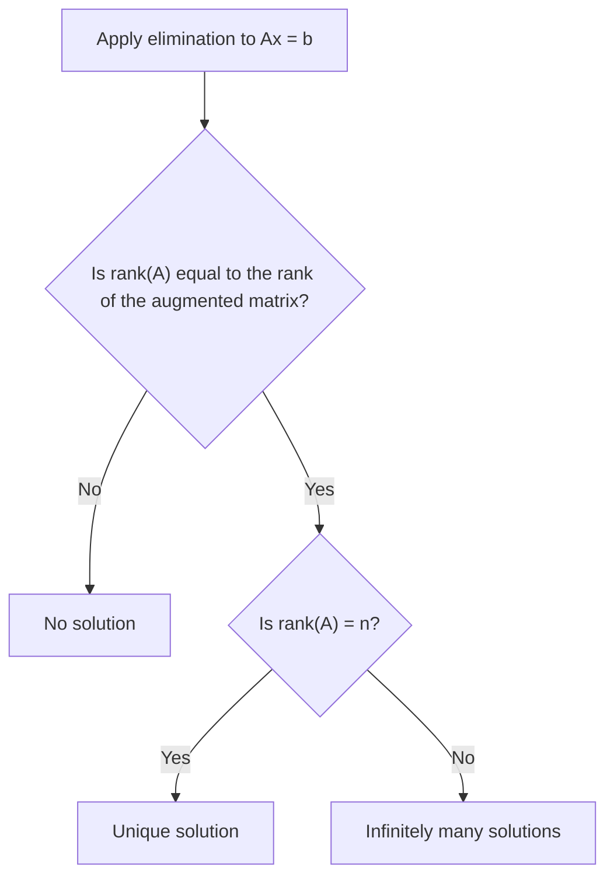

# Chapter 2 — Solving Linear Equations

[Repository Guide](../../README.md) | [English](Concepts_Lecture.md) | [한국어](Concepts_Lecture.ko.md)

> **Last Updated:** 2026-10-19
>
> Introduction to Linear Algebra, Strang, Ch 2

> **Learning Objectives:**
> 1. Apply Gaussian elimination to solve linear systems
> 2. Express elimination using matrix factorization ($`A = LU`$)
> 3. Identify when systems have no solution, one solution, or infinitely many solutions
> 4. Use the properties of permutation matrices and transposes to find the $`PA = LU`$ and $`LDL^T`$ factorizations
> 5. Approximate derivatives with finite differences and explain the properties of the second difference matrices $`K`$, $`T`$, $`B`$

---

<br>

## Table of Contents

- [1. Introduction](#1-introduction)
- [2. Elimination and Back Substitution (2.1)](#2-elimination-and-back-substitution-21)
  - [2.1 The Elimination Process](#21-the-elimination-process)
  - [2.2 Three Cases of Solutions](#22-three-cases-of-solutions)
  - [2.3 Examples of 2x2 Systems](#23-examples-of-2x2-systems)
  - [2.4 Homogeneous Systems](#24-homogeneous-systems)
  - [2.5 Back Substitution Example](#25-back-substitution-example)
  - [2.6 Elimination on Each Column](#26-elimination-on-each-column)
  - [2.7 Possible Breakdown of Elimination](#27-possible-breakdown-of-elimination)
  - [2.8 Dependent or Independent Columns](#28-dependent-or-independent-columns)
  - [2.9 The Row Picture and the Column Picture](#29-the-row-picture-and-the-column-picture)
- [3. Elimination Matrices and Inverse Matrix (2.2)](#3-elimination-matrices-and-inverse-matrix-22)
  - [3.1 Examples of Elimination and Permutation](#31-examples-of-elimination-and-permutation)
  - [3.2 Elimination Matrices and A = LU](#32-elimination-matrices-and-a--lu)
  - [3.3 The Facts about Inverse Matrices](#33-the-facts-about-inverse-matrices)
  - [3.4 The Inverse of a Product AB](#34-the-inverse-of-a-product-ab)
  - [3.5 Inverse of Elimination Matrices](#35-inverse-of-elimination-matrices)
  - [3.6 L is the Inverse of E](#36-l-is-the-inverse-of-e)
- [4. Matrix Computations and A = LU (2.3)](#4-matrix-computations-and-a--lu-23)
  - [4.1 Key Facts](#41-key-facts)
  - [4.2 Finding the Inverse Explicitly](#42-finding-the-inverse-explicitly)
  - [4.3 Gauss-Jordan Elimination](#43-gauss-jordan-elimination)
  - [4.4 The Cost of Elimination](#44-the-cost-of-elimination)
  - [4.5 The Great Factorization A = LU](#45-the-great-factorization-a--lu)
  - [4.6 Second Proof of A = LU](#46-second-proof-of-a--lu)
  - [4.7 Elimination without Row Exchanges](#47-elimination-without-row-exchanges)
- [5. Permutations and Transpose (2.4)](#5-permutations-and-transpose-24)
  - [5.1 Permutation Matrices](#51-permutation-matrices)
  - [5.2 Properties of Permutation Matrices](#52-properties-of-permutation-matrices)
  - [5.3 The PA = LU Factorization](#53-the-pa--lu-factorization)
  - [5.4 Partial Pivoting](#54-partial-pivoting)
  - [5.5 PAQ: Row and Column Permutations](#55-paq-row-and-column-permutations)
  - [5.6 The Transpose of A](#56-the-transpose-of-a)
  - [5.7 Inner Products and the Transpose](#57-inner-products-and-the-transpose)
  - [5.8 Symmetric Matrices](#58-symmetric-matrices)
  - [5.9 Symmetric Products and LDL^T](#59-symmetric-products-and-ldlt)
- [6. Derivatives and Finite Difference Matrices (2.5)](#6-derivatives-and-finite-difference-matrices-25)
  - [6.1 Taylor Series and Approximations](#61-taylor-series-and-approximations)
  - [6.2 Derivatives from Differences](#62-derivatives-from-differences)
  - [6.3 Second Difference Matrices K, T, B](#63-second-difference-matrices-k-t-b)
  - [6.4 Properties of K](#64-properties-of-k)
  - [6.5 Free-Fixed Matrices T](#65-free-fixed-matrices-t)
  - [6.6 Free-Free Matrices B](#66-free-free-matrices-b)
- [Summary](#summary)
- [Self-Check Questions](#self-check-questions)

---

<br>

## 1. Introduction

This chapter focuses on solving the system of linear equations:

```math
A\mathbf{x} = \mathbf{b}
```

**Sections covered:**

1. **2.1** Elimination and Back Substitution
2. **2.2** Elimination Matrices and Inverse Matrix
3. **2.3** Matrix Computations and $`A = LU`$
4. **2.4** Permutations and Transposes
5. **2.5** Derivatives and Finite Difference Matrices

We focus on **square matrices** $`A \in \mathbb{R}^{n \times n}`$.

$`A\mathbf{x} = \mathbf{b}`$ gives $`n`$ equations.

**Example ($`2 \times 2`$ system):**

```math
a_{11}x_1 + a_{12}x_2 = b_1
```
```math
a_{21}x_1 + a_{22}x_2 = b_2
```

In matrix form:

```math
\begin{pmatrix} a_{11} & a_{12} \\ a_{21} & a_{22} \end{pmatrix} \begin{pmatrix} x_1 \\ x_2 \end{pmatrix} = \begin{pmatrix} b_1 \\ b_2 \end{pmatrix}
```

**General form** ($`n`$ equations, $`n`$ unknowns):

```math
\begin{pmatrix} a_{11} & a_{12} & \cdots & a_{1n} \\ a_{21} & a_{22} & \cdots & a_{2n} \\ \vdots & \vdots & \ddots & \vdots \\ a_{n1} & a_{n2} & \cdots & a_{nn} \end{pmatrix} \begin{pmatrix} x_1 \\ x_2 \\ \vdots \\ x_n \end{pmatrix} = \begin{pmatrix} b_1 \\ b_2 \\ \vdots \\ b_n \end{pmatrix}
```

If there exists a unique solution $`\mathbf{x} \in \mathbb{R}^n`$ for given $`\mathbf{b}`$, then there exists an inverse matrix $`A^{-1}`$ such that:

```math
A^{-1}A = AA^{-1} = I
```

In this case, the solution is:

```math
A\mathbf{x} = \mathbf{b} \implies A^{-1}A\mathbf{x} = A^{-1}\mathbf{b} \implies \boxed{\mathbf{x} = A^{-1}\mathbf{b}}
```

This chapter aims to find the solution $`\mathbf{x}`$ **without** computing $`A^{-1}`$ explicitly. We find $`\mathbf{x}`$ by using:

1. **Elimination**
2. **Back substitution**

**Overview of the process:**

```math
\begin{pmatrix} A & | & \mathbf{b} \end{pmatrix} \xrightarrow{\text{elimination}} \begin{pmatrix} U & | & \mathbf{c} \end{pmatrix} \xrightarrow{\text{back substitution}} \mathbf{x}
```

where $`U`$ is an **upper triangular matrix**.

In equations:

```math
A\mathbf{x} = \mathbf{b} \implies U\mathbf{x} = \mathbf{c} \implies \mathbf{x} = U^{-1}\mathbf{c} = A^{-1}\mathbf{b}
```

---

<br>

## 2. Elimination and Back Substitution (2.1)

### 2.1 The Elimination Process

**Step 1:** Elimination subtracts $`l_{ij}`$ times row $`j`$ from row $`i`$, resulting in a zero in row $`i`$.

```math
\text{row } i \leftarrow \text{row } i - l_{ij} \cdot \text{row } j
```

**Example:**

```math
\begin{pmatrix} 2 & 3 \\ 4 & 2 \end{pmatrix} \xrightarrow{R_2 - 2 \cdot R_1} \begin{pmatrix} 2 & 3 \\ 0 & -4 \end{pmatrix}
```

**Step 2:** $`A\mathbf{x} = \mathbf{b}`$ becomes either:
- $`U\mathbf{x} = \mathbf{c}`$ (unique solution)
- No solution
- Infinitely many solutions

**Step 3:** $`U\mathbf{x} = \mathbf{c}`$ is solved by **back substitution**, where $`U`$ is upper triangular.

---

### 2.2 Three Cases of Solutions

Consider $`A\mathbf{x} = \mathbf{b}`$, where $`A \in \mathbb{R}^{n \times n}`$, $`\mathbf{x}, \mathbf{b} \in \mathbb{R}^{n \times 1}`$.

There are **three cases**:

**Case 1: Unique solution.** Exactly one $`\mathbf{x}`$ satisfies $`A\mathbf{x} = \mathbf{b}`$ ($`\exists! \; \mathbf{x}`$).

- $`A`$ has **independent columns**.
- The only solution to $`A\mathbf{x} = \mathbf{0}`$ is $`\mathbf{x} = \mathbf{0}`$.
- $`A`$ has an inverse matrix $`A^{-1}`$.

**Case 2: No solution.** No $`\mathbf{x}`$ satisfies $`A\mathbf{x} = \mathbf{b}`$.

- $`\mathbf{b}`$ is **not** in the column space of $`A`$.
- $`\mathbf{b}`$ is not a linear combination of the columns of $`A`$.

**Case 3: Infinitely many solutions.** Infinitely many $`\mathbf{x}`$ satisfy $`A\mathbf{x} = \mathbf{b}`$.

- The columns of $`A`$ are **not independent**.
- $`\mathbf{b}`$ is in the column space of $`A`$.
- $`n > \text{rank}(A) = \text{rank}(A|\mathbf{b})`$

The three cases can be told apart by comparing the rank of $`A`$ with the rank of the augmented matrix $`(A|\mathbf{b})`$.



*Figure 1. Three cases of solutions by rank comparison*

---

### 2.3 Examples of 2x2 Systems

**Example 1: Unique solution**

```math
x + 2y = 1, \quad 3x + y = -2
```

```math
\begin{pmatrix} 1 & 2 \\ 3 & 1 \end{pmatrix}\begin{pmatrix} x \\ y \end{pmatrix} = \begin{pmatrix} 1 \\ -2 \end{pmatrix}
```

Augmented matrix:

```math
\begin{pmatrix} 1 & 2 & | & 1 \\ 3 & 1 & | & -2 \end{pmatrix} \xrightarrow{R_2 - 3R_1} \begin{pmatrix} 1 & 2 & | & 1 \\ 0 & -5 & | & -5 \end{pmatrix} \implies \begin{pmatrix} 1 & 2 & | & 1 \\ 0 & 1 & | & 1 \end{pmatrix} \xrightarrow{R_1 - 2R_2} \begin{pmatrix} 1 & 0 & | & -1 \\ 0 & 1 & | & 1 \end{pmatrix}
```

$`\text{rank}(A) = 2`$, $`\text{rank}(A|\mathbf{b}) = 2`$, number of unknowns $`= 2`$.

$`\Rightarrow \exists! \; \mathbf{x}`$. Solution: $`x = -1, y = 1`$.

**Example 2: No solution**

```math
3x + 2y = 3, \quad -6x - 4y = 0
```

```math
\begin{pmatrix} 3 & 2 \\ -6 & -4 \end{pmatrix}\begin{pmatrix} x \\ y \end{pmatrix} = \begin{pmatrix} 3 \\ 0 \end{pmatrix}
```

Augmented matrix:

```math
\begin{pmatrix} 3 & 2 & | & 3 \\ -6 & -4 & | & 0 \end{pmatrix} \xrightarrow{R_2 + 2R_1} \begin{pmatrix} 3 & 2 & | & 3 \\ 0 & 0 & | & 6 \end{pmatrix} \implies \begin{pmatrix} 1 & 2/3 & | & 1 \\ 0 & 0 & | & 1 \end{pmatrix}
```

$`\text{rank}(A) = 1`$, $`\text{rank}(A|\mathbf{b}) = 2`$.

$`\Rightarrow`$ **No solution exists.**

**Example 3: Infinitely many solutions**

```math
3x + 2y = 3, \quad -6x - 4y = -6
```

```math
\begin{pmatrix} 3 & 2 \\ -6 & -4 \end{pmatrix}\begin{pmatrix} x \\ y \end{pmatrix} = \begin{pmatrix} 3 \\ -6 \end{pmatrix}
```

```math
\begin{pmatrix} 3 & 2 & | & 3 \\ -6 & -4 & | & -6 \end{pmatrix} \xrightarrow{R_2 + 2R_1} \begin{pmatrix} 3 & 2 & | & 3 \\ 0 & 0 & | & 0 \end{pmatrix} \implies \begin{pmatrix} 1 & 2/3 & | & 1 \\ 0 & 0 & | & 0 \end{pmatrix}
```

$`\text{rank}(A) = 1`$, $`\text{rank}(A|\mathbf{b}) = 1`$, number of unknowns is 2.

$`\Rightarrow`$ **Infinitely many solutions.** There is effectively one equation in two unknowns, so there is 1 free parameter.

---

### 2.4 Homogeneous Systems

When $`\mathbf{b} = \mathbf{0}`$, we have a **homogeneous system**:

```math
A\mathbf{x} = \mathbf{0}
```

$`\mathbf{x} = \mathbf{0}`$ is the **trivial solution**. Are there any other solutions?

**Yes**, when $`\text{rank}(A) < n`$. We denote the nonzero vectors $`\mathbf{x}`$ satisfying $`A\mathbf{x} = \mathbf{0}`$ by $`X`$ (nullspace vectors).

**Key property:** If there is one solution $`\mathbf{x}`$ to $`A\mathbf{x} = \mathbf{b}`$, then we can add any solution to $`AX = \mathbf{0}`$:

```math
\mathbf{x} + \alpha X \text{ solves the same equations.}
```

**Proof:** For $`\alpha \in \mathbb{R}`$,

```math
A(\mathbf{x} + \alpha X) = A\mathbf{x} + \alpha AX = \mathbf{b} + \mathbf{0} = \mathbf{b}
```

**Example:**

```math
\begin{pmatrix} 2 & 3 \\ 4 & 6 \end{pmatrix}\begin{pmatrix} x \\ y \end{pmatrix} = \begin{pmatrix} 6 \\ 12 \end{pmatrix}
```

$`\text{rank}(A) = 1`$, $`\text{rank}(A|\mathbf{b}) = 1 < n = 2`$. $`\Rightarrow`$ Infinitely many solutions.

Pick a particular solution $`\mathbf{x} = \begin{pmatrix} 3 \\ 0 \end{pmatrix}`$.

Pick a nontrivial homogeneous solution to $`\begin{pmatrix} 2 & 3 \\ 4 & 6 \end{pmatrix}\begin{pmatrix} x \\ y \end{pmatrix} = \begin{pmatrix} 0 \\ 0 \end{pmatrix}`$:

```math
X = \begin{pmatrix} 3 \\ -2 \end{pmatrix}
```

All vectors $`\alpha X`$ can be added to the particular solution $`\mathbf{x}`$:

```math
\mathbf{x} + \alpha X = \begin{pmatrix} 3 \\ 0 \end{pmatrix} + \alpha \begin{pmatrix} 3 \\ -2 \end{pmatrix}
```

This forms a **line** of solutions to $`A\mathbf{x} = \mathbf{b}`$.

---

### 2.5 Back Substitution Example

We apply elimination to $`A\mathbf{x} = \mathbf{b}`$; the result is $`U\mathbf{x} = \mathbf{c}`$.

**Example:**

```math
\begin{pmatrix} 2 & 3 & 4 \\ 0 & 5 & 6 \\ 0 & 0 & 7 \end{pmatrix}\begin{pmatrix} x_1 \\ x_2 \\ x_3 \end{pmatrix} = \begin{pmatrix} 19 \\ 17 \\ 14 \end{pmatrix}
```

Back substitution finds $`\mathbf{x}`$:

1. From row 3: $`7x_3 = 14 \implies x_3 = 2`$
2. From row 2: $`5x_2 + 6x_3 = 17 \implies 5x_2 + 12 = 17 \implies x_2 = 1`$
3. From row 1: $`2x_1 + 3x_2 + 4x_3 = 19 \implies 2x_1 + 3 + 8 = 19 \implies x_1 = 4`$

```math
\therefore \mathbf{x} = \begin{pmatrix} 4 \\ 1 \\ 2 \end{pmatrix}
```

**Remarks:**
- We needed to divide by the **pivots** $`2, 5, 7`$.
- The pivots were discovered after elimination.
- We do **not** allow zero to be a pivot. If needed, we do **row exchanges**.
- Every square matrix $`A`$ with independent columns can be reduced to a triangular matrix with **nonzero pivots**.

---

### 2.6 Elimination on Each Column

**Example:**

```math
A = \begin{pmatrix} 2 & 3 & 4 \\ 4 & 11 & 14 \\ 2 & 8 & 17 \end{pmatrix}, \quad \mathbf{b} = \begin{pmatrix} 19 \\ 55 \\ 50 \end{pmatrix}
```

**Step 1:** Form the augmented matrix $`(A|\mathbf{b})`$ and apply $`R_2 - 2R_1`$:

```math
\begin{pmatrix} 2 & 3 & 4 & | & 19 \\ 4 & 11 & 14 & | & 55 \\ 2 & 8 & 17 & | & 50 \end{pmatrix} \xrightarrow{R_2 - 2R_1} \begin{pmatrix} 2 & 3 & 4 & | & 19 \\ 0 & 5 & 6 & | & 17 \\ 2 & 8 & 17 & | & 50 \end{pmatrix}
```

This operation corresponds to:

```math
-2R_1 + R_2 + 0 \cdot R_3 = (-2 \quad 1 \quad 0)\begin{pmatrix} R_1 \\ R_2 \\ R_3 \end{pmatrix}
```

Introduce the elimination matrix:

```math
E_{21} = \begin{pmatrix} 1 & 0 & 0 \\ -2 & 1 & 0 \\ 0 & 0 & 1 \end{pmatrix}
```

Then the result is $`(E_{21}A \mid E_{21}\mathbf{b})`$.

**Step 2:** Apply $`R_3 - R_1`$:

```math
\begin{pmatrix} 2 & 3 & 4 & | & 19 \\ 0 & 5 & 6 & | & 17 \\ 2 & 8 & 17 & | & 50 \end{pmatrix} \xrightarrow{R_3 - R_1} \begin{pmatrix} 2 & 3 & 4 & | & 19 \\ 0 & 5 & 6 & | & 17 \\ 0 & 5 & 13 & | & 31 \end{pmatrix}
```

```math
E_{31} = \begin{pmatrix} 1 & 0 & 0 \\ 0 & 1 & 0 \\ -1 & 0 & 1 \end{pmatrix}
```

Result: $`(E_{31}E_{21}A \mid E_{31}E_{21}\mathbf{b})`$

**Step 3:** Apply $`R_3' - R_2'`$:

```math
\begin{pmatrix} 2 & 3 & 4 & | & 19 \\ 0 & 5 & 6 & | & 17 \\ 0 & 5 & 13 & | & 31 \end{pmatrix} \xrightarrow{R_3' - R_2'} \begin{pmatrix} 2 & 3 & 4 & | & 19 \\ 0 & 5 & 6 & | & 17 \\ 0 & 0 & 7 & | & 14 \end{pmatrix}
```

```math
E_{32} = \begin{pmatrix} 1 & 0 & 0 \\ 0 & 1 & 0 \\ 0 & -1 & 1 \end{pmatrix}
```

Final result: $`(E_{32}E_{31}E_{21}A \mid E_{32}E_{31}E_{21}\mathbf{b}) = (U \mid \mathbf{c})`$

---

### 2.7 Possible Breakdown of Elimination

This happens when **zero appears in a pivot position**.

**Example (fixable with row swap):**

```math
\begin{pmatrix} 2 & 3 & 4 \\ 4 & 6 & 14 \\ 2 & 8 & 17 \end{pmatrix} \rightarrow \begin{pmatrix} 2 & 3 & 4 \\ 0 & 0 & 6 \\ 0 & 5 & 13 \end{pmatrix}
```

**Swap row 2 with row 3** using permutation matrix $`P`$:

```math
\begin{pmatrix} 1 & 0 & 0 \\ 0 & 0 & 1 \\ 0 & 1 & 0 \end{pmatrix}\begin{pmatrix} 2 & 3 & 4 \\ 0 & 0 & 6 \\ 0 & 5 & 13 \end{pmatrix} = \begin{pmatrix} 2 & 3 & 4 \\ 0 & 5 & 13 \\ 0 & 0 & 6 \end{pmatrix}
```

**Example (not fixable, singular matrix):**

```math
A^* = \begin{pmatrix} 2 & 3 & 4 \\ 4 & 6 & 14 \\ 2 & 3 & 17 \end{pmatrix} \rightarrow \begin{pmatrix} 2 & 3 & 4 \\ 0 & 0 & 6 \\ 0 & 0 & 13 \end{pmatrix} = U^*
```

No pivot is available in the second column.

- $`A^*`$ does **not** have full rank.
- $`A^*`$ and $`U^*`$ are **not** invertible.
- The 1st and 2nd columns are in the same direction.
- $`A^* X = \mathbf{0}`$ has nonzero solution $`X`$.

---

### 2.8 Dependent or Independent Columns

A square triangular matrix $`U`$ has **full rank** exactly when its main diagonal has **no zeros**.

For full rank $`A`$:
- The columns of $`U`$ are independent.
- The rows of $`U`$ are independent.

When $`U`$ has a **zero on its diagonal**:
- $`U`$ is a **singular** matrix.
- $`U^{-1}`$ does not exist.
- $`A^{-1}`$ does not exist.
- $`A`$ is a **singular** matrix.

---

### 2.9 The Row Picture and the Column Picture

**The Row Picture:**

Each equation represents a line (in 2D), plane (in 3D), or hyperplane. The solution is where they intersect.

**Example 1 (no solution, parallel lines):**

```math
x - 2y = -1, \quad x - 2y = 1 \implies \begin{pmatrix} 1 & -2 \\ 1 & -2 \end{pmatrix}\begin{pmatrix} x \\ y \end{pmatrix} = \begin{pmatrix} -1 \\ 1 \end{pmatrix}
```

**Example 2 (infinitely many solutions, same line):**

```math
x - 2y = 1, \quad x - 2y = 1 \implies \begin{pmatrix} 1 & -2 \\ 1 & -2 \end{pmatrix}\begin{pmatrix} x \\ y \end{pmatrix} = \begin{pmatrix} 1 \\ 1 \end{pmatrix}
```

The solutions form a line.

**Example 3 (one solution, intersecting lines):**

```math
x - 2y = 7, \quad x + y = 2 \implies \begin{pmatrix} 1 & -2 \\ 1 & 1 \end{pmatrix}\begin{pmatrix} x \\ y \end{pmatrix} = \begin{pmatrix} 7 \\ 2 \end{pmatrix}
```

There is one solution at the intersection point.

**The Column Picture:**

```math
A = \begin{pmatrix} 1 & -2 \\ 1 & 1 \end{pmatrix}, \quad \mathbf{b} = \begin{pmatrix} 7 \\ 2 \end{pmatrix}
```

Columns: $`\mathbf{a}_1 = \begin{pmatrix} 1 \\ 1 \end{pmatrix}`$, $`\mathbf{a}_2 = \begin{pmatrix} -2 \\ 1 \end{pmatrix}`$

```math
x_1 \mathbf{a}_1 + x_2 \mathbf{a}_2 = \mathbf{b}
```

$`\mathbf{b}`$ is a **linear combination** of $`\mathbf{a}_1`$ and $`\mathbf{a}_2`$.

$`\Leftrightarrow`$ $`\mathbf{b}`$ is in the **column space** of $`A`$.

---

<br>

## 3. Elimination Matrices and Inverse Matrix (2.2)

### 3.1 Examples of Elimination and Permutation

**Example 1 (no permutation needed):**

```math
A = \begin{pmatrix} 2 & 4 & -2 \\ 4 & 9 & -3 \\ -2 & -3 & 7 \end{pmatrix}
```

```math
E_{21}: R_2 - 2R_1 \implies E_{21} = \begin{pmatrix} 1 & 0 & 0 \\ -2 & 1 & 0 \\ 0 & 0 & 1 \end{pmatrix}
```

```math
\begin{pmatrix} 2 & 4 & -2 \\ 0 & 1 & 1 \\ -2 & -3 & 7 \end{pmatrix}
```

```math
E_{31}: R_3 + R_1 \implies E_{31} = \begin{pmatrix} 1 & 0 & 0 \\ 0 & 1 & 0 \\ 1 & 0 & 1 \end{pmatrix}
```

```math
\begin{pmatrix} 2 & 4 & -2 \\ 0 & 1 & 1 \\ 0 & 1 & 5 \end{pmatrix}
```

```math
E_{32}: R_3' - R_2' \implies E_{32} = \begin{pmatrix} 1 & 0 & 0 \\ 0 & 1 & 0 \\ 0 & -1 & 1 \end{pmatrix}
```

```math
\begin{pmatrix} 2 & 4 & -2 \\ 0 & 1 & 1 \\ 0 & 0 & 4 \end{pmatrix} = U
```

Applying the same operations to $`\mathbf{b} = \begin{pmatrix} 2 \\ 8 \\ 10 \end{pmatrix}`$:

```math
\mathbf{b} = \begin{pmatrix} 2 \\ 8 \\ 10 \end{pmatrix} \xrightarrow{E_{21}} \begin{pmatrix} 2 \\ 4 \\ 10 \end{pmatrix} \xrightarrow{E_{31}} \begin{pmatrix} 2 \\ 4 \\ 12 \end{pmatrix} \xrightarrow{E_{32}} \begin{pmatrix} 2 \\ 4 \\ 8 \end{pmatrix} = \mathbf{c}
```

```math
(A|\mathbf{b}) \xrightarrow{E} (U|\mathbf{c})
```

**Example 2 (permutation needed):**

```math
A = \begin{pmatrix} 1 & 1 & 1 \\ 2 & 2 & 3 \\ 0 & 4 & 5 \end{pmatrix}
```

```math
E_{21}: R_2 - 2R_1 \implies \begin{pmatrix} 1 & 1 & 1 \\ 0 & 0 & 1 \\ 0 & 4 & 5 \end{pmatrix}
```

A zero appears in the pivot position, so swap rows using $`P = \begin{pmatrix} 1 & 0 & 0 \\ 0 & 0 & 1 \\ 0 & 1 & 0 \end{pmatrix}`$:

```math
\begin{pmatrix} 1 & 1 & 1 \\ 0 & 4 & 5 \\ 0 & 0 & 1 \end{pmatrix} = U
```

**Can we apply $`P`$ to $`A`$ first?**

```math
PA = \begin{pmatrix} 1 & 1 & 1 \\ 0 & 4 & 5 \\ 2 & 2 & 3 \end{pmatrix}
```

```math
E_{31}: R_3 - 2R_1 \implies E_{31} = \begin{pmatrix} 1 & 0 & 0 \\ 0 & 1 & 0 \\ -2 & 0 & 1 \end{pmatrix}
```

```math
\begin{pmatrix} 1 & 1 & 1 \\ 0 & 4 & 5 \\ 0 & 0 & 1 \end{pmatrix} = U \quad \text{Yes!}
```

**Overall equation:**

```math
EPA = U \iff \boxed{PA = E^{-1}U = LU}
```

---

### 3.2 Elimination Matrices and A = LU

1. Elimination multiplies $`A`$ by $`E_{21}, E_{31}, \ldots, E_{n1}`$, then $`E_{32}, E_{42}, \ldots, E_{n2}`$, as $`A`$ becomes $`EA = U`$.

2. In reverse order, the inverses of the $`E`$'s multiply $`U`$ to recover $`A = E^{-1}U`$. This is $`A = LU`$.

3. $`A^{-1}A = I`$ and $`(LU)^{-1} = U^{-1}L^{-1}`$. Then $`A\mathbf{x} = \mathbf{b}`$ becomes:

```math
\mathbf{x} = A^{-1}\mathbf{b} = U^{-1}L^{-1}\mathbf{b}
```

All the steps of elimination can be done with matrices:

```math
E_{n2} \cdots E_{42} E_{32} A = C
```

Those steps can be undone with matrices:

```math
A = E_{32}^{-1} E_{42}^{-1} \cdots E_{n2}^{-1} C
```

**Example:**

Let $`A = \begin{pmatrix} 3 & 1 & 0 \\ -3 & 1 & 1 \\ 6 & 8 & 4 \end{pmatrix}`$

```math
E_{21}: R_2 + R_1 \implies E_{21} = \begin{pmatrix} 1 & 0 & 0 \\ 1 & 1 & 0 \\ 0 & 0 & 1 \end{pmatrix}
```

```math
E_{31}: R_3 - 2R_1 \implies E_{31} = \begin{pmatrix} 1 & 0 & 0 \\ 0 & 1 & 0 \\ -2 & 0 & 1 \end{pmatrix}
```

```math
\begin{pmatrix} 3 & 1 & 0 \\ 0 & 2 & 1 \\ 0 & 6 & 4 \end{pmatrix}
```

```math
E_{32}: R_3' - 3R_2' \implies E_{32} = \begin{pmatrix} 1 & 0 & 0 \\ 0 & 1 & 0 \\ 0 & -3 & 1 \end{pmatrix}
```

```math
\begin{pmatrix} 3 & 1 & 0 \\ 0 & 2 & 1 \\ 0 & 0 & 1 \end{pmatrix} = U
```

Let $`E = E_{32}E_{31}E_{21}`$:

```math
EA = U \implies A = E^{-1}U = LU
```

---

### 3.3 The Facts about Inverse Matrices

**Definition:** The matrix $`A`$ is **invertible** if there exists a matrix $`A^{-1}`$ that inverts $`A`$:

```math
A^{-1}A = AA^{-1} = I
```

Let $`A \in \mathbb{R}^{n \times n}`$. If $`A`$ has $`n`$ independent columns, then $`A`$ is invertible. This means $`\text{rank}(A) = n`$.

**Note 1:** The inverse exists iff elimination produces $`n`$ pivots (with row exchanges).

Elimination solves $`A\mathbf{x} = \mathbf{b}`$ without explicit $`A^{-1}`$.

**Note 2:** The matrix $`A`$ **cannot have two different inverses**.

Suppose $`BA = I`$ and $`AC = I`$. Then $`B = C`$.

*Proof:* By the associative law,

```math
BAC = B(AC) = (BA)C
```

gives $`B = C`$. $`\square`$

The left inverse $`B`$ and the right inverse $`C`$ must be the same.

**Note 3:** If $`A`$ is invertible, then $`\exists! \; \mathbf{x}`$ to $`A\mathbf{x} = \mathbf{b}`$ s.t. $`\mathbf{x} = A^{-1}\mathbf{b}`$.

*Proof:*

```math
A\mathbf{x} = \mathbf{b} \implies A^{-1}A\mathbf{x} = A^{-1}\mathbf{b} \implies \mathbf{x} = A^{-1}\mathbf{b}. \quad \square
```

**Note 4:** Suppose there exists a nonzero vector $`\mathbf{x}`$ s.t. $`A\mathbf{x} = \mathbf{0}`$. Then:

- $`A`$ has **dependent columns**.
- $`A`$ cannot have an inverse.
- No matrix can bring $`\mathbf{0}`$ back to $`\mathbf{x}`$.

**Example:**

```math
\begin{pmatrix} 1 & 2 \\ 1 & 2 \end{pmatrix}\begin{pmatrix} -2 \\ 1 \end{pmatrix} = \begin{pmatrix} 0 \\ 0 \end{pmatrix}
```

If $`A`$ is invertible, then $`A\mathbf{x} = \mathbf{0}`$ implies $`\mathbf{x} = A^{-1}\mathbf{0} = \mathbf{0}`$.

**Note 5:** A square matrix is invertible iff its columns are independent.

**Note 6:** $`A = \begin{pmatrix} a & b \\ c & d \end{pmatrix}`$ is invertible iff $`ad - bc \neq 0`$ (the **determinant** of $`A`$).

```math
A^{-1} = \frac{1}{ad - bc}\begin{pmatrix} d & -b \\ -c & a \end{pmatrix}
```

**Note 7:** A triangular matrix has an inverse provided **nonzero diagonal entries**.

If $`A`$ is upper triangular with diagonal entries $`d_1, d_2, \ldots, d_n`$ (all nonzero), then $`A^{-1}`$ is also upper triangular with diagonal entries $`\frac{1}{d_1}, \frac{1}{d_2}, \ldots, \frac{1}{d_n}`$.

**Example 2:**

```math
A = \begin{pmatrix} 1 & 2 \\ 1 & 2 \end{pmatrix} \xrightarrow{R_2 - R_1} \begin{pmatrix} 1 & 2 \\ 0 & 0 \end{pmatrix}
```

$`\text{rank}(A) = 1 < 2`$. $`A`$ has 1 pivot. $`\det(A) = 1 \cdot 2 - 2 \cdot 1 = 0`$. $`A`$ has a dependent column.

**Example 3:**

```math
A = \begin{pmatrix} 4 & 3 \\ 8 & 6 \end{pmatrix} \quad \text{rank}(A) = 1 < 2 \quad \text{(not invertible)}
```

```math
B = \begin{pmatrix} 4 & 3 \\ 8 & 7 \end{pmatrix} \quad \det(B) = 4 \cdot 7 - 3 \cdot 8 = 4 \neq 0 \quad B^{-1} = \frac{1}{4}\begin{pmatrix} 7 & -3 \\ -8 & 4 \end{pmatrix}
```

```math
C = \begin{pmatrix} 6 & 6 \\ 6 & 0 \end{pmatrix} \quad \det(C) = 6 \cdot 0 - 6 \cdot 6 = -36 \neq 0 \quad C^{-1} = -\frac{1}{36}\begin{pmatrix} 0 & -6 \\ -6 & 6 \end{pmatrix} = \frac{1}{6}\begin{pmatrix} 0 & 1 \\ 1 & -1 \end{pmatrix}
```

```math
D = \begin{pmatrix} 6 & 6 \\ 6 & 6 \end{pmatrix} \quad \text{rank}(D) = 1 < 2 \quad \text{(not invertible)}
```

```math
S = \begin{pmatrix} 1 & 0 & 0 \\ 1 & 1 & 0 \\ 1 & 1 & 1 \end{pmatrix} \xrightarrow{R_2 - R_1, R_3 - R_1} \begin{pmatrix} 1 & 0 & 0 \\ 0 & 1 & 0 \\ 0 & 1 & 1 \end{pmatrix} \xrightarrow{R_3' - R_2'} \begin{pmatrix} 1 & 0 & 0 \\ 0 & 1 & 0 \\ 0 & 0 & 1 \end{pmatrix}
```

There are 3 pivots, so $`S`$ is invertible.

Computing $`E = E_{32}E_{31}E_{21} = S^{-1}`$:

```math
E_{21} = \begin{pmatrix} 1 & 0 & 0 \\ -1 & 1 & 0 \\ 0 & 0 & 1 \end{pmatrix}, \quad E_{31} = \begin{pmatrix} 1 & 0 & 0 \\ 0 & 1 & 0 \\ -1 & 0 & 1 \end{pmatrix}, \quad E_{32} = \begin{pmatrix} 1 & 0 & 0 \\ 0 & 1 & 0 \\ 0 & -1 & 1 \end{pmatrix}
```

```math
E_{31}E_{21} = \begin{pmatrix} 1 & 0 & 0 \\ -1 & 1 & 0 \\ -1 & 0 & 1 \end{pmatrix}
```

```math
E_{32}(E_{31}E_{21}) = \begin{pmatrix} 1 & 0 & 0 \\ -1 & 1 & 0 \\ 0 & -1 & 1 \end{pmatrix} = E = S^{-1}
```

```math
T = \begin{pmatrix} 1 & 1 & 1 \\ 1 & 1 & 0 \\ 1 & 1 & 1 \end{pmatrix} \xrightarrow{R_3 - R_1} \begin{pmatrix} 1 & 1 & 1 \\ 1 & 1 & 0 \\ 0 & 0 & 0 \end{pmatrix}
```

$`\text{rank}(T) = 2 < 3`$. **Not invertible.**

---

### 3.4 The Inverse of a Product AB

For two nonzero values $`a`$ and $`b`$, the sum $`(a + b)`$ may not be invertible.

**Example:** $`a = 3 \implies a^{-1} = 1/3`$, $`b = -3 \implies b^{-1} = -1/3`$, $`a + b = 0 \implies (a+b)^{-1}`$ does not exist.

But: $`ab = -9 \implies (ab)^{-1} = -1/9 = a^{-1}b^{-1}`$.

**Theorem:** If $`A, B \in \mathbb{R}^{n \times n}`$ are invertible, then the inverse of $`AB`$ is:

```math
\boxed{(AB)^{-1} = B^{-1}A^{-1}}
```

*Proof:*

```math
(AB)^{-1}AB = I
```
```math
(AB)^{-1}ABB^{-1} = IB^{-1} = B^{-1}
```
```math
(AB)^{-1}AA^{-1} = B^{-1}A^{-1}
```

```math
\therefore (AB)^{-1} = B^{-1}A^{-1} \quad \square
```

**Inverses come in reverse order.**

For three matrices:

```math
(ABC)^{-1} = C^{-1}B^{-1}A^{-1}
```

*Proof:*

```math
(ABC)^{-1}ABC = I \implies (ABC)^{-1}ABCC^{-1} = C^{-1} \implies (ABC)^{-1}ABB^{-1} = C^{-1}B^{-1}
```

```math
\implies (ABC)^{-1}AA^{-1} = C^{-1}B^{-1}A^{-1} \implies (ABC)^{-1} = C^{-1}B^{-1}A^{-1}
```

---

### 3.5 Inverse of Elimination Matrices

**Example 4:**

```math
E = \begin{pmatrix} 1 & 0 & 0 \\ -5 & 1 & 0 \\ 0 & 0 & 1 \end{pmatrix} \quad \text{(subtract 5 times row 1 from row 2)}
```

$`(-5 \quad 1 \quad 0)\begin{pmatrix} R_1 \\ R_2 \\ R_3 \end{pmatrix} = R_2 - 5R_1 = R_2'`$

To undo: $`R_2 = R_2' + 5R_1`$, i.e., $`(5 \quad 1 \quad 0)\begin{pmatrix} R_1 \\ R_2' \\ R_3 \end{pmatrix}`$

```math
E^{-1} = \begin{pmatrix} 1 & 0 & 0 \\ 5 & 1 & 0 \\ 0 & 0 & 1 \end{pmatrix} \quad \text{(add 5 times row 1 to row 2)}
```

```math
EE^{-1} = E^{-1}E = I
```

**Important:** If $`AC = I`$ for square matrices $`A, C`$, then $`CA = I`$.

**Example 5:**

```math
F = \begin{pmatrix} 1 & 0 & 0 \\ 0 & 1 & 0 \\ 0 & -4 & 1 \end{pmatrix} \quad (R_3' = R_3 - 4R_2)
```

```math
F^{-1} = \begin{pmatrix} 1 & 0 & 0 \\ 0 & 1 & 0 \\ 0 & 4 & 1 \end{pmatrix} \quad (R_3 = R_3' + 4R_2)
```

Computing the product $`FE`$:

```math
FE = \begin{pmatrix} 1 & 0 & 0 \\ 0 & 1 & 0 \\ 0 & -4 & 1 \end{pmatrix}\begin{pmatrix} 1 & 0 & 0 \\ -5 & 1 & 0 \\ 0 & 0 & 1 \end{pmatrix} = \begin{pmatrix} 1 & 0 & 0 \\ -5 & 1 & 0 \\ 20 & -4 & 1 \end{pmatrix}
```

The (3,1) entry 20 comes from row 1 through the chain of operations:

```math
R_3'' = R_3' - 4R_2' = R_3 - 4(R_2 - 5R_1) = R_3 - 4R_2 + 20R_1
```

```math
(FE)^{-1} = E^{-1}F^{-1} = \begin{pmatrix} 1 & 0 & 0 \\ 5 & 1 & 0 \\ 0 & 0 & 1 \end{pmatrix}\begin{pmatrix} 1 & 0 & 0 \\ 0 & 1 & 0 \\ 0 & 4 & 1 \end{pmatrix} = \begin{pmatrix} 1 & 0 & 0 \\ 5 & 1 & 0 \\ 0 & 4 & 1 \end{pmatrix}
```

The multipliers 5 and 4 fall into place below the diagonal of $`L = (FE)^{-1}`$.

---

### 3.6 L is the Inverse of E

**L is the inverse of E.**

Recall the example in Section 3.2: $`A = \begin{pmatrix} 3 & 1 & 0 \\ -3 & 1 & 1 \\ 6 & 8 & 4 \end{pmatrix}`$

```math
E = E_{32}E_{31}E_{21} = \begin{pmatrix} 1 & 0 & 0 \\ 0 & 1 & 0 \\ 0 & -3 & 1 \end{pmatrix}\begin{pmatrix} 1 & 0 & 0 \\ 0 & 1 & 0 \\ -2 & 0 & 1 \end{pmatrix}\begin{pmatrix} 1 & 0 & 0 \\ 1 & 1 & 0 \\ 0 & 0 & 1 \end{pmatrix}
```

```math
EA = \begin{pmatrix} 3 & 1 & 0 \\ 0 & 2 & 1 \\ 0 & 0 & 1 \end{pmatrix} = U
```

**General formula for E and L ($`3 \times 3`$ case):**

Let $`l_{32} = 3`$, $`l_{31} = 2`$, $`l_{21} = -1`$. Then:

```math
E = \begin{pmatrix} 1 & 0 & 0 \\ 0 & 1 & 0 \\ 0 & -l_{32} & 1 \end{pmatrix}\begin{pmatrix} 1 & 0 & 0 \\ 0 & 1 & 0 \\ -l_{31} & 0 & 1 \end{pmatrix}\begin{pmatrix} 1 & 0 & 0 \\ -l_{21} & 1 & 0 \\ 0 & 0 & 1 \end{pmatrix}
```

```math
= \begin{pmatrix} 1 & 0 & 0 \\ -l_{21} & 1 & 0 \\ l_{32}l_{21} - l_{31} & -l_{32} & 1 \end{pmatrix}
```

A cross-product term $`l_{32}l_{21} - l_{31}`$ appears in position (3,1).

```math
E^{-1} = \begin{pmatrix} 1 & 0 & 0 \\ l_{21} & 1 & 0 \\ 0 & 0 & 1 \end{pmatrix}\begin{pmatrix} 1 & 0 & 0 \\ 0 & 1 & 0 \\ l_{31} & 0 & 1 \end{pmatrix}\begin{pmatrix} 1 & 0 & 0 \\ 0 & 1 & 0 \\ 0 & l_{32} & 1 \end{pmatrix} = \begin{pmatrix} 1 & 0 & 0 \\ l_{21} & 1 & 0 \\ l_{31} & l_{32} & 1 \end{pmatrix} = L
```

**The inverse matrix $`E^{-1}`$ takes a clean form.** The factors $`l_{21}, l_{31}, l_{32}`$ appear as they are.

**All multipliers $`l_{ij}`$ appear in their correct position in $`L`$.**

---

<br>

## 4. Matrix Computations and A = LU (2.3)

### 4.1 Key Facts

1. The elimination steps from $`A`$ to $`U`$ cost $`\frac{1}{3}n^3`$ multiplications and subtractions.
2. Each right side $`\mathbf{b}`$ costs only $`n^2`$:
   - Forward elimination gives $`U\mathbf{x} = \mathbf{c}`$.
   - Back substitution then gives $`\mathbf{x}`$.
3. Elimination without row exchanges factors $`A`$ into $`LU`$.

The solution to $`A\mathbf{x} = \mathbf{b}`$ is given by $`\mathbf{x} = A^{-1}\mathbf{b}`$.

**Q:** Do we need to know $`A^{-1}`$ explicitly? Computing $`A^{-1}`$ and multiplying $`A^{-1}\mathbf{b}`$ is a very **slow** way to find $`\mathbf{x}`$.

---

### 4.2 Finding the Inverse Explicitly

**Q:** How do we find $`A^{-1}`$ explicitly?

Start by $`AA^{-1} = I \in \mathbb{R}^{n \times n}`$.

```math
I = \begin{pmatrix} | & | & & | \\ \hat{e}_1 & \hat{e}_2 & \cdots & \hat{e}_n \\ | & | & & | \end{pmatrix}
```

where $`\hat{e}_1, \hat{e}_2, \ldots, \hat{e}_n`$ are **standard basis vectors** (unit vectors).

View $`AA^{-1} = I`$ as:

```math
A\begin{pmatrix} | & | & & | \\ \mathbf{x}_1 & \mathbf{x}_2 & \cdots & \mathbf{x}_n \\ | & | & & | \end{pmatrix} = \begin{pmatrix} | & | & & | \\ \hat{e}_1 & \hat{e}_2 & \cdots & \hat{e}_n \\ | & | & & | \end{pmatrix}
```

That is $`n`$ equations:

```math
A\mathbf{x}_1 = \hat{e}_1, \quad A\mathbf{x}_2 = \hat{e}_2, \quad \ldots, \quad A\mathbf{x}_n = \hat{e}_n
```

Same coefficient matrix $`A`$, different right hand side vectors.

---

### 4.3 Gauss-Jordan Elimination

Solve the $`n`$ equations together by using **Gauss-Jordan elimination**:

```math
(A \mid I) \implies (I \mid A^{-1})
```

**Example:**

```math
\begin{pmatrix} 1 & 0 & 0 & | & 1 & 0 & 0 \\ -1 & 1 & 0 & | & 0 & 1 & 0 \\ 0 & -1 & 1 & | & 0 & 0 & 1 \end{pmatrix} = (A|I)
```

```math
\xrightarrow{R_2 + R_1} \begin{pmatrix} 1 & 0 & 0 & | & 1 & 0 & 0 \\ 0 & 1 & 0 & | & 1 & 1 & 0 \\ 0 & -1 & 1 & | & 0 & 0 & 1 \end{pmatrix}
```

```math
\xrightarrow{R_3 + R_2} \begin{pmatrix} 1 & 0 & 0 & | & 1 & 0 & 0 \\ 0 & 1 & 0 & | & 1 & 1 & 0 \\ 0 & 0 & 1 & | & 1 & 1 & 1 \end{pmatrix} = (I|A^{-1})
```

The elimination steps on $`A`$ only have to be done **once**.

---

### 4.4 The Cost of Elimination

**Reducing $`A`$ to $`U`$:**

Step 1 (eliminate column 1): $`(n-1)`$ rows, $`n`$ columns $`\implies (n-1)n`$ multiplications and $`(n-1)n`$ subtractions.

Step 2 (eliminate column 2): $`(n-2)`$ rows, $`(n-1)`$ columns $`\implies (n-2)(n-1)`$ multiplications and subtractions.

$`\vdots`$

Step $`(n-1)`$ (eliminate column $`n-1`$): 1 row, 2 columns $`\implies 1 \cdot 2`$ multiplications and subtractions.

**Total multiplications:**

```math
(n-1)n + (n-2)(n-1) + \cdots + 1 \cdot 2 = \sum_{i=1}^{n-1} i(i+1) = \sum_{i=1}^{n-1} i^2 + \sum_{i=1}^{n-1} i
```

```math
= \frac{n(n+1)(2n+1)}{6} - n^2 + \frac{(n-1)n}{2}
```

```math
= \frac{1}{3}n^3 - \frac{n}{3}
```

As $`n \to \infty`$: $`\approx \dfrac{1}{3}n^3`$.

**Reducing $`A`$ to $`U`$ requires about $`\frac{1}{3}n^3`$ multiplications and $`\frac{1}{3}n^3`$ subtractions.**

**Reducing $`\mathbf{b}`$ to $`\mathbf{c}`$:**

Similar to $`A`$ but only 1 column:

- Step 1: $`(n-1)`$ multiplications and subtractions
- Step 2: $`(n-2)`$ multiplications and subtractions
- ...
- Step $`(n-1)`$: 1 multiplication and subtraction

```math
\sum_{i=1}^{n-1} i = \frac{(n-1)n}{2} = \frac{n^2}{2} - \frac{n}{2}
```

As $`n \to \infty`$: $`\approx \dfrac{n^2}{2}`$.

**Reducing $`\mathbf{b}`$ to $`\mathbf{c}`$ involves $`\frac{n^2}{2}`$ multiplications and $`\frac{n^2}{2}`$ subtractions.**

**Back substitution** ($`U\mathbf{x} = \mathbf{c}`$):

```math
x_n = c_n / u_{nn}
```
```math
x_{n-1} = (c_{n-1} - u_{(n-1)n}x_n) / u_{(n-1)(n-1)}
```
```math
\vdots
```
```math
x_1 = (c_1 - u_{12}x_2 - u_{13}x_3 - \cdots - u_{1n}x_n) / u_{11}
```

Back substitution needs $`n`$ divisions, $`1 + 2 + \cdots + (n-1)`$ multiplications, and $`1 + 2 + \cdots + (n-1)`$ subtractions.

Adding the $`n + \frac{(n-1)n}{2} = \frac{(n+1)n}{2}`$ divisions and multiplications of back substitution to the $`\frac{(n-1)n}{2}`$ multiplications for reducing $`\mathbf{b}`$ to $`\mathbf{c}`$ gives:

```math
\frac{(n+1)n}{2} + \frac{(n-1)n}{2} = n^2
```

**The total count on the right side from $`\mathbf{b}`$ to $`\mathbf{c}`$ to $`\mathbf{x}`$ is about $`n^2`$:**
- $`n^2`$ multiplications (divisions included)
- $`(n-1)n = n^2 - n \approx n^2`$ subtractions

The operation counts of each stage are summarized below.

| Stage | Multiplications (divisions included) | Subtractions |
|:-----|:-----|:-----|
| Reducing $`A`$ to $`U`$ | $`\frac{1}{3}n^3 - \frac{n}{3}`$ | $`\frac{1}{3}n^3 - \frac{n}{3}`$ |
| Reducing $`\mathbf{b}`$ to $`\mathbf{c}`$ | $`\frac{(n-1)n}{2}`$ | $`\frac{(n-1)n}{2}`$ |
| Back substitution | $`\frac{(n+1)n}{2}`$ | $`\frac{(n-1)n}{2}`$ |
| Right side total ($`\mathbf{b} \to \mathbf{c} \to \mathbf{x}`$) | $`n^2`$ | $`n^2 - n`$ |

*Table 1. Operation counts of elimination and back substitution*

---

### 4.5 The Great Factorization A = LU

To invert one elimination step $`E_{ij}`$, which subtracts $`l_{ij}`$ times row $`j`$ from row $`i`$: we **add** instead of subtracting.

```math
E_{31} = \begin{pmatrix} 1 & 0 & 0 \\ 0 & 1 & 0 \\ -l_{31} & 0 & 1 \end{pmatrix} \implies L_{31} = E_{31}^{-1} = \begin{pmatrix} 1 & 0 & 0 \\ 0 & 1 & 0 \\ l_{31} & 0 & 1 \end{pmatrix}
```

**Example (revisited):**

Let $`A = \begin{pmatrix} 3 & 1 & 0 \\ -3 & 1 & 1 \\ 6 & 8 & 4 \end{pmatrix}`$

```math
E_{21}: R_2 + R_1 \implies \begin{pmatrix} 3 & 1 & 0 \\ 0 & 2 & 1 \\ 6 & 8 & 4 \end{pmatrix}
```

```math
E_{31}: R_3 - 2R_1 \implies \begin{pmatrix} 3 & 1 & 0 \\ 0 & 2 & 1 \\ 0 & 6 & 4 \end{pmatrix}
```

```math
E_{32}: R_3' - 3R_2' \implies \begin{pmatrix} 3 & 1 & 0 \\ 0 & 2 & 1 \\ 0 & 0 & 1 \end{pmatrix} = U
```

Row 1 of $`U`$ equals row 1 of $`A`$. Row 2 of $`U`$ remains unchanged after the application of $`E_{31}`$ and $`E_{32}`$.

**Relationship between rows of $`A`$ and $`U`$:**

Row 3 of $`U`$ = Row 3 of $`A`$ $`-`$ 2 (row 1 of $`U`$) $`-`$ 3 (row 2 of $`U`$)

Equivalently:

Row 3 of $`A`$ = Row 3 of $`U`$ $`+`$ $`l_{31}`$ (row 1 of $`U`$) $`+`$ $`l_{32}`$ (row 2 of $`U`$)

where $`l_{31} = 2`$ and $`l_{32} = 3`$.

```math
\text{Row 3 of } A = (l_{31} \quad l_{32} \quad 1) \begin{pmatrix} U_1 \\ U_2 \\ U_3 \end{pmatrix}
```

```math
\implies A = LU
```

---

### 4.6 Second Proof of A = LU

**Multiply columns times rows.**

Consider $`A = \begin{pmatrix} a_{11} & a_{12} & a_{13} \\ a_{21} & a_{22} & a_{23} \\ a_{31} & a_{32} & a_{33} \end{pmatrix}`$

**Step 1:** Take row 1 as pivot row. Multiply row 1 by $`l_{21}, l_{31}`$ and subtract from rows 2, 3.

Choose $`l_{21} = a_{21}/a_{11}`$, $`l_{31} = a_{31}/a_{11}`$.

```math
R_2 - l_{21}R_1, \quad R_3 - l_{31}R_1
```

```math
A' = \begin{pmatrix} a_{11} & a_{12} & a_{13} \\ 0 & a'_{22} & a'_{23} \\ 0 & a'_{32} & a'_{33} \end{pmatrix}
```

This step can be seen as:

```math
A = A' + \begin{pmatrix} - & 0 & - \\ - & l_{21}R_1 & - \\ - & l_{31}R_1 & - \end{pmatrix}
```

The subtracted part is a **rank 1 matrix**:

```math
\begin{pmatrix} 1 \\ l_{21} \\ l_{31} \end{pmatrix}\begin{pmatrix} a_{11} & a_{12} & a_{13} \end{pmatrix} = \mathbf{l}_1 \mathbf{u}_1 = \mathbf{l}_1 \otimes \mathbf{u}_1
```

```math
= \begin{pmatrix} 1 \cdot a_{11} & 1 \cdot a_{12} & 1 \cdot a_{13} \\ l_{21}a_{11} & l_{21}a_{12} & l_{21}a_{13} \\ l_{31}a_{11} & l_{31}a_{12} & l_{31}a_{13} \end{pmatrix}
```

Subtracting $`\mathbf{l}_1\mathbf{u}_1`$ from $`A`$ leaves the remaining part $`A_2`$, whose first row is also zero.

**Step 2:** Take the second row of $`A_2`$ (the remaining part) as pivot row.

```math
A_2 = \begin{pmatrix} 0 & 0 & 0 \\ 0 & a'_{22} & a'_{23} \\ 0 & a'_{32} & a'_{33} \end{pmatrix}
```

Apply $`R_3' - l_{32}R_2'`$:

```math
A'' = \begin{pmatrix} 0 & 0 & 0 \\ 0 & a'_{22} & a'_{23} \\ 0 & 0 & a''_{33} \end{pmatrix} = A_2 - \begin{pmatrix} 0 \\ 0 \\ l_{32} \end{pmatrix}(R_2')
```

Taking row 2 out as well gives another rank 1 matrix:

```math
\begin{pmatrix} 0 \\ 1 \\ l_{32} \end{pmatrix}\begin{pmatrix} 0 & a'_{22} & a'_{23} \end{pmatrix} = \mathbf{l}_2 \mathbf{u}_2
```

$`\mathbf{u}_2`$ is row 2 of $`U`$.

The remaining part:

```math
A_3 = \begin{pmatrix} 0 \\ 0 \\ 1 \end{pmatrix}\begin{pmatrix} 0 & 0 & a''_{33} \end{pmatrix} = \mathbf{l}_3 \mathbf{u}_3
```

Now we denote $`A`$ by:

```math
A = \mathbf{l}_1 \mathbf{u}_1 + \mathbf{l}_2 \mathbf{u}_2 + \mathbf{l}_3 \mathbf{u}_3
```

```math
= \begin{pmatrix} | & | & | \\ \mathbf{l}_1 & \mathbf{l}_2 & \mathbf{l}_3 \\ | & | & | \end{pmatrix}\begin{pmatrix} - & \mathbf{u}_1 & - \\ - & \mathbf{u}_2 & - \\ - & \mathbf{u}_3 & - \end{pmatrix}
```

```math
= \begin{pmatrix} 1 & 0 & 0 \\ l_{21} & 1 & 0 \\ l_{31} & l_{32} & 1 \end{pmatrix}\begin{pmatrix} a_{11} & a_{12} & a_{13} \\ 0 & a'_{22} & a'_{23} \\ 0 & 0 & a''_{33} \end{pmatrix} = LU
```

**General extension:** for $`A \in \mathbb{R}^{n \times n}`$, the following holds:

```math
A = \mathbf{l}_1\mathbf{u}_1 + \mathbf{l}_2\mathbf{u}_2 + \cdots + \mathbf{l}_n\mathbf{u}_n
```

```math
= \begin{pmatrix} 1 & 0 & 0 & \cdots & 0 \\ l_{21} & 1 & 0 & \cdots & 0 \\ l_{31} & l_{32} & 1 & \cdots & 0 \\ \vdots & \vdots & \vdots & \ddots & \vdots \\ l_{n1} & l_{n2} & l_{n3} & \cdots & 1 \end{pmatrix}\begin{pmatrix} a_{11} & a_{12} & a_{13} & \cdots & a_{1n} \\ 0 & a'_{22} & a'_{23} & \cdots & a'_{2n} \\ 0 & 0 & a''_{33} & \cdots & a''_{3n} \\ \vdots & \vdots & \vdots & \ddots & \vdots \\ 0 & 0 & 0 & \cdots & a_{nn}^{(n-1)} \end{pmatrix} = LU
```

$`\mathbf{l}_k`$ begins with $`(k-1)`$ zeros. $`\mathbf{u}_k`$ begins with $`(k-1)`$ zeros.

---

### 4.7 Elimination without Row Exchanges

**Q:** When is $`A = LU`$ possible with **no row exchanges** and **no zeros in the pivots**?

**A:** All upper left $`k`$ by $`k`$ submatrices of $`A`$ must be invertible.

For a $`3 \times 3`$ matrix $`A`$:
- $`A_1 = (a_{11})`$: $`A_1 = L_1 U_1`$ ($`1 \times 1`$ submatrix must be invertible)
- $`A_2 = \begin{pmatrix} a_{11} & a_{12} \\ a_{21} & a_{22} \end{pmatrix}`$: $`A_2 = L_2 U_2`$ ($`2 \times 2`$ submatrix must be invertible)
- $`A_3 = A`$ (full matrix): $`A_3 = L_3 U_3`$

---

<br>

## 5. Permutations and Transpose (2.4)

### 5.1 Permutation Matrices

A **permutation matrix** $`P`$ has the same rows as $`I \in \mathbb{R}^{n \times n}`$, in some order.

There are $`n!`$ different orders.

**Example:** $`P \in \mathbb{R}^{3 \times 3}`$ has 3 rows. There are 3 cases for the 1st row, 2 for the 2nd row, and 1 for the 3rd row, so there are $`3! = 6`$ orders.

$`P`$ times $`\mathbf{x}`$ puts the components $`x_1`$ to $`x_n`$ in that new order.

And $`P^T`$ equals $`P^{-1}`$.

**Example:**

```math
P\mathbf{x} = \begin{pmatrix} 0 & 0 & 1 \\ 1 & 0 & 0 \\ 0 & 1 & 0 \end{pmatrix}\begin{pmatrix} x_1 \\ x_2 \\ x_3 \end{pmatrix} = \begin{pmatrix} x_3 \\ x_1 \\ x_2 \end{pmatrix}
```

```math
P^T = \begin{pmatrix} 0 & 1 & 0 \\ 0 & 0 & 1 \\ 1 & 0 & 0 \end{pmatrix}
```

$`P^{-1}`$ is found by the Gauss-Jordan method $`(A|I) \Rightarrow (I|A^{-1})`$:

```math
\begin{pmatrix} 0 & 0 & 1 & | & 1 & 0 & 0 \\ 1 & 0 & 0 & | & 0 & 1 & 0 \\ 0 & 1 & 0 & | & 0 & 0 & 1 \end{pmatrix} \xrightarrow{\text{row exchange}} \begin{pmatrix} 1 & 0 & 0 & | & 0 & 1 & 0 \\ 0 & 1 & 0 & | & 0 & 0 & 1 \\ 0 & 0 & 1 & | & 1 & 0 & 0 \end{pmatrix}
```

```math
P^{-1} = P^T
```

**Transpose properties:**

- Columns of $`A`$ are rows of $`A^T`$.
- The transposes of $`A\mathbf{x}`$ and $`AB`$ are $`\mathbf{x}^T A^T`$ and $`B^T A^T`$.

**Inner product property:**

```math
A\mathbf{x} \cdot \mathbf{y} = \mathbf{x} \cdot A^T\mathbf{y}
```

This holds because $`(A\mathbf{x})^T\mathbf{y} = \mathbf{x}^T A^T \mathbf{y} = \mathbf{x}^T(A^T\mathbf{y})`$.

**Symmetric matrix:** $`S^T = S`$. The products $`A^T A`$ and $`AA^T`$ are always symmetric.

---

### 5.2 Properties of Permutation Matrices

Permutation matrices have exactly one 1 in every row and exactly one 1 in every column.

When we multiply $`P`$ with a vector $`\mathbf{x}`$, it changes the order of its components:

```math
P\mathbf{x} = \begin{pmatrix} 0 & 0 & 1 \\ 1 & 0 & 0 \\ 0 & 1 & 0 \end{pmatrix}\begin{pmatrix} x_1 \\ x_2 \\ x_3 \end{pmatrix} = \begin{pmatrix} x_3 \\ x_1 \\ x_2 \end{pmatrix}
```

$`P`$ shifts $`x_1`$ to the second position.

```math
PP\mathbf{x} = P^2\mathbf{x} = \begin{pmatrix} x_2 \\ x_3 \\ x_1 \end{pmatrix}
```

$`P^2`$ shifts $`x_1`$ to the third position.

```math
PPP\mathbf{x} = P^3\mathbf{x} = \begin{pmatrix} x_1 \\ x_2 \\ x_3 \end{pmatrix} = I\mathbf{x}
```

$`P^3`$ returns $`x_1`$ to its original position. $`P^3 = I`$.

**Examples of $`4 \times 4`$ permutation matrices:**

**(a)** $`P`$ reverses the order of $`\mathbf{x}`$:

```math
\begin{pmatrix} 0 & 0 & 0 & 1 \\ 0 & 0 & 1 & 0 \\ 0 & 1 & 0 & 0 \\ 1 & 0 & 0 & 0 \end{pmatrix}\begin{pmatrix} x_1 \\ x_2 \\ x_3 \\ x_4 \end{pmatrix} = \begin{pmatrix} x_4 \\ x_3 \\ x_2 \\ x_1 \end{pmatrix}
```

$`P(P\mathbf{x}) = \mathbf{x} \implies P^2 = I`$

**(b)** $`P`$ does not change $`x_4`$ position:

```math
\begin{pmatrix} 0 & 0 & 1 & 0 \\ 1 & 0 & 0 & 0 \\ 0 & 1 & 0 & 0 \\ 0 & 0 & 0 & 1 \end{pmatrix}\begin{pmatrix} x_1 \\ x_2 \\ x_3 \\ x_4 \end{pmatrix} = \begin{pmatrix} x_3 \\ x_1 \\ x_2 \\ x_4 \end{pmatrix}
```

$`P(P(P\mathbf{x})) = \mathbf{x} \implies P^3 = I`$

**(c)** $`P`$ cyclically shifts the elements:

```math
\begin{pmatrix} 0 & 0 & 0 & 1 \\ 1 & 0 & 0 & 0 \\ 0 & 1 & 0 & 0 \\ 0 & 0 & 1 & 0 \end{pmatrix}\begin{pmatrix} x_1 \\ x_2 \\ x_3 \\ x_4 \end{pmatrix} = \begin{pmatrix} x_4 \\ x_1 \\ x_2 \\ x_3 \end{pmatrix}
```

$`PPPP\mathbf{x} = P^4\mathbf{x} = I\mathbf{x} \implies P^4 = I`$

**(d)** Even-odd separation:

```math
\begin{pmatrix} 1 & 0 & 0 & 0 \\ 0 & 0 & 1 & 0 \\ 0 & 1 & 0 & 0 \\ 0 & 0 & 0 & 1 \end{pmatrix}\begin{pmatrix} x_0 \\ x_1 \\ x_2 \\ x_3 \end{pmatrix} = \begin{pmatrix} x_0 \\ x_2 \\ x_1 \\ x_3 \end{pmatrix} \quad \text{(even, odd separation)}
```

$`P^2 = I`$

This extends to $`\mathbf{x} \in \mathbb{R}^8`$ vectors using an $`8 \times 8`$ permutation matrix that separates even-indexed and odd-indexed entries.

**Proof that $`P^T P = I`$:**

The rows of any $`P`$ are the columns of $`P^{-1} = P^T`$. Let $`\mathbf{h}_i`$ be row $`i`$ of $`P`$ written as a column vector; then column $`i`$ of $`P^T`$ is $`\mathbf{h}_i`$.

```math
P^T P = \begin{pmatrix} 0 & 1 & 0 \\ 0 & 0 & 1 \\ 1 & 0 & 0 \end{pmatrix}\begin{pmatrix} 0 & 0 & 1 \\ 1 & 0 & 0 \\ 0 & 1 & 0 \end{pmatrix}
```

```math
= \mathbf{h}_1\mathbf{h}_1^T + \mathbf{h}_2\mathbf{h}_2^T + \mathbf{h}_3\mathbf{h}_3^T
```

Since the $`\mathbf{h}_i`$ are distinct standard basis vectors (canonical unit vectors):

```math
= \begin{pmatrix} 1 & & \\ & 1 & \\ & & 1 \end{pmatrix} = I
```

**Properties of Permutation Matrices:**

1. A permutation matrix $`P`$ has exactly a 1 in each row and exactly a 1 in each column.

2. The columns of $`P`$ are **orthogonal**. (Dot products between columns are all zero.)

3. The product $`P_1 P_2`$ of permutations is a permutation. So is the inverse of $`P`$.

4. If $`A`$ is invertible, then there exists a permutation $`P`$ to order its rows in advance, so that elimination on $`PA`$ meets no zeros in the pivot positions:

```math
PA = LU
```

---

### 5.3 The PA = LU Factorization

**Row exchanges from $`P`$:**

Consider a matrix $`A`$:

```math
A = \begin{pmatrix} 1 & 2 & a \\ 2 & 4 & b \\ 3 & 7 & c \end{pmatrix}
```

Take 1 as pivot in row 1:

```math
R_2 - 2R_1, \quad R_3 - 3R_1
```

```math
EA = \begin{pmatrix} 1 & 2 & a \\ 0 & 0 & b - 2a \\ 0 & 1 & c - 3a \end{pmatrix}
```

Because a zero appears in the pivot position, swap row 2 and row 3:

```math
PEA = \begin{pmatrix} 1 & 2 & a \\ 0 & 1 & c - 3a \\ 0 & 0 & b - 2a \end{pmatrix} = U
```

$`A`$ is invertible iff $`b - 2a \neq 0`$. When $`b = 2a`$, $`\text{rank}(A) = 2 < 3`$ and $`A`$ is not invertible.

**We can exchange rows 2 and 3 first:**

```math
PA = \begin{pmatrix} 1 & 2 & a \\ 3 & 7 & c \\ 2 & 4 & b \end{pmatrix}
```

```math
\xrightarrow{R_2 - 3R_1, R_3 - 2R_1}
```

```math
EPA = \begin{pmatrix} 1 & 2 & a \\ 0 & 1 & c - 3a \\ 0 & 0 & b - 2a \end{pmatrix} = U
```

```math
\therefore PA = E^{-1}U = LU
```

**Daniel Drucker's method for tracking $`P`$:**

Append a column that records the row indices to the matrix:

```math
\begin{pmatrix} 1 & 2 & a & | & 1 \\ 2 & 4 & b & | & 2 \\ 3 & 7 & c & | & 3 \end{pmatrix} \xrightarrow{\text{elimination}} \begin{pmatrix} 1 & 2 & a & | & 1 \\ 0 & 0 & b-2a & | & 2 \\ 0 & 1 & c-3a & | & 3 \end{pmatrix} \xrightarrow{\text{swap}} \begin{pmatrix} 1 & 2 & a & | & 1 \\ 0 & 1 & c-3a & | & 3 \\ 0 & 0 & b-2a & | & 2 \end{pmatrix}
```

The final column gives $`P_{132}`$:

```math
P_{132} = \begin{pmatrix} 1 & 0 & 0 \\ 0 & 0 & 1 \\ 0 & 1 & 0 \end{pmatrix}
```

---

### 5.4 Partial Pivoting

**Partial pivoting** is a method to reduce roundoff errors.

The computation is more stable if we exchange rows so that the number with the **largest absolute value** becomes the pivot.

**Example:** The last column records the original row numbers as in Section 5.3 and is not affected by the elimination steps.

```math
\begin{pmatrix} 1 & 2 & a & | & 1 \\ 2 & 4 & b & | & 2 \\ 3 & 7 & c & | & 3 \end{pmatrix}
```

```math
\xrightarrow{R_3 \leftrightarrow R_1} \begin{pmatrix} 3 & 7 & c & | & 3 \\ 2 & 4 & b & | & 2 \\ 1 & 2 & a & | & 1 \end{pmatrix}
```

```math
\xrightarrow{R_2 - \frac{2}{3}R_1, R_3 - \frac{1}{3}R_1} \begin{pmatrix} 3 & 7 & c & | & 3 \\ 0 & -\frac{2}{3} & b - \frac{2}{3}c & | & 2 \\ 0 & -\frac{1}{3} & a - \frac{1}{3}c & | & 1 \end{pmatrix}
```

```math
\xrightarrow{R_3' - R_2'(\frac{1}{2})} \begin{pmatrix} 3 & 7 & c & | & 3 \\ 0 & -\frac{2}{3} & b - \frac{2}{3}c & | & 2 \\ 0 & 0 & a - \frac{1}{2}b & | & 1 \end{pmatrix} = U
```

All entries of $`L`$ satisfy $`|l_{ij}| \leq 1`$ when each pivot is at least as large in absolute value as all numbers below it:

```math
L = \begin{pmatrix} 1 & 0 & 0 \\ 2/3 & 1 & 0 \\ 1/3 & 1/2 & 1 \end{pmatrix}
```

```math
P_{321} = \begin{pmatrix} 0 & 0 & 1 \\ 0 & 1 & 0 \\ 1 & 0 & 0 \end{pmatrix}
```

---

### 5.5 PAQ: Row and Column Permutations

$`PAQ`$ has row permutation $`P`$ and column permutation $`Q`$.

Start with $`A \in \mathbb{R}^{3 \times 3}`$. Reorder its rows by $`P \in \mathbb{R}^{3 \times 3}`$.

```math
P = \begin{pmatrix} 0 & 1 & 0 \\ 0 & 0 & 1 \\ 1 & 0 & 0 \end{pmatrix}, \quad PA = \begin{pmatrix} a_{21} & a_{22} & a_{23} \\ a_{31} & a_{32} & a_{33} \\ a_{11} & a_{12} & a_{13} \end{pmatrix}
```

Multiply $`Q = \begin{pmatrix} 0 & 0 & 1 \\ 0 & 1 & 0 \\ 1 & 0 & 0 \end{pmatrix}`$ from the right:

```math
(PA)Q = \begin{pmatrix} a_{23} & a_{22} & a_{21} \\ a_{33} & a_{32} & a_{31} \\ a_{13} & a_{12} & a_{11} \end{pmatrix}
```

Column permutation $`Q`$ reorders those columns.

Is the column space of $`A`$ equal to the column space of $`PA`$?

```math
C(A) \stackrel{?}{=} C(PA)
```

**In general, no.** $`P`$ reorders the components of every column, so $`C(PA) = \lbrace P\mathbf{v} : \mathbf{v} \in C(A)\rbrace`$. For example, if $`A = \begin{pmatrix} 1 & 0 \\ 0 & 0 \end{pmatrix}`$ and $`P`$ exchanges the two rows, $`C(A)`$ is the $`x`$-axis and $`C(PA)`$ is the $`y`$-axis. What $`P`$ does not change is the linear relationships among the columns: $`PA\mathbf{x} = \mathbf{0} \iff A\mathbf{x} = \mathbf{0}`$, so the nullspace and the rank stay the same. A column permutation $`Q`$ only reorders the columns, so $`C(AQ) = C(A)`$. If $`A`$ is invertible, $`C(A) = C(PA) = \mathbb{R}^3`$.

**Q:** A matrix $`A`$ has 9 numbers. How many different ways can you arrange the 9 numbers in $`A`$? **A:** $`9!`$

$`P, Q`$ can arrange the numbers $`6 \times 6 = 36`$ ways for $`PAQ`$. These arrangements are very special, all satisfying $`\text{rank}(PAQ) = \text{rank}(A)`$.

---

### 5.6 The Transpose of A

The **transpose** of $`A`$ is denoted by $`A^T`$. The columns of $`A^T`$ are the rows of $`A`$.

```math
A^T = \begin{pmatrix} a_{11} & a_{21} & \cdots & a_{m1} \\ a_{12} & a_{22} & \cdots & a_{m2} \\ \vdots & \vdots & \ddots & \vdots \\ a_{1n} & a_{2n} & \cdots & a_{mn} \end{pmatrix}_{n \times m}
```

```math
A = \begin{pmatrix} a_{11} & a_{12} & \cdots & a_{1n} \\ a_{21} & a_{22} & \cdots & a_{2n} \\ \vdots & \vdots & \ddots & \vdots \\ a_{m1} & a_{m2} & \cdots & a_{mn} \end{pmatrix}_{m \times n}
```

**Example:**

```math
A = \begin{pmatrix} 1 & 2 & 3 \\ 0 & 0 & 4 \end{pmatrix}, \quad A^T = \begin{pmatrix} 1 & 0 \\ 2 & 0 \\ 3 & 4 \end{pmatrix}
```

Transposing flips the matrix over its main diagonal.

```math
(A^T)_{ij} = A_{ji}
```

**Rules for transpose:**

- **Sum:** $`(A + B)^T = A^T + B^T`$
- **Product:** $`(AB)^T = B^T A^T`$ (reverse order)
- **Inverse:** $`(A^{-1})^T = (A^T)^{-1}`$

**Proof of $`(A\mathbf{x})^T = \mathbf{x}^T A^T`$:**

```math
A\mathbf{x} = \begin{pmatrix} \sum_{j=1}^n a_{1j}x_j \\ \sum_{j=1}^n a_{2j}x_j \\ \vdots \\ \sum_{j=1}^n a_{mj}x_j \end{pmatrix}
```

```math
(A\mathbf{x})^T = \left(\sum_{j=1}^n a_{1j}x_j \quad \sum_{j=1}^n a_{2j}x_j \quad \cdots \quad \sum_{j=1}^n a_{mj}x_j\right)
```

```math
= (x_1, x_2, \ldots, x_n)\begin{pmatrix} a_{11} & a_{21} & \cdots & a_{m1} \\ a_{12} & a_{22} & \cdots & a_{m2} \\ \vdots & & & \vdots \\ a_{1n} & a_{2n} & \cdots & a_{mn} \end{pmatrix}_{n \times m}
```

```math
= \mathbf{x}^T A^T
```

**Proof of $`(AB)^T = B^T A^T`$:**

Interpret $`B = \begin{pmatrix} | & | & & | \\ \mathbf{x}_1 & \mathbf{x}_2 & \cdots & \mathbf{x}_p \\ | & | & & | \end{pmatrix}_{n \times p}`$

```math
(AB)^T = (A\mathbf{x}_1 \quad A\mathbf{x}_2 \quad \cdots \quad A\mathbf{x}_p)^T = \begin{pmatrix} \mathbf{x}_1^T A^T \\ \mathbf{x}_2^T A^T \\ \vdots \\ \mathbf{x}_p^T A^T \end{pmatrix} = \begin{pmatrix} \mathbf{x}_1^T \\ \mathbf{x}_2^T \\ \vdots \\ \mathbf{x}_p^T \end{pmatrix} A^T = B^T A^T
```

**Example:**

```math
AB = \begin{pmatrix} 1 & 0 \\ 1 & 1 \end{pmatrix}\begin{pmatrix} 5 & 0 \\ 4 & 1 \end{pmatrix} = \begin{pmatrix} 5 & 0 \\ 9 & 1 \end{pmatrix}
```

```math
B^T A^T = \begin{pmatrix} 5 & 4 \\ 0 & 1 \end{pmatrix}\begin{pmatrix} 1 & 1 \\ 0 & 1 \end{pmatrix} = \begin{pmatrix} 5 & 9 \\ 0 & 1 \end{pmatrix} = (AB)^T
```

Also: $`(ABC)^T = (AB \cdot C)^T = C^T(AB)^T = C^T B^T A^T`$. The reverse order rule still holds true.

**Proof of $`(A^{-1})^T = (A^T)^{-1}`$:**

Consider $`A^{-1}A = I`$:

```math
\Rightarrow (A^{-1}A)^T = I^T = I
```
```math
\Leftrightarrow A^T(A^{-1})^T = I
```

$`\therefore (A^{-1})^T`$ is the inverse of $`A^T`$:

```math
(A^{-1})^T = (A^T)^{-1}
```

This implies that $`A^T`$ is invertible exactly when $`A`$ is invertible.

**Example:**

```math
A = \begin{pmatrix} 1 & 0 \\ 6 & 1 \end{pmatrix}, \quad A^{-1} = \begin{pmatrix} 1 & 0 \\ -6 & 1 \end{pmatrix} \implies (A^{-1})^T = \begin{pmatrix} 1 & -6 \\ 0 & 1 \end{pmatrix}
```

```math
A^T = \begin{pmatrix} 1 & 6 \\ 0 & 1 \end{pmatrix} \implies (A^T)^{-1} = \begin{pmatrix} 1 & -6 \\ 0 & 1 \end{pmatrix}
```

They agree: $`(A^{-1})^T = (A^T)^{-1}`$.

---

### 5.7 Inner Products and the Transpose

**The meaning of inner products.**

The dot product of $`\mathbf{x}`$ and $`\mathbf{y}`$ (inner product) is the sum of numbers $`x_i y_i`$:

```math
\mathbf{x} \cdot \mathbf{y} = \sum x_i y_i
```

Let $`\mathbf{x}, \mathbf{y} \in \mathbb{R}^n`$:

```math
\mathbf{x} \cdot \mathbf{y} = \sum_{i=1}^n x_i y_i = \mathbf{x}^T \mathbf{y} \quad (1 \times n)(n \times 1) = (1 \times 1)
```

```math
\mathbf{x}\mathbf{y}^T = \begin{pmatrix} x_1 \\ x_2 \\ \vdots \\ x_n \end{pmatrix}(y_1, y_2, \ldots, y_n) = \mathbf{x} \otimes \mathbf{y} \quad (n \times 1)(1 \times n) = (n \times n)
```

This is the **outer product** (rank one product, rank one matrix).

**Examples of dot products:**

```math
\text{work} = \text{force} \cdot \text{distance} = \mathbf{f}^T \mathbf{d} \quad [J] = [N] \cdot [m]
```

```math
\text{income} = \text{quantities} \cdot \text{prices} = \mathbf{q}^T \mathbf{p}
```

**A better definition of $`A^T`$:**

We define $`A^T`$ by flipping the matrix $`A`$ across its main diagonal, but a better definition of $`A^T`$ is that $`A^T`$ is the matrix that makes the following inner products equal:

```math
(A\mathbf{x}) \cdot \mathbf{y} = \mathbf{x} \cdot (A^T\mathbf{y})
```

i.e.,

```math
(A\mathbf{x})^T\mathbf{y} = \mathbf{x}^T A^T \mathbf{y}
```

**Example 1:**

```math
A = \begin{pmatrix} -1 & 1 & 0 \\ 0 & -1 & 1 \end{pmatrix}, \quad \mathbf{x} = \begin{pmatrix} x_1 \\ x_2 \\ x_3 \end{pmatrix}, \quad \mathbf{y} = \begin{pmatrix} y_1 \\ y_2 \end{pmatrix}
```

```math
A\mathbf{x} = \begin{pmatrix} x_2 - x_1 \\ x_3 - x_2 \end{pmatrix}
```

```math
(A\mathbf{x})^T\mathbf{y} = (x_2 - x_1)y_1 + (x_3 - x_2)y_2
```

```math
A^T\mathbf{y} = \begin{pmatrix} -1 & 0 \\ 1 & -1 \\ 0 & 1 \end{pmatrix}\begin{pmatrix} y_1 \\ y_2 \end{pmatrix} = \begin{pmatrix} -y_1 \\ y_1 - y_2 \\ y_2 \end{pmatrix}
```

```math
\mathbf{x}^T(A^T\mathbf{y}) = (x_1, x_2, x_3)\begin{pmatrix} -y_1 \\ y_1 - y_2 \\ y_2 \end{pmatrix} = -x_1y_1 + x_2(y_1 - y_2) + x_3y_2
```

Both are equal. $`\checkmark`$

**Example 2: Inner product of functions.**

```math
\mathbf{x}^T\mathbf{y} = x_1 y_1 + x_2 y_2 + \cdots + x_n y_n
```

In the continuous world:

```math
(x, y) := \int_{-\infty}^{\infty} x(t) \, y(t) \, dt
```

Similarly, $`(A\mathbf{x})^T\mathbf{y} = \mathbf{x}^T(A^T\mathbf{y})`$:

```math
(Ax, y) = (x, A^T y)
```

Let $`A = \frac{d}{dt}`$, $`A^T = -\frac{d}{dt} = -A`$.

```math
\left(\frac{dx}{dt}, y\right) = \left(x, -\frac{dy}{dt}\right)
```

```math
\int_{-\infty}^{\infty} \frac{dx}{dt} y \, dt = \int_{-\infty}^{\infty} x \left(-\frac{dy}{dt}\right) dt
```

**Proof via integration by parts (IBP):**

```math
(f(t)g(t))' = f'(t)g(t) + f(t)g'(t)
```

```math
\int f'g \, dt = \int (fg)' \, dt - \int fg' \, dt = (fg)\Big|_{-\infty}^{\infty} - \int fg' \, dt
```

Assuming $`f(\infty) = f(-\infty) = 0`$:

```math
\boxed{\int_{-\infty}^{\infty} f'g \, dt = -\int_{-\infty}^{\infty} fg' \, dt}
```

The derivative is **anti-symmetric**: $`A^T = -A`$.

Symmetric matrices have $`A^T = A`$.

---

### 5.8 Symmetric Matrices

A **symmetric matrix** has $`S^T = S`$:

```math
\implies (S^T)_{ij} = S_{ij} = S_{ji}
```

**Examples:**

```math
S = \begin{pmatrix} 1 & 2 \\ 2 & 5 \end{pmatrix} = S^T, \quad D = \begin{pmatrix} 1 & 0 \\ 0 & 10 \end{pmatrix} = D^T
```

**The inverse of a symmetric matrix is a symmetric matrix:**

```math
(S^{-1})^T = (S^T)^{-1} = S^{-1}
```

$`\Rightarrow`$ When $`S`$ is invertible, $`S^{-1}`$ is symmetric.

**Example:**

```math
S = \begin{pmatrix} 1 & 2 \\ 2 & 5 \end{pmatrix}, \quad S^{-1} = \begin{pmatrix} 5 & -2 \\ -2 & 1 \end{pmatrix} = (S^{-1})^T
```

---

### 5.9 Symmetric Products and LDL^T

**Symmetric Products $`A^T A`$, $`AA^T`$, $`LDL^T`$:**

For $`A \in \mathbb{R}^{m \times n}`$:

- $`A^T A \in \mathbb{R}^{n \times n}`$: $`(A^T A)^T = A^T A \implies`$ **symmetric**
- $`AA^T \in \mathbb{R}^{m \times m}`$: $`(AA^T)^T = AA^T \implies`$ **symmetric**

**Example 3:**

```math
A = \begin{pmatrix} -1 & 1 & 0 \\ 0 & -1 & 1 \end{pmatrix}
```

```math
AA^T = \begin{pmatrix} -1 & 1 & 0 \\ 0 & -1 & 1 \end{pmatrix}\begin{pmatrix} -1 & 0 \\ 1 & -1 \\ 0 & 1 \end{pmatrix} = \begin{pmatrix} 2 & -1 \\ -1 & 2 \end{pmatrix}
```

```math
A^T A = \begin{pmatrix} -1 & 0 \\ 1 & -1 \\ 0 & 1 \end{pmatrix}\begin{pmatrix} -1 & 1 & 0 \\ 0 & -1 & 1 \end{pmatrix} = \begin{pmatrix} 1 & -1 & 0 \\ -1 & 2 & -1 \\ 0 & -1 & 1 \end{pmatrix}
```

**Symmetric matrices in elimination:** $`S^T = S`$ makes elimination **twice as fast**.

```math
S = \begin{pmatrix} 1 & 2 \\ 2 & 7 \end{pmatrix} \xrightarrow{R_2 - 2R_1} \begin{pmatrix} 1 & 2 \\ 0 & 3 \end{pmatrix} = U
```

```math
L = \begin{pmatrix} 1 & 0 \\ 2 & 1 \end{pmatrix}
```

```math
S = LU = \begin{pmatrix} 1 & 0 \\ 2 & 1 \end{pmatrix}\begin{pmatrix} 1 & 2 \\ 0 & 3 \end{pmatrix}
```

We do not see the symmetry of $`S`$ in $`LU`$ decomposition. For symmetric matrix $`S`$, we can further decompose $`U`$ into $`D`$ and $`L^T`$:

```math
U = \begin{pmatrix} 1 & 2 \\ 0 & 3 \end{pmatrix} = \begin{pmatrix} d_1 & \\ & d_2 \end{pmatrix}\begin{pmatrix} 1 & 2 \\ 0 & 1 \end{pmatrix} = \begin{pmatrix} 1 & \\ & 3 \end{pmatrix}\begin{pmatrix} 1 & 2 \\ 0 & 1 \end{pmatrix}
```

```math
S = \begin{pmatrix} 1 & 0 \\ 2 & 1 \end{pmatrix}\begin{pmatrix} 1 & \\ & 3 \end{pmatrix}\begin{pmatrix} 1 & 2 \\ 0 & 1 \end{pmatrix} = LDL^T
```

**Example 4: Saddle-point matrix.**

For a rectangular $`A \in \mathbb{R}^{m \times n}`$, the **saddle-point matrix** $`S`$ is symmetric and important:

```math
S = \begin{pmatrix} I_{m \times m} & A_{m \times n} \\ A^T_{n \times m} & 0_{n \times n} \end{pmatrix} = S^T \quad (m+n) \times (m+n)
```

Block elimination: $`R_2 - A^T R_1`$:

```math
ES = \begin{pmatrix} I & A \\ 0 & -A^T A \end{pmatrix} = U
```

**Block factorization:**

```math
S = \begin{pmatrix} I & 0 \\ A^T & I \end{pmatrix}\begin{pmatrix} I & 0 \\ 0 & -A^T A \end{pmatrix}\begin{pmatrix} I & A \\ 0 & I \end{pmatrix} = LDL^T
```

$`S`$ is invertible $`\iff`$ $`A^T A`$ is invertible $`\iff`$ $`\text{rank}(A^T A) = n`$ $`\iff`$ $`A\mathbf{x} \neq \mathbf{0}`$ whenever $`\mathbf{x} \neq \mathbf{0}`$ $`\iff`$ columns of $`A`$ are linearly independent.

---

<br>

## 6. Derivatives and Finite Difference Matrices (2.5)

### 6.1 Taylor Series and Approximations

The matrices imitate **derivatives**. Derivatives tell us what is happening at one point $`x`$ of space or at one moment $`t`$ in time.

**Example:** $`y = x^2 + 2`$

```math
\frac{dy}{dx} = 2x \xrightarrow{x=1} 2 > 0
```

```math
\frac{d^2y}{dx^2} = 2 > 0
```

The graph of $`y`$ bends upward (slope is increasing).

**Approximating** $`\Delta y = y(x+h) - y(x)`$:

1. The difference is approximately: $`\Delta y \approx h \cdot \frac{dy}{dx}\Big|_{x=x_1}`$

2. For better approximation: $`\Delta y \approx h \cdot \frac{dy}{dx}\Big|_{x=x_1} + \frac{h^2}{2}\frac{d^2y}{dx^2}\Big|_{x=x_1}`$ (tangent line + parabola)

3. The exact $`\Delta y`$ is the integral: $`\Delta y = y(x+h) - y(x) = \int_x^{x+h} \frac{dy}{dx} \, dx`$

The accuracy of $`\Delta y`$ increases by adding the derivative terms.

**Taylor Series:**

```math
y(x+h) = y(x) + h\frac{dy}{dx} + \frac{h^2}{2}\frac{d^2y}{dx^2} + \cdots + \frac{h^n}{n!}\frac{d^{(n)}y}{dx^n} + \cdots
```

> **[Calculus]** The Taylor series expands the value of a smooth function $`y`$ at $`x + h`$ in terms of its derivatives at $`x`$, which assumes the differentiation and series expansion taught in calculus. The finite differences in this chapter cut the Taylor series after a few terms to approximate derivatives by differences of function values, so the order of the dropped terms sets the accuracy (the order of the error).

**Example:** $`e^x`$ (entire analytic function):

```math
e^{x+h} = e^x + h \cdot e^x + \frac{h^2}{2} \cdot e^x + \cdots + \frac{h^n}{n!} e^x + \cdots
```

```math
= e^x\left(1 + h + \frac{h^2}{2} + \cdots + \frac{h^n}{n!} + \cdots\right)
```

```math
\therefore e^h = 1 + h + \frac{h^2}{2} + \cdots + \frac{h^n}{n!} + \cdots
```

---

### 6.2 Derivatives from Differences

**Turning the Formulas Around: Derivatives from Differences**

Start with a tangent parabola:

```math
y(x+h) \approx y(x) + h\frac{dy}{dx} + \frac{h^2}{2}\frac{d^2y}{dx^2}
```

**Q:** If we know $`y(x)`$ and $`y(x+h)`$, then how do we estimate $`\frac{dy}{dx}`$?

**Q:** If we know $`y(x-h)`$, then can we have an estimation of $`\frac{dy}{dx}`$, $`\frac{d^2y}{dx^2}`$?

Using **Finite difference method**, we can approximate the derivatives.

**Forward Difference:**

```math
y(x+h) \approx y(x) + h\frac{dy}{dx}
```

```math
\implies \frac{dy}{dx} \approx \frac{y(x+h) - y(x)}{h} \quad \text{(Forward Difference)}
```

This is the **first order** approximation:

```math
y(x+h) = y(x) + h\frac{dy}{dx} + O(h^2)
```

```math
\implies \frac{dy}{dx} = \frac{y(x+h) - y(x)}{h} + O(h) \quad \text{(truncation error)}
```

**Backward Difference:**

```math
y(x-h) \approx y(x) - h\frac{dy}{dx}
```

```math
\implies \frac{dy}{dx} \approx \frac{y(x) - y(x-h)}{h}
```

**Q:** Can we increase the accuracy of the approximation to $`\frac{dy}{dx}`$?

**Centered Difference (2nd order accuracy):**

```math
y(x+h) = y(x) + h\frac{dy}{dx} + \frac{h^2}{2}\frac{d^2y}{dx^2} + O(h^3)
```

```math
y(x-h) = y(x) - h\frac{dy}{dx} + \frac{h^2}{2}\frac{d^2y}{dx^2} + O(h^3)
```

Subtracting:

```math
y(x+h) - y(x-h) = 2h\frac{dy}{dx} + O(h^3)
```

```math
\implies \frac{dy}{dx} = \frac{y(x+h) - y(x-h)}{2h} + O(h^2) \approx \frac{y(x+h) - y(x-h)}{2h}
```

This centered difference formula has the **2nd order accuracy**.

**Second Difference (approximation to $`\frac{d^2y}{dx^2}`$):**

Adding the two Taylor expansions:

```math
y(x+h) + y(x-h) = 2y(x) + h^2\frac{d^2y}{dx^2} + O(h^4)
```

```math
\implies \frac{d^2y}{dx^2} = \frac{y(x+h) - 2y(x) + y(x-h)}{h^2} + O(h^2)
```

```math
\approx \frac{y(x+h) - 2y(x) + y(x-h)}{h^2} \quad \text{(Second difference)}
```

```math
\frac{d^2y}{dx^2} \approx \frac{1}{h^2}(1 \quad -2 \quad 1)\begin{pmatrix} y(x-h) \\ y(x) \\ y(x+h) \end{pmatrix}
```

---

### 6.3 Second Difference Matrices K, T, B

**A 1D domain:**

```math
x_0, x_1, x_2, \ldots, x_{N-1}, x_N, x_{N+1}
```

We decompose the whole domain into $`N+1`$ non-overlapping elements with uniform spacing $`h`$.

Here $`x_0 = 0`$, $`x_{N+1} = 1`$ are boundary points.

```math
h = \frac{1}{N+1} \implies x_i = ih = \frac{i}{N+1}
```

```text
x_0 = 0     x_1       x_2                x_N   x_{N+1} = 1
   ●─────────○─────────○─── ... ──────────○─────────●
   |<── h ──>|<── h ──>|                  |<── h ──>|

● boundary points (x_0, x_{N+1})
○ interior points (x_1, ..., x_N)
```

*Figure 2. Uniform grid on the interval [0, 1] with spacing h*

**Discretize** the equation $`-\frac{d^2u}{dx^2} = f(x)`$ with $`u(0) = u(1) = 0`$ (boundary conditions).

From BC: $`u_0 = u_{N+1} = 0`$.

**Q:** What are $`u_1, u_2, \ldots, u_N`$?

```math
\left.\frac{d^2u}{dx^2}\right|_{x=x_1} \approx \frac{u_0 - 2u_1 + u_2}{h^2} = -f(x_1)
```

```math
\left.\frac{d^2u}{dx^2}\right|_{x=x_2} \approx \frac{u_1 - 2u_2 + u_3}{h^2} = -f(x_2)
```

```math
\vdots
```

```math
\left.\frac{d^2u}{dx^2}\right|_{x=x_N} \approx \frac{u_{N-1} - 2u_N + u_{N+1}}{h^2} = -f(x_N)
```

In matrix form:

```math
\frac{1}{h^2}\begin{pmatrix} 2 & -1 & 0 & \cdots & 0 \\ -1 & 2 & -1 & \cdots & 0 \\ 0 & -1 & 2 & \cdots & 0 \\ \vdots & & \ddots & & \vdots \\ 0 & 0 & \cdots & -1 & 2 & -1 \\ 0 & 0 & \cdots & 0 & -1 & 2 \end{pmatrix}\begin{pmatrix} u_1 \\ u_2 \\ u_3 \\ \vdots \\ u_{N-1} \\ u_N \end{pmatrix} = \begin{pmatrix} f_1 \\ f_2 \\ f_3 \\ \vdots \\ f_{N-1} \\ f_N \end{pmatrix}
```

where $`f_i := f(x_i)`$.

```math
\boxed{\frac{1}{h^2}K\mathbf{u} = \mathbf{f}}
```

The matrix $`K`$ gives a natural approximation to $`-\frac{d^2u}{dx^2}`$ with **fixed-fixed BC**: $`u_0 = 0`$ and $`u_{N+1} = 0`$.

---

### 6.4 Properties of K

Let $`N = 4`$:

```math
K_4 = \begin{pmatrix} 2 & -1 & 0 & 0 \\ -1 & 2 & -1 & 0 \\ 0 & -1 & 2 & -1 \\ 0 & 0 & -1 & 2 \end{pmatrix}
```

**Properties:**

**1. $`K`$ is symmetric.** $`K^T = K`$.

**2. $`K`$ is banded.** All the nonzeros in $`K`$ lie in a band around the main diagonal. A matrix with a narrow band is **sparse** (mostly zeros). It is a **tridiagonal matrix**.

Example: $`N = 100`$:
- Number of 2's: 100
- Number of $`-1`$'s: $`99 + 99 = 198`$
- Number of nonzeros $`\approx 300`$. Out of $`10000`$ entries: $`\frac{300}{10000} = 3\%`$.

**3. $`K`$ has constant diagonals,** which is related to Fourier transforms, filters, convolution matrices, and Toeplitz matrices. $`K`$ is **shift-invariant** because $`(-1, 2, -1)`$ pattern appears in each row.

**4. $`K`$ is invertible.** We can check it by elimination. If the resulting upper triangular matrix $`U`$ has no zero pivot, then $`K`$ is invertible.

**5. The symmetric matrices $`K_n`$ are positive definite:**

```math
\mathbf{x}^T K \mathbf{x} > 0 \quad \forall \; \mathbf{x} \neq \mathbf{0}
```

**Example:** $`K = \begin{pmatrix} 2 & -1 \\ -1 & 2 \end{pmatrix}`$

```math
K\mathbf{x} = \begin{pmatrix} 2x - y \\ -x + 2y \end{pmatrix}
```

```math
\mathbf{x}^T(K\mathbf{x}) = 2x^2 - 2xy + 2y^2 = x^2 + (x-y)^2 + y^2 > 0
```

When $`\mathbf{x}^T K \mathbf{x} \geq 0 \; \forall \; \mathbf{x} \neq \mathbf{0}`$, we say $`K`$ is **positive semidefinite**.

**Pivots:**
- An invertible matrix has $`n`$ nonzero pivots (with row exchanges allowed).
- A positive definite symmetric matrix has $`n`$ **positive** pivots.
- A positive semidefinite symmetric matrix has $`n`$ **nonnegative** pivots when elimination needs no row exchanges.

---

### 6.5 Free-Fixed Matrices T

```math
-\frac{d^2u}{dx^2} = f(x), \quad \text{with } \frac{du}{dx} = 0 \text{ at } x = 0, \quad u(1) = 0
```

The Neumann BC at $`x = 0`$: $`\frac{u_1 - u_0}{h} = 0 \implies \frac{1}{h^2}(u_0 - u_1) = 0`$. Here $`u_0`$ is **unknown**.

This gives the matrix $`T`$:

```math
\frac{1}{h^2}\begin{pmatrix} 1 & -1 & 0 & 0 & \cdots & 0 \\ -1 & 2 & -1 & 0 & \cdots & 0 \\ 0 & -1 & 2 & -1 & \cdots & 0 \\ \vdots & & & \ddots & & \vdots \\ 0 & 0 & \cdots & -1 & 2 & -1 \\ 0 & 0 & \cdots & 0 & -1 & 2 \end{pmatrix}\begin{pmatrix} u_0 \\ u_1 \\ u_2 \\ \vdots \\ u_{N-1} \\ u_N \end{pmatrix} = \begin{pmatrix} 0 \\ f_1 \\ f_2 \\ \vdots \\ f_{N-1} \\ f_N \end{pmatrix}
```

For $`N = 4`$:

```math
T_4 = \begin{pmatrix} 1 & -1 & 0 & 0 \\ -1 & 2 & -1 & 0 \\ 0 & -1 & 2 & -1 \\ 0 & 0 & -1 & 2 \end{pmatrix}
```

**Elimination of $`T_4`$:**

```math
\xrightarrow{R_2 + R_1} \begin{pmatrix} 1 & -1 & 0 & 0 \\ 0 & 1 & -1 & 0 \\ 0 & -1 & 2 & -1 \\ 0 & 0 & -1 & 2 \end{pmatrix} \xrightarrow{R_3' + R_2'} \begin{pmatrix} 1 & -1 & 0 & 0 \\ 0 & 1 & -1 & 0 \\ 0 & 0 & 1 & -1 \\ 0 & 0 & -1 & 2 \end{pmatrix} \xrightarrow{R_4'' + R_3''} \begin{pmatrix} 1 & -1 & 0 & 0 \\ 0 & 1 & -1 & 0 \\ 0 & 0 & 1 & -1 \\ 0 & 0 & 0 & 1 \end{pmatrix} = U = L^T
```

```math
\therefore T_4 = LL^T
```

```math
L = \begin{pmatrix} 1 & 0 & 0 & 0 \\ -1 & 1 & 0 & 0 \\ 0 & -1 & 1 & 0 \\ 0 & 0 & -1 & 1 \end{pmatrix}
```

**What is $`L^{-1}`$?** Use the Gauss-Jordan method $`(L|I) \Rightarrow (I|L^{-1})`$.

```math
\begin{pmatrix} 1 & 0 & 0 & 0 & | & 1 & 0 & 0 & 0 \\ -1 & 1 & 0 & 0 & | & 0 & 1 & 0 & 0 \\ 0 & -1 & 1 & 0 & | & 0 & 0 & 1 & 0 \\ 0 & 0 & -1 & 1 & | & 0 & 0 & 0 & 1 \end{pmatrix} \implies \begin{pmatrix} 1 & 0 & 0 & 0 & | & 1 & 0 & 0 & 0 \\ 0 & 1 & 0 & 0 & | & 1 & 1 & 0 & 0 \\ 0 & 0 & 1 & 0 & | & 1 & 1 & 1 & 0 \\ 0 & 0 & 0 & 1 & | & 1 & 1 & 1 & 1 \end{pmatrix}
```

```math
L^{-1} = \begin{pmatrix} 1 & 0 & 0 & 0 \\ 1 & 1 & 0 & 0 \\ 1 & 1 & 1 & 0 \\ 1 & 1 & 1 & 1 \end{pmatrix}
```

```math
T_4^{-1} = (LL^T)^{-1} = L^{-T}L^{-1} = \begin{pmatrix} 1 & 1 & 1 & 1 \\ 0 & 1 & 1 & 1 \\ 0 & 0 & 1 & 1 \\ 0 & 0 & 0 & 1 \end{pmatrix}\begin{pmatrix} 1 & 0 & 0 & 0 \\ 1 & 1 & 0 & 0 \\ 1 & 1 & 1 & 0 \\ 1 & 1 & 1 & 1 \end{pmatrix} = \begin{pmatrix} 4 & 3 & 2 & 1 \\ 3 & 3 & 2 & 1 \\ 2 & 2 & 2 & 1 \\ 1 & 1 & 1 & 1 \end{pmatrix}
```

---

### 6.6 Free-Free Matrices B

**Free-Free matrices $`B`$ are singular.**

- Not invertible.
- There exists a nonzero $`\mathbf{x}`$ with $`B\mathbf{x} = \mathbf{0}`$.

For the equation $`-\frac{d^2u}{dx^2} = f(x)`$ with:

```math
\frac{du}{dx} = 0 \text{ at } x = 0, \quad \frac{du}{dx} = 0 \text{ at } x = 1
```

```math
\frac{u_1 - u_0}{h} = 0 \implies \frac{1}{h^2}(u_0 - u_1) = 0 \quad (u_0 \text{ is unknown})
```

```math
\frac{u_{N+1} - u_N}{h} = 0 \implies \frac{1}{h^2}(-u_N + u_{N+1}) = 0 \quad (u_{N+1} \text{ is unknown})
```

```math
\frac{1}{h^2}\begin{pmatrix} 1 & -1 & 0 & 0 & \cdots & 0 & 0 \\ -1 & 2 & -1 & 0 & \cdots & 0 & 0 \\ 0 & -1 & 2 & -1 & \cdots & 0 & 0 \\ \vdots & & & \ddots & & & \vdots \\ 0 & 0 & \cdots & -1 & 2 & -1 & 0 \\ 0 & 0 & \cdots & 0 & -1 & 2 & -1 \\ 0 & 0 & \cdots & 0 & 0 & -1 & 1 \end{pmatrix}\begin{pmatrix} u_0 \\ u_1 \\ u_2 \\ \vdots \\ u_{N-1} \\ u_N \\ u_{N+1} \end{pmatrix} = \begin{pmatrix} 0 \\ f_1 \\ f_2 \\ \vdots \\ f_{N-1} \\ f_N \\ 0 \end{pmatrix}
```

**The case $`B_3`$:**

```math
B_3 = \begin{pmatrix} 1 & -1 & 0 \\ -1 & 2 & -1 \\ 0 & -1 & 1 \end{pmatrix}
```

```math
B_3 \begin{pmatrix} 1 \\ 1 \\ 1 \end{pmatrix} = \begin{pmatrix} 1 & -1 & 0 \\ -1 & 2 & -1 \\ 0 & -1 & 1 \end{pmatrix}\begin{pmatrix} 1 \\ 1 \\ 1 \end{pmatrix} = \begin{pmatrix} 0 \\ 0 \\ 0 \end{pmatrix}
```

$`\mathbf{x} = \begin{pmatrix} 1 \\ 1 \\ 1 \end{pmatrix}`$ is in the **nullspace** of $`B_3`$.

$`\mathbf{x} = c\begin{pmatrix} 1 \\ 1 \\ 1 \end{pmatrix}`$ vectors are in the nullspace of $`B_3`$.

$`\Rightarrow`$ $`B_3`$ **cannot be invertible.**

The three second difference matrices compare as follows by boundary condition.

| Matrix | Boundary conditions | First row | Last row | Properties |
|:-----|:-----|:-----|:-----|:-----|
| $`K`$ (fixed-fixed) | $`u(0) = 0`$, $`u(1) = 0`$ | $`(2, -1, 0, \ldots, 0)`$ | $`(0, \ldots, 0, -1, 2)`$ | Symmetric, invertible, positive definite |
| $`T`$ (free-fixed) | $`u'(0) = 0`$, $`u(1) = 0`$ | $`(1, -1, 0, \ldots, 0)`$ | $`(0, \ldots, 0, -1, 2)`$ | Symmetric, invertible, $`T = LL^T`$ |
| $`B`$ (free-free) | $`u'(0) = 0`$, $`u'(1) = 0`$ | $`(1, -1, 0, \ldots, 0)`$ | $`(0, \ldots, 0, -1, 1)`$ | Symmetric, singular, constant vectors in the nullspace |

*Table 2. Second difference matrices K, T, B by boundary condition*

---

<br>

## Summary

| Concept | Key Summary |
|:-----|:-----|
| $`A\mathbf{x} = \mathbf{b}`$ | It is a system of $`n`$ linear equations with $`n`$ unknowns written in matrix form. |
| Elimination | It subtracts $`l_{ij}`$ times row $`j`$ from row $`i`$ to produce zeros below the pivots. |
| Back substitution | It solves $`U\mathbf{x} = \mathbf{c}`$ from the bottom row upward. |
| Three cases | A system has a unique solution ($`\text{rank} = n`$), no solution, or infinitely many solutions. |
| Augmented matrix | $`(A \mid \mathbf{b})`$ tracks both sides during elimination. |
| Homogeneous system | $`A\mathbf{x} = \mathbf{0}`$ has nontrivial solutions when $`\text{rank}(A) < n`$. |
| Pivots | They are the diagonal entries of $`U`$ and must all be nonzero for invertibility. |
| Row exchange | Rows are swapped when a zero appears in a pivot position. |
| Elimination matrix $`E_{ij}`$ | It is the identity matrix with $`-l_{ij}`$ in position $`(i,j)`$. |
| $`EA = U`$ | The product of all elimination matrices transforms $`A`$ into the upper triangular $`U`$. |
| $`A = LU`$ | $`L = E^{-1}`$ is lower triangular with the multipliers $`l_{ij}`$ in their correct positions. |
| Inverse $`A^{-1}`$ | It exists iff $`A`$ has $`n`$ independent columns ($`\text{rank}(A) = n`$). |
| Uniqueness of inverse | The left inverse equals the right inverse: $`BA = I`$ and $`AC = I`$ imply $`B = C`$. |
| $`(AB)^{-1} = B^{-1}A^{-1}`$ | The inverse of a product is the product of the inverses in reverse order. |
| $`2 \times 2`$ inverse | $`A^{-1} = \frac{1}{ad-bc}\begin{pmatrix} d & -b \\ -c & a \end{pmatrix}`$, which exists only if $`\det(A) \neq 0`$. |
| Gauss-Jordan | $`(A \mid I) \Rightarrow (I \mid A^{-1})`$ finds the inverse explicitly. |
| Cost of elimination | $`A \to U`$ needs about $`\frac{1}{3}n^3`$ multiplications, and $`\mathbf{b} \to \mathbf{c} \to \mathbf{x}`$ needs about $`n^2`$. |
| Second proof of $`A = LU`$ | Columns times rows give $`A = \sum \mathbf{l}_k \mathbf{u}_k`$. |
| $`A = LU`$ without row exchange | All upper-left $`k \times k`$ submatrices must be invertible. |
| Permutation matrix $`P`$ | It has the rows of $`I`$ in a different order, $`P^{-1} = P^T`$, and $`n!`$ of them are possible. |
| $`PA = LU`$ | It is the general factorization with the row exchanges recorded in $`P`$. |
| Partial pivoting | It exchanges rows so that the entry with the largest absolute value becomes the pivot, which reduces roundoff errors. |
| $`PAQ`$ | It applies a row permutation $`P`$ and a column permutation $`Q`$, with $`C(AQ) = C(A)`$ and $`\text{rank}(PAQ) = \text{rank}(A)`$. |
| Transpose $`A^T`$ | $`(A^T)_{ij} = A_{ji}`$, so the columns of $`A^T`$ are the rows of $`A`$. |
| Transpose rules | $`(A+B)^T = A^T + B^T`$, $`(AB)^T = B^T A^T`$, and $`(A^{-1})^T = (A^T)^{-1}`$ hold. |
| Inner product | $`\mathbf{x} \cdot \mathbf{y} = \mathbf{x}^T\mathbf{y}`$, and $`(A\mathbf{x}) \cdot \mathbf{y} = \mathbf{x} \cdot (A^T\mathbf{y})`$ holds. |
| Outer product | For nonzero vectors, $`\mathbf{x}\mathbf{y}^T`$ is a rank-one $`n \times n`$ matrix. |
| Symmetric matrix $`S`$ | $`S^T = S`$, and $`S^{-1}`$ is also symmetric when it exists. |
| $`A^T A`$ and $`AA^T`$ | They are always symmetric, and $`A^T A`$ is invertible iff the columns of $`A`$ are independent. |
| $`S = LDL^T`$ | It is a symmetric factorization that reveals the symmetry that $`LU`$ does not show. |
| IBP and transpose | $`A = d/dt`$ gives $`A^T = -d/dt`$ (anti-symmetric), and $`(Ax, y) = (x, A^T y)`$ holds. |
| Forward difference | $`\frac{dy}{dx} \approx \frac{y(x+h)-y(x)}{h}`$ has 1st order accuracy $`O(h)`$. |
| Centered difference | $`\frac{dy}{dx} \approx \frac{y(x+h)-y(x-h)}{2h}`$ has 2nd order accuracy $`O(h^2)`$. |
| Second difference | $`\frac{d^2y}{dx^2} \approx \frac{y(x+h)-2y(x)+y(x-h)}{h^2}`$ has 2nd order accuracy. |
| Matrix $`K`$ (fixed-fixed) | It is the tridiagonal $`(-1, 2, -1)`$ matrix, which is symmetric, banded, invertible, and positive definite. |
| Matrix $`T`$ (free-fixed) | Its first row is $`(1, -1, 0, \ldots)`$, it factors as $`T = LL^T`$, and it is invertible. |
| Matrix $`B`$ (free-free) | It is singular because $`B\mathbf{1} = \mathbf{0}`$, so the constant vector is in the nullspace. |
| Positive definite | $`\mathbf{x}^T K\mathbf{x} > 0`$ for all $`\mathbf{x} \neq \mathbf{0}`$, and all pivots are positive. |
| Positive semidefinite | $`\mathbf{x}^T K\mathbf{x} \geq 0`$ for all $`\mathbf{x} \neq \mathbf{0}`$, and all pivots are nonnegative when elimination needs no row exchanges. |

---

<br>

## Self-Check Questions

1. **Elimination and LU factorization:** Apply elimination to $`A = \begin{pmatrix} 1 & 2 & 1 \\ 3 & 8 & 1 \\ 0 & 4 & 1 \end{pmatrix}`$, $`\mathbf{b} = \begin{pmatrix} 2 \\ 12 \\ 2 \end{pmatrix}`$. Find the multipliers $`l_{21}, l_{31}, l_{32}`$ and the pivots, then find $`L`$ and $`U`$ in $`A = LU`$ and the solution $`\mathbf{x}`$.

   <details>
   <summary>Answer</summary>

   Applying $`R_2 - 3R_1`$ turns row 2 into $`(0, 2, -2 \mid 6)`$. Row 3 already has 0 in column 1, so $`l_{31} = 0`$. Then $`R_3 - 2R_2`$ turns row 3 into $`(0, 0, 5 \mid -10)`$. Hence $`l_{21} = 3`$, $`l_{31} = 0`$, $`l_{32} = 2`$, the pivots are 1, 2, 5, and $`L = \begin{pmatrix} 1 & 0 & 0 \\ 3 & 1 & 0 \\ 0 & 2 & 1 \end{pmatrix}`$, $`U = \begin{pmatrix} 1 & 2 & 1 \\ 0 & 2 & -2 \\ 0 & 0 & 5 \end{pmatrix}`$. Back substitution gives $`x_3 = -2`$ from $`5x_3 = -10`$, $`x_2 = 1`$ from $`2x_2 - 2x_3 = 6`$, and $`x_1 = 2`$ from $`x_1 + 2x_2 + x_3 = 2`$. Therefore $`\mathbf{x} = (2, 1, -2)`$.

   </details>

2. **Three cases of solutions:** For the system $`x + 2y = 3`$, $`2x + 4y = c`$, find the values of $`c`$ that give no solution and those that give infinitely many solutions. In the second case, write all solutions as a particular solution plus homogeneous solutions, and explain whether any $`c`$ gives a unique solution.

   <details>
   <summary>Answer</summary>

   Applying $`R_2 - 2R_1`$ turns row 2 into $`0 = c - 6`$. If $`c \neq 6`$, then $`\text{rank}(A) = 1`$ and $`\text{rank}(A|\mathbf{b}) = 2`$, so there is no solution. If $`c = 6`$, then $`\text{rank}(A) = \text{rank}(A|\mathbf{b}) = 1 < 2`$, so there are infinitely many solutions. With the particular solution $`(3, 0)`$ and the solution $`X = (-2, 1)`$ of $`AX = \mathbf{0}`$, all solutions are $`(3, 0) + \alpha(-2, 1)`$. The determinant of the coefficient matrix is $`1 \cdot 4 - 2 \cdot 2 = 0`$, so no value of $`c`$ gives a unique solution.

   </details>

3. **Elimination matrices and L:** $`E_{21}`$ subtracts 2 times row 1 from row 2, and $`E_{32}`$ subtracts 3 times row 2 from row 3. Find $`E = E_{32}E_{21}`$ and $`L = E^{-1}`$, and explain why their (3,1) entries differ.

   <details>
   <summary>Answer</summary>

   Since $`E_{21} = \begin{pmatrix} 1 & 0 & 0 \\ -2 & 1 & 0 \\ 0 & 0 & 1 \end{pmatrix}`$ and $`E_{32} = \begin{pmatrix} 1 & 0 & 0 \\ 0 & 1 & 0 \\ 0 & -3 & 1 \end{pmatrix}`$, we get $`E = E_{32}E_{21} = \begin{pmatrix} 1 & 0 & 0 \\ -2 & 1 & 0 \\ 6 & -3 & 1 \end{pmatrix}`$. Inverses multiply in reverse order, so $`L = E_{21}^{-1}E_{32}^{-1} = \begin{pmatrix} 1 & 0 & 0 \\ 2 & 1 & 0 \\ 0 & 3 & 1 \end{pmatrix}`$. The (3,1) entry 6 of $`E`$ is a cross term that appears because the new row 3 is $`R_3 - 3(R_2 - 2R_1) = R_3 - 3R_2 + 6R_1`$. In $`L`$ no such cross term appears, and the multipliers 2 and 3 stay in their places.

   </details>

4. **PA = LU factorization:** For $`A = \begin{pmatrix} 0 & 1 & 2 \\ 1 & 1 & 1 \\ 2 & 3 & 6 \end{pmatrix}`$, explain why elimination cannot start directly, and find $`P`$, $`L`$, $`U`$ with $`PA = LU`$.

   <details>
   <summary>Answer</summary>

   The (1,1) entry is 0, so there is no first pivot. Multiplying first by $`P = \begin{pmatrix} 0 & 1 & 0 \\ 1 & 0 & 0 \\ 0 & 0 & 1 \end{pmatrix}`$, which exchanges rows 1 and 2, gives $`PA = \begin{pmatrix} 1 & 1 & 1 \\ 0 & 1 & 2 \\ 2 & 3 & 6 \end{pmatrix}`$. $`R_3 - 2R_1`$ turns row 3 into $`(0, 1, 4)`$, and $`R_3 - R_2`$ turns it into $`(0, 0, 2)`$. Row 2 already has 0 in column 1, so $`l_{21} = 0`$. Hence $`L = \begin{pmatrix} 1 & 0 & 0 \\ 0 & 1 & 0 \\ 2 & 1 & 1 \end{pmatrix}`$ and $`U = \begin{pmatrix} 1 & 1 & 1 \\ 0 & 1 & 2 \\ 0 & 0 & 2 \end{pmatrix}`$. The pivots 1, 1, 2 are all nonzero, so $`A`$ is invertible.

   </details>

5. **Second difference matrices:** Find the pivots of $`K_3 = \begin{pmatrix} 2 & -1 & 0 \\ -1 & 2 & -1 \\ 0 & -1 & 2 \end{pmatrix}`$ by elimination, and use them to explain why $`K_3`$ is invertible and positive definite. Also explain why $`B_3`$ is not invertible.

   <details>
   <summary>Answer</summary>

   Applying $`R_2 + \frac{1}{2}R_1`$ turns row 2 into $`(0, \frac{3}{2}, -1)`$, and applying $`R_3 + \frac{2}{3}R_2`$ turns row 3 into $`(0, 0, \frac{4}{3})`$. The pivots $`2, \frac{3}{2}, \frac{4}{3}`$ are all nonzero, so $`K_3`$ is invertible. Since the symmetric matrix $`K_3`$ has all positive pivots, $`K_3`$ is positive definite. In contrast, $`B_3`$ sends a nonzero vector to the zero vector, as in $`B_3(1, 1, 1)^T = \mathbf{0}`$, so it cannot have an inverse.

   </details>
