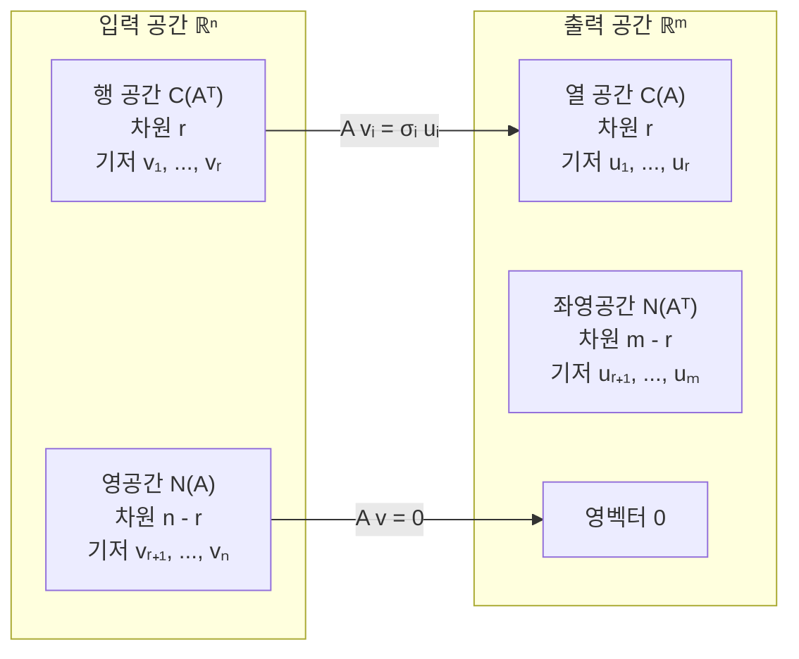

# 7장 — 특이값 분해

[레포지토리 안내](../../README.ko.md) | [English](Concepts_Lecture.md) | [한국어](Concepts_Lecture.ko.md)

> **최종 수정일:** 2026-10-18
>
> Introduction to Linear Algebra, Strang, Ch 7

> **학습 목표:**
> 1. 특이값 분해(SVD)를 유도하고 계산할 수 있다
> 2. SVD를 네 가지 기본 부분공간 관점에서 기하학적으로 해석할 수 있다
> 3. SVD를 저랭크 근사와 데이터 분석에 적용할 수 있다
> 4. 스펙트럼 노름, 프로베니우스 노름, 핵 노름을 특이값으로 표현할 수 있다

---

<br>

## 목차

- [1. SVD (특이값 분해)](#1-svd-특이값-분해)
  - [1.1 동기: 두 집합의 정규직교 벡터](#11-동기-두-집합의-정규직교-벡터)
  - [1.2 SVD에서의 네 가지 기본 부분공간](#12-svd에서의-네-가지-기본-부분공간)
  - [1.3 고유값 분해에서 SVD로](#13-고유값-분해에서-svd로)
  - [1.4 SVD 방정식](#14-svd-방정식)
  - [1.5 예제: SVD 계산](#15-예제-svd-계산)
  - [1.6 SVD의 기하학적 의미](#16-svd의-기하학적-의미)
  - [1.7 SVD의 전체 크기 형태](#17-svd의-전체-크기-형태)
  - [1.8 SVD의 증명](#18-svd의-증명)
  - [1.9 예제: 증명 방법을 이용한 SVD 계산](#19-예제-증명-방법을-이용한-svd-계산)
  - [1.10 AB와 BA: 동일한 0이 아닌 고유값](#110-ab와-ba-동일한-0이-아닌-고유값)
- [2. 선형대수를 이용한 이미지 처리](#2-선형대수를-이용한-이미지-처리)
  - [2.1 행렬로서의 이미지](#21-행렬로서의-이미지)
  - [2.2 상관된 픽셀을 이용한 이미지 압축](#22-상관된-픽셀을-이용한-이미지-압축)
  - [2.3 SVD와 랭크-1 분해를 이용한 압축](#23-svd와-랭크-1-분해를-이용한-압축)
- [3. 주성분 분석 (PCA)](#3-주성분-분석-pca)
  - [3.1 SVD를 이용한 PCA](#31-svd를-이용한-pca)
  - [3.2 저랭크 근사](#32-저랭크-근사)
  - [3.3 행렬의 노름](#33-행렬의-노름)
  - [3.4 노름의 성질과 부등식](#34-노름의-성질과-부등식)
  - [3.5 PCA 예제 (P 7.3.1)](#35-pca-예제-p-731)
  - [3.6 수직 최소제곱법](#36-수직-최소제곱법)
- [요약](#요약)
- [점검 문제](#점검-문제)

---

<br>

## 1. SVD (특이값 분해)

### 1.1 동기: 두 집합의 정규직교 벡터

SVD는 **두 집합의 정규직교 벡터**(orthonormal vectors)를 찾는 것을 포함한다:

**입력 벡터** (정의역 $`\mathbb{R}^n`$에 대해):

```math
\lbrace\underset{\sim}{v}_1, \underset{\sim}{v}_2, \dots, \underset{\sim}{v}_r, \dots, \underset{\sim}{v}_n\rbrace
```

- $`\underset{\sim}{v}_1, \underset{\sim}{v}_2, \dots, \underset{\sim}{v}_r`$은 **$`C(A^T)`$의 기저**(행 공간)를 형성한다.
- $`\underset{\sim}{v}_{r+1}, \dots, \underset{\sim}{v}_n`$은 **$`N(A)`$의 기저**(영공간)를 형성한다.

**출력 벡터** (공역 $`\mathbb{R}^m`$에 대해):

```math
\lbrace\underset{\sim}{u}_1, \underset{\sim}{u}_2, \dots, \underset{\sim}{u}_r, \dots, \underset{\sim}{u}_m\rbrace
```

- $`\underset{\sim}{u}_1, \underset{\sim}{u}_2, \dots, \underset{\sim}{u}_r`$은 **$`C(A)`$의 기저**(열 공간)를 형성한다.
- $`\underset{\sim}{u}_{r+1}, \dots, \underset{\sim}{u}_m`$은 **$`N(A^T)`$의 기저**(좌영공간)를 형성한다.

### 1.2 SVD에서의 네 가지 기본 부분공간

네 가지 기본 부분공간의 차원:

- $`\dim C(A^T) = r`$
- $`\dim C(A) = r`$
- $`\dim N(A) = n - r`$
- $`\dim N(A^T) = m - r`$

SVD는 입력 공간을 출력 공간으로 사상한다:

```math
A\underset{\sim}{v}_i = \sigma_i \underset{\sim}{u}_i
```

행렬 $`A`$는 행 공간의 각 우특이벡터(right singular vector) $`\underset{\sim}{v}_i`$를 열 공간의 스케일된 좌특이벡터(left singular vector) $`\sigma_i \underset{\sim}{u}_i`$로 사상한다. 영공간 벡터들은 영벡터로 사상된다.



*그림 1. SVD의 네 가지 기본 부분공간과 A에 의한 사상*

각 기저 벡터에 대해 풀어 쓰면:

```math
\sigma_1 \underset{\sim}{u}_1 = A\underset{\sim}{v}_1
```

```math
\sigma_2 \underset{\sim}{u}_2 = A\underset{\sim}{v}_2
```

행렬 형태로 결합하면:

```math
\begin{pmatrix} \underset{\sim}{u}_1 & \underset{\sim}{u}_2 \end{pmatrix} \begin{pmatrix} \sigma_1 & \\ & \sigma_2 \end{pmatrix} = A \begin{pmatrix} \underset{\sim}{v}_1 & \underset{\sim}{v}_2 \end{pmatrix}
```

### 1.3 고유값 분해에서 SVD로

$`r`$개의 기저 벡터만 사용하면:

```math
\begin{pmatrix} \underset{\sim}{u}_1 & \underset{\sim}{u}_2 & \cdots & \underset{\sim}{u}_r \end{pmatrix} \begin{pmatrix} \sigma_1 & & \\ & \sigma_2 & \\ & & \ddots \\ & & & \sigma_r \end{pmatrix} = A \begin{pmatrix} \underset{\sim}{v}_1 & \underset{\sim}{v}_2 & \cdots & \underset{\sim}{v}_r \end{pmatrix}
```

```math
U \Sigma = A V
```

여기서 $`\sigma_1 \geq \sigma_2 \geq \sigma_3 \geq \cdots \geq \sigma_r > 0`$은 **특이값**(singular values)이다.

차원은 다음과 같다:

```math
\underset{m \times n}{A} \underset{n \times r}{V} = \underset{m \times r}{U} \underset{r \times r}{\Sigma}
```

**6장의 고유값 분해를 상기하면:** 고유값 $`\lambda_1, \lambda_2, \dots, \lambda_n`$과 고유벡터 $`\underset{\sim}{x}_1, \underset{\sim}{x}_2, \dots, \underset{\sim}{x}_n`$을 가진 행렬에 대해:

```math
A(\underset{\sim}{x}_1 \; \underset{\sim}{x}_2 \; \cdots \; \underset{\sim}{x}_n) = (\lambda_1 \underset{\sim}{x}_1 \; \lambda_2 \underset{\sim}{x}_2 \; \cdots \; \lambda_n \underset{\sim}{x}_n) = (\underset{\sim}{x}_1 \; \underset{\sim}{x}_2 \; \cdots \; \underset{\sim}{x}_n) \begin{pmatrix} \lambda_1 & & \\ & \lambda_2 & \\ & & \ddots \\ & & & \lambda_n \end{pmatrix}
```

```math
AX = X\Lambda
```

$`A`$가 **대칭 행렬**(symmetric matrix) $`S`$이면, $`X = Q`$ (직교 행렬):

```math
SQ = Q\Lambda
```

```math
S = Q\Lambda Q^T
```

**목표:** 대칭 행렬을 넘어 **모든 행렬**로 확장하고자 한다.

```math
S\underset{\sim}{x} = \lambda\underset{\sim}{x} \quad \Longrightarrow \quad A\underset{\sim}{v} = \sigma\underset{\sim}{u}
```

### 1.4 SVD 방정식

$`AV = U\Sigma`$에서, $`V`$가 직교 행렬이므로 ($`VV^T = I`$):

```math
AV = U\Sigma
```

```math
AVV^T = U\Sigma V^T
```

```math
\boxed{A = U\Sigma V^T}
```

> **핵심:** 모든 행렬 $`A`$는 두 집합의 정규직교 벡터에 의해 대각화된다.

이를 랭크-1 행렬의 합으로 쓸 수도 있다:

```math
A = \sigma_1 \underset{\sim}{u}_1 \underset{\sim}{v}_1^T + \sigma_2 \underset{\sim}{u}_2 \underset{\sim}{v}_2^T + \cdots + \sigma_r \underset{\sim}{u}_r \underset{\sim}{v}_r^T
```

### 1.5 예제: SVD 계산

**예제.** $`A = \begin{pmatrix} 5 & 4 \\ 0 & 3 \end{pmatrix}`$으로 놓자.

$`\text{rank}(A) = 2 = \text{rank}(A^T)`$.

**단계 1:** $`C(A^T)`$에서 서로 직교하는 두 벡터를 취한다. 이 벡터들은 1.9절에서 구하는 $`A^T A`$의 고유벡터이며, 정규화는 단계 4에서 한다:

```math
\underset{\sim}{v}_1 = \begin{pmatrix} 1 \\ 1 \end{pmatrix}, \quad \underset{\sim}{v}_2 = \begin{pmatrix} -1 \\ 1 \end{pmatrix}
```

확인: $`\underset{\sim}{v}_1 \cdot \underset{\sim}{v}_2 = 1 - 1 = 0 \implies \underset{\sim}{v}_1 \perp \underset{\sim}{v}_2`$.

**단계 2:** $`A\underset{\sim}{v}_1`$과 $`A\underset{\sim}{v}_2`$를 계산한다:

```math
A\underset{\sim}{v}_1 = \begin{pmatrix} 5 & 4 \\ 0 & 3 \end{pmatrix}\begin{pmatrix} 1 \\ 1 \end{pmatrix} = \begin{pmatrix} 9 \\ 3 \end{pmatrix} = 3\begin{pmatrix} 3 \\ 1 \end{pmatrix} = 3\sqrt{10} \cdot \frac{1}{\sqrt{10}}\begin{pmatrix} 3 \\ 1 \end{pmatrix} \quad \leftarrow \underset{\sim}{u}_1
```

```math
A\underset{\sim}{v}_2 = \begin{pmatrix} 5 & 4 \\ 0 & 3 \end{pmatrix}\begin{pmatrix} -1 \\ 1 \end{pmatrix} = \begin{pmatrix} -1 \\ 3 \end{pmatrix} = \frac{\sqrt{10}}{\sqrt{10}}\begin{pmatrix} -1 \\ 3 \end{pmatrix} \quad \leftarrow \underset{\sim}{u}_2
```

**직교성 검증:**

```math
(A\underset{\sim}{v}_1) \cdot (A\underset{\sim}{v}_2) = 9 \cdot (-1) + 3 \cdot 3 = 0 \quad \checkmark
```

**단계 3:** 행렬 형태로 쓴다:

```math
A\begin{pmatrix} 1 & -1 \\ 1 & 1 \end{pmatrix} = \begin{pmatrix} 9 & -1 \\ 3 & 3 \end{pmatrix}
```

**단계 4:** 각각을 $`\sqrt{2}`$로 나누어 $`\underset{\sim}{v}_1, \underset{\sim}{v}_2`$를 정규화한다:

```math
A \cdot \frac{1}{\sqrt{2}}\begin{pmatrix} 1 & -1 \\ 1 & 1 \end{pmatrix} = \frac{1}{\sqrt{2}}\begin{pmatrix} 9 & -1 \\ 3 & 3 \end{pmatrix}
```

정규화된 벡터는:

```math
\underset{\sim}{v}_1 = \frac{1}{\sqrt{2}}\begin{pmatrix} 1 \\ 1 \end{pmatrix}, \quad \underset{\sim}{v}_2 = \frac{1}{\sqrt{2}}\begin{pmatrix} -1 \\ 1 \end{pmatrix}
```

이로부터:

```math
A \cdot \frac{1}{\sqrt{2}}\begin{pmatrix} 1 & -1 \\ 1 & 1 \end{pmatrix} = \frac{1}{\sqrt{10}}\begin{pmatrix} 3 & -1 \\ 1 & 3 \end{pmatrix} \begin{pmatrix} 3\sqrt{5} & \\ & \sqrt{5} \end{pmatrix}
```

```math
AV = U\Sigma
```

여기서 $`\sigma_1 = 3\sqrt{5}`$, $`\sigma_2 = \sqrt{5}`$.

**$`VV^T = I`$ 검증:**

```math
(\underset{\sim}{v}_1 \; \underset{\sim}{v}_2)\begin{pmatrix} \underset{\sim}{v}_1^T \\ \underset{\sim}{v}_2^T \end{pmatrix} = \underset{\sim}{v}_1\underset{\sim}{v}_1^T + \underset{\sim}{v}_2\underset{\sim}{v}_2^T
```

```math
= \frac{1}{2}\begin{pmatrix} 1 \\ 1 \end{pmatrix}(1\;1) + \frac{1}{2}\begin{pmatrix} -1 \\ 1 \end{pmatrix}(-1\;1)
```

```math
= \frac{1}{2}\begin{pmatrix} 1 & 1 \\ 1 & 1 \end{pmatrix} + \frac{1}{2}\begin{pmatrix} 1 & -1 \\ -1 & 1 \end{pmatrix} = \begin{pmatrix} 1 & 0 \\ 0 & 1 \end{pmatrix} = I \quad \checkmark
```

**최종 SVD:**

```math
\boxed{A = U\Sigma V^T}
```

```math
= \begin{pmatrix} \underset{\sim}{u}_1 & \underset{\sim}{u}_2 \end{pmatrix}\begin{pmatrix} \sigma_1 & \\ & \sigma_2 \end{pmatrix}\begin{pmatrix} \underset{\sim}{v}_1^T \\ \underset{\sim}{v}_2^T \end{pmatrix}
```

```math
= \sigma_1 \underset{\sim}{u}_1 \underset{\sim}{v}_1^T + \sigma_2 \underset{\sim}{u}_2 \underset{\sim}{v}_2^T
```

### 1.6 SVD의 기하학적 의미

$`A = U\Sigma V^T`$에 대해:

```math
\begin{pmatrix} 5 & 4 \\ 0 & 3 \end{pmatrix} = \frac{1}{\sqrt{10}}\begin{pmatrix} 3 & -1 \\ 1 & 3 \end{pmatrix}\begin{pmatrix} 3\sqrt{5} & \\ & \sqrt{5} \end{pmatrix}\frac{1}{\sqrt{2}}\begin{pmatrix} 1 & 1 \\ -1 & 1 \end{pmatrix}
```

특이값을 정규화하면:

```math
\frac{1}{\sqrt{5}}\begin{pmatrix} 5 & 4 \\ 0 & 3 \end{pmatrix} = \frac{1}{\sqrt{10}}\begin{pmatrix} 3 & -1 \\ 1 & 3 \end{pmatrix}\begin{pmatrix} 3 & \\ & 1 \end{pmatrix}\frac{1}{\sqrt{2}}\begin{pmatrix} 1 & 1 \\ -1 & 1 \end{pmatrix}
```

$`A = U\Sigma V^T`$가 벡터에 작용하는 기하학적 해석:

1. **$`V^T`$로 회전:** 각도 $`-\phi`$만큼 첫 번째 회전을 하여 입력을 표준 기저에 정렬한다.
2. **$`\Sigma`$로 신축:** 각 축 방향으로 특이값만큼 스케일링한다.
3. **$`U`$로 회전:** 각도 $`+\theta`$만큼 두 번째 회전을 하여 출력 방향으로 돌린다.

**기하학적 그림:**

- 입력 공간의 단위원은 먼저 $`V^T`$에 의해 회전하여, $`\underset{\sim}{v}_1, \underset{\sim}{v}_2`$ 방향이 좌표축에 정렬된다.
- 그런 다음 $`\Sigma`$가 이를 타원으로 신축한다 (반축 길이 $`\sigma_1`$과 $`\sigma_2`$).
- 마지막으로 $`U`$가 타원을 최종 방향으로 회전한다.


*그림 2. SVD가 단위원을 타원으로 바꾸는 세 단계*

> **주의:** 일반적으로 $`U`$와 $`V^T`$는 직교 행렬이므로, 각각 회전일 수도 있고 반사를 포함할 수도 있다(행렬식이 $`-1`$인 경우). 이 예제에서는 둘 다 행렬식이 $`1`$인 회전이다.

회전 행렬로 표현하면:

```math
A = \begin{pmatrix} \cos\theta & -\sin\theta \\ \sin\theta & \cos\theta \end{pmatrix}\begin{pmatrix} \sigma_1 & \\ & \sigma_2 \end{pmatrix}\begin{pmatrix} \cos(-\phi) & -\sin(-\phi) \\ \sin(-\phi) & \cos(-\phi) \end{pmatrix}
```

### 1.7 SVD의 전체 크기 형태

전체 크기 형태는 $`A`$와 $`A^T`$의 **영공간(nullspace)에 대한 기저 벡터**를 포함한다.

```math
V = \begin{pmatrix} \underset{\sim}{v}_1 & \underset{\sim}{v}_2 & \cdots & \underset{\sim}{v}_r & \underset{\sim}{v}_{r+1} & \cdots & \underset{\sim}{v}_n \end{pmatrix}_{n \times n}
```

```math
U = \begin{pmatrix} \underset{\sim}{u}_1 & \underset{\sim}{u}_2 & \cdots & \underset{\sim}{u}_r & \underset{\sim}{u}_{r+1} & \cdots & \underset{\sim}{u}_m \end{pmatrix}_{m \times m}
```

전체 형태 방정식:

```math
\underset{m \times n}{A} \underset{n \times n}{V} = \underset{m \times m}{U} \underset{m \times n}{\Sigma}
```

$`V`$는 정방 직교 행렬이므로: $`V^T = V^{-1}`$. 마찬가지로 $`U^T = U^{-1}`$.

영공간 벡터들은 영벡터로 사상된다:

```math
A\underset{\sim}{v}_{r+1} = \underset{\sim}{0}, \quad A\underset{\sim}{v}_{r+2} = \underset{\sim}{0}, \quad \dots, \quad A\underset{\sim}{v}_n = \underset{\sim}{0}
```

따라서 $`AV`$의 형태는:

```math
AV = A\begin{pmatrix} \underset{\sim}{v}_1 & \underset{\sim}{v}_2 & \cdots & \underset{\sim}{v}_r & \underset{\sim}{v}_{r+1} & \cdots & \underset{\sim}{v}_n \end{pmatrix} = \begin{pmatrix} \sigma_1 \underset{\sim}{u}_1 & \sigma_2 \underset{\sim}{u}_2 & \cdots & \sigma_r \underset{\sim}{u}_r & \underset{\sim}{0} & \cdots & \underset{\sim}{0} \end{pmatrix}_{m \times n}
```

```math
= \begin{pmatrix} \underset{\sim}{u}_1 & \underset{\sim}{u}_2 & \cdots & \underset{\sim}{u}_r & \underset{\sim}{u}_{r+1} & \cdots & \underset{\sim}{u}_m \end{pmatrix}_{m \times m} \begin{pmatrix} \sigma_1 & & & 0 & \cdots & 0 \\ & \sigma_2 & & 0 & \cdots & 0 \\ & & \ddots & \vdots & & \vdots \\ & & & \sigma_r & 0 & \cdots & 0 \\ 0 & 0 & \cdots & 0 & 0 & \cdots & 0 \\ \vdots & \vdots & & \vdots & \vdots & & \vdots \\ 0 & 0 & \cdots & 0 & 0 & \cdots & 0 \end{pmatrix}_{m \times n}
```

**$`\Sigma`$의 모양에 대한 두 가지 경우:**

**i) $`m < n`$ (짧고 넓은 경우):** $`\Sigma`$ 행렬은 $`m \times n`$이며 대각선에 $`\sigma_1, \dots, \sigma_r`$이 있고 나머지는 0인 넓은 직사각 행렬이다.

**ii) $`m > n`$ (얇고 긴 경우):** $`\Sigma`$ 행렬은 $`m \times n`$이며 대각선에 $`\sigma_1, \dots, \sigma_r`$이 있고 나머지는 0인, 아래에 추가 0 행이 있는 세로로 긴 직사각 행렬이다.

**전체 형태는 많은 0을 가지며**, 이들은 행렬 곱셈에 아무런 기여를 하지 않는다. 따라서 처음 $`r`$개의 벡터만 취하여 **축소 형태**(reduced form)를 얻을 수 있다:

```math
\underset{m \times n}{A} \underset{n \times r}{V_r} = \underset{m \times r}{U_r} \underset{r \times r}{\Sigma_r}
```

여기서 $`V_r`$은 $`C(A^T)`$의 기저를, $`U_r`$은 $`C(A)`$의 기저를 포함한다.

다음이 성립한다:

```math
V_r^T V_r = I_r \quad \text{and} \quad U_r^T U_r = I_r
```

**그러나** $`r < n`$, $`r < m`$이면 다음과 같다. $`V_r V_r^T`$와 $`U_r U_r^T`$는 각각 $`C(A^T)`$와 $`C(A)`$ 위로의 사영 행렬이기 때문이다:

```math
V_r V_r^T \neq I \quad \text{and} \quad U_r U_r^T \neq I
```

축소 SVD:

```math
A = U_r \Sigma_r V_r^T = \sigma_1 \underset{\sim}{u}_1 \underset{\sim}{v}_1^T + \cdots + \sigma_r \underset{\sim}{u}_r \underset{\sim}{v}_r^T
```

### 1.8 SVD의 증명

**$`U`$, $`V`$ (특이벡터)를 어떻게 찾는가?**

$`A = U\Sigma V^T`$가 주어졌다고 하자. $`U`$의 열은 **좌특이벡터**(left singular vectors)이고, $`V`$의 열은 **우특이벡터**(right singular vectors)이다:

**$`A^T A`$ 계산:**

```math
A^T A = (U\Sigma V^T)^T (U\Sigma V^T) = V\Sigma^T U^T U \Sigma V^T = V\Sigma^2 V^T
```

($`U^T U = I`$이므로)

**$`AA^T`$ 계산:**

```math
AA^T = (U\Sigma V^T)(U\Sigma V^T)^T = U\Sigma V^T V \Sigma^T U^T = U\Sigma^2 U^T
```

($`V^T V = I`$이므로)

$`A^T A`$는 대칭이므로:

```math
A^T A = Q\Lambda Q^T = V\Sigma^2 V^T
```

$`AA^T`$는 대칭이므로:

```math
AA^T = Q\Lambda Q^T = U\Sigma^2 U^T
```

따라서 $`\sigma_1^2, \sigma_2^2, \dots, \sigma_r^2`$은 **$`A^T A`$와 $`AA^T`$ 모두의 0이 아닌 고유값**이다.

- **$`A^T A`$로부터 $`V`$를 선택한다.** $`V`$의 열은 $`A^T A`$의 고유벡터이다.
- **$`AA^T`$로부터 $`U`$를 선택한다.** $`U`$의 열은 $`AA^T`$의 고유벡터이다.

**증명 단계:**

**i)** 정규직교 고유벡터 $`\underset{\sim}{v}_1, \underset{\sim}{v}_2, \dots, \underset{\sim}{v}_r`$을 선택한다:

```math
A^T A \underset{\sim}{v}_k = \lambda_k \underset{\sim}{v}_k = \sigma_k^2 \underset{\sim}{v}_k
```

```math
\therefore \sigma_k = \sqrt{\lambda_k}
```

**ii)** 우특이벡터 $`\underset{\sim}{v}_k`$는 좌특이벡터 $`\underset{\sim}{u}_k`$와 연결된다:

```math
A\underset{\sim}{v}_k = \sigma_k \underset{\sim}{u}_k
```

```math
\therefore \underset{\sim}{u}_k = \frac{1}{\sigma_k} A\underset{\sim}{v}_k \quad \forall k = 1, 2, \dots, r
```

**iii)** 건전성 검사로, $`\underset{\sim}{u}_k`$가 $`AA^T`$의 고유벡터인지 확인한다:

```math
AA^T \underset{\sim}{u}_k = AA^T \cdot \frac{1}{\sigma_k} A\underset{\sim}{v}_k = \frac{1}{\sigma_k} AA^T A \underset{\sim}{v}_k = \frac{1}{\sigma_k} A \sigma_k^2 \underset{\sim}{v}_k = \sigma_k A\underset{\sim}{v}_k = \sigma_k^2 \underset{\sim}{u}_k \quad \square
```

**iv)** $`\underset{\sim}{u}_k`$들이 정규직교인지 확인한다:

```math
\underset{\sim}{u}_j^T \underset{\sim}{u}_k = \left(\frac{1}{\sigma_j} A\underset{\sim}{v}_j\right)^T \left(\frac{1}{\sigma_k} A\underset{\sim}{v}_k\right) = \frac{1}{\sigma_j \sigma_k} \underset{\sim}{v}_j^T A^T A \underset{\sim}{v}_k = \frac{\sigma_k}{\sigma_j} \underset{\sim}{v}_j^T \underset{\sim}{v}_k = \begin{cases} 1 & j = k \\ 0 & j \neq k \end{cases}
```

### 1.9 예제: 증명 방법을 이용한 SVD 계산

**예제.** $`A = \begin{pmatrix} 5 & 4 \\ 0 & 3 \end{pmatrix}`$에 대해 $`U, \Sigma, V`$를 구하라.

$`\text{rank}(A) = 2`$이므로 특이값은 $`\sigma_1, \sigma_2`$ 두 개이다.

**i) $`A^T A`$를 계산하고 고유값을 구한다:**

```math
A^T A = \begin{pmatrix} 5 & 0 \\ 4 & 3 \end{pmatrix}\begin{pmatrix} 5 & 4 \\ 0 & 3 \end{pmatrix} = \begin{pmatrix} 25 & 20 \\ 20 & 25 \end{pmatrix}
```

특성 방정식:

```math
\lambda^2 - 50\lambda + 225 = 0
```

```math
(\lambda - 45)(\lambda - 5) = 0 \implies \lambda_1 = 45, \; \lambda_2 = 5
```

```math
\therefore \sigma_1 = \sqrt{45} = 3\sqrt{5}, \quad \sigma_2 = \sqrt{5}
```

**$`A^T A`$의 고유벡터를 구한다:**

$`\lambda_1 = 45`$일 때:

```math
(A^T A - \lambda_1 I)\underset{\sim}{x}_1 = \begin{pmatrix} -20 & 20 \\ 20 & -20 \end{pmatrix}\begin{pmatrix} x_1 \\ x_2 \end{pmatrix} = \begin{pmatrix} 0 \\ 0 \end{pmatrix} \implies \underset{\sim}{x}_1 = \begin{pmatrix} 1 \\ 1 \end{pmatrix}
```

$`\lambda_2 = 5`$일 때:

```math
(A^T A - \lambda_2 I)\underset{\sim}{x}_2 = \begin{pmatrix} 20 & 20 \\ 20 & 20 \end{pmatrix}\begin{pmatrix} x_1 \\ x_2 \end{pmatrix} = \begin{pmatrix} 0 \\ 0 \end{pmatrix} \implies \underset{\sim}{x}_2 = \begin{pmatrix} -1 \\ 1 \end{pmatrix}
```

정규화하여 $`V`$를 얻는다:

```math
V = \frac{1}{\sqrt{2}}\begin{pmatrix} 1 & -1 \\ 1 & 1 \end{pmatrix}
```

**ii) $`A\underset{\sim}{v}_k = \sigma_k \underset{\sim}{u}_k`$로부터 $`U`$를 계산한다:**

```math
\underset{\sim}{u}_1 = \frac{1}{\sigma_1} A\underset{\sim}{v}_1 = \frac{1}{3\sqrt{5}}\begin{pmatrix} 5 & 4 \\ 0 & 3 \end{pmatrix}\frac{1}{\sqrt{2}}\begin{pmatrix} 1 \\ 1 \end{pmatrix} = \frac{1}{3\sqrt{10}}\begin{pmatrix} 9 \\ 3 \end{pmatrix} = \frac{1}{\sqrt{10}}\begin{pmatrix} 3 \\ 1 \end{pmatrix}
```

```math
\underset{\sim}{u}_2 = \frac{1}{\sigma_2} A\underset{\sim}{v}_2 = \frac{1}{\sqrt{5}}\begin{pmatrix} 5 & 4 \\ 0 & 3 \end{pmatrix}\frac{1}{\sqrt{2}}\begin{pmatrix} -1 \\ 1 \end{pmatrix} = \frac{1}{\sqrt{10}}\begin{pmatrix} -1 \\ 3 \end{pmatrix}
```

```math
U = \begin{pmatrix} \underset{\sim}{u}_1 & \underset{\sim}{u}_2 \end{pmatrix} = \frac{1}{\sqrt{10}}\begin{pmatrix} 3 & -1 \\ 1 & 3 \end{pmatrix}
```

### 1.10 AB와 BA: 동일한 0이 아닌 고유값

$`A_{m \times n}`$과 $`B_{n \times m}`$에 대해:

```math
AB_{m \times m} \neq BA_{n \times n}
```

**그러나 $`AB`$와 $`BA`$는 동일한 0이 아닌 고유값을 가진다.**

**증명:** $`\lambda \neq 0`$을 $`AB`$의 고유값, $`\underset{\sim}{x}`$를 대응하는 고유벡터라 하자:

```math
AB\underset{\sim}{x} = \lambda\underset{\sim}{x}
```

```math
B(AB\underset{\sim}{x}) = B(\lambda\underset{\sim}{x}) = \lambda(B\underset{\sim}{x})
```

```math
BA(B\underset{\sim}{x}) = \lambda(B\underset{\sim}{x})
```

$`\lambda \neq 0`$이므로 $`A(B\underset{\sim}{x}) = \lambda\underset{\sim}{x} \neq \underset{\sim}{0}`$이고, 따라서 $`B\underset{\sim}{x} \neq \underset{\sim}{0}`$이다. 그러므로 $`\lambda`$는 $`BA`$의 고유값이고, $`B\underset{\sim}{x}`$는 대응하는 고유벡터이다.

$`AB`$와 $`BA`$는 0이 아닌 고유값 $`\lambda`$를 공유한다. 두 행렬의 크기가 다르면 고유값 0의 개수는 다를 수 있다. $`B = A^T`$로 두면 $`A^T A`$와 $`AA^T`$가 0이 아닌 고유값 $`\sigma_i^2`$을 공유한다는 1.8절의 결과가 이 성질의 특수한 경우임을 알 수 있다.

---

<br>

## 2. 선형대수를 이용한 이미지 처리

### 2.1 행렬로서의 이미지

이미지는 **회색조 값의 큰 행렬**이다.

- 각 픽셀은 하나의 값을 가진다. 예: **8비트** ($`0`$에서 $`255`$까지의 값).
- 행렬 원소는 각 픽셀 위치에서의 밝기를 나타낸다.

### 2.2 상관된 픽셀을 이용한 이미지 압축

**인접 픽셀이 서로 상관**되어 있으면 이미지를 **압축**할 수 있다.

**예제: 프랑스 국기.**

프랑스 국기 이미지 (파랑, 흰색, 빨강 세로 줄무늬)는 행렬로 표현할 수 있다:

```math
\begin{pmatrix} b & b & w & w & r & r \\ b & b & w & w & r & r \\ b & b & w & w & r & r \\ b & b & w & w & r & r \\ b & b & w & w & r & r \\ b & b & w & w & r & r \end{pmatrix} = \begin{pmatrix} 1 \\ 1 \\ 1 \\ 1 \\ 1 \\ 1 \end{pmatrix} \begin{pmatrix} b & b & w & w & r & r \end{pmatrix}
```

이것은 **랭크 1 행렬**이다.

저장 공간 절감: $`N^2`$개의 원소를 $`2N`$개의 원소로 대체 (하나의 열 벡터 + 하나의 행 벡터).

**질문.** 한국 국기(태극기)는 어떠한가? 태극기 이미지는 랭크가 훨씬 높아서 구조가 더 복잡하고 압축이 어렵다.

### 2.3 SVD와 랭크-1 분해를 이용한 압축

**대각선에 놓인 특이값:**

```math
A = U\Sigma V^T
```

```math
= \begin{pmatrix} \underset{\sim}{u}_1 & \underset{\sim}{u}_2 & \cdots & \underset{\sim}{u}_r \end{pmatrix}\begin{pmatrix} \sigma_1 & & \\ & \sigma_2 & \\ & & \ddots \\ & & & \sigma_r \end{pmatrix}\begin{pmatrix} \underset{\sim}{v}_1^T \\ \underset{\sim}{v}_2^T \\ \vdots \\ \underset{\sim}{v}_r^T \end{pmatrix}
```

```math
= \begin{pmatrix} \underset{\sim}{u}_1 & \underset{\sim}{u}_2 & \cdots & \underset{\sim}{u}_r \end{pmatrix}\begin{pmatrix} \sigma_1 \underset{\sim}{v}_1^T \\ \sigma_2 \underset{\sim}{v}_2^T \\ \vdots \\ \sigma_r \underset{\sim}{v}_r^T \end{pmatrix}
```

```math
= \sigma_1 \underset{\sim}{u}_1 \underset{\sim}{v}_1^T + \sigma_2 \underset{\sim}{u}_2 \underset{\sim}{v}_2^T + \cdots + \sigma_r \underset{\sim}{u}_r \underset{\sim}{v}_r^T
```

이것은 **랭크-1 행렬의 합**이다.

**압축 원리:** 압축할 때 **작은 $`\sigma`$는 버려도** **이미지 품질에 심각한 손실이 없다**.

```math
A = U\Sigma V^T
```

```math
= \begin{pmatrix} \underset{\sim}{u}_1 & \underset{\sim}{u}_2 & \cdots & \underset{\sim}{u}_r \end{pmatrix}\begin{pmatrix} \sigma_1 & & \\ & \sigma_2 & \\ & & \ddots \\ & & & \sigma_r \end{pmatrix}\begin{pmatrix} \underset{\sim}{v}_1^T \\ \underset{\sim}{v}_2^T \\ \vdots \\ \underset{\sim}{v}_r^T \end{pmatrix}
```

```math
\approx \begin{pmatrix} \underset{\sim}{u}_1 & \underset{\sim}{u}_2 \end{pmatrix}\begin{pmatrix} \sigma_1 & \\ & \sigma_2 \end{pmatrix}\begin{pmatrix} \underset{\sim}{v}_1^T \\ \underset{\sim}{v}_2^T \end{pmatrix} = \sigma_1 \underset{\sim}{u}_1 \underset{\sim}{v}_1^T + \sigma_2 \underset{\sim}{u}_2 \underset{\sim}{v}_2^T
```

> **참고:** **예시.** SVD를 이용한 이미지 압축의 대화형 데모는 "timbaumann SVD"를 검색하면 볼 수 있다.

---

<br>

## 3. 주성분 분석 (PCA)

### 3.1 SVD를 이용한 PCA

```math
A = U\Sigma V^T
```

**PCA**는 데이터 행렬에서 정보를 이해하기 위해 처음 $`\underset{\sim}{u}`$와 $`\underset{\sim}{v}`$에 연결된 **가장 큰 $`\sigma`$** 를 사용한다.

### 3.2 저랭크 근사

가장 중요한 부분 $`A_k`$를 추출한다:

```math
A_k = \sigma_1 \underset{\sim}{u}_1 \underset{\sim}{v}_1^T + \sigma_2 \underset{\sim}{u}_2 \underset{\sim}{v}_2^T + \cdots + \sigma_k \underset{\sim}{u}_k \underset{\sim}{v}_k^T
```

```math
\text{rank}(A_k) = k
```

```math
A \approx A_k
```

- $`A_k`$는 데이터에서 **가장 큰 분산**(variance)을 포착한다.
- $`A_k`$는 $`A`$에 **가장 가까운 랭크-$`k`$ 행렬**이다.
- 랭크가 $`k`$ 이하인 임의의 행렬 $`B`$에 대해 다음이 성립한다(Eckart-Young 정리). 노름은 3.3절의 세 노름 중 어느 것이어도 된다:

```math
\|A - A_k\| \leq \|A - B\|
```

### 3.3 행렬의 노름

**세 가지 행렬 노름:**

**i) 스펙트럼 노름 (2-노름, spectral norm):**

```math
\|A\|_2 = \max_{\underset{\sim}{x}} \frac{\|A\underset{\sim}{x}\|}{\|\underset{\sim}{x}\|} = \sigma_1
```

**ii) 프로베니우스 노름 (Frobenius norm):**

```math
\|A\|_F = \sqrt{\sigma_1^2 + \sigma_2^2 + \cdots + \sigma_r^2}
```

**iii) 핵 노름 (nuclear norm, 트레이스 노름):**

```math
\|A\|_N = \sigma_1 + \sigma_2 + \cdots + \sigma_r
```

**항등 행렬 예제** $`I \in \mathbb{R}^{n \times n}`$:

```math
\|I\|_2 = \max \frac{\|I\underset{\sim}{x}\|}{\|\underset{\sim}{x}\|} = \max \frac{\|\underset{\sim}{x}\|}{\|\underset{\sim}{x}\|} = 1
```

```math
\|I\|_F = \sqrt{1 + 1 + \cdots + 1} = \sqrt{n}
```

```math
\|I\|_N = 1 + 1 + \cdots + 1 = n
```

**SVD를 이용한 예제:**

$`A = U\Sigma V^T`$에 대해 다음이 성립한다. 노름은 일반적으로 $`\|AB\|_2 \leq \|A\|_2 \|B\|_2`$만 만족하지만, 여기서는 아래와 같이 직교 행렬이 길이를 보존하므로 등호가 성립한다:

```math
\|A\|_2 = \|U\|_2 \|\Sigma\|_2 \|V^T\|_2
```

$`U, V`$는 직교 행렬이므로 곱해도 $`\underset{\sim}{x}`$의 크기는 **변하지 않는다**:

```math
\|U\|_2 = \max \frac{\|U\underset{\sim}{x}\|}{\|\underset{\sim}{x}\|} = 1
```

```math
\|V^T\|_2 = 1
```

따라서:

```math
\|A\|_2 = \|\Sigma\|_2 = \sigma_1
```

### 3.4 노름의 성질과 부등식

**벡터 노름에서 행렬 노름으로의 확장:**

벡터 $`\underset{\sim}{v}`$의 길이:

```math
\|\underset{\sim}{v}\|^2 = v_1^2 + v_2^2 + \cdots + v_n^2
```

이 아이디어를 행렬로 확장:

```math
\|A\|_F^2 = a_{11}^2 + a_{12}^2 + \cdots + a_{1n}^2 + \cdots + a_{mn}^2 \quad \text{(프로베니우스 노름)}
```

**기본 성질:**

- $`\|\underset{\sim}{v}\| \geq 0`$이고 $`\|c\underset{\sim}{v}\| = |c| \|\underset{\sim}{v}\|`$이다.
- $`\|A\|_F \geq 0`$이고 $`\|cA\|_F = |c| \|A\|_F`$이다.

**슈바르츠 부등식 (Schwarz inequality)과 그로부터 얻는 행렬 부등식:**

```math
|\underset{\sim}{v}^T \underset{\sim}{w}| \leq \|\underset{\sim}{v}\| \|\underset{\sim}{w}\|
```

```math
\|AB\|_F \leq \|A\|_F \|B\|_F
```

**삼각 부등식 (Triangle inequality):**

```math
\|\underset{\sim}{v} + \underset{\sim}{w}\| \leq \|\underset{\sim}{v}\| + \|\underset{\sim}{w}\|
```

```math
\|A + B\|_F \leq \|A\|_F + \|B\|_F
```

### 3.5 PCA 예제 (P 7.3.1)

$`A_0`$는 **5개 샘플**에 대한 **2개 측정값**을 담고 있다:

```math
A_0 = \begin{pmatrix} 5 & 4 & 3 & 2 & 1 \\ -1 & 1 & 0 & 1 & -1 \end{pmatrix}
```

**i) 각 행의 평균을 구하고 빼서 중심화된 $`A`$를 만든다.**

```math
\text{행 1 평균} = \frac{1}{5}(5 + 4 + 3 + 2 + 1) = 3
```

```math
\text{행 2 평균} = \frac{1}{5}(-1 + 1 + 0 + 1 + (-1)) = 0
```

```math
A = A_0 - \begin{pmatrix} 3 \\ 0 \end{pmatrix}(1\;1\;1\;1\;1) = \begin{pmatrix} 2 & 1 & 0 & -1 & -2 \\ -1 & 1 & 0 & 1 & -1 \end{pmatrix}
```

**ii) 표본 공분산 행렬(sample covariance matrix)을 계산한다.**

```math
S = \frac{AA^T}{n - 1}
```

```math
AA^T = \begin{pmatrix} 2 & 1 & 0 & -1 & -2 \\ -1 & 1 & 0 & 1 & -1 \end{pmatrix}\begin{pmatrix} 2 & -1 \\ 1 & 1 \\ 0 & 0 \\ -1 & 1 \\ -2 & -1 \end{pmatrix} = \begin{pmatrix} 10 & 0 \\ 0 & 4 \end{pmatrix}
```

```math
S = \frac{1}{4}AA^T = \frac{1}{4}\begin{pmatrix} 10 & 0 \\ 0 & 4 \end{pmatrix} =: S
```

**iii) $`S`$의 고유값을 구한다.**

```math
\lambda_1 = \frac{5}{2}, \quad \lambda_2 = 1
```

```math
(S - \lambda I)\underset{\sim}{x}_1 = \begin{pmatrix} \frac{5}{2} - \lambda & 0 \\ 0 & 1 - \lambda \end{pmatrix}\begin{pmatrix} x_1 \\ x_2 \end{pmatrix} = \begin{pmatrix} 0 \\ 0 \end{pmatrix}
```

$`\lambda_1 = \frac{5}{2}`$일 때:

```math
\begin{pmatrix} 0 & 0 \\ 0 & -\frac{3}{2} \end{pmatrix}\begin{pmatrix} x_1 \\ x_2 \end{pmatrix} = \begin{pmatrix} 0 \\ 0 \end{pmatrix}
```

```math
\therefore \underset{\sim}{x}_1 = \begin{pmatrix} 1 \\ 0 \end{pmatrix}
```

**iv) 원점을 지나면서 $`A`$의 열에 있는 5개 샘플에 가장 가까운 직선은 무엇인가?**

중심화된 데이터 행렬:

```math
A = \begin{pmatrix} 2 & 1 & 0 & -1 & -2 \\ -1 & 1 & 0 & 1 & -1 \end{pmatrix}
```

5개 데이터 점 $`(2, -1)`$, $`(1, 1)`$, $`(0, 0)`$, $`(-1, 1)`$, $`(-2, -1)`$을 $`xy`$-평면에 그리면:

```text
                y
                ^
y =  1       *  |  *
y =  0  --+--+--*--+--+--> x
y = -1    *     |     *
         -2 -1  0  1  2
```

*그림 3. 중심화된 5개 데이터 점과 원점을 지나는 가장 가까운 직선인 x축*

**$`x`$축이 5개 점에 가장 가까운 직선이다.** 각 점에서 $`x`$축까지의 수선 거리 제곱합은 $`1 + 1 + 0 + 1 + 1 = 4`$이고, $`y`$축까지의 제곱합은 $`4 + 1 + 0 + 1 + 4 = 10`$이다.

첫 번째 특이벡터 $`\begin{pmatrix} 1 \\ 0 \end{pmatrix}`$은 데이터에서 **가장 큰 변동성**(variability)을 설명하는 방향을 나타낸다.

### 3.6 수직 최소제곱법

4장에서 다룬 $`A\underset{\sim}{x} = \underset{\sim}{b}`$의 **최소제곱 해**(least squares solution) $`\underset{\sim}{\hat{x}}`$은 $`\|A\underset{\sim}{\hat{x}} - \underset{\sim}{b}\|^2`$을 최소화하며, 오차는 다음과 같이 정의된다:

```math
\underset{\sim}{e} = A\underset{\sim}{\hat{x}} - \underset{\sim}{b}
```

직선 적합에서 각 오차는 데이터 점에서 적합된 직선까지의 **세로 거리**(vertical distance)이다.

이에 비해, **수직 최소제곱법**(perpendicular least squares)은 데이터 점에서 직선까지의 **수선 거리**(perpendicular distances)를 측정한다.

데이터 점에서 $`\underset{\sim}{u}_1`$ 방향의 직선까지의 **수선 거리의 제곱합**이 **최소**가 된다. 여기서 $`\underset{\sim}{u}_1`$은 중심화된 데이터 행렬 $`A`$의 첫 번째 좌특이벡터이다.

---

<br>

## 요약

| 개념 | 핵심 요약 |
|:-----|:-----|
| SVD 분해 | $`A = U\Sigma V^T`$이며, $`U, V`$는 열이 정규직교인 행렬이고 $`\Sigma`$는 특이값 $`\sigma_1 \geq \sigma_2 \geq \cdots \geq \sigma_r > 0`$을 대각에 갖는 행렬이다. |
| 두 집합의 벡터 | 입력 벡터 $`\lbrace\underset{\sim}{v}_i\rbrace`$는 $`C(A^T)`$와 $`N(A)`$의 기저를, 출력 벡터 $`\lbrace\underset{\sim}{u}_i\rbrace`$는 $`C(A)`$와 $`N(A^T)`$의 기저를 이룬다. |
| SVD와 고유값 분해 | 고유값 분해 $`S = Q\Lambda Q^T`$는 대칭 행렬에 적용되고, SVD $`A = U\Sigma V^T`$는 **모든** 행렬에 적용된다. |
| 기본 관계식 | $`A\underset{\sim}{v}_i = \sigma_i \underset{\sim}{u}_i`$는 우특이벡터를 스케일된 좌특이벡터로 사상한다. |
| SVD의 기하학 | $`A = U\Sigma V^T`$는 $`V^T`$로 회전하고 $`\Sigma`$로 신축한 뒤 $`U`$로 회전하여 단위원을 타원으로 바꾼다. |
| 전체 SVD와 축소 SVD | 전체 형태는 $`A_{m \times n} V_{n \times n} = U_{m \times m} \Sigma_{m \times n}`$이고, 축소 형태는 $`r`$개 벡터만 남긴 $`A V_r = U_r \Sigma_r`$이다. |
| 랭크-1 분해 | $`A = \sigma_1 \underset{\sim}{u}_1 \underset{\sim}{v}_1^T + \sigma_2 \underset{\sim}{u}_2 \underset{\sim}{v}_2^T + \cdots + \sigma_r \underset{\sim}{u}_r \underset{\sim}{v}_r^T`$는 $`A`$를 랭크-1 행렬의 합으로 나타낸다. |
| 특이벡터 구하기 | $`V`$는 $`A^T A`$의 고유벡터에서, $`U`$는 $`AA^T`$의 고유벡터에서 얻으며, $`\sigma_k = \sqrt{\lambda_k}`$이고 $`\underset{\sim}{u}_k = \frac{1}{\sigma_k} A\underset{\sim}{v}_k`$이다. |
| $`A^T A`$와 $`AA^T`$ | $`A^T A = V\Sigma^2 V^T`$, $`AA^T = U\Sigma^2 U^T`$이며, 두 행렬은 0이 아닌 고유값 $`\sigma_1^2, \dots, \sigma_r^2`$을 공유한다. |
| AB와 BA의 고유값 | $`AB`$와 $`BA`$는 크기가 달라도 0이 아닌 고유값이 같다. |
| 행렬로서의 이미지 | 이미지는 회색조 값의 큰 행렬이며, 8비트 이미지의 원소는 0~255 범위의 값이다. |
| 이미지 압축 | 작은 특이값 $`\sigma_i`$를 버리면 품질 손실을 최소로 하며 압축할 수 있고, 국기처럼 랭크가 1인 이미지는 저장 공간을 $`N^2`$에서 $`2N`$으로 줄인다. |
| PCA | 가장 큰 $`\sigma`$들을 사용하여 데이터에서 가장 중요한 정보를 추출한다. |
| 저랭크 근사 | 상위 $`k`$개 특이값을 남긴 $`A_k`$는 $`A`$에 가장 가까운 랭크-$`k`$ 행렬이며, 랭크가 $`k`$ 이하인 임의의 $`B`$에 대해 $`\Vert A - A_k\Vert \leq \Vert A - B\Vert`$이다. |
| 스펙트럼 노름 | $`\Vert A\Vert_2 = \sigma_1`$로, 가장 큰 특이값과 같다. |
| 프로베니우스 노름 | $`\Vert A\Vert_F = \sqrt{\sigma_1^2 + \sigma_2^2 + \cdots + \sigma_r^2}`$이며, 모든 원소의 제곱합의 제곱근과 같다. |
| 핵 노름 | $`\Vert A\Vert_N = \sigma_1 + \sigma_2 + \cdots + \sigma_r`$로, 특이값의 합이며 트레이스 노름이라고도 한다. |
| 표본 공분산 | 중심화된 데이터 행렬 $`A`$에 대해 $`S = \frac{AA^T}{n-1}`$이다. |
| 첫 번째 특이벡터 | 데이터에서 가장 큰 변동성을 설명하는 방향을 나타낸다. |
| 수직 최소제곱법 | PCA는 데이터 점에서 $`\underset{\sim}{u}_1`$ 직선까지의 세로 거리가 아니라 수선 거리의 제곱합을 최소화한다. |

---

<br>

## 점검 문제

1. **특이값과 고유값:** $`A = \begin{pmatrix} 3 & 0 \\ 0 & -2 \end{pmatrix}`$의 고유값과 특이값을 구하고, SVD $`A = U\Sigma V^T`$를 하나 쓰라.

   <details>
   <summary>정답</summary>

   고유값은 대각 원소인 $`3`$과 $`-2`$이다. $`A^T A = \begin{pmatrix} 9 & 0 \\ 0 & 4 \end{pmatrix}`$의 고유값이 $`9, 4`$이므로 특이값은 $`\sigma_1 = 3`$, $`\sigma_2 = 2`$이다. 특이값은 항상 음이 아니므로 음의 부호는 $`U`$나 $`V`$로 옮긴다. 예를 들어 $`U = \begin{pmatrix} 1 & 0 \\ 0 & -1 \end{pmatrix}`$, $`\Sigma = \begin{pmatrix} 3 & 0 \\ 0 & 2 \end{pmatrix}`$, $`V = I`$로 두면 $`U\Sigma V^T = A`$이다.

   </details>

2. **노름 계산:** 특이값이 $`\sigma_1 = 4`$, $`\sigma_2 = 3`$인 행렬 $`A`$의 스펙트럼 노름, 프로베니우스 노름, 핵 노름을 구하라.

   <details>
   <summary>정답</summary>

   $`\|A\|_2 = \sigma_1 = 4`$, $`\|A\|_F = \sqrt{4^2 + 3^2} = 5`$, $`\|A\|_N = 4 + 3 = 7`$이다.

   </details>

3. **최적 저랭크 근사:** 특이값이 $`5, 2, 1`$인 행렬 $`A`$의 최적 랭크-1 근사 $`A_1`$을 SVD로 쓰고, $`\|A - A_1\|_2`$와 $`\|A - A_1\|_F`$를 구하라.

   <details>
   <summary>정답</summary>

   $`A_1 = 5\underset{\sim}{u}_1\underset{\sim}{v}_1^T`$이다. $`A - A_1 = 2\underset{\sim}{u}_2\underset{\sim}{v}_2^T + 1\underset{\sim}{u}_3\underset{\sim}{v}_3^T`$의 특이값은 $`2, 1`$이므로 $`\|A - A_1\|_2 = 2`$, $`\|A - A_1\|_F = \sqrt{2^2 + 1^2} = \sqrt{5}`$이다. Eckart-Young 정리에 의해 랭크가 1 이하인 어떤 행렬도 이보다 작은 오차를 낼 수 없다.

   </details>

4. **AB와 BA의 고유값:** $`A`$가 $`2 \times 3`$, $`B`$가 $`3 \times 2`$ 행렬이고 $`AB`$의 고유값이 $`2`$와 $`5`$일 때, $`BA`$의 고유값을 모두 구하라.

   <details>
   <summary>정답</summary>

   $`AB`$와 $`BA`$는 0이 아닌 고유값이 같으므로 $`BA`$도 $`2`$와 $`5`$를 고유값으로 갖는다. $`BA`$는 $`3 \times 3`$이지만 랭크가 2 이하이므로 나머지 고유값은 $`0`$이다. 따라서 $`BA`$의 고유값은 $`2, 5, 0`$이다. 대각합으로 확인하면 $`\text{tr}(BA) = \text{tr}(AB) = 7 = 2 + 5 + 0`$이다.

   </details>

5. **축소 SVD:** 축소 SVD에서 $`V_r^T V_r = I_r`$은 항상 성립하지만 $`V_r V_r^T = I`$는 일반적으로 성립하지 않는 이유를 설명하라.

   <details>
   <summary>정답</summary>

   $`V_r`$의 열 $`r`$개는 정규직교이므로 $`V_r^T V_r = I_r`$이다. 반면 $`V_r V_r^T`$는 $`n \times n`$ 행렬로서 $`C(A^T)`$ 위로의 사영 행렬이며, $`N(A)`$의 벡터를 $`\underset{\sim}{0}`$으로 보낸다. 따라서 $`V_r V_r^T = I`$는 $`r = n`$, 즉 $`N(A) = \lbrace\underset{\sim}{0}\rbrace`$일 때만 성립한다.

   </details>
