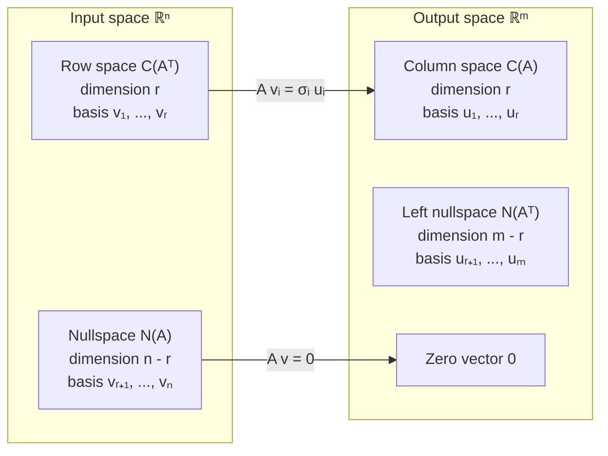

# Chapter 7 — Singular Value Decomposition

[Repository Guide](../../README.md) | [English](Concepts_Lecture.md) | [한국어](Concepts_Lecture.ko.md)

> **Last Updated:** 2026-10-19
>
> Introduction to Linear Algebra, Strang, Ch 7

> **Learning Objectives:**
> 1. Derive and compute the Singular Value Decomposition (SVD)
> 2. Interpret SVD geometrically in terms of the four fundamental subspaces
> 3. Apply SVD to low-rank approximation and data analysis
> 4. Express the spectral, Frobenius, and nuclear norms in terms of singular values

---

<br>

## Table of Contents

- [1. SVD (Singular Value Decomposition)](#1-svd-singular-value-decomposition)
  - [1.1 Motivation: Two Sets of Orthonormal Vectors](#11-motivation-two-sets-of-orthonormal-vectors)
  - [1.2 The Four Fundamental Subspaces in SVD](#12-the-four-fundamental-subspaces-in-svd)
  - [1.3 From Eigendecomposition to SVD](#13-from-eigendecomposition-to-svd)
  - [1.4 The SVD Equation](#14-the-svd-equation)
  - [1.5 Example: Computing SVD](#15-example-computing-svd)
  - [1.6 The Geometry of SVD](#16-the-geometry-of-svd)
  - [1.7 Full Size Form of SVD](#17-full-size-form-of-svd)
  - [1.8 Proof of the SVD](#18-proof-of-the-svd)
  - [1.9 Example: Computing SVD via the Proof Method](#19-example-computing-svd-via-the-proof-method)
  - [1.10 AB and BA: Equal Nonzero Eigenvalues](#110-ab-and-ba-equal-nonzero-eigenvalues)
- [2. Image Processing by Linear Algebra](#2-image-processing-by-linear-algebra)
  - [2.1 Images as Matrices](#21-images-as-matrices)
  - [2.2 Image Compression via Correlated Pixels](#22-image-compression-via-correlated-pixels)
  - [2.3 SVD and Rank-1 Decomposition for Compression](#23-svd-and-rank-1-decomposition-for-compression)
- [3. Principal Component Analysis (PCA)](#3-principal-component-analysis-pca)
  - [3.1 PCA by SVD](#31-pca-by-svd)
  - [3.2 Low-Rank Approximation](#32-low-rank-approximation)
  - [3.3 Norm of a Matrix](#33-norm-of-a-matrix)
  - [3.4 Norm Properties and Inequalities](#34-norm-properties-and-inequalities)
  - [3.5 PCA Example (Textbook Problem 7.3.1)](#35-pca-example-textbook-problem-731)
  - [3.6 Perpendicular Least Squares](#36-perpendicular-least-squares)
- [Summary](#summary)
- [Self-Check Questions](#self-check-questions)

---

<br>

## 1. SVD (Singular Value Decomposition)

### 1.1 Motivation: Two Sets of Orthonormal Vectors

The SVD involves finding **two sets of orthonormal vectors**:

**Input vectors** (for the domain, $`\mathbb{R}^n`$):

```math
\lbrace\mathbf{v}_1, \mathbf{v}_2, \dots, \mathbf{v}_r, \dots, \mathbf{v}_n\rbrace
```

- $`\mathbf{v}_1, \mathbf{v}_2, \dots, \mathbf{v}_r`$ form a **basis for $`C(A^T)`$** (row space).
- $`\mathbf{v}_{r+1}, \dots, \mathbf{v}_n`$ form a **basis for $`N(A)`$** (nullspace).

**Output vectors** (for the codomain, $`\mathbb{R}^m`$):

```math
\lbrace\mathbf{u}_1, \mathbf{u}_2, \dots, \mathbf{u}_r, \dots, \mathbf{u}_m\rbrace
```

- $`\mathbf{u}_1, \mathbf{u}_2, \dots, \mathbf{u}_r`$ form a **basis for $`C(A)`$** (column space).
- $`\mathbf{u}_{r+1}, \dots, \mathbf{u}_m`$ form a **basis for $`N(A^T)`$** (left nullspace).

### 1.2 The Four Fundamental Subspaces in SVD

The dimensions of the four fundamental subspaces:

- $`\dim C(A^T) = r`$
- $`\dim C(A) = r`$
- $`\dim N(A) = n - r`$
- $`\dim N(A^T) = m - r`$

The SVD maps the input space to the output space:

```math
A\mathbf{v}_i = \sigma_i \mathbf{u}_i
```

The matrix $`A`$ maps each right singular vector $`\mathbf{v}_i`$ in the row space to a scaled left singular vector $`\sigma_i \mathbf{u}_i`$ in the column space. The nullspace vectors are mapped to zero.



*Figure 1. The four fundamental subspaces in the SVD and the mapping by A*

Writing this out for the first two basis vectors:

```math
\sigma_1 \mathbf{u}_1 = A\mathbf{v}_1
```

```math
\sigma_2 \mathbf{u}_2 = A\mathbf{v}_2
```

Combining into matrix form:

```math
\begin{pmatrix} \mathbf{u}_1 & \mathbf{u}_2 \end{pmatrix} \begin{pmatrix} \sigma_1 & \\ & \sigma_2 \end{pmatrix} = A \begin{pmatrix} \mathbf{v}_1 & \mathbf{v}_2 \end{pmatrix}
```

### 1.3 From Eigendecomposition to SVD

Using only $`r`$ basis vectors:

```math
\begin{pmatrix} \mathbf{u}_1 & \mathbf{u}_2 & \cdots & \mathbf{u}_r \end{pmatrix} \begin{pmatrix} \sigma_1 & & \\ & \sigma_2 & \\ & & \ddots \\ & & & \sigma_r \end{pmatrix} = A \begin{pmatrix} \mathbf{v}_1 & \mathbf{v}_2 & \cdots & \mathbf{v}_r \end{pmatrix}
```

```math
U \Sigma = A V
```

where $`\sigma_1 \geq \sigma_2 \geq \sigma_3 \geq \cdots \geq \sigma_r > 0`$ are the **singular values**.

The dimensions are:

```math
\underset{m \times n}{A} \underset{n \times r}{V} = \underset{m \times r}{U} \underset{r \times r}{\Sigma}
```

**Recall** the eigendecomposition from Chapter 6: for a matrix with eigenvalues $`\lambda_1, \lambda_2, \dots, \lambda_n`$ and eigenvectors $`\mathbf{x}_1, \mathbf{x}_2, \dots, \mathbf{x}_n`$:

```math
A(\mathbf{x}_1 \; \mathbf{x}_2 \; \cdots \; \mathbf{x}_n) = (\lambda_1 \mathbf{x}_1 \; \lambda_2 \mathbf{x}_2 \; \cdots \; \lambda_n \mathbf{x}_n) = (\mathbf{x}_1 \; \mathbf{x}_2 \; \cdots \; \mathbf{x}_n) \begin{pmatrix} \lambda_1 & & \\ & \lambda_2 & \\ & & \ddots \\ & & & \lambda_n \end{pmatrix}
```

```math
AX = X\Lambda
```

If $`A`$ is a **symmetric matrix** $`S`$, then $`X = Q`$ (orthogonal matrix):

```math
SQ = Q\Lambda
```

```math
S = Q\Lambda Q^T
```

**Goal:** We want to go beyond symmetric matrices to **all matrices**.

```math
S\mathbf{x} = \lambda\mathbf{x} \quad \Longrightarrow \quad A\mathbf{v} = \sigma\mathbf{u}
```

### 1.4 The SVD Equation

From $`AV = U\Sigma`$, when $`V`$ is square orthogonal ($`r = n`$), $`VV^T = I`$ gives the following. When $`r < n`$, the full size form in Section 1.7 gives the same result:

```math
AV = U\Sigma
```

```math
AVV^T = U\Sigma V^T
```

```math
\boxed{A = U\Sigma V^T}
```

> **Key Point:** Every matrix $`A`$ is diagonalized by two sets of orthonormal vectors.

This can also be written as a sum of rank-1 matrices:

```math
A = \sigma_1 \mathbf{u}_1 \mathbf{v}_1^T + \sigma_2 \mathbf{u}_2 \mathbf{v}_2^T + \cdots + \sigma_r \mathbf{u}_r \mathbf{v}_r^T
```

### 1.5 Example: Computing SVD

**Example.** Let $`A = \begin{pmatrix} 5 & 4 \\ 0 & 3 \end{pmatrix}`$.

Then $`\text{rank}(A) = 2 = \text{rank}(A^T)`$.

**Step 1:** Take two orthogonal vectors in $`C(A^T)`$. They are the eigenvectors of $`A^T A`$ found in Section 1.9, and they are normalized in Step 4:

```math
\mathbf{v}_1 = \begin{pmatrix} 1 \\ 1 \end{pmatrix}, \quad \mathbf{v}_2 = \begin{pmatrix} -1 \\ 1 \end{pmatrix}
```

Check: $`\mathbf{v}_1 \cdot \mathbf{v}_2 = 1 - 1 = 0 \implies \mathbf{v}_1 \perp \mathbf{v}_2`$.

**Step 2:** Compute $`A\mathbf{v}_1`$ and $`A\mathbf{v}_2`$:

```math
A\mathbf{v}_1 = \begin{pmatrix} 5 & 4 \\ 0 & 3 \end{pmatrix}\begin{pmatrix} 1 \\ 1 \end{pmatrix} = \begin{pmatrix} 9 \\ 3 \end{pmatrix} = 3\begin{pmatrix} 3 \\ 1 \end{pmatrix} = 3\sqrt{10} \cdot \frac{1}{\sqrt{10}}\begin{pmatrix} 3 \\ 1 \end{pmatrix} \quad \leftarrow \mathbf{u}_1
```

```math
A\mathbf{v}_2 = \begin{pmatrix} 5 & 4 \\ 0 & 3 \end{pmatrix}\begin{pmatrix} -1 \\ 1 \end{pmatrix} = \begin{pmatrix} -1 \\ 3 \end{pmatrix} = \sqrt{10} \cdot \frac{1}{\sqrt{10}}\begin{pmatrix} -1 \\ 3 \end{pmatrix} \quad \leftarrow \mathbf{u}_2
```

**Verify orthogonality:**

```math
(A\mathbf{v}_1) \cdot (A\mathbf{v}_2) = 9 \cdot (-1) + 3 \cdot 3 = 0 \quad \checkmark
```

**Step 3:** Write in matrix form:

```math
A\begin{pmatrix} 1 & -1 \\ 1 & 1 \end{pmatrix} = \begin{pmatrix} 9 & -1 \\ 3 & 3 \end{pmatrix}
```

**Step 4:** Normalize $`\mathbf{v}_1, \mathbf{v}_2`$ by dividing each by $`\sqrt{2}`$:

```math
A \cdot \frac{1}{\sqrt{2}}\begin{pmatrix} 1 & -1 \\ 1 & 1 \end{pmatrix} = \frac{1}{\sqrt{2}}\begin{pmatrix} 9 & -1 \\ 3 & 3 \end{pmatrix}
```

So the normalized vectors are:

```math
\mathbf{v}_1 = \frac{1}{\sqrt{2}}\begin{pmatrix} 1 \\ 1 \end{pmatrix}, \quad \mathbf{v}_2 = \frac{1}{\sqrt{2}}\begin{pmatrix} -1 \\ 1 \end{pmatrix}
```

This gives:

```math
A \cdot \frac{1}{\sqrt{2}}\begin{pmatrix} 1 & -1 \\ 1 & 1 \end{pmatrix} = \frac{1}{\sqrt{10}}\begin{pmatrix} 3 & -1 \\ 1 & 3 \end{pmatrix} \begin{pmatrix} 3\sqrt{5} & \\ & \sqrt{5} \end{pmatrix}
```

```math
AV = U\Sigma
```

where $`\sigma_1 = 3\sqrt{5}`$, $`\sigma_2 = \sqrt{5}`$.

**Verify $`VV^T = I`$:**

```math
(\mathbf{v}_1 \; \mathbf{v}_2)\begin{pmatrix} \mathbf{v}_1^T \\ \mathbf{v}_2^T \end{pmatrix} = \mathbf{v}_1\mathbf{v}_1^T + \mathbf{v}_2\mathbf{v}_2^T
```

```math
= \frac{1}{2}\begin{pmatrix} 1 \\ 1 \end{pmatrix}(1\;1) + \frac{1}{2}\begin{pmatrix} -1 \\ 1 \end{pmatrix}(-1\;1)
```

```math
= \frac{1}{2}\begin{pmatrix} 1 & 1 \\ 1 & 1 \end{pmatrix} + \frac{1}{2}\begin{pmatrix} 1 & -1 \\ -1 & 1 \end{pmatrix} = \begin{pmatrix} 1 & 0 \\ 0 & 1 \end{pmatrix} = I \quad \checkmark
```

**Final SVD:**

```math
\boxed{A = U\Sigma V^T}
```

```math
= \begin{pmatrix} \mathbf{u}_1 & \mathbf{u}_2 \end{pmatrix}\begin{pmatrix} \sigma_1 & \\ & \sigma_2 \end{pmatrix}\begin{pmatrix} \mathbf{v}_1^T \\ \mathbf{v}_2^T \end{pmatrix}
```

```math
= \sigma_1 \mathbf{u}_1 \mathbf{v}_1^T + \sigma_2 \mathbf{u}_2 \mathbf{v}_2^T
```

### 1.6 The Geometry of SVD

For $`A = U\Sigma V^T`$:

```math
\begin{pmatrix} 5 & 4 \\ 0 & 3 \end{pmatrix} = \frac{1}{\sqrt{10}}\begin{pmatrix} 3 & -1 \\ 1 & 3 \end{pmatrix}\begin{pmatrix} 3\sqrt{5} & \\ & \sqrt{5} \end{pmatrix}\frac{1}{\sqrt{2}}\begin{pmatrix} 1 & 1 \\ -1 & 1 \end{pmatrix}
```

Normalizing the singular values:

```math
\frac{1}{\sqrt{5}}\begin{pmatrix} 5 & 4 \\ 0 & 3 \end{pmatrix} = \frac{1}{\sqrt{10}}\begin{pmatrix} 3 & -1 \\ 1 & 3 \end{pmatrix}\begin{pmatrix} 3 & \\ & 1 \end{pmatrix}\frac{1}{\sqrt{2}}\begin{pmatrix} 1 & 1 \\ -1 & 1 \end{pmatrix}
```

The geometric interpretation of $`A = U\Sigma V^T`$ acting on a vector:

1. **Rotate by $`V^T`$:** the first rotation, by angle $`-\phi`$, aligns the input with the standard basis.
2. **Stretch by $`\Sigma`$:** each axis is scaled by its singular value.
3. **Rotate by $`U`$:** the second rotation, by angle $`+\theta`$, turns the result to the output orientation.

**Geometric picture:**

- A unit circle in the input space is first rotated by $`V^T`$, so that the directions of $`\mathbf{v}_1, \mathbf{v}_2`$ align with the coordinate axes.
- Then $`\Sigma`$ stretches it into an ellipse (semi-axes of lengths $`\sigma_1`$ and $`\sigma_2`$).
- Finally, $`U`$ rotates the ellipse to its final orientation.


*Figure 2. Three steps by which the SVD maps the unit circle to an ellipse*

> **Caution:** In general $`U`$ and $`V^T`$ are orthogonal matrices, so each may be a rotation or may include a reflection (when its determinant is $`-1`$). In this example both are rotations with determinant $`1`$.

In terms of rotation matrices:

```math
A = \begin{pmatrix} \cos\theta & -\sin\theta \\ \sin\theta & \cos\theta \end{pmatrix}\begin{pmatrix} \sigma_1 & \\ & \sigma_2 \end{pmatrix}\begin{pmatrix} \cos(-\phi) & -\sin(-\phi) \\ \sin(-\phi) & \cos(-\phi) \end{pmatrix}
```

### 1.7 Full Size Form of SVD

The full size form includes **basis vectors for the nullspaces** of $`A`$ and $`A^T`$.

```math
V = \begin{pmatrix} \mathbf{v}_1 & \mathbf{v}_2 & \cdots & \mathbf{v}_r & \mathbf{v}_{r+1} & \cdots & \mathbf{v}_n \end{pmatrix}_{n \times n}
```

```math
U = \begin{pmatrix} \mathbf{u}_1 & \mathbf{u}_2 & \cdots & \mathbf{u}_r & \mathbf{u}_{r+1} & \cdots & \mathbf{u}_m \end{pmatrix}_{m \times m}
```

The full form equation:

```math
\underset{m \times n}{A} \underset{n \times n}{V} = \underset{m \times m}{U} \underset{m \times n}{\Sigma}
```

Since $`V`$ is square orthogonal: $`V^T = V^{-1}`$. Similarly $`U^T = U^{-1}`$.

The nullspace vectors are mapped to zero:

```math
A\mathbf{v}_{r+1} = \mathbf{0}, \quad A\mathbf{v}_{r+2} = \mathbf{0}, \quad \dots, \quad A\mathbf{v}_n = \mathbf{0}
```

So $`AV`$ has the form:

```math
AV = A\begin{pmatrix} \mathbf{v}_1 & \mathbf{v}_2 & \cdots & \mathbf{v}_r & \mathbf{v}_{r+1} & \cdots & \mathbf{v}_n \end{pmatrix} = \begin{pmatrix} \sigma_1 \mathbf{u}_1 & \sigma_2 \mathbf{u}_2 & \cdots & \sigma_r \mathbf{u}_r & \mathbf{0} & \cdots & \mathbf{0} \end{pmatrix}_{m \times n}
```

```math
= \begin{pmatrix} \mathbf{u}_1 & \mathbf{u}_2 & \cdots & \mathbf{u}_r & \mathbf{u}_{r+1} & \cdots & \mathbf{u}_m \end{pmatrix}_{m \times m} \begin{pmatrix} \sigma_1 & & & 0 & \cdots & 0 \\ & \sigma_2 & & 0 & \cdots & 0 \\ & & \ddots & \vdots & & \vdots \\ & & & \sigma_r & 0 & \cdots & 0 \\ 0 & 0 & \cdots & 0 & 0 & \cdots & 0 \\ \vdots & \vdots & & \vdots & \vdots & & \vdots \\ 0 & 0 & \cdots & 0 & 0 & \cdots & 0 \end{pmatrix}_{m \times n}
```

**Two cases for the shape of $`\Sigma`$:**

**i) $`m < n`$ (short and wide):** The $`\Sigma`$ matrix is $`m \times n`$ with $`\sigma_1, \dots, \sigma_r`$ on the diagonal and zeros elsewhere, forming a wide rectangular matrix.

**ii) $`m > n`$ (thin and tall):** The $`\Sigma`$ matrix is $`m \times n`$ with $`\sigma_1, \dots, \sigma_r`$ on the diagonal and zeros elsewhere, forming a tall rectangular matrix with extra zero rows at the bottom.

**The full form has a lot of zeros**, which contribute nothing to the matrix multiplication. Therefore, we can take only the first $`r`$ vectors to get the **reduced form**:

```math
\underset{m \times n}{A} \underset{n \times r}{V_r} = \underset{m \times r}{U_r} \underset{r \times r}{\Sigma_r}
```

where $`V_r`$ contains the basis for $`C(A^T)`$ and $`U_r`$ contains the basis for $`C(A)`$.

Note that:

```math
V_r^T V_r = I_r \quad \text{and} \quad U_r^T U_r = I_r
```

**But** if $`r < n`$ and $`r < m`$, the following holds, because $`V_r V_r^T`$ and $`U_r U_r^T`$ are the projection matrices onto $`C(A^T)`$ and $`C(A)`$, respectively:

```math
V_r V_r^T \neq I \quad \text{and} \quad U_r U_r^T \neq I
```

The reduced SVD:

```math
A = U_r \Sigma_r V_r^T = \sigma_1 \mathbf{u}_1 \mathbf{v}_1^T + \cdots + \sigma_r \mathbf{u}_r \mathbf{v}_r^T
```

### 1.8 Proof of the SVD

**How do we find $`U`$, $`V`$ (singular vectors)?**

Suppose $`A = U\Sigma V^T`$ is given. The columns of $`U`$ are the **left singular vectors**, and the columns of $`V`$ are the **right singular vectors**:

**Computing $`A^T A`$:**

```math
A^T A = (U\Sigma V^T)^T (U\Sigma V^T) = V\Sigma^T U^T U \Sigma V^T = V\Sigma^2 V^T
```

(since $`U^T U = I`$)

**Computing $`AA^T`$:**

```math
AA^T = (U\Sigma V^T)(U\Sigma V^T)^T = U\Sigma V^T V \Sigma^T U^T = U\Sigma^2 U^T
```

(since $`V^T V = I`$)

Since $`A^T A`$ is symmetric:

```math
A^T A = Q\Lambda Q^T = V\Sigma^2 V^T
```

Since $`AA^T`$ is symmetric:

```math
AA^T = Q\Lambda Q^T = U\Sigma^2 U^T
```

Therefore $`\sigma_1^2, \sigma_2^2, \dots, \sigma_r^2`$ are **nonzero eigenvalues of both $`A^T A`$ and $`AA^T`$**.

- **Choose $`V`$ from $`A^T A`$.** The columns of $`V`$ are eigenvectors of $`A^T A`$.
- **Choose $`U`$ from $`AA^T`$.** The columns of $`U`$ are eigenvectors of $`AA^T`$.

**Steps of the proof:**

**i)** Choose orthonormal eigenvectors $`\mathbf{v}_1, \mathbf{v}_2, \dots, \mathbf{v}_r`$:

```math
A^T A \mathbf{v}_k = \lambda_k \mathbf{v}_k = \sigma_k^2 \mathbf{v}_k
```

```math
\therefore \sigma_k = \sqrt{\lambda_k}
```

**ii)** Right singular vector $`\mathbf{v}_k`$ is connected to left singular vector $`\mathbf{u}_k`$:

```math
A\mathbf{v}_k = \sigma_k \mathbf{u}_k
```

```math
\therefore \mathbf{u}_k = \frac{1}{\sigma_k} A\mathbf{v}_k \quad \forall k = 1, 2, \dots, r
```

**iii)** Sanity check: verify that $`\mathbf{u}_k`$ is an eigenvector of $`AA^T`$:

```math
AA^T \mathbf{u}_k = AA^T \cdot \frac{1}{\sigma_k} A\mathbf{v}_k = \frac{1}{\sigma_k} AA^T A \mathbf{v}_k = \frac{1}{\sigma_k} A \sigma_k^2 \mathbf{v}_k = \sigma_k A\mathbf{v}_k = \sigma_k^2 \mathbf{u}_k \quad \square
```

**iv)** Check that the $`\mathbf{u}_k`$ are orthonormal:

```math
\mathbf{u}_j^T \mathbf{u}_k = \left(\frac{1}{\sigma_j} A\mathbf{v}_j\right)^T \left(\frac{1}{\sigma_k} A\mathbf{v}_k\right) = \frac{1}{\sigma_j \sigma_k} \mathbf{v}_j^T A^T A \mathbf{v}_k = \frac{\sigma_k}{\sigma_j} \mathbf{v}_j^T \mathbf{v}_k = \begin{cases} 1 & j = k \\ 0 & j \neq k \end{cases}
```

### 1.9 Example: Computing SVD via the Proof Method

**Example.** Find $`U, \Sigma, V`$ for $`A = \begin{pmatrix} 5 & 4 \\ 0 & 3 \end{pmatrix}`$.

Since $`\text{rank}(A) = 2`$, there are two singular values $`\sigma_1, \sigma_2`$.

**i) Compute $`A^T A`$ and find eigenvalues:**

```math
A^T A = \begin{pmatrix} 5 & 0 \\ 4 & 3 \end{pmatrix}\begin{pmatrix} 5 & 4 \\ 0 & 3 \end{pmatrix} = \begin{pmatrix} 25 & 20 \\ 20 & 25 \end{pmatrix}
```

Characteristic equation:

```math
\lambda^2 - 50\lambda + 225 = 0
```

```math
(\lambda - 45)(\lambda - 5) = 0 \implies \lambda_1 = 45, \; \lambda_2 = 5
```

```math
\therefore \sigma_1 = \sqrt{45} = 3\sqrt{5}, \quad \sigma_2 = \sqrt{5}
```

**Find eigenvectors of $`A^T A`$:**

For $`\lambda_1 = 45`$:

```math
(A^T A - \lambda_1 I)\mathbf{x}_1 = \begin{pmatrix} -20 & 20 \\ 20 & -20 \end{pmatrix}\begin{pmatrix} x_1 \\ x_2 \end{pmatrix} = \begin{pmatrix} 0 \\ 0 \end{pmatrix} \implies \mathbf{x}_1 = \begin{pmatrix} 1 \\ 1 \end{pmatrix}
```

For $`\lambda_2 = 5`$:

```math
(A^T A - \lambda_2 I)\mathbf{x}_2 = \begin{pmatrix} 20 & 20 \\ 20 & 20 \end{pmatrix}\begin{pmatrix} x_1 \\ x_2 \end{pmatrix} = \begin{pmatrix} 0 \\ 0 \end{pmatrix} \implies \mathbf{x}_2 = \begin{pmatrix} -1 \\ 1 \end{pmatrix}
```

Normalize to get $`V`$:

```math
V = \frac{1}{\sqrt{2}}\begin{pmatrix} 1 & -1 \\ 1 & 1 \end{pmatrix}
```

**ii) Compute $`U`$ from $`A\mathbf{v}_k = \sigma_k \mathbf{u}_k`$:**

```math
\mathbf{u}_1 = \frac{1}{\sigma_1} A\mathbf{v}_1 = \frac{1}{3\sqrt{5}}\begin{pmatrix} 5 & 4 \\ 0 & 3 \end{pmatrix}\frac{1}{\sqrt{2}}\begin{pmatrix} 1 \\ 1 \end{pmatrix} = \frac{1}{3\sqrt{10}}\begin{pmatrix} 9 \\ 3 \end{pmatrix} = \frac{1}{\sqrt{10}}\begin{pmatrix} 3 \\ 1 \end{pmatrix}
```

```math
\mathbf{u}_2 = \frac{1}{\sigma_2} A\mathbf{v}_2 = \frac{1}{\sqrt{5}}\begin{pmatrix} 5 & 4 \\ 0 & 3 \end{pmatrix}\frac{1}{\sqrt{2}}\begin{pmatrix} -1 \\ 1 \end{pmatrix} = \frac{1}{\sqrt{10}}\begin{pmatrix} -1 \\ 3 \end{pmatrix}
```

```math
U = \begin{pmatrix} \mathbf{u}_1 & \mathbf{u}_2 \end{pmatrix} = \frac{1}{\sqrt{10}}\begin{pmatrix} 3 & -1 \\ 1 & 3 \end{pmatrix}
```

### 1.10 AB and BA: Equal Nonzero Eigenvalues

For $`A_{m \times n}`$ and $`B_{n \times m}`$:

```math
AB_{m \times m} \neq BA_{n \times n}
```

**But $`AB`$ and $`BA`$ have the same nonzero eigenvalues.**

**Proof:** Let $`\lambda \neq 0`$ be an eigenvalue of $`AB`$, with $`\mathbf{x}`$ the corresponding eigenvector:

```math
AB\mathbf{x} = \lambda\mathbf{x}
```

```math
B(AB\mathbf{x}) = B(\lambda\mathbf{x}) = \lambda(B\mathbf{x})
```

```math
BA(B\mathbf{x}) = \lambda(B\mathbf{x})
```

Since $`\lambda \neq 0`$, $`A(B\mathbf{x}) = \lambda\mathbf{x} \neq \mathbf{0}`$, so $`B\mathbf{x} \neq \mathbf{0}`$. Therefore $`\lambda`$ is an eigenvalue of $`BA`$, and $`B\mathbf{x}`$ is the corresponding eigenvector.

Both $`AB`$ and $`BA`$ share the nonzero eigenvalue $`\lambda`$. When their sizes differ, the number of zero eigenvalues can differ. Setting $`B = A^T`$ shows that the result of Section 1.8, that $`A^T A`$ and $`AA^T`$ share the nonzero eigenvalues $`\sigma_i^2`$, is a special case of this property.

---

<br>

## 2. Image Processing by Linear Algebra

### 2.1 Images as Matrices

An image is a **large matrix of grayscale values**.

- Each pixel has a value, e.g., **8-bit** (values from $`0`$ to $`255`$).
- The matrix entries represent the intensity at each pixel location.

### 2.2 Image Compression via Correlated Pixels

When **nearby pixels are correlated**, the image can be **compressed**.

**Example: French flag.**

The French flag image (blue, white, red vertical stripes) can be represented as a matrix:

```math
\begin{pmatrix} b & b & w & w & r & r \\ b & b & w & w & r & r \\ b & b & w & w & r & r \\ b & b & w & w & r & r \\ b & b & w & w & r & r \\ b & b & w & w & r & r \end{pmatrix} = \begin{pmatrix} 1 \\ 1 \\ 1 \\ 1 \\ 1 \\ 1 \end{pmatrix} \begin{pmatrix} b & b & w & w & r & r \end{pmatrix}
```

This is a **rank 1 matrix**.

Storage reduction: Replace $`N^2`$ entries with $`2N`$ entries (one column vector + one row vector).

**Q.** What about the Korean flag? Its image has a much higher rank, so its structure is more complex and harder to compress.

### 2.3 SVD and Rank-1 Decomposition for Compression

**Singular values on the diagonal:**

```math
A = U\Sigma V^T
```

```math
= \begin{pmatrix} \mathbf{u}_1 & \mathbf{u}_2 & \cdots & \mathbf{u}_r \end{pmatrix}\begin{pmatrix} \sigma_1 & & \\ & \sigma_2 & \\ & & \ddots \\ & & & \sigma_r \end{pmatrix}\begin{pmatrix} \mathbf{v}_1^T \\ \mathbf{v}_2^T \\ \vdots \\ \mathbf{v}_r^T \end{pmatrix}
```

```math
= \begin{pmatrix} \mathbf{u}_1 & \mathbf{u}_2 & \cdots & \mathbf{u}_r \end{pmatrix}\begin{pmatrix} \sigma_1 \mathbf{v}_1^T \\ \sigma_2 \mathbf{v}_2^T \\ \vdots \\ \sigma_r \mathbf{v}_r^T \end{pmatrix}
```

```math
= \sigma_1 \mathbf{u}_1 \mathbf{v}_1^T + \sigma_2 \mathbf{u}_2 \mathbf{v}_2^T + \cdots + \sigma_r \mathbf{u}_r \mathbf{v}_r^T
```

This is a **sum of rank-1 matrices**.

**Compression principle:** In compression, the **small $`\sigma`$'s can be discarded** with **no serious loss in image quality**.

```math
A = U\Sigma V^T
```

```math
= \begin{pmatrix} \mathbf{u}_1 & \mathbf{u}_2 & \cdots & \mathbf{u}_r \end{pmatrix}\begin{pmatrix} \sigma_1 & & \\ & \sigma_2 & \\ & & \ddots \\ & & & \sigma_r \end{pmatrix}\begin{pmatrix} \mathbf{v}_1^T \\ \mathbf{v}_2^T \\ \vdots \\ \mathbf{v}_r^T \end{pmatrix}
```

```math
\approx \begin{pmatrix} \mathbf{u}_1 & \mathbf{u}_2 \end{pmatrix}\begin{pmatrix} \sigma_1 & \\ & \sigma_2 \end{pmatrix}\begin{pmatrix} \mathbf{v}_1^T \\ \mathbf{v}_2^T \end{pmatrix} = \sigma_1 \mathbf{u}_1 \mathbf{v}_1^T + \sigma_2 \mathbf{u}_2 \mathbf{v}_2^T
```

> **Note:** **Example.** For an interactive demonstration of image compression using SVD, search "timbaumann SVD".

---

<br>

## 3. Principal Component Analysis (PCA)

### 3.1 PCA by SVD

```math
A = U\Sigma V^T
```

**PCA** uses the **largest $`\sigma`$'s** connected to the first $`\mathbf{u}`$'s and $`\mathbf{v}`$'s to understand the information in a matrix of data.

### 3.2 Low-Rank Approximation

We extract the most important part $`A_k`$:

```math
A_k = \sigma_1 \mathbf{u}_1 \mathbf{v}_1^T + \sigma_2 \mathbf{u}_2 \mathbf{v}_2^T + \cdots + \sigma_k \mathbf{u}_k \mathbf{v}_k^T
```

```math
\text{rank}(A_k) = k
```

```math
A \approx A_k
```

- $`A_k`$ captures the **largest variance** in the data.
- $`A_k`$ is the **closest rank-$`k`$ matrix** to $`A`$.
- For any matrix $`B`$ of rank at most $`k`$, the following holds (the Eckart-Young theorem). The norm can be any of the three norms in Section 3.3:

```math
\|A - A_k\| \leq \|A - B\|
```

### 3.3 Norm of a Matrix

**Three types of matrix norms:**

**i) Spectral norm (2-norm):**

```math
\|A\|_2 = \max_{\mathbf{x}} \frac{\|A\mathbf{x}\|}{\|\mathbf{x}\|} = \sigma_1
```

**ii) Frobenius norm:**

```math
\|A\|_F = \sqrt{\sigma_1^2 + \sigma_2^2 + \cdots + \sigma_r^2}
```

**iii) Nuclear norm (trace norm):**

```math
\|A\|_N = \sigma_1 + \sigma_2 + \cdots + \sigma_r
```

**Example with the identity matrix** $`I \in \mathbb{R}^{n \times n}`$:

```math
\|I\|_2 = \max \frac{\|I\mathbf{x}\|}{\|\mathbf{x}\|} = \max \frac{\|\mathbf{x}\|}{\|\mathbf{x}\|} = 1
```

```math
\|I\|_F = \sqrt{1 + 1 + \cdots + 1} = \sqrt{n}
```

```math
\|I\|_N = 1 + 1 + \cdots + 1 = n
```

**Example with SVD:**

For $`A = U\Sigma V^T`$, the following holds. In general a norm only satisfies $`\|AB\|_2 \leq \|A\|_2 \|B\|_2`$, but here equality holds because orthogonal matrices preserve length, as shown below:

```math
\|A\|_2 = \|U\|_2 \|\Sigma\|_2 \|V^T\|_2
```

Since $`U, V`$ are orthogonal matrices, multiplying by them does **NOT change** the magnitude of $`\mathbf{x}`$:

```math
\|U\|_2 = \max \frac{\|U\mathbf{x}\|}{\|\mathbf{x}\|} = 1
```

```math
\|V^T\|_2 = 1
```

Therefore:

```math
\|A\|_2 = \|\Sigma\|_2 = \sigma_1
```

### 3.4 Norm Properties and Inequalities

**Extending vector norms to matrices:**

Length of a vector $`\mathbf{v}`$:

```math
\|\mathbf{v}\|^2 = v_1^2 + v_2^2 + \cdots + v_n^2
```

Extend the idea to a matrix:

```math
\|A\|_F^2 = a_{11}^2 + a_{12}^2 + \cdots + a_{1n}^2 + \cdots + a_{mn}^2 \quad \text{(Frobenius Norm)}
```

**Basic properties:**

- $`\|\mathbf{v}\| \geq 0`$ and $`\|c\mathbf{v}\| = |c| \|\mathbf{v}\|`$.
- $`\|A\|_F \geq 0`$ and $`\|cA\|_F = |c| \|A\|_F`$.

**Schwarz inequality and the matrix inequality that follows from it:**

```math
|\mathbf{v}^T \mathbf{w}| \leq \|\mathbf{v}\| \|\mathbf{w}\|
```

```math
\|AB\|_F \leq \|A\|_F \|B\|_F
```

**Triangle inequality:**

```math
\|\mathbf{v} + \mathbf{w}\| \leq \|\mathbf{v}\| + \|\mathbf{w}\|
```

```math
\|A + B\|_F \leq \|A\|_F + \|B\|_F
```

### 3.5 PCA Example (Textbook Problem 7.3.1)

$`A_0`$ holds **2 measurements** of **5 samples**:

```math
A_0 = \begin{pmatrix} 5 & 4 & 3 & 2 & 1 \\ -1 & 1 & 0 & 1 & -1 \end{pmatrix}
```

**i) Find the average of each row and subtract it to produce the centered $`A`$.**

```math
\text{row 1 avg} = \frac{1}{5}(5 + 4 + 3 + 2 + 1) = 3
```

```math
\text{row 2 avg} = \frac{1}{5}(-1 + 1 + 0 + 1 + (-1)) = 0
```

```math
A = A_0 - \begin{pmatrix} 3 \\ 0 \end{pmatrix}(1\;1\;1\;1\;1) = \begin{pmatrix} 2 & 1 & 0 & -1 & -2 \\ -1 & 1 & 0 & 1 & -1 \end{pmatrix}
```

**ii) Compute the sample covariance matrix.**

```math
S = \frac{AA^T}{n - 1}
```

> **[Probability and Statistics]** The sample covariance matrix collects the sample variances and sample covariances from probability and statistics: its diagonal entries are the sample variances of the measurements, and its off-diagonal entries are the sample covariances between pairs of measurements. Dividing by $`n - 1`$ instead of $`n`$ gives an unbiased estimate of the population covariance from the sample, and PCA uses the eigenvectors of this matrix to find the directions of largest variance.

```math
AA^T = \begin{pmatrix} 2 & 1 & 0 & -1 & -2 \\ -1 & 1 & 0 & 1 & -1 \end{pmatrix}\begin{pmatrix} 2 & -1 \\ 1 & 1 \\ 0 & 0 \\ -1 & 1 \\ -2 & -1 \end{pmatrix} = \begin{pmatrix} 10 & 0 \\ 0 & 4 \end{pmatrix}
```

```math
S = \frac{1}{4}AA^T = \frac{1}{4}\begin{pmatrix} 10 & 0 \\ 0 & 4 \end{pmatrix} = \begin{pmatrix} \frac{5}{2} & 0 \\ 0 & 1 \end{pmatrix}
```

**iii) Find the eigenvalues of $`S`$.**

```math
\lambda_1 = \frac{5}{2}, \quad \lambda_2 = 1
```

```math
(S - \lambda I)\mathbf{x}_1 = \begin{pmatrix} \frac{5}{2} - \lambda & 0 \\ 0 & 1 - \lambda \end{pmatrix}\begin{pmatrix} x_1 \\ x_2 \end{pmatrix} = \begin{pmatrix} 0 \\ 0 \end{pmatrix}
```

For $`\lambda_1 = \frac{5}{2}`$:

```math
\begin{pmatrix} 0 & 0 \\ 0 & -\frac{3}{2} \end{pmatrix}\begin{pmatrix} x_1 \\ x_2 \end{pmatrix} = \begin{pmatrix} 0 \\ 0 \end{pmatrix}
```

```math
\therefore \mathbf{x}_1 = \begin{pmatrix} 1 \\ 0 \end{pmatrix}
```

**iv) What line through the origin is closest to the 5 samples in columns of $`A`$?**

The centered data matrix:

```math
A = \begin{pmatrix} 2 & 1 & 0 & -1 & -2 \\ -1 & 1 & 0 & 1 & -1 \end{pmatrix}
```

Plotting the 5 data points $`(2, -1)`$, $`(1, 1)`$, $`(0, 0)`$, $`(-1, 1)`$, $`(-2, -1)`$ in the $`xy`$-plane:

```text
                y
                ^
y =  1       *  |  *
y =  0  --+--+--*--+--+--> x
y = -1    *     |     *
         -2 -1  0  1  2
```

*Figure 3. The five centered data points and the x-axis, the closest line through the origin*

**The $`x`$-axis is the line closest to the 5 points.** Among the lines through the origin, the closest one is the line in the direction of the eigenvector $`\mathbf{x}_1 = (1, 0)`$ of the largest eigenvalue $`\lambda_1`$. For example, the sum of squared perpendicular distances from the points to the $`x`$-axis is $`1 + 1 + 0 + 1 + 1 = 4`$, while to the $`y`$-axis it is $`4 + 1 + 0 + 1 + 4 = 10`$.

Since the eigenvectors of $`S = AA^T/(n-1)`$ are the left singular vectors of $`A`$, this direction $`\begin{pmatrix} 1 \\ 0 \end{pmatrix}`$ is the first left singular vector $`\mathbf{u}_1`$ of $`A`$, and it represents the direction in the data that accounts for the **greatest variability**.

### 3.6 Perpendicular Least Squares

Recall from Chapter 4 that the **least squares solution** $`\hat{\mathbf{x}}`$ to $`A\mathbf{x} = \mathbf{b}`$ minimizes $`\|A\hat{\mathbf{x}} - \mathbf{b}\|^2`$, where the errors are defined by:

```math
\mathbf{e} = A\hat{\mathbf{x}} - \mathbf{b}
```

In line fitting, each error is the **vertical distance** from a data point to the fitted line.

In contrast, **perpendicular least squares** measures the **perpendicular distances** from data points to the line.

Among the lines through the origin, the line in the direction of $`\mathbf{u}_1`$ gives the **minimum** sum of squared **perpendicular distances** from the data points. Here $`\mathbf{u}_1`$ is the first left singular vector of the centered data matrix $`A`$.

---

<br>

## Summary

| Concept | Key Summary |
|:-----|:-----|
| SVD Decomposition | It is $`A = U\Sigma V^T`$, where $`U, V`$ have orthonormal columns and $`\Sigma`$ is diagonal with singular values $`\sigma_1 \geq \sigma_2 \geq \cdots \geq \sigma_r > 0`$. |
| Two Sets of Vectors | The input vectors $`\lbrace\mathbf{v}_i\rbrace`$ form bases for $`C(A^T)`$ and $`N(A)`$, and the output vectors $`\lbrace\mathbf{u}_i\rbrace`$ form bases for $`C(A)`$ and $`N(A^T)`$. |
| SVD vs Eigendecomposition | The eigendecomposition $`S = Q\Lambda Q^T`$ works for symmetric matrices, while the SVD $`A = U\Sigma V^T`$ works for **all** matrices. |
| Fundamental Relationship | $`A\mathbf{v}_i = \sigma_i \mathbf{u}_i`$ maps right singular vectors to scaled left singular vectors. |
| Geometry of SVD | $`A = U\Sigma V^T`$ rotates by $`V^T`$, stretches by $`\Sigma`$, and rotates by $`U`$, which transforms the unit circle into an ellipse. |
| Full vs Reduced SVD | The full form is $`A_{m \times n} V_{n \times n} = U_{m \times m} \Sigma_{m \times n}`$, and the reduced form keeps only $`r`$ vectors, $`A V_r = U_r \Sigma_r`$. |
| Rank-1 Decomposition | $`A = \sigma_1 \mathbf{u}_1 \mathbf{v}_1^T + \sigma_2 \mathbf{u}_2 \mathbf{v}_2^T + \cdots + \sigma_r \mathbf{u}_r \mathbf{v}_r^T`$ writes $`A`$ as a sum of rank-1 matrices. |
| Finding Singular Vectors | $`V`$ comes from the eigenvectors of $`A^T A`$ and $`U`$ from the eigenvectors of $`AA^T`$, with $`\sigma_k = \sqrt{\lambda_k}`$ and $`\mathbf{u}_k = \frac{1}{\sigma_k} A\mathbf{v}_k`$. |
| $`A^T A`$ and $`AA^T`$ | $`A^T A = V\Sigma^2 V^T`$ and $`AA^T = U\Sigma^2 U^T`$, and the two matrices share the nonzero eigenvalues $`\sigma_1^2, \dots, \sigma_r^2`$. |
| AB and BA Eigenvalues | $`AB`$ and $`BA`$ have the same nonzero eigenvalues even when their sizes differ. |
| Image as Matrix | An image is a large matrix of grayscale values, and the entries of an 8-bit image lie in 0-255. |
| Image Compression | Discarding small singular values $`\sigma_i`$ compresses an image with minimal quality loss, and a rank-1 image such as a flag reduces storage from $`N^2`$ to $`2N`$. |
| PCA | It uses the largest $`\sigma`$'s to extract the most important information from data. |
| Low-Rank Approximation | $`A_k`$, which keeps the top $`k`$ singular values, is the closest rank-$`k`$ matrix to $`A`$, so $`\Vert A - A_k\Vert \leq \Vert A - B\Vert`$ for any matrix $`B`$ of rank at most $`k`$. |
| Spectral Norm | It is $`\Vert A\Vert_2 = \sigma_1`$, the largest singular value. |
| Frobenius Norm | It is $`\Vert A\Vert_F = \sqrt{\sigma_1^2 + \sigma_2^2 + \cdots + \sigma_r^2}`$, which equals the square root of the sum of squares of all entries. |
| Nuclear Norm | It is $`\Vert A\Vert_N = \sigma_1 + \sigma_2 + \cdots + \sigma_r`$, the sum of the singular values, also called the trace norm. |
| Sample Covariance | It is $`S = \frac{AA^T}{n-1}`$, where $`A`$ is the centered data matrix. |
| First Singular Vector | It represents the direction in the data that accounts for the greatest variability. |
| Perpendicular Least Squares | PCA minimizes the sum of squared perpendicular distances, not vertical distances, from the data points to the $`\mathbf{u}_1`$ line. |

---

<br>

## Self-Check Questions

1. **Singular values and eigenvalues:** Find the eigenvalues and singular values of $`A = \begin{pmatrix} 3 & 0 \\ 0 & -2 \end{pmatrix}`$, and write one SVD $`A = U\Sigma V^T`$.

   <details>
   <summary>Answer</summary>

   The eigenvalues are the diagonal entries $`3`$ and $`-2`$. The eigenvalues of $`A^T A = \begin{pmatrix} 9 & 0 \\ 0 & 4 \end{pmatrix}`$ are $`9, 4`$, so the singular values are $`\sigma_1 = 3`$ and $`\sigma_2 = 2`$. Singular values are never negative, so the minus sign moves into $`U`$ or $`V`$. For example, with $`U = \begin{pmatrix} 1 & 0 \\ 0 & -1 \end{pmatrix}`$, $`\Sigma = \begin{pmatrix} 3 & 0 \\ 0 & 2 \end{pmatrix}`$, and $`V = I`$, we get $`U\Sigma V^T = A`$.

   </details>

2. **Computing norms:** Find the spectral, Frobenius, and nuclear norms of a matrix $`A`$ with singular values $`\sigma_1 = 4`$ and $`\sigma_2 = 3`$.

   <details>
   <summary>Answer</summary>

   $`\|A\|_2 = \sigma_1 = 4`$, $`\|A\|_F = \sqrt{4^2 + 3^2} = 5`$, and $`\|A\|_N = 4 + 3 = 7`$.

   </details>

3. **Best low-rank approximation:** For a matrix $`A`$ with singular values $`5, 2, 1`$, write the best rank-1 approximation $`A_1`$ using the SVD, and find $`\|A - A_1\|_2`$ and $`\|A - A_1\|_F`$.

   <details>
   <summary>Answer</summary>

   $`A_1 = 5\mathbf{u}_1\mathbf{v}_1^T`$. The singular values of $`A - A_1 = 2\mathbf{u}_2\mathbf{v}_2^T + 1\mathbf{u}_3\mathbf{v}_3^T`$ are $`2, 1`$, so $`\|A - A_1\|_2 = 2`$ and $`\|A - A_1\|_F = \sqrt{2^2 + 1^2} = \sqrt{5}`$. By the Eckart-Young theorem, no matrix of rank at most 1 gives a smaller error.

   </details>

4. **Eigenvalues of AB and BA:** Let $`A`$ be $`2 \times 3`$ and $`B`$ be $`3 \times 2`$, and let the eigenvalues of $`AB`$ be $`2`$ and $`5`$. Find all eigenvalues of $`BA`$.

   <details>
   <summary>Answer</summary>

   $`AB`$ and $`BA`$ have the same nonzero eigenvalues, so $`BA`$ also has the eigenvalues $`2`$ and $`5`$. $`BA`$ is $`3 \times 3`$ but has rank at most 2, so its remaining eigenvalue is $`0`$. The eigenvalues of $`BA`$ are therefore $`2, 5, 0`$. As a check with the trace, $`\text{tr}(BA) = \text{tr}(AB) = 7 = 2 + 5 + 0`$.

   </details>

5. **Reduced SVD:** In the reduced SVD, explain why $`V_r^T V_r = I_r`$ always holds but $`V_r V_r^T = I`$ does not hold in general.

   <details>
   <summary>Answer</summary>

   The $`r`$ columns of $`V_r`$ are orthonormal, so $`V_r^T V_r = I_r`$. In contrast, $`V_r V_r^T`$ is an $`n \times n`$ matrix that projects onto $`C(A^T)`$, and it sends the vectors of $`N(A)`$ to $`\mathbf{0}`$. Therefore $`V_r V_r^T = I`$ holds only when $`r = n`$, that is, when $`N(A) = \lbrace\mathbf{0}\rbrace`$.

   </details>
