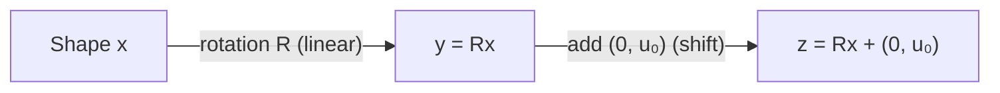
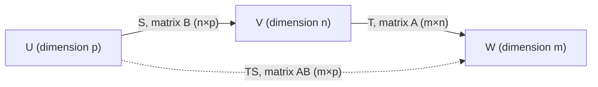

# Chapter 8 — Linear Transformations

[Repository Guide](../../README.md) | [English](Concepts_Lecture.md) | [한국어](Concepts_Lecture.ko.md)

> **Last Updated:** 2026-10-18
>
> Introduction to Linear Algebra, Strang, Ch 8

> **Learning Objectives:**
> 1. Define linear transformations and verify linearity
> 2. Construct matrix representations of linear transformations
> 3. Analyze kernel and range of transformations
> 4. Find good bases for a transformation using change of basis and the Jordan form

---

<br>

## Table of Contents

- [1. Idea of a Linear Transformation (8.1)](#1-idea-of-a-linear-transformation-81)
  - [1.1 Definition and Linearity Condition](#11-definition-and-linearity-condition)
  - [1.2 Formal Definition of a Linear Transformation](#12-formal-definition-of-a-linear-transformation)
  - [1.3 Non-Linear Example: Shift Transformation and Affine Mappings](#13-non-linear-example-shift-transformation-and-affine-mappings)
  - [1.4 Examples of Linear and Non-Linear Transformations](#14-examples-of-linear-and-non-linear-transformations)
  - [1.5 Linear Transformation Determined by Basis](#15-linear-transformation-determined-by-basis)
  - [1.6 Geometric Interpretation: Lines to Lines](#16-geometric-interpretation-lines-to-lines)
  - [1.7 Linear Transformations in Calculus (Derivative)](#17-linear-transformations-in-calculus-derivative)
  - [1.8 Example 5: Integration is Also Linear](#18-example-5-integration-is-also-linear)
  - [1.9 Example 6: Projection onto z=1 Plane (Non-Linear)](#19-example-6-projection-onto-z1-plane-non-linear)
  - [1.10 Example 7: Invertible Matrix and Range/Kernel](#110-example-7-invertible-matrix-and-rangekernel)
- [2. The Matrix of a Linear Transformation (8.2)](#2-the-matrix-of-a-linear-transformation-82)
  - [2.1 Key Ideas Summary](#21-key-ideas-summary)
  - [2.2 Choice of Bases and the Standard Matrix](#22-choice-of-bases-and-the-standard-matrix)
  - [2.3 Example 1: Standard Basis in R^2 to R^3](#23-example-1-standard-basis-in-r2-to-r3)
  - [2.4 Construction of the Matrix for T](#24-construction-of-the-matrix-for-t)
  - [2.5 Change of Basis: Matrix B](#25-change-of-basis-matrix-b)
  - [2.6 Example 3: Derivative Matrix for Polynomials](#26-example-3-derivative-matrix-for-polynomials)
  - [2.7 Example 4: Integral Matrix (Pseudoinverse of Derivative)](#27-example-4-integral-matrix-pseudoinverse-of-derivative)
  - [2.8 Matrix Product AB Matches Transformation TS](#28-matrix-product-ab-matches-transformation-ts)
  - [2.9 Example 5: Rotation Composition](#29-example-5-rotation-composition)
  - [2.10 Example 6: Inverse Rotation](#210-example-6-inverse-rotation)
- [3. The Search for a Good Basis (8.3)](#3-the-search-for-a-good-basis-83)
  - [3.1 Key Ideas Summary](#31-key-ideas-summary)
  - [3.2 The Change of Basis Formula](#32-the-change-of-basis-formula)
  - [3.3 Best Basis 1: Eigenvectors (Diagonalization)](#33-best-basis-1-eigenvectors-diagonalization)
  - [3.4 Best Basis 2: Singular Vectors (SVD)](#34-best-basis-2-singular-vectors-svd)
  - [3.5 Best Basis 3: Generalized Eigenvectors (Jordan Form)](#35-best-basis-3-generalized-eigenvectors-jordan-form)
  - [3.6 Jordan Form: Structure and Definition](#36-jordan-form-structure-and-definition)
  - [3.7 Example: 2x2 Jordan Form](#37-example-2x2-jordan-form)
  - [3.8 Example: 3x3 Jordan Form](#38-example-3x3-jordan-form)
  - [3.9 Basis for Function Space](#39-basis-for-function-space)
  - [3.10 Orthogonal Bases for Function Space](#310-orthogonal-bases-for-function-space)
  - [3.11 Constructing the Legendre Basis via Gram-Schmidt](#311-constructing-the-legendre-basis-via-gram-schmidt)
- [Summary](#summary)
- [Self-Check Questions](#self-check-questions)

---

<br>

## 1. Idea of a Linear Transformation (8.1)

### 1.1 Definition and Linearity Condition

**Chapter overview:**

- **8.1** Idea of a Linear Transformation
- **8.2** The Matrix of a Linear Transformation
- **8.3** The Search for a Good Basis

A **linear transformation** $`T`$ takes vectors $`\mathbf{u}`$ to vectors $`T(\mathbf{u})`$:

```math
T: \mathbf{u} \longrightarrow T(\mathbf{u})
```

**Linearity requires:**

```math
T(c\mathbf{u} + d\mathbf{w}) = c\,T(\mathbf{u}) + d\,T(\mathbf{w})
```

A linear transformation always satisfies $`T(\mathbf{0}) = \mathbf{0}`$.

So if $`\mathbf{u}_0 \neq \mathbf{0}`$, then $`T(\mathbf{u}) = \mathbf{u} + \mathbf{u}_0`$ is **NOT** linear (because $`T(\mathbf{0}) = \mathbf{u}_0 \neq \mathbf{0}`$).

The input vector $`\mathbf{u}`$ and output $`T(\mathbf{u})`$ can be in $`\mathbb{R}^n`$ or matrix space or function space.

If $`A`$ is $`m`$ by $`n`$, then $`T(\mathbf{u}) = A\mathbf{u}`$ is linear, from the input space $`\mathbb{R}^n`$ to the output space $`\mathbb{R}^m`$.

The **derivative** $`T(f) = \dfrac{df}{dx}`$ is linear.

The **integral** $`T^+(f) = \displaystyle\int_0^x f(t)\,dt`$ is its pseudoinverse.

The **product** $`ST`$ of two linear transformations is still linear:

```math
(ST)(\mathbf{u}) = S(T(\mathbf{u}))
```

---

### 1.2 Formal Definition of a Linear Transformation

$`A: \mathbf{u} \longrightarrow A\mathbf{u}`$

$`A`$ transforms $`\mathbf{u}`$ into another vector $`A\mathbf{u}`$.

Similar to $`f: x \longrightarrow f(x)`$, a transformation $`T`$ takes a vector $`\mathbf{u}`$ and maps it to another vector $`T(\mathbf{u})`$:

```math
T: \mathbf{u} \longrightarrow T(\mathbf{u})
```

Start with $`A`$:

```math
A: \mathbf{u} \longrightarrow A\mathbf{u}
```
```math
A: \mathbf{w} \longrightarrow A\mathbf{w}
```

What happens to $`\mathbf{y} = \mathbf{u} + \mathbf{w}`$?

```math
A\mathbf{y} = A(\mathbf{u} + \mathbf{w}) = A\mathbf{u} + A\mathbf{w}
```

Matrix multiplication $`T(\mathbf{u}) = A\mathbf{u}`$ gives a linear transformation.

A transformation $`T`$ assigns an output $`T(\mathbf{u})`$ to each input vector $`\mathbf{u}`$ in $`V`$.

**The transformation is linear if it meets these requirements for all $`\mathbf{u}`$ and $`\mathbf{w} \in V`$:**

**(a)** $`T(\mathbf{u} + \mathbf{w}) = T(\mathbf{u}) + T(\mathbf{w})`$

**(b)** $`T(c\mathbf{u}) = c\,T(\mathbf{u})`$ for every scalar $`c`$ ($`c \in \mathbb{R}`$ for a real vector space, $`c \in \mathbb{C}`$ for a complex one)

Then $`T`$ is said to be **additive** and **homogeneous**.

```math
T(\mathbf{0}) = T(0\mathbf{u}) = 0\,T(\mathbf{u}) = \mathbf{0}
```

We can combine (a) and (b) into:

```math
T(c\mathbf{u} + d\mathbf{w}) = c\,T(\mathbf{u}) + d\,T(\mathbf{w})
```

**Generalize:**

```math
T(c_1\mathbf{x}_1 + c_2\mathbf{x}_2 + \cdots + c_n\mathbf{x}_n) = c_1\,T(\mathbf{x}_1) + c_2\,T(\mathbf{x}_2) + \cdots + c_n\,T(\mathbf{x}_n)
```

---

### 1.3 Non-Linear Example: Shift Transformation and Affine Mappings

**Example.** Define $`T`$ that takes a vector $`\mathbf{u} \in V`$ and adds a fixed vector $`\mathbf{u}_0 \in V`$ ($`\mathbf{u}_0 \neq \mathbf{0}`$) as follows:

```math
T: \mathbf{u} \longrightarrow \mathbf{u} + \mathbf{u}_0
```
```math
T: \mathbf{w} \longrightarrow \mathbf{w} + \mathbf{u}_0
```

Check additivity:

```math
T(\mathbf{u} + \mathbf{w}) \stackrel{?}{=} T(\mathbf{u}) + T(\mathbf{w})
```

```math
\mathbf{u} + \mathbf{w} + \mathbf{u}_0 \neq \mathbf{u} + \mathbf{u}_0 + \mathbf{w} + \mathbf{u}_0
```

Therefore $`T`$ is **NOT** linear.

**Linear plus shift transformation:**

```math
T(\mathbf{u}) = A\mathbf{u} + \mathbf{u}_0
```

is called an **affine** transformation.

In computer graphics, affine mapping is used:
- Start with a shape $`\mathbf{x}`$.
- Rotate: $`\mathbf{y} = R\mathbf{x}`$. This step is linear.
- Translate: $`\mathbf{z} = \mathbf{y} + \begin{pmatrix} 0 \\ u_0 \end{pmatrix}`$. This step is a shift.



*Figure 1. Affine mapping in computer graphics: rotation followed by translation*

---

### 1.4 Examples of Linear and Non-Linear Transformations

**Example 1 (linear): Dot product**

```math
\mathbf{a} = \begin{pmatrix} 1 \\ 3 \\ 4 \end{pmatrix}, \quad \mathbf{u} = \begin{pmatrix} u_1 \\ u_2 \\ u_3 \end{pmatrix}
```

```math
T(\mathbf{u}) = \mathbf{a} \cdot \mathbf{u} = \mathbf{a}^T\mathbf{u} = (\mathbf{a}^T)\mathbf{u} = u_1 + 3u_2 + 4u_3
```

**Dot products are linear.**

---

**Example 2 (non-linear): Length (norm)**

$`T(\mathbf{u}) = \|\mathbf{u}\|`$ is **NOT** linear.

**Check (i) additivity:**

```math
T(\mathbf{u} + \mathbf{w}) \stackrel{?}{=} T(\mathbf{u}) + T(\mathbf{w})
```

```math
\|\mathbf{u} + \mathbf{w}\| \neq \|\mathbf{u}\| + \|\mathbf{w}\|
```

Equality holds only when one vector is a nonnegative multiple of the other, so additivity fails in general. For example, if $`\mathbf{w} = -\mathbf{u} \neq \mathbf{0}`$, the left side is $`0`$ and the right side is $`2\|\mathbf{u}\|`$.

**Check (ii) homogeneity:**

```math
T(c\mathbf{u}) \stackrel{?}{=} c\,T(\mathbf{u})
```

```math
T(-\mathbf{u}) \stackrel{?}{=} -T(\mathbf{u})
```

```math
\|-\mathbf{u}\| = \|\mathbf{u}\| \neq -\|\mathbf{u}\|
```

Homogeneity also fails, because a norm is never negative.

---

**Example 3 (linear): Rotation**

$`T`$ is the rotation matrix that rotates every vector by $`30°`$.

```math
T: \mathbf{u} \longrightarrow \begin{pmatrix} \cos\theta & -\sin\theta \\ \sin\theta & \cos\theta \end{pmatrix}\mathbf{u} \quad \text{with } \theta = 30°
```

where the rotation matrix is $`R`$.

**Check (i):**

```math
T(\mathbf{u} + \mathbf{w}) = R(\mathbf{u} + \mathbf{w}) = R\mathbf{u} + R\mathbf{w} = T(\mathbf{u}) + T(\mathbf{w})
```

**Check (ii):**

```math
T(c\mathbf{u}) = R(c\mathbf{u}) = cR\mathbf{u} = c\,T(\mathbf{u})
```

**Recall the generalization:**

```math
T(c_1\mathbf{u}_1 + c_2\mathbf{u}_2 + \cdots + c_n\mathbf{u}_n) = c_1\,T(\mathbf{u}_1) + c_2\,T(\mathbf{u}_2) + \cdots + c_n\,T(\mathbf{u}_n)
```

---

### 1.5 Linear Transformation Determined by Basis

Suppose you know $`T(\mathbf{u})`$ for all vectors $`\mathbf{u}_1, \mathbf{u}_2, \ldots, \mathbf{u}_n`$ in a basis.

Write any vector in the space as $`\mathbf{y} = c_1\mathbf{u}_1 + \cdots + c_n\mathbf{u}_n`$.

By linearity, $`T(\mathbf{y}) = c_1T(\mathbf{u}_1) + \cdots + c_nT(\mathbf{u}_n)`$, so you know $`T(\mathbf{y})`$ for all $`\mathbf{y}`$ in the space.

> **Key Point:** A linear transformation is completely determined by its action on a basis.

---

### 1.6 Geometric Interpretation: Lines to Lines

Linear transformations preserve the following:
- They map **lines to lines**.
- They map **triangles to triangles**.
- They map **equally spaced points to equally spaced points**.

> **Caution:** A linear transformation that is not invertible can collapse a line to a single point and a triangle to a segment or a point. The properties above hold as stated for invertible linear transformations.

---

### 1.7 Linear Transformations in Calculus (Derivative)

**Example 4.** $`T(u) = \dfrac{d}{dt}(u)`$

**Check (i):**

```math
T(cu + dw) = \frac{d}{dt}(cu + dw) = c\frac{du}{dt} + d\frac{dw}{dt} = c\,T(u) + d\,T(w) \quad \text{Linear}
```

where $`c, d \in \mathbb{R}`$.

**Nullspace of $`T`$:**

```math
T(u) = \frac{d}{dt}u = 0
```

This only happens when $`u`$ is a constant $`c`$.

```math
dc \in \mathcal{N}(T), \quad d \in \mathbb{R}
```

The nullspace is a **line** in function space.

**Column space of $`T`$:**

Let $`u = a + bt + ct^2`$, then:

```math
T(u) = b + 2ct, \quad \text{a linear function.}
```

**Dimensions:** their sum equals the dimension of the domain, the space of polynomials of degree at most 2.

```math
\dim C(T) + \dim \mathcal{N}(T) = 2 + 1 = 3
```

**Matrix for the derivative $`T = \dfrac{d}{dt}`$:**

Write $`u = (1 \;\; t \;\; t^2) \begin{pmatrix} a \\ b \\ c \end{pmatrix}`$.

Let $`\mathbf{u}_1 = 1`$, $`\mathbf{u}_2 = t`$, $`\mathbf{u}_3 = t^2`$.

```math
\frac{d}{dt}\mathbf{u}_1 = \frac{d}{dt}(1) = 0
```

```math
\frac{d}{dt}\mathbf{u}_2 = \frac{d}{dt}(t) = 1
```

```math
\frac{d}{dt}\mathbf{u}_3 = \frac{d}{dt}(t^2) = 2t
```

```math
T: \begin{pmatrix} a \\ b \\ c \end{pmatrix} \longrightarrow \begin{pmatrix} b \\ 2c \end{pmatrix}
```

```math
a + bx + cx^2 \longrightarrow b + 2cx
```

Linear transformation $`\dfrac{dy}{dx}`$ is connected to $`A\mathbf{u}`$:

```math
\begin{pmatrix} b \\ 2c \end{pmatrix} = \begin{pmatrix} 0 & 1 & 0 \\ 0 & 0 & 2 \end{pmatrix}\begin{pmatrix} a \\ b \\ c \end{pmatrix}
```

The matrix is $`A = \begin{pmatrix} 0 & 1 & 0 \\ 0 & 0 & 2 \end{pmatrix}`$.

---

### 1.8 Example 5: Integration is Also Linear

Integration $`T^+`$ is also linear:

```math
\int_0^x (D + Ex)\,dx = Dx + \frac{1}{2}Ex^2
```

```math
T^+: \begin{pmatrix} D \\ E \end{pmatrix} \longrightarrow \begin{pmatrix} 0 \\ D \\ \frac{1}{2}E \end{pmatrix}
```

The input $`\mathbf{u} = D + Ex`$ and the output is $`Dx + \frac{1}{2}Ex^2`$.

```math
\begin{pmatrix} 0 \\ D \\ \frac{1}{2}E \end{pmatrix} = \begin{pmatrix} 0 & 0 \\ 1 & 0 \\ 0 & \frac{1}{2} \end{pmatrix}\begin{pmatrix} D \\ E \end{pmatrix}
```

The integral matrix is $`A^+`$.

**Products $`A^+A`$ and $`AA^+`$:**

```math
A^+A = \begin{pmatrix} 0 & 0 \\ 1 & 0 \\ 0 & \frac{1}{2} \end{pmatrix}\begin{pmatrix} 0 & 1 & 0 \\ 0 & 0 & 2 \end{pmatrix} = \begin{pmatrix} 0 & 0 & 0 \\ 0 & 1 & 0 \\ 0 & 0 & 1 \end{pmatrix}
```

```math
AA^+ = \begin{pmatrix} 0 & 1 & 0 \\ 0 & 0 & 2 \end{pmatrix}\begin{pmatrix} 0 & 0 \\ 1 & 0 \\ 0 & \frac{1}{2} \end{pmatrix} = \begin{pmatrix} 1 & 0 \\ 0 & 1 \end{pmatrix} = I
```

---

### 1.9 Example 6: Projection onto z=1 Plane (Non-Linear)

Consider the transformation that projects a vector $`\mathbf{u} \in \mathbb{R}^3`$ onto the horizontal plane $`z = 1`$:

```math
T: \begin{pmatrix} x \\ y \\ z \end{pmatrix} \longrightarrow \begin{pmatrix} x \\ y \\ 1 \end{pmatrix}
```

$`T(\mathbf{u})`$ is **NOT** linear because:

```math
T(\mathbf{0}) = \begin{pmatrix} 0 \\ 0 \\ 0 \end{pmatrix} \longrightarrow \begin{pmatrix} 0 \\ 0 \\ 1 \end{pmatrix} \neq \begin{pmatrix} 0 \\ 0 \\ 0 \end{pmatrix}
```

---

### 1.10 Example 7: Invertible Matrix and Range/Kernel

Suppose $`A`$ is invertible:

```math
T(\mathbf{u} + \mathbf{w}) = A\mathbf{u} + A\mathbf{w} = T(\mathbf{u}) + T(\mathbf{w})
```

The inverse transformation is $`T^{-1}(\mathbf{u}) = A^{-1}(\mathbf{u})`$:

```math
T^{-1}(T(\mathbf{u})) = A^{-1}(A\mathbf{u}) = \mathbf{u}
```

If $`T(\mathbf{u}) = A\mathbf{u}`$, $`S(\mathbf{u}) = B\mathbf{u}`$, then $`T \circ S(\mathbf{u})`$ corresponds to $`AB\mathbf{u}`$.

**Q:** Are all linear transformations from $`V = \mathbb{R}^n`$ to $`W = \mathbb{R}^m`$ produced by matrices? **Yes.**

The set of all $`A\mathbf{u}`$ is the **column space**.

The **null space** of $`A`$ contains all the inputs for which $`A\mathbf{u} = \mathbf{0}`$.

```math
\text{Range of } T = T(\mathbf{u}) \quad \longleftrightarrow \quad \text{column space } A\mathbf{u}
```

```math
\text{Kernel of } T = \text{all inputs for which } T(\mathbf{u}) = \mathbf{0} \quad \longleftrightarrow \quad \text{nullspace of } A
```

---

<br>

## 2. The Matrix of a Linear Transformation (8.2)

### 2.1 Key Ideas Summary

1. **Linearity** tells us all $`T(\mathbf{u})`$ if we know $`T(\mathbf{u}_1), \ldots, T(\mathbf{u}_n)`$ for an input basis $`\mathbf{u}_1, \mathbf{u}_2, \ldots, \mathbf{u}_n`$.

2. **Column $`j`$** in the matrix for $`T`$ comes from applying $`T`$ to the input basis vector $`\mathbf{u}_j`$.

3. Write $`T(\mathbf{u}_j) = a_{1j}\,\mathbf{w}_1 + \cdots + a_{mj}\,\mathbf{w}_m = \displaystyle\sum_{i=1}^{m} a_{ij}\,\mathbf{w}_i`$ in the output basis of $`\mathbf{w}`$'s. Those $`a_{ij}`$ go into column $`j`$.

4. If the input and output bases are the columns of $`I_{n \times n}`$ and $`I_{m \times m}`$, the matrix for $`T(\mathbf{x}) = A\mathbf{x}`$ is $`A`$ itself.

5. When the bases change to $`\mathbf{v}`$'s and $`\mathbf{w}`$'s, the matrix for the same $`T`$ changes from $`A`$ to $`W^{-1}AV`$.

6. **Best bases:** choosing $`V = W`$ = eigenvectors turns $`A`$ into $`\Lambda`$ (when $`A`$ is diagonalizable), and choosing $`V, W`$ = singular vectors turns $`A`$ into $`\Sigma`$.

---

### 2.2 Choice of Bases and the Standard Matrix

A transformation $`T`$ maps from input space $`V`$ to output space $`W`$:

```math
V \xrightarrow{T} W
```

Choose $`V = \mathbb{R}^n`$, $`W = \mathbb{R}^m`$. Then the matrix $`A`$ for this transformation will be $`m`$ by $`n`$.

The choice of bases in $`V`$ and $`W`$ will decide $`A`$.

The standard basis vectors for $`\mathbb{R}^n`$ and $`\mathbb{R}^m`$ are the columns of $`I`$.

This choice leads to a **standard matrix**: $`T(\mathbf{u}) = A\mathbf{u}`$.

We can choose other bases for $`V`$ and $`W`$.
$`\Rightarrow`$ The same transformation $`T`$ is represented by other matrices.

**Q.** How should we choose the bases that give the **best matrix** for $`T`$?

---

### 2.3 Example 1: Standard Basis in R^2 to R^3

$`T: \mathbb{R}^2 \to \mathbb{R}^3`$

```math
\mathbf{u}_1 = \begin{pmatrix} 1 \\ 0 \end{pmatrix} \longrightarrow T(\mathbf{u}_1) = \begin{pmatrix} 2 \\ 3 \\ 4 \end{pmatrix}
```

```math
\mathbf{u}_2 = \begin{pmatrix} 0 \\ 1 \end{pmatrix} \longrightarrow T(\mathbf{u}_2) = \begin{pmatrix} 5 \\ 5 \\ 5 \end{pmatrix}
```

Express this linear transformation as matrix $`A`$:

```math
A = \begin{pmatrix} T(\mathbf{u}_1) & T(\mathbf{u}_2) \end{pmatrix} = \begin{pmatrix} 2 & 5 \\ 3 & 5 \\ 4 & 5 \end{pmatrix}
```

The outputs go into the **columns of $`A`$**. Then $`T(\mathbf{u}) = A\mathbf{u}`$.

**Verification:**

```math
T(\mathbf{u}_1 + \mathbf{u}_2) = A(\mathbf{u}_1 + \mathbf{u}_2) = A\mathbf{u}_1 + A\mathbf{u}_2 = \begin{pmatrix} 2 \\ 3 \\ 4 \end{pmatrix} + \begin{pmatrix} 5 \\ 5 \\ 5 \end{pmatrix} = A\begin{pmatrix} 1 \\ 1 \end{pmatrix} = \begin{pmatrix} 7 \\ 8 \\ 9 \end{pmatrix}
```

**General formula:**

```math
T(c_1\mathbf{u}_1 + c_2\mathbf{u}_2) = c_1\,T(\mathbf{u}_1) + c_2\,T(\mathbf{u}_2) = \begin{pmatrix} T(\mathbf{u}_1) & T(\mathbf{u}_2) \end{pmatrix}\begin{pmatrix} c_1 \\ c_2 \end{pmatrix} = A\mathbf{c}
```

---

### 2.4 Construction of the Matrix for T

Construct a matrix for **any** linear transformation.

```math
V \xrightarrow{T} W, \quad \dim V = n, \quad \dim W = m
```

Choose a basis $`\mathbf{u}_1, \mathbf{u}_2, \ldots, \mathbf{u}_n`$ for $`V`$.

Choose a basis $`\mathbf{w}_1, \mathbf{w}_2, \ldots, \mathbf{w}_m`$ for $`W`$.

$`A`$ will be $`m`$ by $`n`$.

$`T(\mathbf{u}_1)`$ is a combination of the output basis for $`W`$:

```math
T(\mathbf{u}_1) = d_1\mathbf{w}_1 + d_2\mathbf{w}_2 + \cdots + d_m\mathbf{w}_m = a_{11}\mathbf{w}_1 + a_{21}\mathbf{w}_2 + \cdots + a_{m1}\mathbf{w}_m = (\mathbf{w}_1 \;\; \mathbf{w}_2 \;\; \cdots \;\; \mathbf{w}_m)\begin{pmatrix} a_{11} \\ a_{21} \\ \vdots \\ a_{m1} \end{pmatrix}
```

```math
T(\mathbf{u}_2) = (\mathbf{w}_1 \;\; \mathbf{w}_2 \;\; \cdots \;\; \mathbf{w}_m)\begin{pmatrix} a_{12} \\ a_{22} \\ \vdots \\ a_{m2} \end{pmatrix}
```

```math
\vdots
```

```math
T(\mathbf{u}_n) = (\mathbf{w}_1 \;\; \mathbf{w}_2 \;\; \cdots \;\; \mathbf{w}_m)\begin{pmatrix} a_{1n} \\ a_{2n} \\ \vdots \\ a_{mn} \end{pmatrix}
```

Combining:

```math
\begin{pmatrix} T(\mathbf{u}_1) & T(\mathbf{u}_2) & \cdots & T(\mathbf{u}_n) \end{pmatrix} = A
```

```math
= (\mathbf{w}_1 \;\; \mathbf{w}_2 \;\; \cdots \;\; \mathbf{w}_m)\begin{pmatrix} a_{11} & a_{12} & \cdots & a_{1n} \\ a_{21} & a_{22} & \cdots & a_{2n} \\ \vdots & \vdots & \ddots & \vdots \\ a_{m1} & a_{m2} & \cdots & a_{mn} \end{pmatrix}
```

> **Key Point:** The $`j`$th column of $`A`$ holds the coefficients of $`T(\mathbf{u}_j)`$, the result of applying $`T`$ to the $`j`$th basis vector $`\mathbf{u}_j`$, written as a linear combination of the output basis vectors.

When the output basis is the standard basis, suppose we know the outputs $`T(\mathbf{u})`$ for the input basis vectors $`\mathbf{u}_1`$ to $`\mathbf{u}_n`$:

```math
T(\mathbf{u}_1),\; T(\mathbf{u}_2),\; \ldots,\; T(\mathbf{u}_n)
```

```math
A = \begin{pmatrix} T(\mathbf{u}_1) & T(\mathbf{u}_2) & \cdots & T(\mathbf{u}_n) \end{pmatrix}
```

```math
A\mathbf{c} = c_1\,T(\mathbf{u}_1) + c_2\,T(\mathbf{u}_2) + \cdots + c_n\,T(\mathbf{u}_n)
```

---

### 2.5 Change of Basis: Matrix B

**Example 2.** $`V = W = \mathbb{R}^2`$

Suppose $`T(\mathbf{u}) = \mathbf{u}`$ (the identity transformation).

**Input basis** ($`V`$): Standard basis $`\mathbf{v}_1 = \begin{pmatrix} 1 \\ 0 \end{pmatrix}`$, $`\mathbf{v}_2 = \begin{pmatrix} 0 \\ 1 \end{pmatrix}`$.

**Output basis** ($`W`$): Rotated basis $`\mathbf{w}_1 = \begin{pmatrix} \cos\theta \\ \sin\theta \end{pmatrix}`$, $`\mathbf{w}_2 = \begin{pmatrix} -\sin\theta \\ \cos\theta \end{pmatrix}`$.

Express $`\mathbf{u}`$ in both bases:

```math
\mathbf{u} = c_1\mathbf{v}_1 + c_2\mathbf{v}_2 = (\mathbf{v}_1 \;\; \mathbf{v}_2)\begin{pmatrix} c_1 \\ c_2 \end{pmatrix} = V\mathbf{c}
```

```math
\mathbf{u} = d_1\mathbf{w}_1 + d_2\mathbf{w}_2 = (\mathbf{w}_1 \;\; \mathbf{w}_2)\begin{pmatrix} d_1 \\ d_2 \end{pmatrix} = W\mathbf{d}
```

Since both represent the same vector:

```math
\boxed{V\mathbf{c} = W\mathbf{d}}
```

```math
\mathbf{c} = V^{-1}W\mathbf{d} \qquad \mathbf{d} = W^{-1}V\mathbf{c}
```

```math
B = W^{-1}V
```

**In this example:**

```math
\mathbf{d} = \begin{pmatrix} \cos\theta & -\sin\theta \\ \sin\theta & \cos\theta \end{pmatrix}^{-1}\begin{pmatrix} 1 & 0 \\ 0 & 1 \end{pmatrix}\mathbf{c}
```

```math
= \begin{pmatrix} \cos\theta & \sin\theta \\ -\sin\theta & \cos\theta \end{pmatrix}\begin{pmatrix} 1 & 0 \\ 0 & 1 \end{pmatrix}\mathbf{c}
```

```math
= \begin{pmatrix} \cos(-\theta) & -\sin(-\theta) \\ \sin(-\theta) & \cos(-\theta) \end{pmatrix}\begin{pmatrix} 1 & 0 \\ 0 & 1 \end{pmatrix}\mathbf{c}
```

When $`V = I`$, the coefficients $`\mathbf{d}`$ in $`W`$ become:

```math
\mathbf{d} = W^{-1}\begin{pmatrix} x \\ y \end{pmatrix}
```

---

### 2.6 Example 3: Derivative Matrix for Polynomials

$`T(u) = \dfrac{du}{dx}`$

Input space: $`V = \text{span}\lbrace1, x, x^2, x^3\rbrace`$ with basis $`\mathbf{u}_1 = 1,\; \mathbf{u}_2 = x,\; \mathbf{u}_3 = x^2,\; \mathbf{u}_4 = x^3`$.

Output space: $`W = \text{span}\lbrace1, x, x^2\rbrace`$ with basis $`\mathbf{w}_1 = 1,\; \mathbf{w}_2 = x,\; \mathbf{w}_3 = x^2`$.

Apply $`T`$ to each basis vector:

```math
T(\mathbf{u}_1) = T(1) = 0
```
```math
T(\mathbf{u}_2) = T(x) = 1 = \mathbf{w}_1
```
```math
T(\mathbf{u}_3) = T(x^2) = 2x = 2\mathbf{w}_2
```
```math
T(\mathbf{u}_4) = T(x^3) = 3x^2 = 3\mathbf{w}_3
```

```math
A = \begin{pmatrix} T(\mathbf{u}_1) & T(\mathbf{u}_2) & T(\mathbf{u}_3) & T(\mathbf{u}_4) \end{pmatrix}
```

```math
= (\mathbf{w}_1 \;\; \mathbf{w}_2 \;\; \mathbf{w}_3)\begin{pmatrix} 0 & 1 & 0 & 0 \\ 0 & 0 & 2 & 0 \\ 0 & 0 & 0 & 3 \end{pmatrix}
```

The **derivative matrix** is:

```math
D = \begin{pmatrix} 0 & 1 & 0 & 0 \\ 0 & 0 & 2 & 0 \\ 0 & 0 & 0 & 3 \end{pmatrix}
```

For input $`u = c_1 + c_2 x + c_3 x^2 + c_4 x^3`$ with coefficient vector $`\mathbf{c} = (c_1, c_2, c_3, c_4)^T`$:

```math
T(u) = (\mathbf{w}_1 \;\; \mathbf{w}_2 \;\; \mathbf{w}_3) \begin{pmatrix} 0 & 1 & 0 & 0 \\ 0 & 0 & 2 & 0 \\ 0 & 0 & 0 & 3 \end{pmatrix}\begin{pmatrix} c_1 \\ c_2 \\ c_3 \\ c_4 \end{pmatrix} = (\mathbf{w}_1 \;\; \mathbf{w}_2 \;\; \mathbf{w}_3)\begin{pmatrix} c_2 \\ 2c_3 \\ 3c_4 \end{pmatrix}
```

$`\mathbf{d} = D\mathbf{c}`$ produces the coefficients in the $`T(u)`$ combination.

---

### 2.7 Example 4: Integral Matrix (Pseudoinverse of Derivative)

Integral of $`d_1 + d_2 x + d_3 x^2`$:

```math
(1 \;\; x \;\; x^2)\begin{pmatrix} d_1 \\ d_2 \\ d_3 \end{pmatrix}
```

is $`d_1 x + \frac{1}{2}d_2 x^2 + \frac{1}{3}d_3 x^3`$:

```math
(1 \;\; x \;\; x^2 \;\; x^3)\begin{pmatrix} 0 \\ d_1 \\ \frac{1}{2}d_2 \\ \frac{1}{3}d_3 \end{pmatrix}
```

```math
= (1 \;\; x \;\; x^2 \;\; x^3)\begin{pmatrix} 0 & 0 & 0 \\ 1 & 0 & 0 \\ 0 & \frac{1}{2} & 0 \\ 0 & 0 & \frac{1}{3} \end{pmatrix}\begin{pmatrix} d_1 \\ d_2 \\ d_3 \end{pmatrix}
```

The **integral matrix** is:

```math
D^+ = \begin{pmatrix} 0 & 0 & 0 \\ 1 & 0 & 0 \\ 0 & \frac{1}{2} & 0 \\ 0 & 0 & \frac{1}{3} \end{pmatrix}
```

**Products $`DD^+`$ and $`D^+D`$:**

```math
DD^+ = \begin{pmatrix} 0 & 1 & 0 & 0 \\ 0 & 0 & 2 & 0 \\ 0 & 0 & 0 & 3 \end{pmatrix}\begin{pmatrix} 0 & 0 & 0 \\ 1 & 0 & 0 \\ 0 & \frac{1}{2} & 0 \\ 0 & 0 & \frac{1}{3} \end{pmatrix} = \begin{pmatrix} 1 & 0 & 0 \\ 0 & 1 & 0 \\ 0 & 0 & 1 \end{pmatrix} = I
```

```math
D^+D = \begin{pmatrix} 0 & 0 & 0 \\ 1 & 0 & 0 \\ 0 & \frac{1}{2} & 0 \\ 0 & 0 & \frac{1}{3} \end{pmatrix}\begin{pmatrix} 0 & 1 & 0 & 0 \\ 0 & 0 & 2 & 0 \\ 0 & 0 & 0 & 3 \end{pmatrix} = \begin{pmatrix} 0 & 0 & 0 & 0 \\ 0 & 1 & 0 & 0 \\ 0 & 0 & 1 & 0 \\ 0 & 0 & 0 & 1 \end{pmatrix}
```

The **kernel** of the derivative $`T`$ consists of the constant functions: $`T(1) = 0`$.

The **nullspace** of its matrix $`D`$ is spanned by $`(1, 0, 0, 0)^T`$, the coefficient vector of the constant function $`1`$. This is why $`D^+D \neq I`$.

---

### 2.8 Matrix Product AB Matches Transformation TS

Define the composition $`TS`$ and the matrix product $`AB`$ as follows:

```math
(TS)(\mathbf{u}) := T \circ S(\mathbf{u}) = T(S(\mathbf{u}))
```

```math
(AB)(\mathbf{x}) := A(B\mathbf{x})
```

Matrix multiplication gives the correct matrix $`AB`$ to represent $`TS`$.

```math
U \xrightarrow{S} V \xrightarrow{T} W
```

```math
\dim U = p, \quad \dim V = n, \quad \dim W = m
```

```math
B: n \times p, \quad A: m \times n
```

The linear transformation $`TS`$ acts as follows:
- It starts with any vector $`\mathbf{u}`$ in $`U`$.
- It goes to $`S(\mathbf{u})`$ in $`V`$.
- It then goes to $`T(S(\mathbf{u}))`$ in $`W`$.

The matrix $`AB`$ acts as follows:
- It starts with any $`\mathbf{x} \in \mathbb{R}^p`$.
- It goes to $`B\mathbf{x} \in \mathbb{R}^n`$.
- It then goes to $`AB\mathbf{x} \in \mathbb{R}^m`$.



*Figure 2. Correspondence between the composition TS and the matrix product AB*

The matrix $`AB`$ correctly represents $`TS`$:

```math
TS: U \to V \to W
```
```math
AB: (m \times n)(n \times p) = (m \times p)
```

---

### 2.9 Example 5: Rotation Composition

$`S`$ rotates the plane by $`\theta`$.

$`T`$ also rotates by $`\theta`$.

Then $`TS`$ rotates by $`2\theta`$.

This transformation $`T^2`$ corresponds to the matrix $`A^2`$ of the rotation by $`2\theta`$:

```math
T = S, \quad A = B, \quad T^2 = \text{rotation by } 2\theta
```

```math
A^2 = \begin{pmatrix} \cos 2\theta & -\sin 2\theta \\ \sin 2\theta & \cos 2\theta \end{pmatrix}
```

**Verification by matrix multiplication:**

```math
A^2 = \begin{pmatrix} \cos\theta & -\sin\theta \\ \sin\theta & \cos\theta \end{pmatrix}\begin{pmatrix} \cos\theta & -\sin\theta \\ \sin\theta & \cos\theta \end{pmatrix}
```

```math
= \begin{pmatrix} \cos^2\theta - \sin^2\theta & -2\sin\theta\cos\theta \\ 2\sin\theta\cos\theta & \cos^2\theta - \sin^2\theta \end{pmatrix}
```

Using double-angle formulas:
- $`\cos^2\theta - \sin^2\theta = \cos 2\theta`$
- $`2\sin\theta\cos\theta = \sin 2\theta`$

---

### 2.10 Example 6: Inverse Rotation

$`S`$ rotates by the angle $`\theta`$.

$`T`$ rotates by $`-\theta`$.

```math
TS = T \circ S = I \longrightarrow AB = I
```

```math
AB\mathbf{x} = I\mathbf{x} = \mathbf{x}
```

```math
AB = \begin{pmatrix} \cos\theta & \sin\theta \\ -\sin\theta & \cos\theta \end{pmatrix}\begin{pmatrix} \cos\theta & -\sin\theta \\ \sin\theta & \cos\theta \end{pmatrix} = \begin{pmatrix} \cos^2\theta + \sin^2\theta & 0 \\ 0 & \cos^2\theta + \sin^2\theta \end{pmatrix} = I
```

---

<br>

## 3. The Search for a Good Basis (8.3)

### 3.1 Key Ideas Summary

1. With a new input basis $`B_{\text{in}}`$ and output basis $`B_{\text{out}}`$, every matrix $`A`$ becomes $`B_{\text{out}}^{-1} A B_{\text{in}}`$.

2. $`B_{\text{in}} = B_{\text{out}}`$ = generalized eigenvectors of $`A`$ produces the **Jordan form** $`J = B^{-1}AB`$.

3. The **Fourier matrix** $`F = B_{\text{in}} = B_{\text{out}}`$ diagonalizes every **circulant matrix**.

4. Sines, cosines, $`e^{ikx}`$, **Legendre** and **Chebyshev**: those are great bases for function space.

---

### 3.2 The Change of Basis Formula

Input basis vectors form $`B_{\text{in}} = (\mathbf{b}_1 \;\; \mathbf{b}_2 \;\; \cdots \;\; \mathbf{b}_n)`$.

Output basis vectors form $`B_{\text{out}} = (\mathbf{b}_1' \;\; \mathbf{b}_2' \;\; \cdots \;\; \mathbf{b}_m')`$.

Always, $`B_{\text{in}}`$ and $`B_{\text{out}}`$ are **invertible**.

The new matrix representation is:

```math
B_{\text{out}}^{-1} \; A \; B_{\text{in}}
```

where $`B_{\text{out}}`$ is $`m \times m`$, $`A`$ is $`m \times n`$, $`B_{\text{in}}`$ is $`n \times n`$.

**Example:** If $`B_{\text{in}} = I_{n \times n}`$ and $`B_{\text{out}} = I_{m \times m}`$, the matrix stays as $`A`$.

**When $`B = B_{\text{in}} = B_{\text{out}}`$:**

```math
B^{-1}AB \quad \text{is similar to } A
```

Similar matrices have the **same eigenvalues**.

---

### 3.3 Best Basis 1: Eigenvectors (Diagonalization)

$`B_{\text{in}} = B_{\text{out}}`$ = the eigenvector matrix $`X`$ from Chapter 6.

```math
A = X\Lambda X^{-1} \quad \Longleftrightarrow \quad X^{-1}AX = \Lambda
```

To use this basis, $`A`$ must be a square matrix with $`n`$ independent eigenvectors, that is, **diagonalizable**.

$`\Lambda`$ is obtained when $`B_{\text{in}} = B_{\text{out}} = X`$ (eigenvectors).

---

### 3.4 Best Basis 2: Singular Vectors (SVD)

$`B_{\text{in}} = V`$, $`B_{\text{out}} = U`$: the singular vectors of $`A`$ from Chapter 7.

```math
A = U\Sigma V^T
```

```math
U^{-1}AV = \Sigma \quad \text{(singular values)}
```

The columns of $`V`$ and $`U`$ are **orthonormal eigenvectors** of $`A^TA`$ and $`AA^T`$, respectively.

---

### 3.5 Best Basis 3: Generalized Eigenvectors (Jordan Form)

$`B_{\text{in}} = B_{\text{out}}`$ = generalized eigenvectors of $`A`$.

```math
B^{-1}AB = \text{Jordan form } J
```

$`A`$ is a square matrix, but it may have only $`s`$ independent eigenvectors:

- If $`s = n`$, then $`B = X`$ (the eigenvector matrix) and $`J = \Lambda`$.
- If $`s < n`$, a matrix filled with eigenvectors would have $`n - s`$ dependent columns, so we construct $`n - s`$ additional **generalized eigenvectors** instead.

Properties of the Jordan form:
- (i) There are $`s`$ square blocks along the diagonal of $`J`$.
- (ii) Each block corresponds to one eigenvalue $`\lambda`$ and one eigenvector, and if its size is at least 2, it has 1's just above the diagonal.

---

### 3.6 Jordan Form: Structure and Definition

When all eigenvectors are independent ($`s = n`$):

```math
J = \Lambda = \begin{pmatrix} \lambda_1 & & \\ & \lambda_2 & \\ & & \ddots & \\ & & & \lambda_n \end{pmatrix} \quad \text{(n 1x1 blocks)}
```

**Example 1:**

```math
J = \begin{pmatrix} \boxed{2} & & & \\ & \boxed{2} & & \\ & & \boxed{3} & 1 \\ & & & \boxed{3} \end{pmatrix}
```

This has **2** 1x1 blocks and **1** 2x2 block.

$`B^{-1}AB = J`$ is **nearly diagonal**.

**General statement of the Jordan form:**

For every $`A`$, we want to choose $`B`$ such that $`B^{-1}AB`$ is as nearly diagonal as possible.

- When $`A`$ is diagonalizable (i.e., has $`n`$ independent eigenvectors), choose $`B = X`$ (the eigenvector matrix) to get $`X^{-1}AX = \Lambda`$.
- When $`A`$ is not diagonalizable (i.e., has only $`s < n`$ independent eigenvectors), we get the Jordan form as follows:

```math
B^{-1}AB = J
```

The Jordan form of $`A`$ is:

```math
J = \begin{pmatrix} J_1 & & \\ & J_2 & \\ & & \ddots & \\ & & & J_s \end{pmatrix}
```

where each **Jordan block** $`J_i`$ is:

```math
J_i = \begin{pmatrix} \lambda_i & 1 & 0 & \cdots & 0 \\ 0 & \lambda_i & 1 & \cdots & 0 \\ \vdots & & \ddots & \ddots & \vdots \\ 0 & \cdots & 0 & \lambda_i & 1 \\ 0 & \cdots & 0 & 0 & \lambda_i \end{pmatrix}
```

> **Key Point:** The best basis $`B`$ gives $`B^{-1}AB = J`$.

---

### 3.7 Example: 2x2 Jordan Form

```math
A = \begin{pmatrix} 1 & 2 \\ 0 & 1 \end{pmatrix}, \quad \lambda^2 - 2\lambda + 1 = (\lambda - 1)^2 = 0
```

**(i)** $`\lambda_1 = 1`$

```math
(A - \lambda I)\mathbf{x} = \begin{pmatrix} 0 & 2 \\ 0 & 0 \end{pmatrix}\begin{pmatrix} x_1 \\ x_2 \end{pmatrix} = \begin{pmatrix} 0 \\ 0 \end{pmatrix}
```

$`x_2 = 0`$ and $`x_1`$ is a free variable, so $`\mathbf{x}_1 = \begin{pmatrix} 1 \\ 0 \end{pmatrix}`$.

**(ii)** Can we find the generalized eigenvector?

```math
(A - \lambda_1 I)\mathbf{x}_2 = \mathbf{x}_1
```

(Note: $`(A - \lambda_1 I)^2\mathbf{x}_2 = (A - \lambda_1 I)\mathbf{x}_1 = \mathbf{0}`$)

```math
(A - \lambda I)\mathbf{x}_2 = \begin{pmatrix} 0 & 2 \\ 0 & 0 \end{pmatrix}\begin{pmatrix} x_1 \\ x_2 \end{pmatrix} = \begin{pmatrix} 1 \\ 0 \end{pmatrix}
```

```math
2x_2 = 1 \quad \Rightarrow \quad x_2 = \frac{1}{2}
```

Choose the free variable $`x_1 = 0`$.

```math
\therefore \mathbf{x}_2 = \begin{pmatrix} 0 \\ \frac{1}{2} \end{pmatrix} \perp \mathbf{x}_1
```

**(iii)** Form the basis matrix:

```math
B = (\mathbf{x}_1 \;\; \mathbf{x}_2) = \begin{pmatrix} 1 & 0 \\ 0 & \frac{1}{2} \end{pmatrix}, \quad B^{-1} = \begin{pmatrix} 1 & 0 \\ 0 & 2 \end{pmatrix}
```

```math
B^{-1}AB = \begin{pmatrix} 1 & 0 \\ 0 & 2 \end{pmatrix}\begin{pmatrix} 1 & 2 \\ 0 & 1 \end{pmatrix}\begin{pmatrix} 1 & 0 \\ 0 & \frac{1}{2} \end{pmatrix} = \begin{pmatrix} 1 & 0 \\ 0 & 2 \end{pmatrix}\begin{pmatrix} 1 & 1 \\ 0 & \frac{1}{2} \end{pmatrix} = \begin{pmatrix} 1 & 1 \\ 0 & 1 \end{pmatrix} = J
```

This is **1 Jordan block** (2x2).

---

### 3.8 Example: 3x3 Jordan Form

```math
A = \begin{pmatrix} 0 & 1 & 2 \\ 0 & 0 & 1 \\ 0 & 0 & 0 \end{pmatrix}, \quad \lambda^3 = 0 \;\Rightarrow\; \lambda = 0
```

**(i)** Find eigenvector: $`(A - \lambda I)\mathbf{x} = \mathbf{0}`$

```math
(A - 0 \cdot I)\mathbf{x} = \begin{pmatrix} 0 & 1 & 2 \\ 0 & 0 & 1 \\ 0 & 0 & 0 \end{pmatrix}\begin{pmatrix} x_1 \\ x_2 \\ x_3 \end{pmatrix} = \begin{pmatrix} 0 \\ 0 \\ 0 \end{pmatrix}
```

$`x_3 = 0`$, then $`x_2 + 2x_3 = 0`$ gives $`x_2 = 0`$, and $`x_1`$ is a free variable.

```math
\Rightarrow \mathbf{x}_1 = \begin{pmatrix} 1 \\ 0 \\ 0 \end{pmatrix}
```

**(ii)** Find first generalized eigenvector: $`(A - \lambda I)\mathbf{x}_2 = \mathbf{x}_1`$

```math
\begin{pmatrix} 0 & 1 & 2 \\ 0 & 0 & 1 \\ 0 & 0 & 0 \end{pmatrix}\begin{pmatrix} x_1 \\ x_2 \\ x_3 \end{pmatrix} = \begin{pmatrix} 1 \\ 0 \\ 0 \end{pmatrix}
```

$`x_3 = 0`$, then $`x_2 + 2x_3 = 1`$ gives $`x_2 = 1`$, and we choose the free variable $`x_1 = 0`$.

```math
\Rightarrow \mathbf{x}_2 = \begin{pmatrix} 0 \\ 1 \\ 0 \end{pmatrix}
```

**(iii)** Find second generalized eigenvector: $`(A - \lambda I)\mathbf{x}_3 = \mathbf{x}_2`$

```math
\begin{pmatrix} 0 & 1 & 2 \\ 0 & 0 & 1 \\ 0 & 0 & 0 \end{pmatrix}\begin{pmatrix} x_1 \\ x_2 \\ x_3 \end{pmatrix} = \begin{pmatrix} 0 \\ 1 \\ 0 \end{pmatrix}
```

$`x_3 = 1`$, then $`x_2 + 2x_3 = 0`$ gives $`x_2 = -2`$, and we choose $`x_1 = 0`$.

```math
\Rightarrow \mathbf{x}_3 = \begin{pmatrix} 0 \\ -2 \\ 1 \end{pmatrix}
```

**(iv)** Jordan chains:

```math
(A - \lambda I)\mathbf{x}_1 = \mathbf{0}
```
```math
(A - \lambda I)^2\mathbf{x}_2 = (A - \lambda I)\mathbf{x}_1 = \mathbf{0}
```
```math
(A - \lambda I)^3\mathbf{x}_3 = (A - \lambda I)^2\mathbf{x}_2 = \mathbf{0}
```

Form the basis:

```math
B = \begin{pmatrix} 1 & 0 & 0 \\ 0 & 1 & -2 \\ 0 & 0 & 1 \end{pmatrix}, \quad B^{-1} = \begin{pmatrix} 1 & 0 & 0 \\ 0 & 1 & 2 \\ 0 & 0 & 1 \end{pmatrix}
```

```math
B^{-1}AB = \begin{pmatrix} 1 & 0 & 0 \\ 0 & 1 & 2 \\ 0 & 0 & 1 \end{pmatrix}\begin{pmatrix} 0 & 1 & 2 \\ 0 & 0 & 1 \\ 0 & 0 & 0 \end{pmatrix}\begin{pmatrix} 1 & 0 & 0 \\ 0 & 1 & -2 \\ 0 & 0 & 1 \end{pmatrix}
```

```math
= \begin{pmatrix} 1 & 0 & 0 \\ 0 & 1 & 2 \\ 0 & 0 & 1 \end{pmatrix}\begin{pmatrix} 0 & 1 & 0 \\ 0 & 0 & 1 \\ 0 & 0 & 0 \end{pmatrix} = \begin{pmatrix} 0 & 1 & 0 \\ 0 & 0 & 1 \\ 0 & 0 & 0 \end{pmatrix} = J
```

This is **1 Jordan block** (3x3) with eigenvalue $`\lambda = 0`$.

---

### 3.9 Basis for Function Space

Consider the standard polynomial basis $`1, x, x^2, x^3, \ldots`$.

```math
x^{10} \approx \text{span}\lbrace1, x, x^2, \ldots, x^9\rbrace
```

On $`[0, 1]`$, $`x^{10}`$ is very closely approximated by combinations of lower powers, so this is an **ill-conditioned basis**.

How can we check if a basis is good or not?

```math
B = \begin{pmatrix} \mathbf{b}_1 & \mathbf{b}_2 & \cdots & \mathbf{b}_n \end{pmatrix} \quad \text{(basis vectors)}
```

```math
B^TB = I \quad \text{when the basis is orthonormal. This is the best.}
```

**Inner product of two vectors:** $`\mathbf{b}_i^T\mathbf{b}_j`$

**Inner product of two functions:** $`\displaystyle\int_0^1 x^i \cdot x^j \, dx`$

```math
\int_0^1 x^i \cdot x^j \, dx = \frac{1}{i + j + 1} \longrightarrow 0 \quad \text{as } i, j \to \infty
```

**Inner product of $`f(x)`$ and $`g(x)`$:**

```math
(f, g) := \int f(x)\,g(x)\,dx
```

**Complex inner product:**

```math
(f, g) := \int \overline{f(x)}\,g(x)\,dx
```

**Weighted inner product:**

```math
(f, g)_w := \int w(x)\,\overline{f(x)}\,g(x)\,dx
```

---

### 3.10 Orthogonal Bases for Function Space

**Fourier basis:**

```math
1, \;\sin x, \;\cos x, \;\sin 2x, \;\ldots
```

**Legendre basis:**

```math
1, \;x, \;x^2 - \frac{1}{3}, \;x^3 - \frac{3}{5}x, \;\ldots
```

**Chebyshev basis:**

```math
1, \;x, \;2x^2 - 1, \;4x^3 - 3x, \;\ldots
```

From the powers of $`x`$: $`1, x, x^2, \ldots`$, how can we construct the Legendre basis?

---

### 3.11 Constructing the Legendre Basis via Gram-Schmidt

Compute inner products on $`[-1, 1]`$:

```math
(1, 1) = \int_{-1}^{1} 1\,dx = 2
```

```math
(1, x) = \int_{-1}^{1} 1 \cdot x\,dx = 0 \quad \text{(orthogonal)}
```

```math
(1, x^2) = \int_{-1}^{1} 1 \cdot x^2\,dx = 2\int_0^1 x^2\,dx = \frac{2}{3}
```

$`x^2`$ has a nonzero component along $`1`$, so it is not orthogonal to $`1`$.

```math
(x, x^2) = \int_{-1}^{1} x^3\,dx = 0 \quad \text{(orthogonal)}
```

By the **Gram-Schmidt process** from Chapter 4, construct the orthogonal basis:

```math
b_1 = 1
```
```math
b_2 = x \quad \perp\; b_1
```
```math
b_3 = x^2 - \frac{1}{3} \quad \perp\; b_1,\; b_2
```
```math
\vdots
```

$`b_3`$ is obtained by subtracting from $`x^2`$ its component along $`1`$: $`b_3 = x^2 - \frac{(1, x^2)}{(1, 1)} \cdot 1 = x^2 - \frac{2/3}{2} = x^2 - \frac{1}{3}`$. Since $`x^2`$ is already orthogonal to $`x`$, no component along $`x`$ needs to be subtracted.

By using the **Gram-Schmidt process**, we can obtain the **Legendre basis**.

---

<br>

## Summary

| Concept | Key Summary |
|:-----|:-----|
| Linear Transformation | It satisfies $`T(c\mathbf{u} + d\mathbf{w}) = cT(\mathbf{u}) + dT(\mathbf{w})`$, which requires both additivity and homogeneity. |
| $`T(\mathbf{0}) = \mathbf{0}`$ | Every linear transformation maps zero to zero. |
| Non-linear examples | The norm $`\Vert\mathbf{u}\Vert`$ and the shift $`\mathbf{u} + \mathbf{u}_0`$ ($`\mathbf{u}_0 \neq \mathbf{0}`$) are NOT linear. |
| Affine transformation | $`T(\mathbf{u}) = A\mathbf{u} + \mathbf{u}_0`$ is a linear transformation plus a shift, and it is used in computer graphics. |
| Dot product | $`T(\mathbf{u}) = \mathbf{a}^T\mathbf{u}`$ is linear. |
| Derivative | $`T(u) = du/dt`$ is a linear transformation on function space. |
| Integration | $`T^+(f) = \int_0^x f(t)\,dt`$ is also linear, and its matrix $`A^+`$ satisfies $`AA^+ = I`$. |
| Projection onto $`z=1`$ | It is NOT linear because $`T(\mathbf{0}) \neq \mathbf{0}`$. |
| Range and Kernel | The range of $`T`$ is the column space of $`A`$, and the kernel of $`T`$ is the nullspace of $`A`$. |
| Determined by basis | A linear transformation is fully determined by its values on basis vectors. |
| Matrix of $`T`$ | Column $`j`$ holds the coefficients of $`T(\mathbf{u}_j)`$ in the output basis, and with the standard output basis $`A = (T(\mathbf{u}_1) \;\cdots\; T(\mathbf{u}_n))`$. |
| Standard matrix | Using the columns of $`I`$ as the input and output bases gives $`T(\mathbf{u}) = A\mathbf{u}`$. |
| Change of basis | The new matrix is $`B_{\text{out}}^{-1} A B_{\text{in}}`$, and the identity transformation gives $`B = W^{-1}V`$. |
| Derivative matrix $`D`$ | For $`\lbrace1, x, x^2, x^3\rbrace \to \lbrace1, x, x^2\rbrace`$, the matrix is $`D = \begin{pmatrix} 0 & 1 & 0 & 0 \\ 0 & 0 & 2 & 0 \\ 0 & 0 & 0 & 3 \end{pmatrix}`$. |
| Integral matrix $`D^+`$ | It is the pseudoinverse of $`D`$, and $`DD^+ = I`$ but $`D^+D \neq I`$ because of the nullspace of $`D`$. |
| Composition $`TS`$ | The matrix product $`AB`$ represents $`TS`$, with sizes $`(m \times n)(n \times p) = (m \times p)`$. |
| Rotation composition | Rotating by $`\theta`$ twice gives $`A^2`$, the rotation by $`2\theta`$. |
| Best basis: Eigenvectors | Choosing $`B = X`$ (eigenvectors) gives $`X^{-1}AX = \Lambda`$ (diagonal). |
| Best basis: Singular vectors | Choosing $`B_{\text{in}} = V`$, $`B_{\text{out}} = U`$ gives $`U^{-1}AV = \Sigma`$. |
| Best basis: Generalized eigenvectors | They give $`B^{-1}AB = J`$ (Jordan form) and are used when $`A`$ has fewer than $`n`$ independent eigenvectors. |
| Jordan block $`J_i`$ | It has $`\lambda_i`$ on the diagonal and 1's on the superdiagonal, and there are $`s`$ blocks for $`s`$ independent eigenvectors. |
| Jordan chains | $`\mathbf{x}_1`$ is an eigenvector, and the chain continues with $`(A - \lambda I)\mathbf{x}_2 = \mathbf{x}_1`$, $`(A - \lambda I)\mathbf{x}_3 = \mathbf{x}_2`$, and so on. |
| Fourier matrix | It diagonalizes every circulant matrix. |
| Function space bases | Good bases for function space include Fourier ($`1, \sin x, \cos x, \ldots`$), Legendre ($`1, x, x^2 - 1/3, \ldots`$), and Chebyshev ($`1, x, 2x^2-1, \ldots`$). |
| Gram-Schmidt for functions | With the inner product $`(f,g) = \int f\,g\,dx`$, it produces the Legendre polynomials from $`1, x, x^2, \ldots`$. |
| Orthonormal basis | It satisfies $`B^TB = I`$ and is the best conditioned basis for computation. |

---

<br>

## Self-Check Questions

1. **Testing linearity:** Decide whether $`T(x, y) = (x + y, 2x)`$ and $`S(x, y) = (x + 1, y)`$ are linear transformations from $`\mathbb{R}^2`$ to $`\mathbb{R}^2`$.

   <details>
   <summary>Answer</summary>

   $`T`$ can be written as $`T(\mathbf{u}) = \begin{pmatrix} 1 & 1 \\ 2 & 0 \end{pmatrix}\mathbf{u}`$, so it is linear. $`S`$ is not linear because $`S(0, 0) = (1, 0) \neq \mathbf{0}`$. It is an affine transformation, the identity plus the shift $`(1, 0)`$.

   </details>

2. **Standard matrix:** Let $`T: \mathbb{R}^2 \to \mathbb{R}^3`$ satisfy $`T(1, 0) = (1, 0, 2)`$ and $`T(0, 1) = (3, 1, 0)`$. Find the standard matrix $`A`$ and $`T(2, 1)`$.

   <details>
   <summary>Answer</summary>

   The outputs become the columns of $`A`$, so $`A = \begin{pmatrix} 1 & 3 \\ 0 & 1 \\ 2 & 0 \end{pmatrix}`$. By linearity, $`T(2, 1) = 2T(1, 0) + T(0, 1) = (2, 0, 4) + (3, 1, 0) = (5, 1, 4)`$.

   </details>

3. **Matrix of the second derivative:** For the input basis $`1, x, x^2, x^3`$ and the output basis $`1, x`$, find the matrix of $`T(u) = \dfrac{d^2u}{dx^2}`$ and the dimension of its kernel.

   <details>
   <summary>Answer</summary>

   $`T(1) = 0`$, $`T(x) = 0`$, $`T(x^2) = 2`$, and $`T(x^3) = 6x`$, so the matrix is $`\begin{pmatrix} 0 & 0 & 2 & 0 \\ 0 & 0 & 0 & 6 \end{pmatrix}`$. The kernel is the space of polynomials of degree at most 1, spanned by $`1`$ and $`x`$, so its dimension is 2. Adding the column space dimension 2 gives the domain dimension 4.

   </details>

4. **Similarity and eigenvalues:** For an invertible $`B`$, explain why $`B^{-1}AB`$ and $`A`$ have the same eigenvalues.

   <details>
   <summary>Answer</summary>

   $`\det(B^{-1}AB - \lambda I) = \det(B^{-1}(A - \lambda I)B) = \det(B^{-1})\det(A - \lambda I)\det(B) = \det(A - \lambda I)`$, so the two matrices have the same characteristic polynomial and therefore the same eigenvalues. $`B^{-1}AB`$ represents the same transformation in another basis, so changing the basis does not change the eigenvalues.

   </details>

5. **Jordan form:** Find the Jordan form $`J`$ of $`A = \begin{pmatrix} 1 & 1 \\ -1 & 3 \end{pmatrix}`$ and a matrix $`B`$ with $`B^{-1}AB = J`$.

   <details>
   <summary>Answer</summary>

   The characteristic equation is $`(1 - \lambda)(3 - \lambda) + 1 = \lambda^2 - 4\lambda + 4 = (\lambda - 2)^2 = 0`$, so $`\lambda = 2`$ is a double root. $`A - 2I = \begin{pmatrix} -1 & 1 \\ -1 & 1 \end{pmatrix}`$ has rank 1, so there is only one independent eigenvector $`\mathbf{x}_1 = (1, 1)^T`$. Writing $`\mathbf{x}_2 = (a, b)^T`$, the equation $`(A - 2I)\mathbf{x}_2 = \mathbf{x}_1`$ gives $`-a + b = 1`$, so we can choose $`\mathbf{x}_2 = (0, 1)^T`$. With $`B = \begin{pmatrix} 1 & 0 \\ 1 & 1 \end{pmatrix}`$, we get $`B^{-1}AB = \begin{pmatrix} 2 & 1 \\ 0 & 2 \end{pmatrix} = J`$.

   </details>
